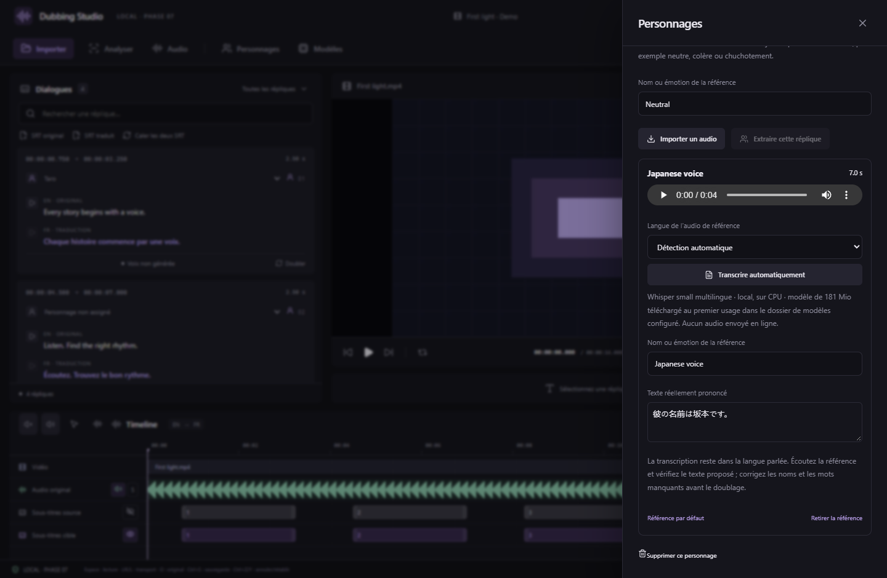

# AI Dubbing Studio — phases 1–7

[Version anglaise et captures de l’interface](README.md) · [Téléchargements Windows](https://github.com/jontechlabs/ai-dubbing-studio/releases/tag/v0.7.3)

Studio desktop local de travail texte, voix et vidéo. Tauri 2, React, TypeScript strict et Rust.

**v0.7.3 — Calage des voix, durée et humeur.** Déplacez les blocs de doublage, étirez leur bord droit pour accélérer ou ralentir la voix en conservant sa hauteur, ou saisissez un décalage et une durée précis. La lecture et l’export MKV partagent ces réglages ; les WAV originaux et les SRT restent intacts. Choisissez une humeur avec CosyVoice3 et Fish S2 FP8/GGUF. [Calage et durée](docs/DUBBING-PLACEMENT.md) · [Humeurs](docs/VOICE-MOODS.md).

**Références vocales : transcription automatique locale et aide Fish corrigée.** Whisper small Q5_1 transcrit le japonais, le français et les autres langues proposées. Le texte reste modifiable et sauvegardé avec le personnage. Modèle de 181 Mio téléchargé au premier usage ; traitement sur CPU pour laisser la VRAM au doublage. [Guide des références](docs/REFERENCE-TRANSCRIPTION.md).

CosyVoice3, Fish S2 FP8/GGUF et Qwen3-TTS GGUF restent disponibles. Pour 16 Go, commencez par Qwen 0.6B GGUF ; les performances réelles sur RTX 5060 Ti restent à mesurer sur votre matériel. [Modèles et GPU](docs/PHASE-6.md) · [Tests et limites](VALIDATION.md).



Capture de l’interface React réelle avec une référence et un résultat de transcription simulés. Des tests natifs distincts transcrivent un véritable extrait japonais.


## Nouveautés du correctif 0.4.2

Zones silencieuses ou audibles et volume indépendant par zone, sélection dans la timeline, commandes rapides globales ou par piste et export des pistes séparées avec le montage. Les paramètres affichent la taille du dossier des modèles avec actualisation. [Guide des zones audio](docs/AUDIO-REGIONS.md) · [Stockage et variantes](docs/MODELS-AND-STORAGE.md).

## Utiliser le studio

La version Windows contient FFmpeg et FFprobe. Bandit v2 Multilingual, CosyVoice3, Fish S2 et Qwen3-TTS sont disponibles après installation optionnelle depuis l'application. La transcription automatique des références vocales est disponible ; la transcription de toute la vidéo reste à intégrer.

1. Importer une vidéo et choisir la langue source, la langue cible et la piste audio.
2. Choisir le dossier parent du projet. Le studio crée un dossier `Nom.dubproject` et copie le média.
3. Importer un SRT original et/ou traduit depuis la colonne Dialogues.
4. Sélectionner une réplique pour positionner le lecteur et la timeline.
5. Éditer le sous-titre ou son texte de prononciation. Le projet se sauvegarde automatiquement.
6. Réouvrir le dossier `.dubproject` depuis le bouton Ouvrir un projet.

L'exemple fourni utilise une vidéo et un son synthétiques. Il ne contient pas de voix doublée.

## Personnages, modèles et commandes de pistes

Installez le modèle de locuteurs depuis Modèles, lancez l’identification depuis Personnages, puis appliquez et corrigez les groupes proposés. Le bouton Ajouter une traduction ouvre l’éditeur même sans sous-titre cible. SRT traduit permet d’importer un fichier ou une piste MKV et propose le calage automatique. Le haut-parleur active ou coupe une piste, S l’isole et l’œil affiche/masque les sous-titres. **Doubler** ouvre le choix du moteur, du GPU et de la référence vocale.

Les références et préférences utilisent le format de projet 3, les zones audio le format 4 et les essais vocaux le format 5. Les anciennes versions refusent les formats plus récents. Fish FP8 et les profils Fish/Qwen GGUF Q8_0 sont intégrés. Le mix synchronisé et l’export MKV sont disponibles en phase 7. Le déplacement, la durée et les humeurs utilisent le format 7, lisible par v0.7.3 ou ultérieure. L’édition simultanée de plusieurs langues cibles reste à intégrer.

## Fonctions présentes

- Trois zones redimensionnables : dialogues, lecteur et timeline.
- Import MKV, MP4, MOV, AVI et WEBM, analyse FFprobe et sélection audio.
- Copie du média original ; proxy H.264/AAC pour les fichiers incompatibles ou les pistes multiples.
- Import/export SRT UTF-8, textes multilignes et sélection des pistes texte du MKV pour le SRT original ou traduit. Les pistes bitmap nécessitent un OCR.
- Associations bilingues conservatrices par timings. Les correspondances ambiguës restent distinctes et signalées.
- Texte original, traduction et surcharge TTS séparés.
- Lecture de réplique, boucle avec marges configurables, volume, plein écran et navigation.
- Forme d’onde réelle de la piste audio choisie, calcul local, cache, progression et annulation.
- Édition des timecodes pour un SRT ou les deux, déplacement et redimensionnement des blocs, aimantation avec Maj, zoom et hauteur des pistes.
- Division à la tête de lecture et fusion avec la réplique suivante ; les SRT exportés reflètent les changements.
- Calage automatique des deux SRT avec choix de référence, estimation de décalage/dérive, associations multiples et aperçu avant application.
- Autosave, sauvegarde précédente, récupération d'une écriture interrompue, undo/redo en session.
- Jobs d'import annulables, logs, relance et détection des jobs interrompus au redémarrage. La zone Traitements s’ouvre automatiquement à la création ; le lecteur affiche un chargement jusqu’à la fin de l’import et la disponibilité de la première image.
- Interface FR/EN, thème sombre/clair et diagnostic exportable.
- Bandit v2 Multilingual local : voix, musique et effets, choix CPU/CUDA détecté, pause/reprise/annulation et relance.
- Mixeur mute/solo/volume, lecture synchrone et export WAV par piste.
- Aperçu fluide 720p/30 fps, images clés rapprochées et suppression du recalcul des blocs à chaque image.
- Préférence GPU Windows, compteurs de lecture et mises à jour signées depuis Paramètres.

La phase 2 est disponible. Le calage compare les timings et refuse les propositions ambiguës ; les blocs non associés restent inchangés. Il ne recale pas encore les sous-titres sur les voix. Consultez le [guide détaillé de la phase 2](docs/PHASE-2.md). La séparation est disponible en phase 3 et la génération CosyVoice3 en phase 5. La transcription des références est disponible depuis 0.7.3 ; celle de toute la vidéo reste à intégrer. Le mix et l’export MKV sont disponibles en [phase 7](docs/PHASE-7.md).


Captures de l’interface réelle en aperçu navigateur, avec média synthétique.

Consultez les guides de [phase 3](docs/PHASE-3.md), [phase 4](docs/PHASE-4.md), [phase 5](docs/PHASE-5.md) et [phase 6](docs/PHASE-6.md). La [phase 7](docs/PHASE-7.md) ajoute l’écoute synchronisée et l’export MKV. L’écoute A/B des essais WAV reste indépendante.

## Raccourcis

Espace : lecture/pause. O : lire l'original. T : écouter le doublage sélectionné. R : ouvrir les réglages de doublage. V : valider l'essai sélectionné. J : retour temporel. K : pause. L : lecture puis accélération. Ctrl+S : sauvegarde. Ctrl+Z / Ctrl+Y : undo/redo. Les raccourcis restent inactifs pendant une saisie.

## Développement

Prérequis : Node compatible avec Vite, pnpm, Rust stable, dépendances Tauri de la plateforme. Sous Windows : compilateur MSVC, SDK Windows et WebView2. Références : https://v2.tauri.app/start/prerequisites/ et https://v2.tauri.app/distribute/windows-installer/.

```sh
pnpm install --frozen-lockfile
powershell -NoProfile -File scripts/prepare-ffmpeg.ps1
pnpm desktop
```

Les exécutables FFmpeg/FFprobe sont recherchés dans les ressources de l'application, `src-tauri/binaries`, puis le PATH. Les exécutables ne sont pas conservés dans Git : le script de préparation télécharge l’archive Windows verrouillée et vérifie son SHA-256. Pour Linux/macOS, fournir les exécutables natifs de la cible. Les binaires Windows distribués ne conviennent pas à ces systèmes.

```sh
pnpm build
pnpm test
pnpm lint
pnpm format:check
cargo test --manifest-path src-tauri/Cargo.toml
cargo clippy --manifest-path src-tauri/Cargo.toml --all-targets -- -D warnings
cargo fmt --manifest-path src-tauri/Cargo.toml --check
pnpm desktop:build
powershell -NoProfile -File scripts/package-windows.ps1
```

Les tests de parcours utilisent Chrome et gèrent automatiquement leur serveur Vite : `pnpm test:e2e`. L'aperçu navigateur stocke ses projets et médias dans IndexedDB. Il permet de vérifier l'interface ; l'analyse FFprobe et les dossiers portables restent des fonctions desktop. L'export JSON du navigateur ne contient pas la vidéo.

## Architecture et données

`src/domain` contient les calculs et contrats métier. `src/services/bridge.ts` est la frontière IPC. `src/components` assemble le studio ; aucun composant ne construit une commande FFmpeg ou IA. `src-tauri/src` contient les services de projet, média, sous-titres et jobs. Les composants de composition peuvent dépasser 100 lignes de JSX ; la logique de traitement reste dans des fonctions et modules séparés.

`project.json` est la source de vérité. Les chemins des assets sont relatifs, les timings en millisecondes entières et les identifiants stables. Les fichiers vidéo d'origine ne sont pas modifiés. Le projet contient les documents source/cible et leurs associations. Un changement de traduction ne modifie pas automatiquement une surcharge TTS.

Les projets aux formats 1 et 2 restent lisibles. L’ajout de stems utilise au moins le format 2 ; personnages, références et préférences utilisent le format 3, refusé par les versions antérieures à 0.4.2. Les formats inconnus sont refusés sans réécriture. `recovery/pending.json` permet de reprendre une sauvegarde interrompue ; `recovery/previous.json` conserve la version précédente. Les générations restent des fichiers distincts avec leur provenance. La piste Doublage utilise le format 6, refusé par les anciennes versions ; les formats 1 à 5 restent lisibles.

Les projets déplacés s'ouvrent depuis leur nouveau dossier. Les médias et caches doivent rester dans le dossier projet. La modification concurrente par deux instances n'est pas prise en charge dans cette version.

## Données locales

L'application ne dispose d'aucun provider cloud et n'envoie pas les médias sur Internet. Les préférences d'interface restent locales. Les diagnostics peuvent contenir les chemins choisis et les arguments FFmpeg ; leur export est déclenché par l'utilisateur.

Les futurs moteurs utiliseront des workers isolés. Les contrats initiaux se trouvent dans `src/domain/providers.ts` et le catalogue initial `resources/models.json` est volontairement vide.

## Distribution et dépendances

Les builds Windows incluent FFmpeg/FFprobe provenant de Gyan, distribué sous GPLv3 ; consulter `THIRD-PARTY-NOTICES.txt` et les licences incluses. Les versions et empreintes de téléchargement sont conservées dans `resources/toolchain.json`. Les dépendances JS et Rust sont verrouillées par `pnpm-lock.yaml` et `Cargo.lock`.

Le build de cette phase est un build de développement sans certificat de signature commerciale. Les contrôles Windows peuvent empêcher l'exécution de binaires non signés. La compilation peut également être effectuée depuis Linux avec cargo-xwin selon la documentation Tauri, sans modifier les protections de Windows.
