# AI Dubbing Studio — phases 1–7

**v0.26.0 — Effets locaux et volume global des pistes.** Vingt effets, douze préréglages, chaînes réglables sur les répliques et les pistes entières ou par portion. Le volume global 0–400 % est accessible directement sur la timeline et reste indépendant des zones. Notifications discrètes au début et à la fin des tâches ; médias et essais originaux conservés. [Guide et captures](docs/AUDIO-EFFECTS.md).

**v0.25.0 — Durée des traitements en direct.** Le panneau Traitements affiche le temps écoulé pendant chaque tâche et conserve sa durée à la fin. L’attente et les pauses sont exclues ; chaque nouvelle tentative possède son propre compteur. [Détails et capture](docs/TASK-DURATION.md).

**v0.24.0 — Orientation de traduction et démarrage vocal corrigé.** Donnez au LLM des consignes de personnage, registre, vulgarité et longueur souhaitée. Les créneaux disponibles guident la concision ; les propositions restent à relire avant application. Correction de `ModuleNotFoundError: No module named 'cosyvoice_worker'` avec VoxCPM2, Chatterbox Multilingual et la conversion de timbre dans le Python Windows isolé. Les modèles déjà installés sont réutilisés.


**v0.23.0 — Microphone et changement de timbre local.** Enregistrez une réplique, écoutez-la puis conservez-la comme nouvel essai. Convertissez le timbre de tout essai avec Chatterbox VC et une référence du personnage ou un fichier audio avec choix du début et de la fin. La durée, les zones muettes et les essais précédents sont conservés. [Guide détaillé](docs/MICROPHONE-VOICE-CONVERSION.md).


**v0.22.0 — VoxCPM2 et Chatterbox Multilingual V3.** Installation et génération par réplique ou en lot, runtime CUDA 12.8 isolé, contrôle d’espace disque et essais conservés. Drama 3 reçoit maintenant la langue cible même avec l’accent Auto, pour corriger la dérive de langue avec une référence japonaise. [Installation, possibilités, limites et captures](docs/VOXCPM2-CHATTERBOX.md).

**v0.21.0 — 43 intentions de jeu.** Mourant, stressé, hilare, paniqué, épuisé et bien d’autres, regroupés par intention. Disponibles par réplique et en lot avec CosyVoice3, Fish S2 et Drama 3. Aide clarifiée sur le compromis accent / expressivité de CosyVoice3. [Guide, liste complète et capture](docs/VOICE-ACTING.md).

**v0.20.1 — Installation et relais MCP.** Les relais quittent le processus à la fermeture du studio ; les mises à jour suspendent MCP et attendent la libération de l’exécutable. La connexion est restaurée si l’installation échoue. [Déblocage des anciennes versions et détails](docs/INSTALLATION-RECOVERY.md).

**v0.20.0 — Transfert d’intonation expérimental.** Transformez un essai français existant avec la mélodie, le rythme et l’énergie de la réplique japonaise ou d’une autre référence. Intensité réglable, traitement local sur CPU, nouvel essai indépendant : les prises précédentes et la vidéo sont conservées. Ce transfert acoustique reste approximatif entre langues. Disponible aussi via MCP (95 outils). [Guide, limites et capture](docs/PROSODY-TRANSFER.md).

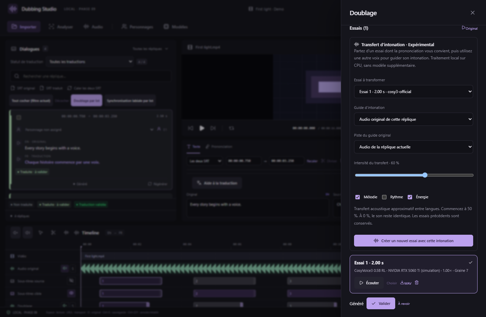

*Actual React UI with simulated native commands / Interface réelle, commandes natives simulées.*

**v0.19.0 — Pilotage du studio par MCP.** Activez le serveur stdio local dans Paramètres et connectez un client IA avec la configuration JSON ou Codex TOML générée. Les 93 outils couvrent projets, sous-titres, montage audio, doublage, synchro labiale, lecture, tâches, exports et mises à jour. Révisions du projet, annulation et vérification du rendu audio restent appliquées. Cette première intégration pilote l’application ouverte. [Installation et guide](docs/MCP.md).

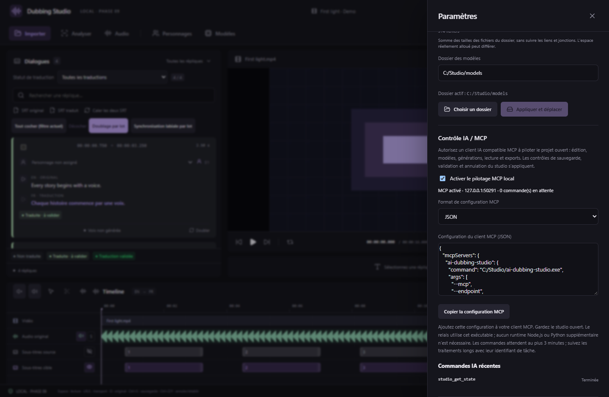

*Actual React UI with simulated native commands / Interface réelle, commandes natives simulées.*

**v0.18.0 — Synchronisation labiale par lot et éditions audio fiabilisées.** Traitez toutes les répliques doublées ou les répliques cochées, avec détection des visages filmés et animes sur CPU, cadrages corrigibles par dialogue, annulation et reprise. Chaque résultat est une séquence indépendante ; la vidéo principale reste intacte. Les découpes et étirements sont vérifiés avant enregistrement, l’essai d’origine reste écoutable, et les cartes multilignes ne se chevauchent plus. Une tête de lecture avec compteur précis permet de situer le son et de placer le curseur dans l’éditeur. [Guide et captures](docs/LIP-BATCHES-AND-AUDIO-RECOVERY.md).

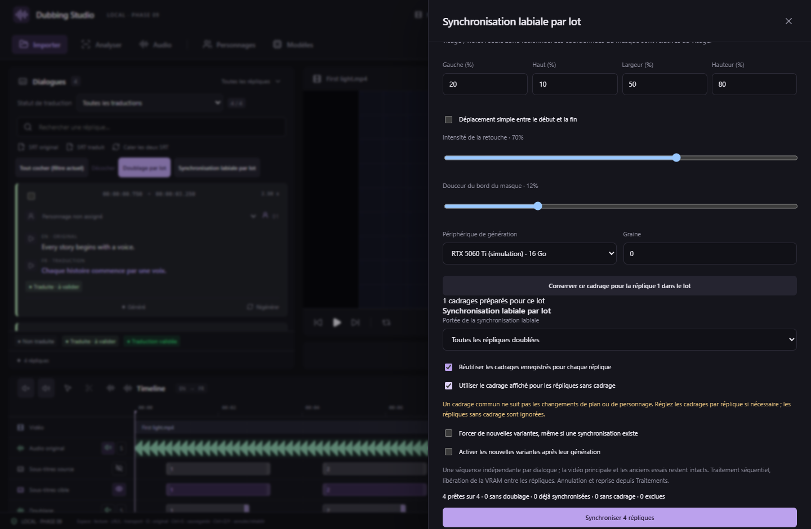

*Actual React UI with synthetic media and simulated native commands / Interface réelle, commandes natives simulées.*

**v0.17.0 — LatentSync 1.5 et 1.6, adaptation du wrapper ShmuelRonen.** Choisissez un moteur, vérifiez l’espace disque puis retouchez uniquement la séquence de chaque dialogue. La vidéo principale reste intacte ; les variantes activées sont préchargées pour la lecture et composées à l’export. Profil mémoire réduit pour 16 Go, avec fenêtres temporelles, guidance séquentielle et VAE séparé. 1.6 reste un profil candidat, sans garantie d’absence d’OOM sur la RTX 5060 Ti. [Guide détaillé](docs/LATENTSYNC.md).

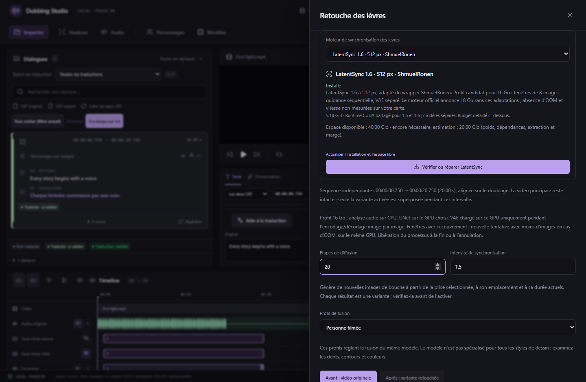

*Interface React réelle avec média synthétique et commandes natives simulées ; diagnostics neuronaux CPU séparés.*

**v0.16.0 — Menus au clic droit.** Supprimez une zone de volume ou de silence directement sur la timeline, sur toutes les pistes audio, avec annulation et sauvegarde. Effacez une sélection sans traitement, activez/désactivez une piste et accédez aux options audio. Le menu général ajoute Annuler, Rétablir, Sauvegarder et Paramètres. [Guide illustré](docs/CONTEXT-MENUS.md).

**v0.15.1 — Durées et déplacements des doublages sécurisés.** Maximum disponible affiché, arrêt à la prochaine voix et à la fin de la vidéo, limite de traitement de 120 secondes. Les déplacements conservent la durée audible ; les champs de calage se valident avec Entrée ou en les quittant. Les anciens calages trop longs ou sans créneau disposent d’une action de récupération qui conserve les retouches. [Guide illustré](docs/VOICE-DURATION-SAFETY.md).


**v0.15.0 — Fondus réglables, redimensionnement des zones audio et navigation cohérente.** Appliquez des fondus d’entrée/sortie à une portion de voix, redimensionnez une sélection ou une zone de volume/silence avec ses poignées, et retrouvez automatiquement la réplique choisie dans la timeline sans changer votre zoom. [Guide illustré](docs/FADES-SELECTION-NAVIGATION.md).

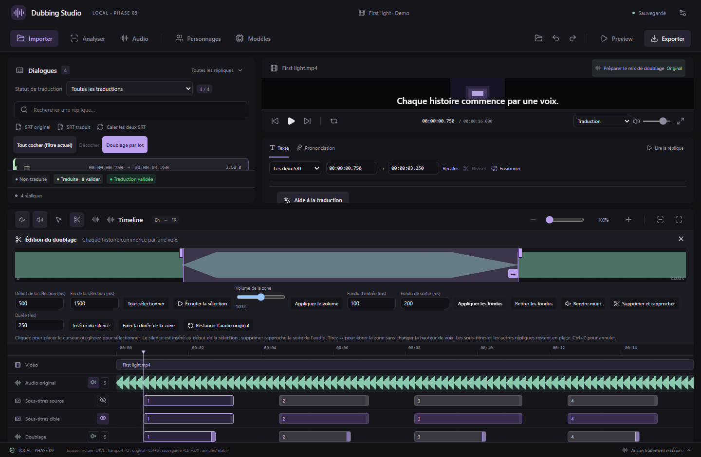

*Actual React interface with synthetic demo audio and simulated native commands; separate real FFmpeg sample and MKV checks.*


**v0.14.0 — Retoucher une partie d’un doublage directement dans la timeline.** Double-cliquez un bloc Doublage pour ouvrir sa forme d’onde : sélectionnez une zone, ajoutez du silence, rendez-la muette, supprimez-la en rapprochant la suite, réglez son volume ou étirez-la avec la poignée ↔ sans changer la hauteur de voix. Originaux conservés, annulation, sauvegarde et rendu identique dans la lecture et le MKV. [Guide illustré](docs/VOICE-REGION-EDITING.md).

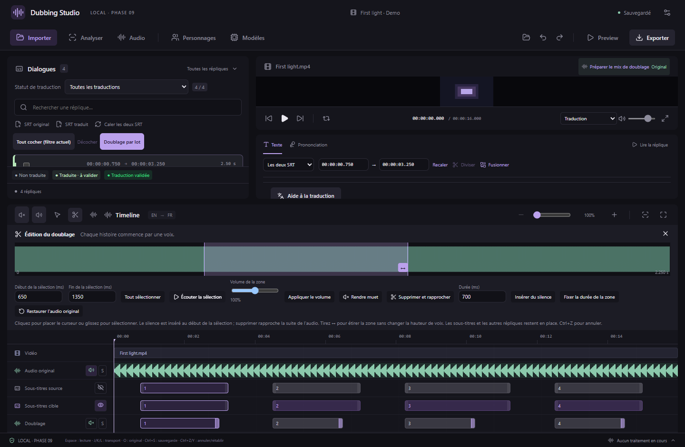

*Interface réelle avec démonstration synthétique et commandes natives simulées ; traitement audio et export vérifiés séparément avec FFmpeg.*


**v0.13.0 — Filtres par statut de traduction, doublage par lot réservé aux traductions validées et propositions locales avec Qwen3-4B-Instruct-2507 GGUF Q4_K_M.** Dans l’éditeur de sous-titres, ouvrez « Aide à la traduction », installez le modèle puis choisissez la RTX dans « Périphérique de traduction ». Relisez la proposition, appliquez-la, puis validez la traduction manuellement. [Guide détaillé](docs/TRANSLATION-ASSISTANT.md).

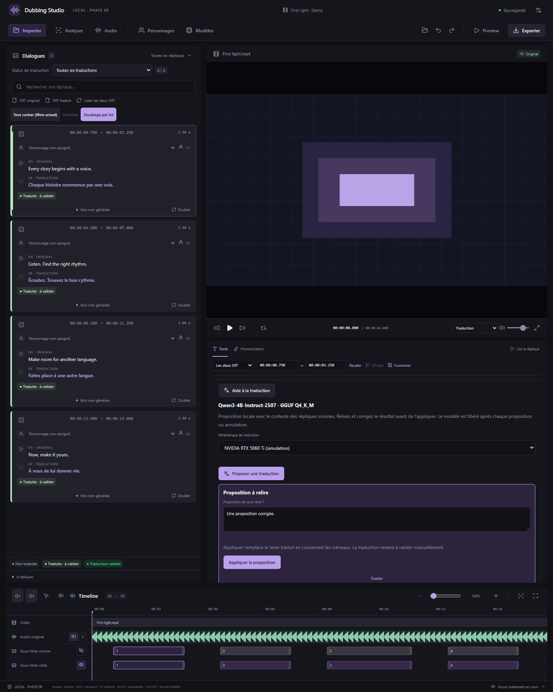

*Interface React réelle ; inventaire natif et proposition affichée simulés pour la capture. Les essais réels du modèle local sont consignés dans VALIDATION.md.*

**v0.12.0** conserve le modèle chargé pendant le doublage par lot, puis arrête son processus à la fin ou à l’annulation pour libérer sa mémoire. Les répliques sont grises sans traduction, vert clair avec traduction et vertes après validation explicite. La validation du texte reste indépendante de celle des voix. [Guide avec capture](docs/BATCH-CACHE-AND-TRANSLATION-REVIEW.md).


**v0.11.0 — Extraits de référence et doublage par lot.** Choisissez le début et la fin d’un extrait audio, écoutez-le et importez uniquement cette portion. Cochez des répliques ou prenez toutes les traductions, configurez le lot, puis générez avec conservation des prises à jour ou forçage de nouveaux essais. Progression, annulation et reprise sont disponibles. [Guide et captures](docs/BATCH-DUBBING.md).

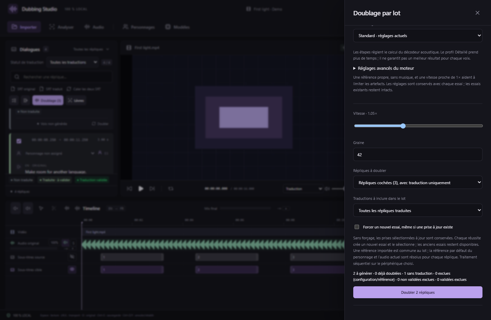

*Actual React UI with simulated model inventory / Interface React réelle, inventaire natif simulé.*

**v0.10.3** corrige la finalisation audio de CosyVoice3 et allège la mémoire de Drama 3 avec des experts mappés sans copie complète en RAM verrouillée. Régénérez les essais pour profiter de la correction CosyVoice3 ; les fichiers existants restent intacts.

**Références et accents :** chargez un fichier audio directement dans **Doublage**, écoutez-le, transcrivez-le et réutilisez-le sans personnage. Pour les moteurs compatibles, choisissez une consigne d’accent français (France, Québec, Belgique ou Suisse). Le résultat dépend du modèle ; une référence française reste préférable. [Guide et captures](docs/VOICE-REFERENCES-AND-ACCENTS.md).

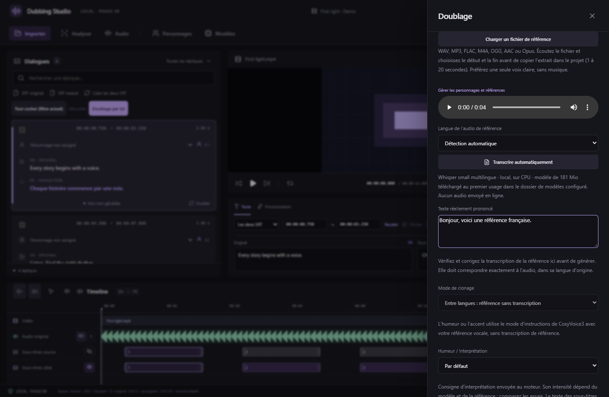

*Actual React UI with simulated native reference import / Interface React réelle, import natif simulé.*

**v0.10.2 — Espace disque avant installation de Drama 3.** La fiche affiche le dossier, l’espace disponible et le besoin estimé incluant les dépendances, leur décompression et les poids manquants. Le bouton reste bloqué si le contrôle échoue ou manque de place ; le démarrage natif vérifie encore la capacité avant tout téléchargement. [Installation](docs/FISH-DRAMA-3.md) · [Fin de syllabe et calage](docs/DUBBING-PLACEMENT.md).

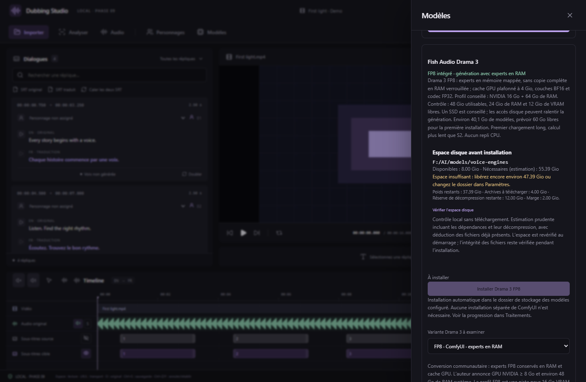

*Real React UI with simulated storage capacity / Interface React réelle, capacité simulée.*

**v0.10.1 — Volume directement sur la timeline.** Sélectionnez une portion de n’importe quelle piste audio : un curseur 0–200 %, muet/audible et retour à 100 % apparaissent dans la timeline. Sauvegarde automatique, annulation et réglages avancés conservés. La fiche Fish Audio Drama 3 intègre maintenant le bouton **Installer Drama 3 FP8**, sans fiche d’installation séparée. [Guide des zones](docs/AUDIO-REGIONS.md) · [Installation Drama 3](docs/FISH-DRAMA-3.md).

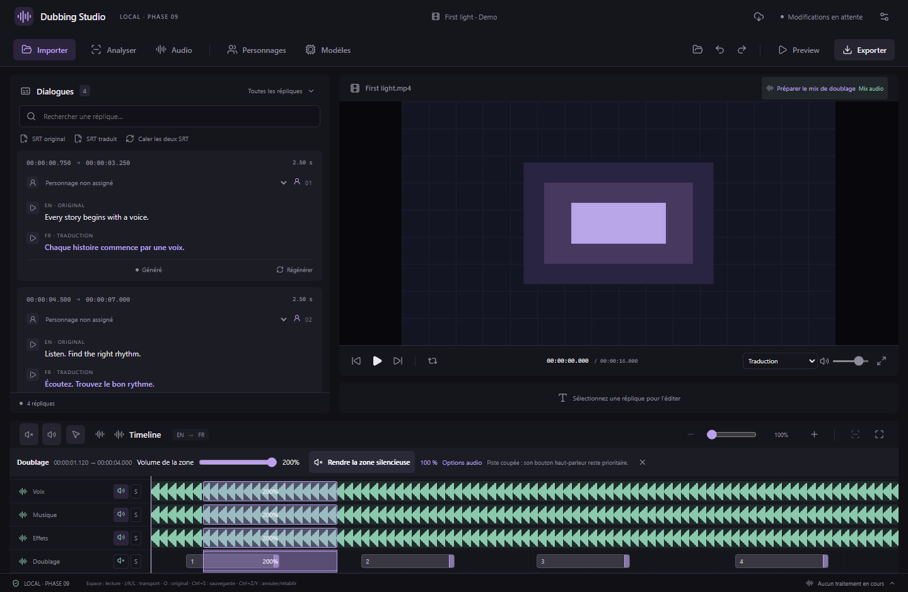

*Interface React réelle avec audio de démonstration synthétique et inventaire natif simulé.*

[Version anglaise et captures de l’interface](README.md) · [Téléchargements Windows](https://github.com/jontechlabs/ai-dubbing-studio/releases/tag/v0.26.0)

Studio desktop local de travail texte, voix et vidéo. Tauri 2, React, TypeScript strict et Rust.

**v0.9.0 — Retouche locale des lèvres et transferts audio.** MuseTalk 1.5 génère les images de bouche depuis la prise de doublage sélectionnée : GPU CUDA choisi, UNet FP16, VAE FP32. Cadrez le visage et le masque de bouche, comparez les variantes avant activation. Le mode anime reste expérimental. Choisissez la piste de référence vocale et celle à remplacer dans le mix ; copiez, déplacez ou interchangez des portions entre pistes, avec volume propre et annulation. [Retouche des lèvres](docs/LIP-INPAINTING.md) · [Transferts audio](docs/AUDIO-TRANSFERS.md) · [Calage visuel](docs/LIP-ALIGNMENT.md).

**v0.10.0 — Génération Fish Audio Drama 3.** Moteur FP8 distinct de S2, experts en RAM et cache GPU plafonné à 4 Gio. Profil NVIDIA 16 Go + 64 Go RAM : référence transcrite, humeurs, graine et essais indépendants, avec calage, mixage et export MKV existants. Environ 40,1 Go de modèles ; 46 Gio de RAM disponibles et 12 Gio de VRAM libre requis. Performances du modèle complet et qualité française sur RTX non mesurées ici. [Guide](docs/FISH-DRAMA-3.md).

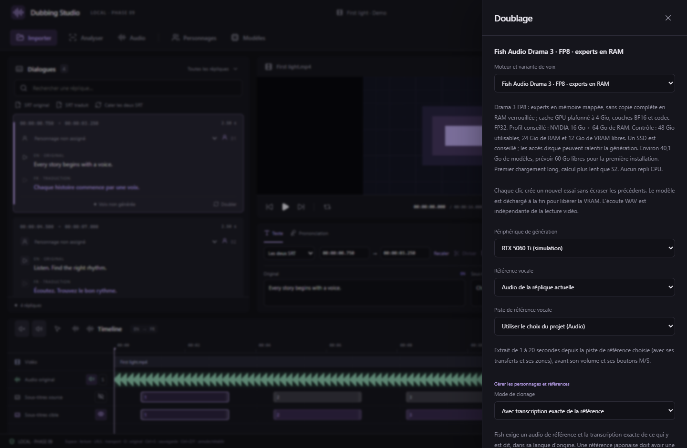

*Interface React réelle, inventaire CUDA et résultat simulés. Diagnostic séparé du calcul FP8 et d’un petit modèle autorégressif sur CPU.*

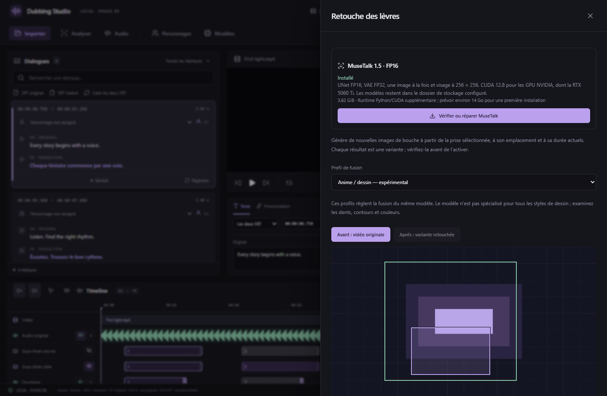

*Interface React/Chrome, vidéo synthétique et inventaire natif simulé. Test neural CPU distinct ; performances sur RTX non mesurées.*

**Références vocales : transcription automatique locale et aide Fish corrigée.** Whisper small Q5_1 transcrit le japonais, le français et les autres langues proposées. Le texte reste modifiable et sauvegardé avec le personnage. Modèle de 181 Mio téléchargé au premier usage ; traitement sur CPU pour laisser la VRAM au doublage. [Guide des références](docs/REFERENCE-TRANSCRIPTION.md).

CosyVoice3, Fish S2 FP8/GGUF et Qwen3-TTS GGUF restent disponibles. Pour 16 Go, commencez par Qwen 0.6B GGUF ; les performances réelles sur RTX 5060 Ti restent à mesurer sur votre matériel. [Modèles et GPU](docs/PHASE-6.md) · [Tests et limites](VALIDATION.md).


Capture de l’interface React réelle avec une référence et un résultat de transcription simulés. Des tests natifs distincts transcrivent un véritable extrait japonais.


## Nouveautés du correctif 0.4.2

Zones silencieuses ou audibles et volume indépendant par zone, sélection dans la timeline, commandes rapides globales ou par piste et export des pistes séparées avec le montage. Les paramètres affichent la taille du dossier des modèles avec actualisation. [Guide des zones audio](docs/AUDIO-REGIONS.md) · [Stockage et variantes](docs/MODELS-AND-STORAGE.md).

## Utiliser le studio

La version Windows contient FFmpeg et FFprobe. Bandit v2 Multilingual, CosyVoice3, Fish S2 et Qwen3-TTS sont disponibles après installation optionnelle depuis l'application. La transcription automatique des références vocales est disponible ; la transcription de toute la vidéo reste à intégrer.

1. Importer une vidéo et choisir la langue source, la langue cible et la piste audio.
2. Choisir le dossier parent du projet. Le studio crée un dossier `Nom.dubproject` et copie le média.
3. Importer un SRT original et/ou traduit depuis la colonne Dialogues.
4. Sélectionner une réplique pour positionner le lecteur et la timeline.
5. Éditer le sous-titre ou son texte de prononciation. Le projet se sauvegarde automatiquement.
6. Réouvrir le dossier `.dubproject` depuis le bouton Ouvrir un projet.

L'exemple fourni utilise une vidéo et un son synthétiques. Il ne contient pas de voix doublée.

## Personnages, modèles et commandes de pistes

Installez le modèle de locuteurs depuis Modèles, lancez l’identification depuis Personnages, puis appliquez et corrigez les groupes proposés. Le bouton Ajouter une traduction ouvre l’éditeur même sans sous-titre cible. SRT traduit permet d’importer un fichier ou une piste MKV et propose le calage automatique. Le haut-parleur active ou coupe une piste, S l’isole et l’œil affiche/masque les sous-titres. **Doubler** ouvre le choix du moteur, du GPU et de la référence vocale.

Les références et préférences utilisent le format de projet 3, les zones audio le format 4 et les essais vocaux le format 5. Les anciennes versions refusent les formats plus récents. Fish FP8 et les profils Fish/Qwen GGUF Q8_0 sont intégrés. Le mix synchronisé et l’export MKV sont disponibles en phase 7. Le déplacement, la durée et les sept premières humeurs utilisent le format 7, lisible par v0.7.3 ou ultérieure. Les nouvelles intentions de v0.21.0 nécessitent le format 15. L’édition simultanée de plusieurs langues cibles reste à intégrer.

## Fonctions présentes

- Trois zones redimensionnables : dialogues, lecteur et timeline.
- Import MKV, MP4, MOV, AVI et WEBM, analyse FFprobe et sélection audio.
- Copie du média original ; proxy H.264/AAC pour les fichiers incompatibles ou les pistes multiples.
- Import/export SRT UTF-8, textes multilignes et sélection des pistes texte du MKV pour le SRT original ou traduit. Les pistes bitmap nécessitent un OCR.
- Associations bilingues conservatrices par timings. Les correspondances ambiguës restent distinctes et signalées.
- Texte original, traduction et surcharge TTS séparés.
- Lecture de réplique, boucle avec marges configurables, volume, plein écran et navigation.
- Forme d’onde réelle de la piste audio choisie, calcul local, cache, progression et annulation.
- Édition des timecodes pour un SRT ou les deux, déplacement et redimensionnement des blocs, aimantation avec Maj, zoom et hauteur des pistes.
- Division à la tête de lecture et fusion avec la réplique suivante ; les SRT exportés reflètent les changements.
- Calage automatique des deux SRT avec choix de référence, estimation de décalage/dérive, associations multiples et aperçu avant application.
- Autosave, sauvegarde précédente, récupération d'une écriture interrompue, undo/redo en session.
- Jobs d'import annulables, logs, relance et détection des jobs interrompus au redémarrage. La zone Traitements s’ouvre automatiquement à la création ; le lecteur affiche un chargement jusqu’à la fin de l’import et la disponibilité de la première image.
- Interface FR/EN, thème sombre/clair et diagnostic exportable.
- Bandit v2 Multilingual local : voix, musique et effets, choix CPU/CUDA détecté, pause/reprise/annulation et relance.
- Mixeur mute/solo/volume, lecture synchrone et export WAV par piste.
- Aperçu fluide 720p/30 fps, images clés rapprochées et suppression du recalcul des blocs à chaque image.
- Préférence GPU Windows, compteurs de lecture et mises à jour signées depuis Paramètres.

La phase 2 est disponible. Le calage compare les timings et refuse les propositions ambiguës ; les blocs non associés restent inchangés. Il ne recale pas encore les sous-titres sur les voix. Consultez le [guide détaillé de la phase 2](docs/PHASE-2.md). La séparation est disponible en phase 3 et la génération CosyVoice3 en phase 5. La transcription des références est disponible depuis 0.7.3 ; celle de toute la vidéo reste à intégrer. Le mix et l’export MKV sont disponibles en [phase 7](docs/PHASE-7.md).


Captures de l’interface réelle en aperçu navigateur, avec média synthétique.

Consultez les guides de [phase 3](docs/PHASE-3.md), [phase 4](docs/PHASE-4.md), [phase 5](docs/PHASE-5.md) et [phase 6](docs/PHASE-6.md). La [phase 7](docs/PHASE-7.md) ajoute l’écoute synchronisée et l’export MKV. L’écoute A/B des essais WAV reste indépendante.

## Raccourcis

Espace : lecture/pause. O : lire l'original. T : écouter le doublage sélectionné. R : ouvrir les réglages de doublage. V : valider l'essai sélectionné. J : retour temporel. K : pause. L : lecture puis accélération. Ctrl+S : sauvegarde. Ctrl+Z / Ctrl+Y : undo/redo. Les raccourcis restent inactifs pendant une saisie.

## Développement

Prérequis : Node compatible avec Vite, pnpm, Rust stable, dépendances Tauri de la plateforme. Sous Windows : compilateur MSVC, SDK Windows et WebView2. Références : https://v2.tauri.app/start/prerequisites/ et https://v2.tauri.app/distribute/windows-installer/.

```sh
pnpm install --frozen-lockfile
powershell -NoProfile -File scripts/prepare-ffmpeg.ps1
powershell -NoProfile -File scripts/prepare-prosody.ps1
pnpm desktop
```

Les exécutables FFmpeg/FFprobe sont recherchés dans les ressources de l'application, `src-tauri/binaries`, puis le PATH. Les exécutables ne sont pas conservés dans Git : le script de préparation télécharge l’archive Windows verrouillée et vérifie son SHA-256. Pour Linux/macOS, fournir les exécutables natifs de la cible. Les binaires Windows distribués ne conviennent pas à ces systèmes.

```sh
pnpm build
pnpm test
pnpm lint
pnpm format:check
cargo test --manifest-path src-tauri/Cargo.toml
cargo clippy --manifest-path src-tauri/Cargo.toml --all-targets -- -D warnings
cargo fmt --manifest-path src-tauri/Cargo.toml --check
pnpm desktop:build
powershell -NoProfile -File scripts/package-windows.ps1
```

Les tests de parcours utilisent Chrome et gèrent automatiquement leur serveur Vite : `pnpm test:e2e`. L'aperçu navigateur stocke ses projets et médias dans IndexedDB. Il permet de vérifier l'interface ; l'analyse FFprobe et les dossiers portables restent des fonctions desktop. L'export JSON du navigateur ne contient pas la vidéo.

## Architecture et données

`src/domain` contient les calculs et contrats métier. `src/services/bridge.ts` est la frontière IPC. `src/components` assemble le studio ; aucun composant ne construit une commande FFmpeg ou IA. `src-tauri/src` contient les services de projet, média, sous-titres et jobs. Les composants de composition peuvent dépasser 100 lignes de JSX ; la logique de traitement reste dans des fonctions et modules séparés.

`project.json` est la source de vérité. Les chemins des assets sont relatifs, les timings en millisecondes entières et les identifiants stables. Les fichiers vidéo d'origine ne sont pas modifiés. Le projet contient les documents source/cible et leurs associations. Un changement de traduction ne modifie pas automatiquement une surcharge TTS.

Les projets aux formats 1 et 2 restent lisibles. L’ajout de stems utilise au moins le format 2 ; personnages, références et préférences utilisent le format 3, refusé par les versions antérieures à 0.4.2. Les formats inconnus sont refusés sans réécriture. `recovery/pending.json` permet de reprendre une sauvegarde interrompue ; `recovery/previous.json` conserve la version précédente. Les générations restent des fichiers distincts avec leur provenance. La piste Doublage utilise le format 6, refusé par les anciennes versions ; les formats 1 à 5 restent lisibles.

Les projets déplacés s'ouvrent depuis leur nouveau dossier. Les médias et caches doivent rester dans le dossier projet. La modification concurrente par deux instances n'est pas prise en charge dans cette version.

## Données locales

L'application ne dispose d'aucun provider cloud et n'envoie pas les médias sur Internet. Les préférences d'interface restent locales. Les diagnostics peuvent contenir les chemins choisis et les arguments FFmpeg ; leur export est déclenché par l'utilisateur.

Les futurs moteurs utiliseront des workers isolés. Les contrats initiaux se trouvent dans `src/domain/providers.ts` et le catalogue initial `resources/models.json` est volontairement vide.

## Distribution et dépendances

Les builds Windows incluent FFmpeg/FFprobe provenant de Gyan, distribué sous GPLv3 ; consulter `THIRD-PARTY-NOTICES.txt` et les licences incluses. Les versions et empreintes de téléchargement sont conservées dans `resources/toolchain.json`. Les dépendances JS et Rust sont verrouillées par `pnpm-lock.yaml` et `Cargo.lock`.

Le build de cette phase est un build de développement sans certificat de signature commerciale. Les contrôles Windows peuvent empêcher l'exécution de binaires non signés. La compilation peut également être effectuée depuis Linux avec cargo-xwin selon la documentation Tauri, sans modifier les protections de Windows.
