# AI Dubbing Studio

A local desktop workspace for preparing video dubbing: review bilingual subtitles, navigate dialogue by dialogue, and keep displayed text separate from voice pronunciation text.

Built with **Tauri 2, React, TypeScript and Rust**. English and French interface. Dark and light themes.

**v0.6.0 — Phase 6 development preview.** Install and generate with **Fish S2 Pro FP8**, **Fish S2 GGUF Q8_0**, and **Qwen3-TTS Base 0.6B / 1.7B GGUF Q8_0**, alongside CosyVoice3. Select the engine and GPU for each line, preserve alternative takes and export individual WAV files. [Phase 6 guide (French)](docs/PHASE-6.md).

Start with Qwen 0.6B GGUF for a 16 GB GPU. GGUF uses the Windows portable Vulkan engine; Fish FP8 uses an isolated CUDA 12.8 environment and requires at least 12 GiB free VRAM. Actual memory use and RTX 5060 Ti generation remain to be qualified on that hardware. CosyVoice3 now automatically converts diarization references from 16 kHz to 24 kHz, fixing `INVALID_REFERENCE_AUDIO` for valid references. [Validation and limits](VALIDATION.md).

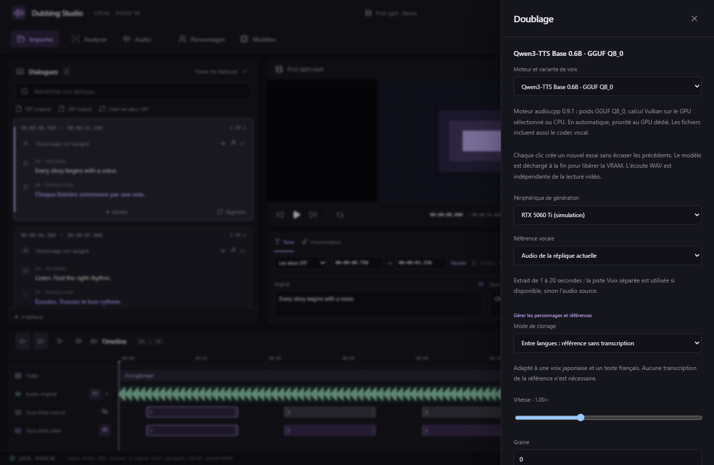

*Actual React browser UI with simulated native results/devices. These are not RTX performance measurements. WAV take listening is independent from video playback in this phase.*

[Windows downloads](https://github.com/jontechlabs/ai-dubbing-studio/releases/tag/v0.6.0) · [User guide](docs/GETTING-STARTED.md) · [Build instructions](docs/BUILDING.md) · [Français](README.fr.md)

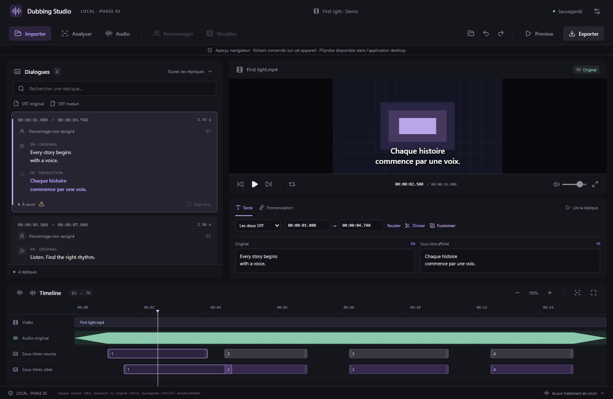

*Actual French React interface running in the browser preview with the bundled synthetic example. This is not a captured Windows Tauri window. The example has synthetic sound and does not contain generated dubbing.*

## Changes in 0.4.2

Audio regions with independent silence and volume, timeline range selection, fast global/track commands and edited WAV export for separated tracks. Model settings show the folder's file size and a refresh control. [Audio region guide (French)](docs/AUDIO-REGIONS.md) · [Storage and variants](docs/MODELS-AND-STORAGE.md).

## Windows downloads

| Package | Purpose |
| --- | --- |
| [Windows x64 setup](https://github.com/jontechlabs/ai-dubbing-studio/releases/download/v0.6.0/AI-Dubbing-Studio-0.6.0-Setup.exe) | NSIS installer for the current user, with English/French installer interface |
| [Portable ZIP](https://github.com/jontechlabs/ai-dubbing-studio/releases/download/v0.6.0/AI-Dubbing-Studio-Windows-Portable.zip) | Extract the whole folder and launch `AI Dubbing Studio.exe` |
| [SHA-256 checksums](https://github.com/jontechlabs/ai-dubbing-studio/releases/download/v0.6.0/SHA256SUMS.txt) | Verify the setup and ZIP downloads |

Target: **Windows 10/11 x64**, with **Microsoft Edge WebView2 Runtime**. FFmpeg and FFprobe are included. Python, CUDA and AI model downloads are not required for editing and playback. Installation may need Internet access if WebView2 is missing; local project editing does not require a cloud account.

These are **unsigned development builds**. Smart App Control blocked an earlier Phase 1 executable on the development machine. The current Windows GUI and installation workflow are **not fully qualified**. This release is a prerelease. See [validation evidence and limits](VALIDATION.md).

## Available in Phases 1–4

- Import MKV, MP4, MOV, AVI and WebM; inspect streams with FFprobe and choose an audio track.
- Copy the original into a portable project folder; create an H.264/AAC preview proxy when required.
- Import/export UTF-8 SRT, including multiline subtitles. Choose embedded text subtitle tracks (SRT/ASS/SSA and compatible formats) from the video as original or translated subtitles; bitmap tracks require OCR.
- Match source and translated cues conservatively using timings; flag ambiguous matches for review.
- Browse a virtualized dialogue list; select a line to seek the video and highlight its timeline entries.
- Edit source subtitles, translated subtitles and independent TTS pronunciation overrides.
- Play or loop a line with configurable padding; use volume, fullscreen, zoom and transport shortcuts.
- Inspect audio waveforms computed from the chosen original track and separated stems, with local cache, progress and cancellation.
- Identify anonymous voice groups locally with Silero VAD and 3D-Speaker CAMPPlus over existing subtitle intervals. Review/apply proposals, rename characters and correct individual or range assignments.
- Import or extract multiple voice references per character; edit their transcripts and default reference.
- Install the speaker runtime/model and official CosyVoice3 RL from Models. Generate, compare, select and review individual dubbing takes; retain preferences for future engines.
- Toggle audio mute/solo and subtitle visibility directly from the timeline; preserve player subtitle preferences.
- Optionally synchronize an imported SRT against the other SRT automatically; ambiguous matches preserve the imported file.
- Separate speech/music/effects locally using Bandit v2 Multilingual; install an isolated Python runtime and verified model from Audio. Choose CPU or a detected NVIDIA CUDA device.
- Mix original/stem tracks with persistent mute, solo and gain, synchronized video playback and individual WAV export. Pause/resume/cancel and retry separation jobs.
- Prepare a 720p/30 fps preview with frequent keyframes, without upscaling low-resolution media. Subtitle timeline blocks stay stable during playback, including the 6,000-dialogue test.
- Set a Windows GPU rendering preference and inspect playback resolution/dropped-frame counters.
- Check for updates automatically or manually, download a signature-verified package, then install/restart from Settings.
- Edit start/end timecodes for either SRT or both; drag cue blocks, resize their edges, snap with Shift, and adjust track height.
- Split at the playhead or merge with the next line. Changes are included in SRT exports and can be undone.
- Preview automatic SRT-to-SRT synchronization with offset/drift estimation and one-to-many matches; choose either reference and apply explicitly. Ambiguous proposals are refused.
- Autosave, previous-version backup and interrupted-save recovery; undo/redo during the current session.
- Track real import jobs, progress and logs; cancel, retry and identify interrupted jobs after a restart. Creation opens Processing automatically, and the player keeps a loading animation until the import and first-frame preparation finish.
- Switch French/English and dark/light themes; export local diagnostic information.

Automatic synchronization compares timing patterns; it does not perform speech recognition or semantic translation matching. Unmatched cues keep their original timings. Different video edits may need manual correction. See the [Phase 2 guide](docs/PHASE-2.md). Final dubbed audio and MKV/video export are planned.

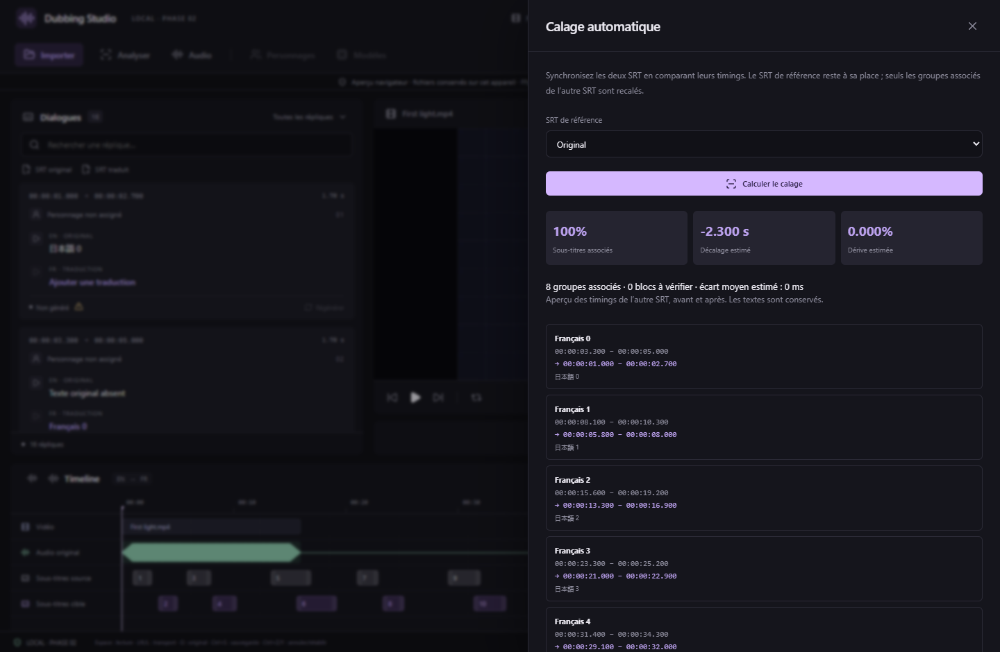

*Actual French browser preview using generated test SRTs with a 2.3-second offset; timings are inspected before application.*

## Phase 3, GPU and updates

Read the [Phase 3 guide](docs/PHASE-3.md) for runtime/model installation, GPU preferences, smooth preview, mixer and in-app updates. Version 0.3.0 must first be installed manually when coming from 0.2.x; subsequent signed releases can update through the interface. A portable package uses the same update installer, which installs a current-user application.

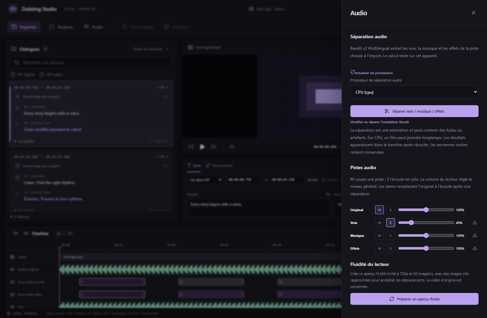

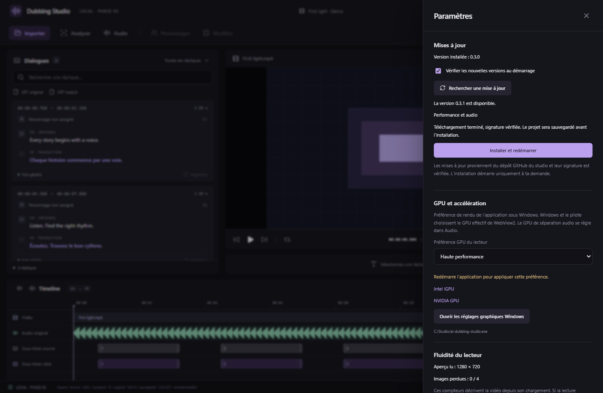

*Actual React interface in browser tests with simulated native IPC, GPU names and a future update scenario. These are not native Tauri captures. Bandit and CosyVoice3 have separate real Windows CPU inference checks.*

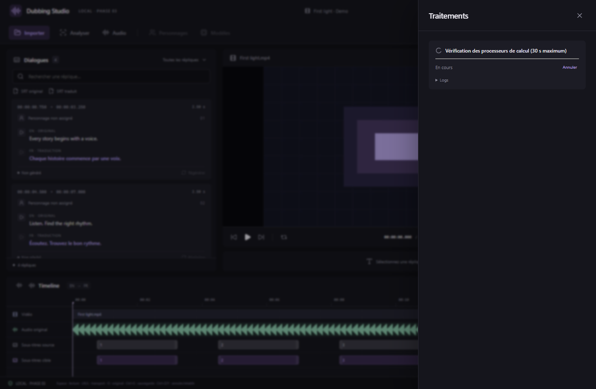

*Browser test of the actual processing interface with simulated native job events. The model download is complete; device checking has its own indeterminate progress.*

## Characters, models and subtitle controls

Read the [Phase 4 guide](docs/PHASE-4.md). Speaker identification proposes anonymous groups from the speech in existing subtitle intervals; users supply character names and review uncertain matches. The CPU model is trained on English VoxCeleb and has not been qualified on full multilingual films. Voice grouping does not synthesize dubbing.

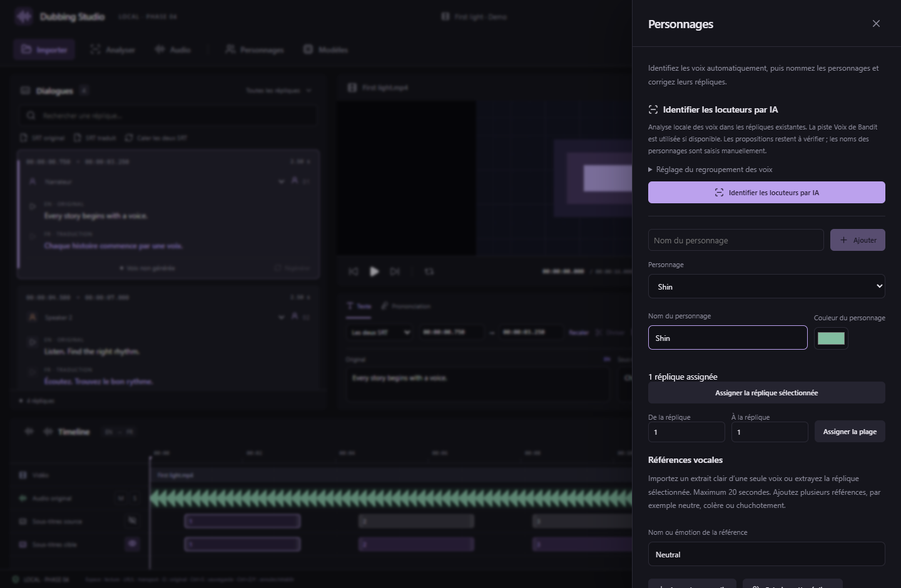

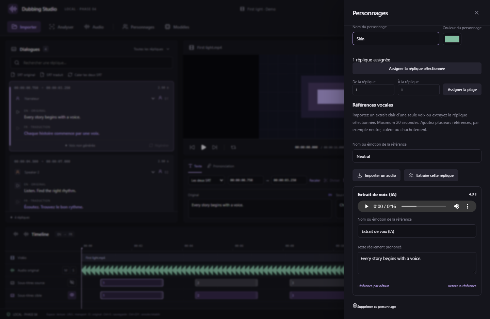

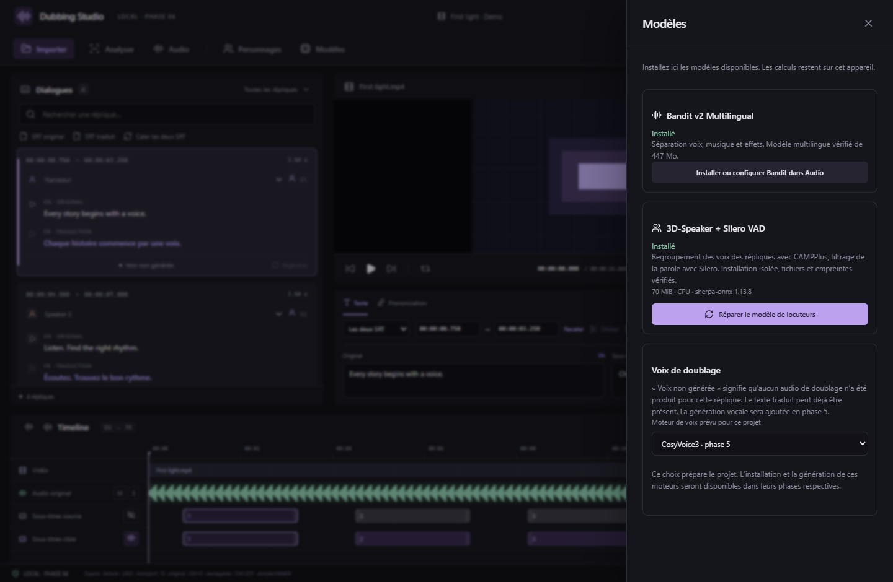

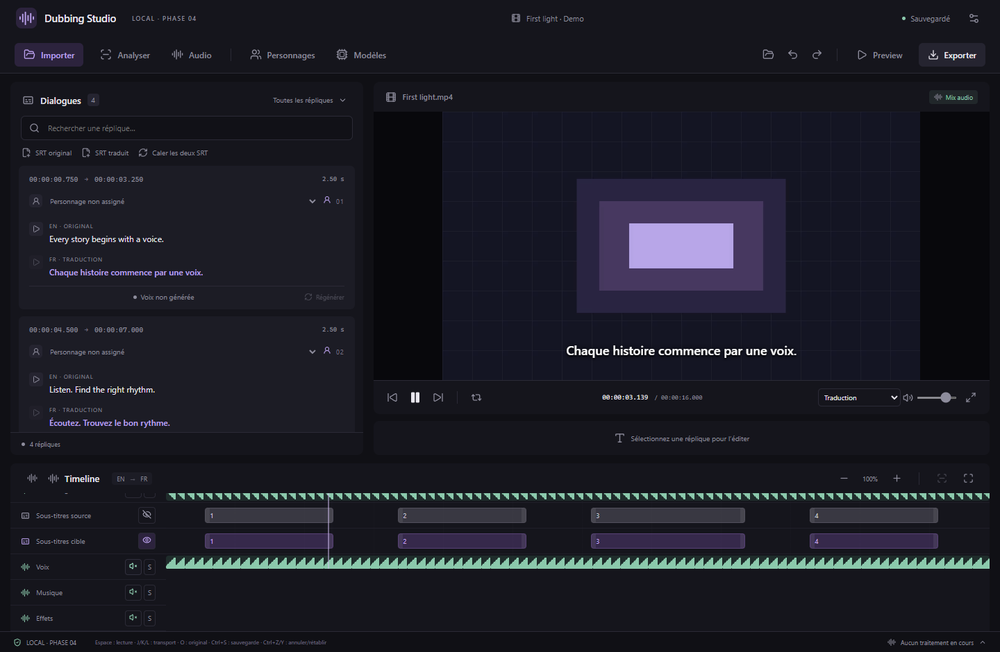

*Actual React UI in browser tests. The character/model/reference screenshots use simulated native results and a synthetic audio stream. Separate real Windows ONNX inference grouped two test voices and kept their repetitions together; it does not establish accuracy on real film soundtracks. Profile/reference preferences use project format 3; older app versions refuse that format.*

## First project

1. Launch the app, choose **Import**, and select a video.
2. Set the project name, source/target languages and audio stream.
3. Choose a parent folder. The desktop app creates `Name.dubproject` and copies the video.
4. Use **Original SRT** and/or **Translated SRT** in the dialogue column. Choose an external file or a text subtitle track detected in the video.
5. Select a dialogue, review the scene, and edit its subtitle or pronunciation text.
6. Reopen the `.dubproject` folder using **Open project**. Move or back up the entire folder to preserve its media.

Use **Explore the example** to try the bundled synthetic video. See the [user guide](docs/GETTING-STARTED.md) for shortcuts, recovery and troubleshooting.

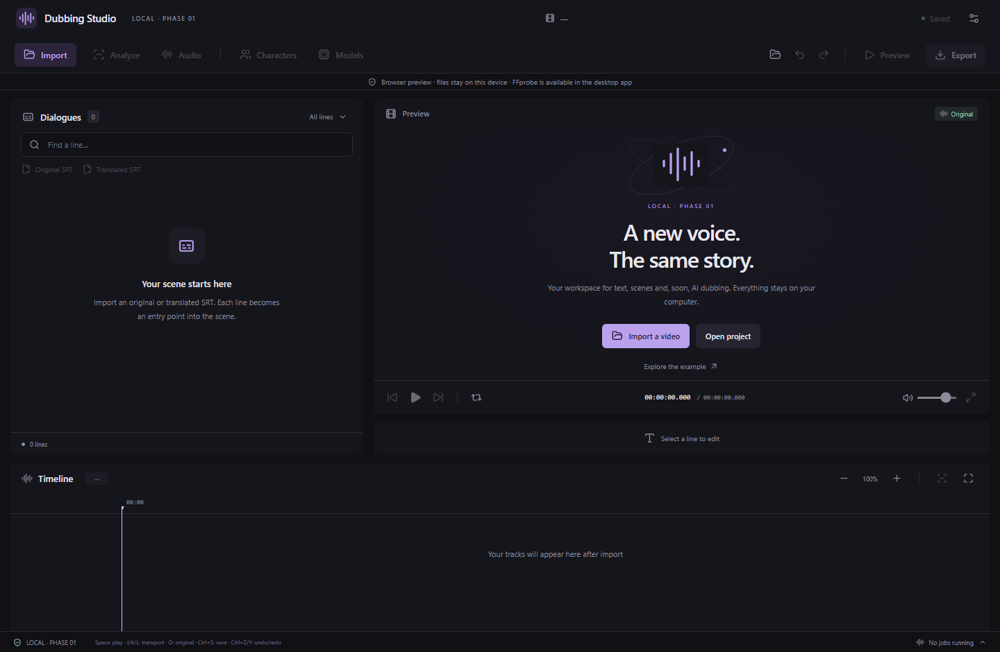

*Welcome screen captured in the French browser preview. Screenshots use the dark theme.*

## Local data

Media processing uses local FFmpeg/FFprobe processes. This version has no cloud provider, account system or telemetry implementation. Original input files are preserved; imported copies and proxies stay inside the project directory.

Projects use JSON, stable IDs, relative asset paths and integer millisecond timings. Existing format 1 projects open normally. Adding separated audio tracks upgrades that project to format 2; older app versions refuse format 2. Unknown formats are rejected without rewriting the file. Autosave uses atomic writes and recovery snapshots. Editing one project simultaneously in multiple app instances is not supported.

The browser preview uses IndexedDB to store projects and video blobs on the current device. It does not run FFprobe or create native portable project folders. Browser JSON export does not include the video blob. Diagnostics may contain local paths and FFmpeg arguments; review an exported report before sharing it.

## Development

Install Node.js 24, pnpm 11.25.0, Rust stable and the [Tauri prerequisites](https://v2.tauri.app/start/prerequisites/). Windows builds need MSVC build tools, a Windows SDK and WebView2.

```powershell
git clone https://github.com/jontechlabs/ai-dubbing-studio.git
cd ai-dubbing-studio
pnpm install --frozen-lockfile
powershell -NoProfile -File scripts/prepare-ffmpeg.ps1
pnpm desktop
```

Large FFmpeg executables are excluded from Git. The preparation script verifies the pinned archive SHA-256 before copying them.

```powershell
pnpm desktop:build
powershell -NoProfile -File scripts/package-windows.ps1
```

The packaging script produces setup, portable ZIP and checksums in `artifacts/`. See [build instructions](docs/BUILDING.md) for preview, tests, packaging options and platform limits.

## Architecture

| Area | Responsibility |
| --- | --- |
| `src/components` | Player, dialogue list, text editor and timeline |
| `src/hooks` | Project state, serialized autosave, playback and shortcuts |
| `src/domain` | Project contracts, subtitle/time calculations and future provider interfaces |
| `src/services/bridge.ts` | Desktop IPC boundary and browser-preview adapter |
| `src-tauri/src` | Project storage/recovery, FFprobe, FFmpeg import/proxies, subtitles and jobs |
| `resources` / `schemas` | Toolchain pins and reserved model/worker contracts |

Processing commands use structured arguments rather than a shell. Project-relative paths are validated, and desktop media access is scoped to the opened project. Future provider contracts keep model runtimes outside the UI. `resources/models.json` contains the pinned Bandit model; no TTS model is integrated yet.

See [architecture and persistence](docs/ARCHITECTURE.md).

## Roadmap

| Phase | Scope | Status |
| --- | --- | --- |
| 1 | Desktop foundation, media import, persistence, subtitle review, simple timeline | Implemented; development preview |
| 2 | Waveforms, timecode editing, subtitle movement, split/merge, automatic SRT synchronization | Implemented; development preview |
| 3 | Bandit speech/music/SFX separation and audio track management | Implemented; CPU validated, CUDA unqualified |
| 4 | Characters, voice references, local AI speaker grouping and dialogue assignment | Implemented; proposals require review |
| 5 | First TTS provider, per-line generation, multiple takes and review | Planned |
| 6 | Additional TTS providers and model manager | Planned |
| 7 | Final mix export, MKV packaging and multiple languages | Planned |

Provider type definitions remain contracts for future integrations. Bandit and local speaker identification are implemented with upstream workers and verified model installation. General model management, voice cloning and generated speech remain future work.

## Validation

The current local checks passed **26 TypeScript tests, 26 Rust tests, 16 Playwright scenarios and 10 Python worker tests (78)**, plus the frontend build, ESLint, Prettier, Rust formatting and Clippy. Tests cover prior media/SRT/mixer flows and new characters, references, safe voice proposals, automatic import synchronization and saved preview controls. Real Windows ONNX/VAD inference grouped two synthetic test voices and their repetitions. Browser scenarios simulate native IPC; they do not replace native GUI or full-film accuracy testing. See [VALIDATION.md](VALIDATION.md) for evidence and limits.

The earlier [v0.1.1 clean Windows run](https://github.com/jontechlabs/ai-dubbing-studio/actions/runs/38362204358) passed its checks and packaging. Current runs are available under [Actions](https://github.com/jontechlabs/ai-dubbing-studio/actions).

Final Windows GUI validation remains pending following the local execution block on an earlier unsigned build. Linux/macOS GUI builds are not qualified. See [VALIDATION.md](VALIDATION.md) for the exact scope.

## Dependencies and licensing

Windows packages bundle the independent Gyan.dev FFmpeg/FFprobe 9.0.2 essentials programs under GPLv3. Their license is included as `binaries/FFMPEG-LICENSE.txt`. See [third-party notices](THIRD-PARTY-NOTICES.txt), the [upstream build description](docs/third-party/FFMPEG-BUILD.txt) and [Gyan build/source references](https://www.gyan.dev/ffmpeg/builds/). Dependencies retain their own licenses; resolved versions are in `pnpm-lock.yaml` and `Cargo.lock`.

Bandit model code is vendored unmodified from the official Apache-2.0 repository at a pinned revision; weights are downloaded from Zenodo under CC BY-SA 4.0 and are not bundled. The inference dependency lock is included.

No project-wide license has been selected. The synthetic example contains no third-party film, voice reference or model weights.
