# AI Dubbing Studio

## v0.49.0 — Multi-track levelling and dubbing review

Per-track previews and approval, atomic application of approved results and one undo step. Local project-wide checks of selected takes: missing/silent/quiet/clipping/possible abrupt endings/silence/timing and conservative multi-voice hints. Persistent tags combine with translation filters; stale findings are excluded. Optional speaker module; audio and takes remain intact. [Guide and screenshots](docs/BATCH-LEVELING-AUDIT.md).

## v0.48.0 — Level an entire audio track

Right-click an audio track → **Level the entire track…**, compare Before / After, then explicitly apply. Selections also extend beyond 120 seconds, up to 24 h. Bounded-memory analysis with one global target, 30-second playback chunks, preserved silence and takes, undo. Long levelling uses project format 28. [Guide and screenshot](docs/WHOLE-TRACK-LEVELING.md).

## v0.47.0 — Level volume within an audio selection

Right-click a selected audio range → **Level selection volume…**. Match the quietest or loudest audible passage, compare before/after, then explicitly apply. Works on source tracks and Dubbing; clears the selection on success. Silence, timing, saved mixer controls and existing takes are preserved. Undoable replacement layers; project format 27 on apply. [Guide and screenshot](docs/VOLUME-LEVELING.md).

## v0.46.0 — Audition dialogue tracks

Right-click → **Listen to tracks…** to solo Original, Speech, Music, Effects, Dubbing and added audio over the dialogue range. Automatic stop, before-level listening and direct voice isolation from the chosen source track. Saved mixer settings and takes are preserved. [Guide and screenshot](docs/DIALOGUE-TRACK-AUDITION.md).

## v0.45.0 — Isolate voices from a dialogue

Right-click a dialogue → **Isolate voices…** to prepare its range in the audio toolbox. Choose the **source track** (Original, Speech, Music, Effects or added audio), select a separator, then preview and route only the desired outputs at the same timestamps. Subtitles, video and dubbing takes are preserved; application is undoable. [Guide and screenshot](docs/DIALOGUE-VOICE-ISOLATION.md).

## v0.44.0 — Transcribe a dialogue from its context menu

Right-click a dialogue → **Transcribe dialogue…**. Choose the source language and track, transcribe locally, review/edit the proposal, then **Replace source SRT** or **Keep source SRT**. Timing, translations and all takes are preserved; replacement is undoable. [Guide and screenshot](docs/DIALOGUE-TRANSCRIPTION.md).

## v0.43.0 — 1–4 takes per dialogue in batch dubbing

[Batch dubbing](docs/BATCH-MULTIPLE-TAKES.md) now accepts **1–4 takes per eligible dialogue**, showing the total before launch. Each take has its own durable outcome and precise retry; successful and earlier takes are retained. Sequential generation keeps the model loaded when supported, then releases it on completion or cancellation.

## v0.42.0 — Persistent batch dubbing history

The [saved batch history](docs/BATCH-HISTORY.md) survives application restarts and shows dates, engines, successes, failures and unprocessed lines. Open **Dubbing → Batch → Batch dubbing history**, then inspect a report to retry one line, a selection or all failures. Retry runs stay grouped with their original batch and previous takes are preserved. Nothing resumes automatically.

**v0.41.0 — Take timestamps and batch recovery.** Each take shows its stored date and local time. Review failed/unprocessed dialogues and retry them individually or together using the batch settings and current inputs. Successful takes stay intact; task summaries can be dismissed and restored. **157 MCP tools, format 26.** [Guide and screenshots](docs/BATCH-RECOVERY.md).

**v0.40.2 — Review existing dubbing takes.** Takes changed since generation can be explicitly approved after reviewing the differences. Later edits withdraw approval again. All takes and WAV files are preserved. [Guide and screenshot](docs/REVALIDATION.md).

**v0.40.1 — Clear dialogue review actions.** Translation status moves into the bottom action bar. Distinct state icons, a checkmark to approve and an undo arrow to return to review, with contextual hints and keyboard activation. [Guide and screenshot](docs/DIALOGUE-REVIEW-ACTIONS.md).

**v0.40.0 — Project manager.** Start on Home to create, open, search and rename projects. Return Home or rename directly from the editor. Recoverable project trash, restoration, automatic interior video thumbnails and a manual timestamp picker. Existing subtitles, dubbing takes and source video are retained. **155 MCP tools, project format 26.** [Guide and screenshot](docs/PROJECTS.md).

**v0.39.1 — Dubbing scroll fix.** The dubbing inspector keeps hidden accessibility labels inside its own scroll area, removing the extra scrollbar and blank space in the main window. Internal scrolling, single/batch mode, progress and take selection remain available.

**v0.39.0 — Compact controls and free-range speaker separation.** Denser dialogue tools/cards, one review status, aligned portrait actions, explicit model loading and results scoped to the current selection. Run MossFormer2 / SepFormer on a free audio-track range, preview and choose voices, then add or replace at the same timestamp. Global model installation progress now completes correctly, and managed weights can be listed by size and deleted with confirmation. [Guide and screenshots](docs/SELECTION-TOOLBOX.md).

**v0.38.0 — Dubbing inspector tab.** Dubbing now lives beside Text and Pronunciation in the right inspector, keeping the video, dialogue list and timeline accessible. Line and batch modes retain separate settings; inline progress and new takes stay tied to their original dialogue. Independent inspector width and keyboard navigation. [Guide and screenshots](docs/DUBBING-INSPECTOR.md).

**v0.37.0 — Compact editing UI.** Text-first dubbing panel, section navigation, a pinned generation action, a compact waveform dock with fade/effect dialogs, a denser character gallery and accessible icon actions. Overall workspace layout, existing takes and settings are preserved. [Guide and screenshots](docs/UI-REFINEMENTS.md).

**v0.36.0 — Character portraits and speaker reset.** Portrait capture chooses a dialogue belonging to the displayed character. A mini video player, detected-face picker and adjustable visual crop help choose the right scene and person. Reset speaker assignments while keeping profiles and voice references, or explicitly remove the character records. Subtitles and every dubbing take are retained; undo is available. **143 MCP tools, project format 26.** [Guide](docs/SPEAKER-RESET.md).

**v0.35.0 — 1–4 takes per dialogue.** Choose the number of takes in Dubbing; sequential generation with distinct seeds, a loaded TTS model reused across the series, inline progress and cancellation. Completed takes survive interruption and the latest is selected. Also supports the two-stage pipeline and MCP (`count`). [Guide](docs/MULTIPLE-TAKES.md).

**v0.34.1 — Clear accent controls.** Enable VoxCPM2 accent instructions with an explicit switch from Ultimate / Hi-Fi or hybrid guidance to Standard. Engine-specific guidance explains reference-driven accents for Audio8, Qwen3-TTS Base and Chatterbox. Existing takes are preserved. [Supported modes and guidance](docs/VOICE-ACCENTS.md).

**v0.34.0 — Audio8-TTS Realistic 0.6B.** Local GGUF Q8_0 installation (model and codec: 1.33 GiB), disk preflight, CPU or selected Vulkan GPU. Clone existing or imported references with an exact transcript, adjust sampling, and keep the model loaded during batches. Earlier takes are retained. Regional-accent and named-mood controls are unavailable for this engine; prefer an expressive French reference for French dubbing. **141 MCP tools, project format 26.** [Installation and limits](docs/AUDIO8-TTS.md).

**v0.33.0 — Overlapping voices and independent sub-dubbings.** Local MossFormer2 (2 voices) and SepFormer (2 or 3 voices) installation, separation and output preview in the Dubbing panel. Replace/add track routing and independent per-character dubbing, mixed concurrently in playback and MKV export. Source video, SRTs and every earlier take remain intact. Includes selection audition and references before listening levels/mutes. **141 MCP tools, project format 25.** [Guide](docs/OVERLAPPING-VOICES.md).

**v0.32.4 — Character matching on request.** Click **Suggest a character** in Dubbing to compare voices. Opening the panel, switching dialogues or changing settings no longer starts automatic analysis, including with an old enabled preference. Assignment still requires approval and every take is retained. [Guide](docs/CHARACTER-VOICE-LIBRARY.md#personnage-proposé-au-moment-du-doublage).

**v0.32.3 — Inline dubbing operations.** Generation, timbre conversion, prosody transfer, reference transcription and batches keep their progress, elapsed time, cancellation and retry in the Dubbing panel. Completion focuses the newly selected take, retaining every earlier take. [Guide and screenshots](docs/DUBBING-INLINE-TASKS.md).

**v0.32.2 — Compact subtitle-editor actions.** Add dubbing and Exclude from dubbing now sit together in the header as icon buttons with tooltips and accessible labels. The header wraps cleanly in a narrow inspector. [Preview](docs/JOINT-REVIEW-DIALOGUE-EDITING.md).

**v0.32.1 — Joint text/take review and dialogue management.** Approval follows one exact text, selected take, local edit and placement. Add timed dialogue lines, or exclude selected lines from dubbing while retaining both SRTs, every take and placement. Excluded-lines view, restoration, undo/redo, project format 24 and 134 MCP tools. [Guide and screenshots](docs/JOINT-REVIEW-DIALOGUE-EDITING.md).

**v0.32.0 — Dubbing workbench and selected audio toolbox.** Edit spoken/original text and audition the chosen voice reference without leaving Dubbing. New takes show their own progress. Optional local TTS → ChatterboxVC pipeline retains every stage, with an experimental source-intonation guide. Right-click a source-audio selection for BS-RoFormer Viperx 1297, Mel-Band RoFormer Kim, Demucs v4/FT or text-conditioned AudioSep; audition outputs before mapping them to Speech/Music/Effects at the same timestamp. Source media stays intact. Explicit translation/voice review actions are linked. **132 MCP tools, format 23.** [Guide, model comparison and screenshots](docs/DUBBING-WORKBENCH-AUDIO-TOOLBOX.md).

**v0.31.0 — Reviewed source transcription and take output volume.** Transcribe source audio locally from Translation help, compare the editable proposal and apply it explicitly to original SRT text. Timing, translations and takes stay intact. Set volume before single/batch generation or adjust existing takes: +50% (150%), +75% (175%), mute and reset to 100%. Reversible gain is used for audition, mix and export. **125 MCP tools, project format 22.** [Guide and screenshots](docs/SOURCE-TRANSCRIPTION-OUTPUT-VOLUME.md).

**v0.30.0 — Reviewed voice libraries and independent delivery guides.** Assemble a character’s original excerpts, generate French reference phrases for audition/approval, and use approved samples without replacing old takes. VoxCPM2 supports acoustic delivery directions or an experimental separate audio prompt. French reference fidelity passes the exact transcript and clean target text without an English direction prefix. Speaker suggestions require explicit acceptance. **120 MCP tools, project format 21.** [Guide and screenshots](docs/CHARACTER-VOICE-LIBRARY.md). Qwen3 GGUF also adds a generation budget and one compatible retry on the same GPU.

**v0.29.0 — Character review and local corrections.** Thumbnail gallery, temporary names, manual gender labels, measured vocal register, visual merge proposals, sample audition and lossless merging with trimmed/combined references. Identify voices on a chosen track/time range with an optional character reference; swap timeline sections directly, or preview and apply a bounded Bandit separation. Existing takes and source media are retained. **113 MCP tools.** [Guide and screenshots](docs/CHARACTER-IDENTIFICATION.md).

Right-click a dubbed block to [reset its duration](docs/DUBBING-PLACEMENT.md) while retaining its offset and all takes. A [VoxCPM2 output safeguard](docs/VOICE-QUALITY.md) attenuates only newly generated waveforms exceeding the PCM range to avoid hard clipping; it does not remove artifacts already produced by the model.

**v0.28.3 — Approve or withdraw checked translations together.** Compact selection actions apply to every checked dialogue, including those hidden by filters. Empty translations are skipped, existing takes are retained, and the complete edit supports undo/redo, autosave and MCP (102 tools). [Guide and screenshot](docs/BATCH-CACHE-AND-TRANSLATION-REVIEW.md).

**v0.28.2 — Batch dubbing for translations awaiting approval.** Choose all translated lines, unapproved translations only, or approved translations only. Combine with the whole project or checked lines and optional forced new takes; earlier takes are preserved. Also available through MCP. [Guide and screenshot](docs/BATCH-DUBBING.md).

**v0.28.1 — Lighter long-film timelines.** Overviews are limited to two minutes on long videos, including keyboard, wheel, slider and MCP commands. Only the visible subtitle/voice blocks are mounted; waveform peaks are indexed once and queried without rescanning the full recording on every scroll. Short clips still fit entirely. [Details and screenshot](docs/TIMELINE-PERFORMANCE.md).


**v0.28.0 — A compact editing workspace.** Dialogues on the left, video in the centre, subtitle editing on the right and a full-width timeline below. Sidebars resize by dragging or keyboard and remember their widths. Audio effects use compact power buttons with a separate settings dialog; preview, processing order and preserved originals remain available. [Guide and screenshots](docs/COMPACT-WORKSPACE.md).

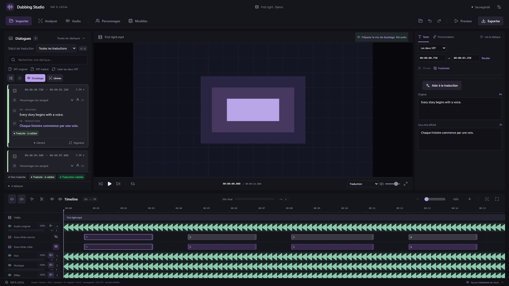

*Interface réelle avec média synthétique et commandes natives simulées.*


**v0.27.1 — MCP relay lifecycle fix.** Request-per-channel SSH relays exit after their exact response, even with stdin held open. Normal MCP clients remain persistent; projects, takes and AI engines are unchanged. [Diagnosis and lifecycle details](docs/MCP-PROCESSES.md).

**v0.27.0 — Voice quality controls and live stereo audio meters.** Model-specific presets and advanced synthesis controls for individual and batch dubbing, including VoxCPM2 Natural (20 steps, guidance 1.6), with saved take settings and all previous takes retained. [Quality guide and screenshot](docs/VOICE-QUALITY.md).

See RMS levels, sample peaks and latched clipping for every audio track and the final mix directly on the timeline and in Audio. Measures the actual signal after gain, regions and rendered effects, before player listening volume. Maxima reset without changing the project. Also available through MCP (101 tools). [Guide and screenshots](docs/AUDIO-LEVELS.md).

**v0.26.0 — Local audio effects and global track volume.** Twenty effects, twelve presets, editable effect chains on voice regions and whole/partial tracks, independent 0–400% track faders directly on the timeline, and brief task start/completion notifications. Original takes and media are retained. [Guide and screenshots](docs/AUDIO-EFFECTS.md).

**v0.25.0 — Live task execution time.** Processing cards show an updating elapsed timer and retain the measured duration when finished. Queue and pauses are excluded; retries have their own timer. [Details and screenshot](docs/TASK-DURATION.md).

**v0.24.0 — Translation direction and voice startup fix.** Give the local LLM character, register, tone and length guidance; available subtitle windows guide concise delivery. Proposals still require review before applying. Fixes `ModuleNotFoundError: No module named 'cosyvoice_worker'` with VoxCPM2, Chatterbox Multilingual and voice conversion under embedded Windows Python. Existing model downloads are reused.


Enregistrement au microphone et conversion locale du timbre : [guide v0.23.0](docs/MICROPHONE-VOICE-CONVERSION.md). Les références de personnages et fichiers audio avec choix de début/fin sont disponibles ; chaque opération ajoute un nouvel essai.


**v0.22.0 — VoxCPM2 and Chatterbox Multilingual V3.** Install and generate individual or batch voice takes, with an isolated CUDA 12.8 runtime, disk-space preflight and preserved takes. Drama 3 now receives the target language even with Auto accent, to prevent Japanese-reference language drift. [Installation, capabilities, limits and screenshots](docs/VOXCPM2-CHATTERBOX.md).

**v0.21.0 — 43 acting directions.** Dying, stressed, laughing, panicked, exhausted and more, grouped by intention. Available for individual and batch dubbing with CosyVoice3, Fish S2 and Drama 3. Clarified the CosyVoice3 accent / reference acting trade-off. [Full list, guide and screenshot (French)](docs/VOICE-ACTING.md).

**v0.20.1 — Installer and MCP relay shutdown.** Relays exit when the studio closes; updates suspend MCP and allow the executable to be released. Failed installations restore MCP. [Recovery for older versions and details (French)](docs/INSTALLATION-RECOVERY.md).

**v0.20.0 — Experimental intonation transfer.** Transform an existing French take using pitch, rhythm and energy contours from the original Japanese dialogue or another reference. Adjustable strength, local CPU processing and an independent new take preserve every previous take and the source video. Cross-language acoustic transfer remains approximate. Also available through MCP (95 tools). [Guide, limits and screenshot](docs/PROSODY-TRANSFER.md).

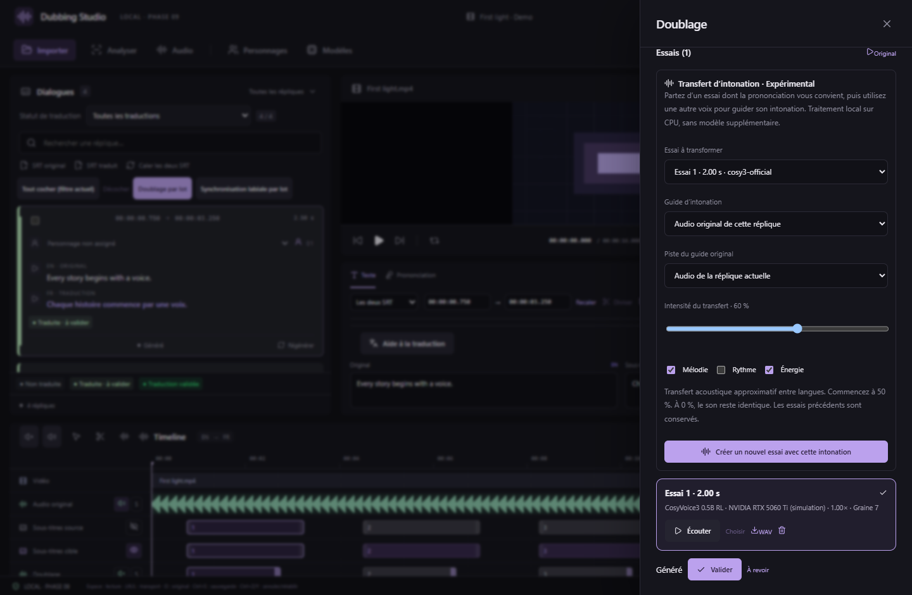

*Actual React UI with simulated native commands / Interface réelle, commandes natives simulées.*

**v0.19.0 — Control the studio through MCP.** Enable the local stdio server in Settings and connect an AI client using the generated JSON or Codex TOML configuration. 93 typed tools cover projects, subtitle/voice/audio editing, generation, lip sync, playback, jobs, exports and updates. Project revisions, undo and audio-render preflight remain enforced. The application stays open during this first integration. [Setup and guide (French)](docs/MCP.md).

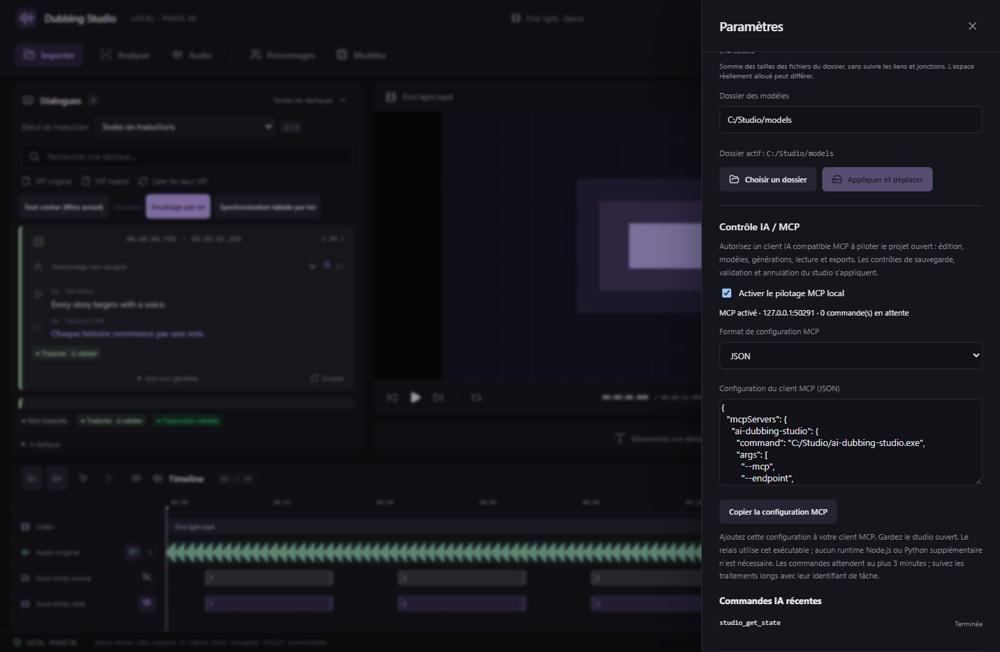

*Actual React UI with simulated native commands / Interface réelle, commandes natives simulées.*

**v0.18.0 — Batch lip sync and safer audio editing.** Process all dubbed or checked dialogue lines with CPU face detection for filmed people and anime, editable individual framing, cancellation and resume. Each result is an independent clip; the main video stays intact. Cuts and stretches render before committing, the original take remains auditionable, and multiline dialogue cards no longer overlap. An audio-clock playhead and precise counter help locate the sound and place the editing cursor. [Guide and screenshots (French)](docs/LIP-BATCHES-AND-AUDIO-RECOVERY.md).

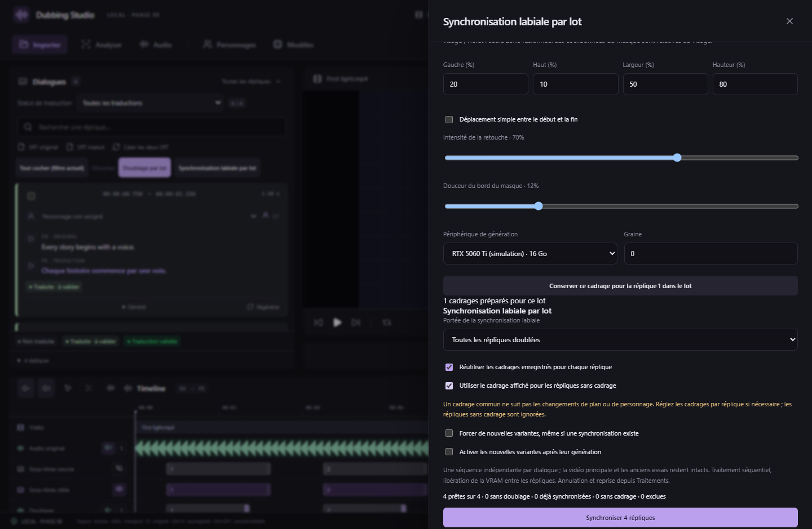

*Actual React UI with synthetic media and simulated native commands / Interface réelle, commandes natives simulées.*

**v0.17.0 — LatentSync 1.5 and 1.6, adapted from ShmuelRonen’s wrapper.** Select an engine, check disk capacity and retouch separate dialogue sequences. The main video stays intact; enabled variants preload for playback and compose on export. Reduced-memory profile uses temporal windows, sequential guidance and a separately loaded VAE. The 1.6 profile remains a 16 GB candidate, without an RTX 5060 Ti no-OOM guarantee. [Detailed guide](docs/LATENTSYNC.md).

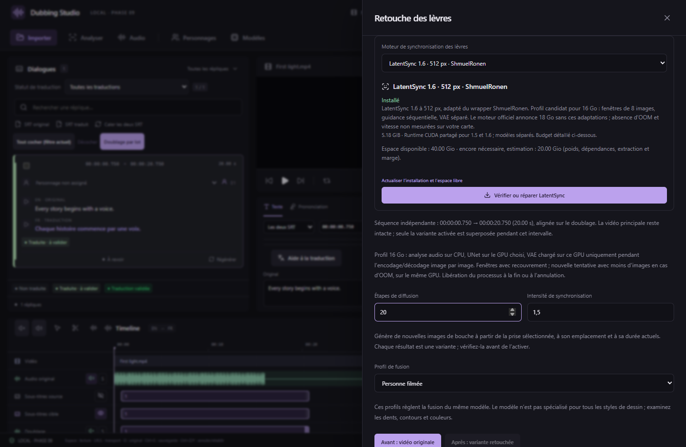

*Interface React réelle avec média synthétique et commandes natives simulées ; diagnostics neuronaux CPU séparés.*

**v0.16.0 — Right-click menus.** Remove a volume or mute region directly from any audio track, with undo/redo and persistence. Clear an unapplied selection, toggle a track or open audio options. The application menu provides Undo, Redo, Save and Settings. [Illustrated guide](docs/CONTEXT-MENUS.md).

**v0.15.1 — Protected voice duration and movement.** Editing shows the actual available maximum, stops at neighbouring voices and the video end, and enforces the 120-second processing limit. Moves preserve audible duration; numeric timing applies on Enter/blur. Existing oversize or collapsed timings have a recovery action that retains edits. [Illustrated guide (French)](docs/VOICE-DURATION-SAFETY.md).


**v0.15.0 — Adjustable voice fades, audio selection resizing and coherent navigation.** Apply fade-in/out to a voice region, resize audio selections or saved gain/mute regions with their edge handles, and reveal the chosen dialogue and playhead without changing timeline zoom. [Illustrated guide (French)](docs/FADES-SELECTION-NAVIGATION.md).

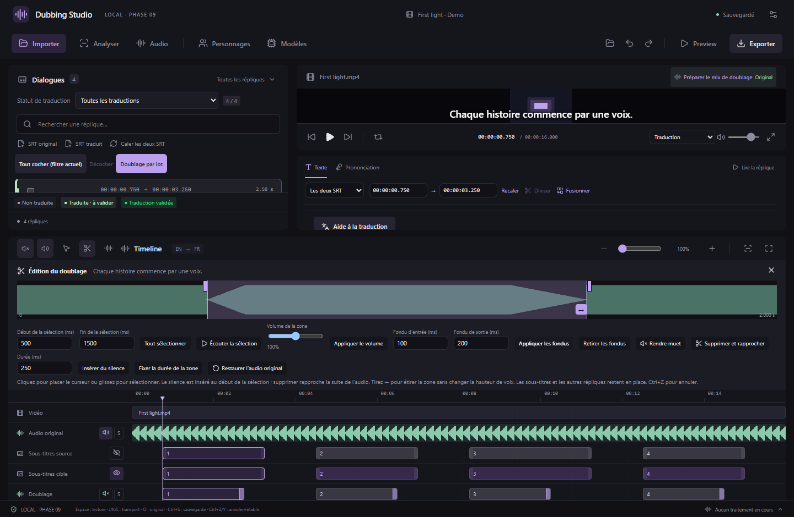

*Actual React interface with synthetic demo audio and simulated native commands; separate real FFmpeg sample and MKV checks.*


**v0.14.0 — Edit parts of a generated voice directly on the timeline.** Double-click a dubbing clip to select a waveform region, insert silence, mute, delete and close its gap, adjust local volume, or drag ↔ to stretch only that region while preserving pitch. Originals are retained; edits support undo, autosave, WAV and synchronized MKV export. [Illustrated guide (French)](docs/VOICE-REGION-EDITING.md).

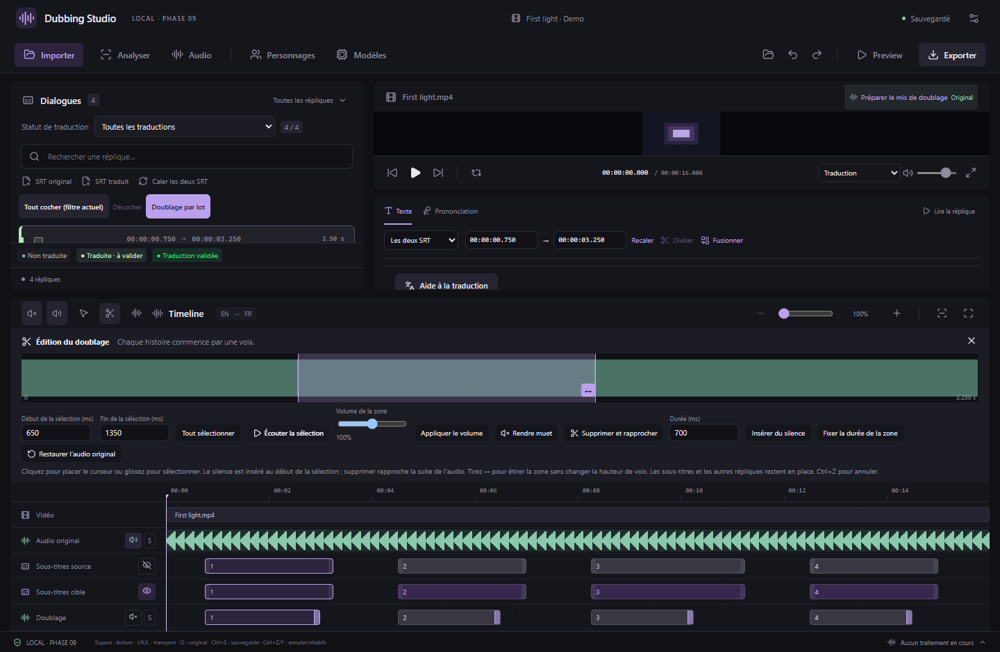

*Actual React interface with synthetic demo audio and simulated native commands; audio rendering and MKV export are tested separately with real FFmpeg.*


**v0.13.0 — Translation status filters, approved-only batch dubbing and local Qwen3-4B-Instruct-2507 GGUF Q4_K_M proposals.** Open the translation assistant in the subtitle editor, install its model, choose a GPU, then review and edit the proposal before applying it. Translation approval remains manual. [Detailed guide (French)](docs/TRANSLATION-ASSISTANT.md).

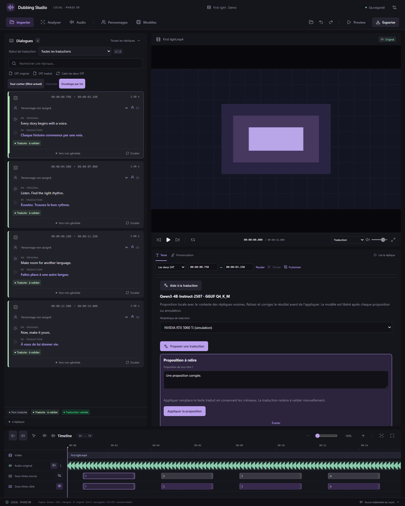

*Actual React UI; native model inventory and displayed proposal are simulated for the screenshot. Real local model checks are recorded in VALIDATION.md.*

**v0.12.0** keeps the model loaded for each dubbing batch, then terminates its process before reporting completion or cancellation. Dialogue cards now show untranslated (grey), translated (light green) and explicitly approved translation (green). Translation approval is independent from voice-take approval and is revoked when source/target text or languages change. [Guide and screenshot](docs/BATCH-CACHE-AND-TRANSLATION-REVIEW.md).


**v0.11.0 — Reference excerpts and batch dubbing.** Choose and audition start/end times before importing an audio reference. Dub all translated lines or checked lines with a common configuration, keep current takes or force new ones, and track/cancel/resume the batch. Previous takes are retained. [Guide and screenshots](docs/BATCH-DUBBING.md).

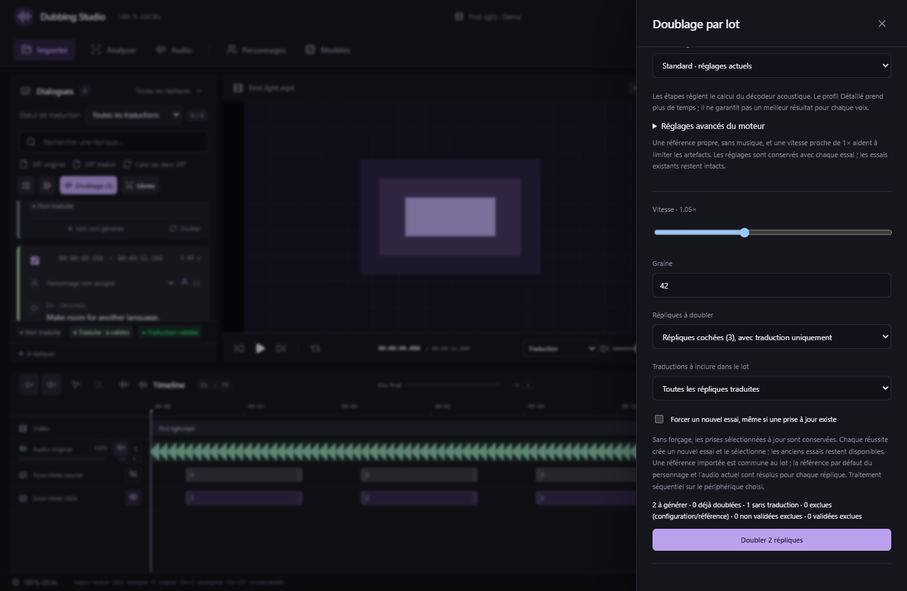

*Actual React UI with simulated model inventory / Interface React réelle, inventaire natif simulé.*

**v0.10.3** improves CosyVoice3 acoustic endings and uses memory-mapped Drama 3 experts without a full pinned RAM copy. Generate new takes to use the CosyVoice3 change; existing WAVs remain untouched.

**References and accents:** load, audition, transcribe and reuse a reference audio file directly in **Dubbing**, without assigning a character. Compatible engines accept French accent instructions (France, Quebec, Belgium or Switzerland); adherence varies, and a French reference remains preferable. [Guide and screenshots](docs/VOICE-REFERENCES-AND-ACCENTS.md).

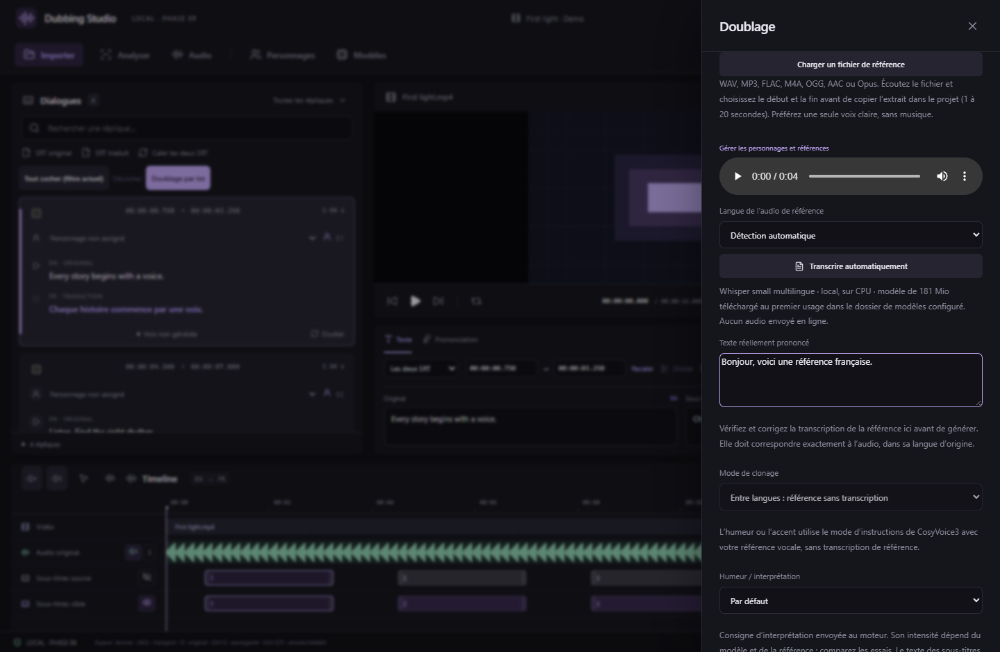

*Actual React UI with simulated native reference import / Interface React réelle, import natif simulé.*

**v0.10.2 — Disk space before Drama 3 installation.** The model card shows the storage folder, available capacity and a conservative budget for missing weights, dependency archives and extraction. Installation is blocked when capacity is insufficient or cannot be checked; the native task checks again before any dependency download. [Installation](docs/FISH-DRAMA-3.md) · [Voice endings and timing](docs/DUBBING-PLACEMENT.md).

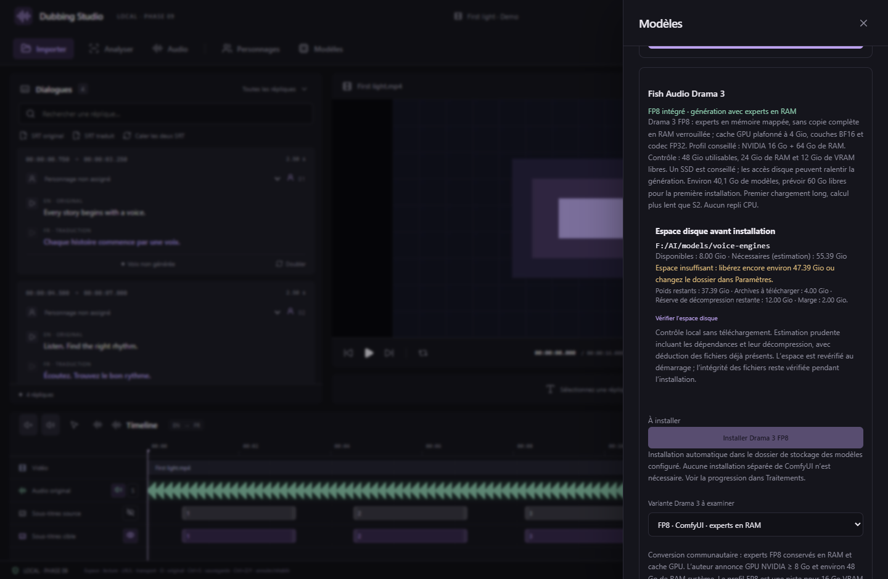

*Real React UI with simulated storage capacity / Interface React réelle, capacité simulée.*

**v0.10.1 — Volume directly on the timeline.** Select a range on any audio track to adjust its 0–200% gain, mute/unmute or restore 100% in the timeline. Changes autosave, support undo and keep the advanced Audio editor available. The Fish Audio Drama 3 card now includes its **Install Drama 3 FP8** button, with no separate installation card. [Audio regions](docs/AUDIO-REGIONS.md) · [Drama 3 installation](docs/FISH-DRAMA-3.md).

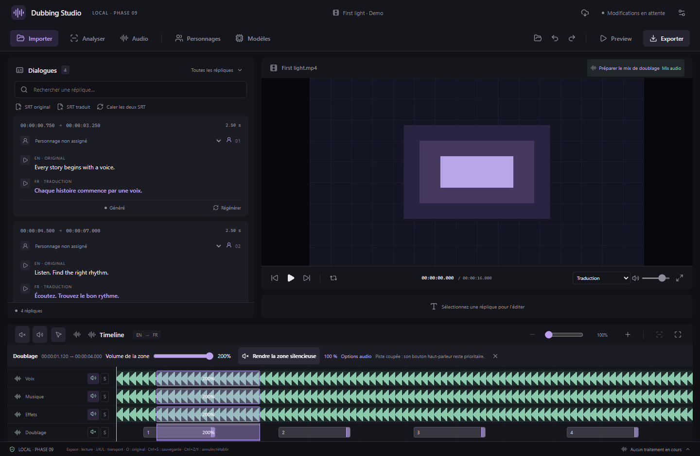

*Actual React UI with synthetic demo audio and simulated native inventory.*

A local desktop workspace for preparing video dubbing: review bilingual subtitles, navigate dialogue by dialogue, and keep displayed text separate from voice pronunciation text.

Built with **Tauri 2, React, TypeScript and Rust**. English and French interface. Dark and light themes.

**v0.9.0 — Local lip retouching and audio range transfers.** MuseTalk 1.5 generates mouth images from a selected dubbed take, using an explicit CUDA GPU, FP16 UNet and FP32 VAE. Frame the full face and blend only the chosen mouth region; compare variants before activation. Anime support is experimental. Choose both the voice-reference source track and the track to replace in the dubbing mix. Copy, move or swap ranges between original/stem tracks, with independent transferred-range gain and undo. [Lip retouching](docs/LIP-INPAINTING.md) · [Audio transfers](docs/AUDIO-TRANSFERS.md) · [Timing analysis](docs/LIP-ALIGNMENT.md).

**v0.10.0 — Fish Audio Drama 3 generation.** A separate FP8 engine keeps routed experts in system RAM, uses up to 4 GiB of GPU expert cache and loads the FP32 codec separately. Profile for NVIDIA 16 GB VRAM + 64 GB RAM, exact reference transcript, moods, seed, independent takes and the existing timing/mix/MKV tools. About 40.1 GB of model downloads; 46 GiB available RAM and 12 GiB free VRAM required. Full-model RTX speed and French quality are not measured on the development host. [Installation and limits](docs/FISH-DRAMA-3.md).

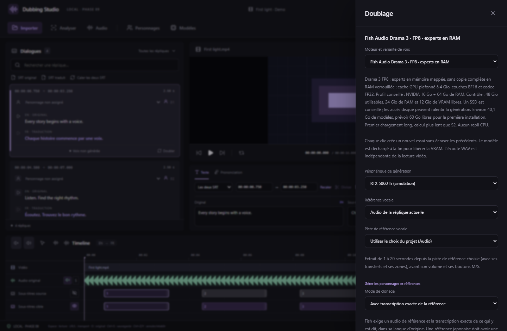

*Actual React UI with simulated CUDA inventory and generation completion; separate real CPU diagnostics exercise FP8 expert offload, the cache and a tiny autoregressive model.*

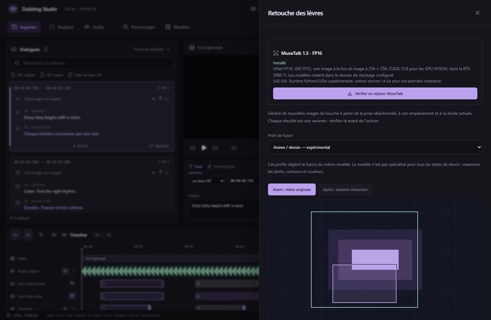

*React/Chrome interface with synthetic video and simulated native model inventory; this screenshot is not an RTX inference benchmark. See validation for the separate real neural CPU diagnostic.*

**Local reference transcription and corrected Fish help.** Whisper small Q5_1 transcribes Japanese, French and the other available languages. The editable transcript is saved with the character reference. The 181 MiB model downloads on first use and runs on CPU to leave VRAM for dubbing. [Reference guide](docs/REFERENCE-TRANSCRIPTION.md).

CosyVoice3, Fish S2 FP8/GGUF and Qwen3-TTS GGUF remain available. [Models and GPU profiles](docs/PHASE-6.md) · [Validation and limits](VALIDATION.md).

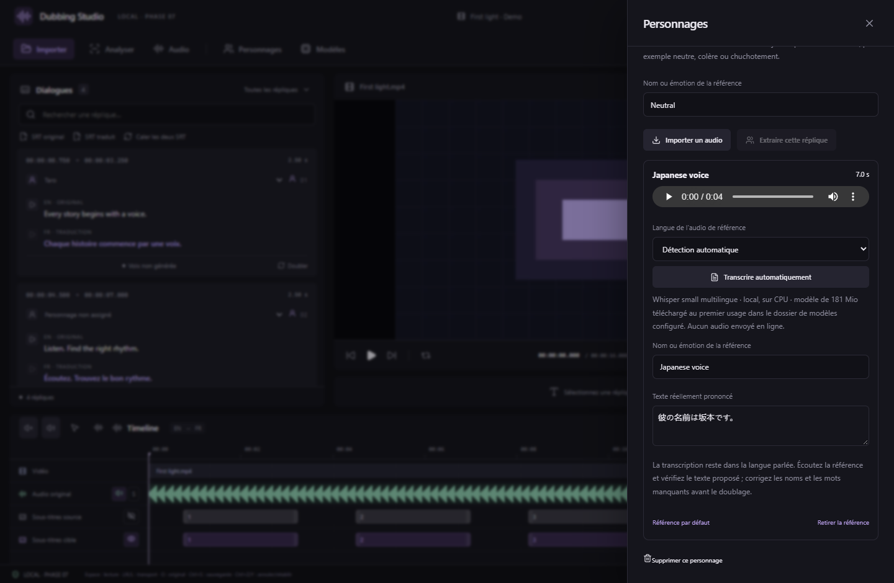

*Actual React browser UI with a simulated reference and transcription result. Separate native checks transcribe real Japanese speech. These are not RTX performance measurements.*

[Windows downloads](https://github.com/jontechlabs/ai-dubbing-studio/releases/tag/v0.36.0) · [User guide](docs/GETTING-STARTED.md) · [Build instructions](docs/BUILDING.md) · [Français](README.fr.md)

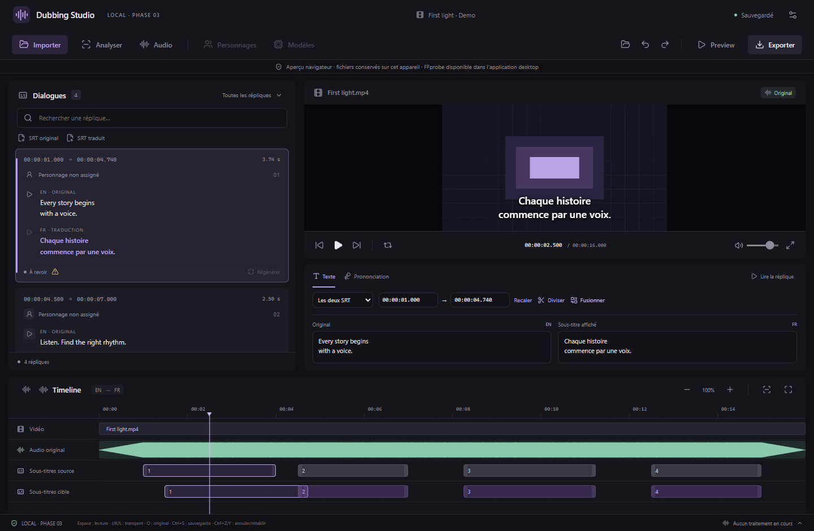

*Actual French React interface running in the browser preview with the bundled synthetic example. This is not a captured Windows Tauri window. The example has synthetic sound and does not contain generated dubbing.*

## Changes in 0.4.2

Audio regions with independent silence and volume, timeline range selection, fast global/track commands and edited WAV export for separated tracks. Model settings show the folder's file size and a refresh control. [Audio region guide (French)](docs/AUDIO-REGIONS.md) · [Storage and variants](docs/MODELS-AND-STORAGE.md).

## Windows downloads

| Package | Purpose |
| --- | --- |
| [Windows x64 setup](https://github.com/jontechlabs/ai-dubbing-studio/releases/download/v0.49.0/AI-Dubbing-Studio-0.49.0-Setup.exe) | NSIS installer for the current user, with English/French installer interface |
| [Portable ZIP](https://github.com/jontechlabs/ai-dubbing-studio/releases/download/v0.49.0/AI-Dubbing-Studio-Windows-Portable.zip) | Extract the whole folder and launch `AI Dubbing Studio.exe` |
| [SHA-256 checksums](https://github.com/jontechlabs/ai-dubbing-studio/releases/download/v0.49.0/SHA256SUMS.txt) | Verify the setup and ZIP downloads |

Target: **Windows 10/11 x64**, with **Microsoft Edge WebView2 Runtime**. FFmpeg and FFprobe are included. Python, CUDA and AI model downloads are not required for editing and playback. Installation may need Internet access if WebView2 is missing; local project editing does not require a cloud account.

These are **unsigned development builds**. Smart App Control blocked an earlier Phase 1 executable on the development machine. The current Windows GUI and installation workflow are **not fully qualified**. This release is a prerelease. See [validation evidence and limits](VALIDATION.md).

## Available in Phases 1–7

- Import MKV, MP4, MOV, AVI and WebM; inspect streams with FFprobe and choose an audio track.
- Copy the original into a portable project folder; create an H.264/AAC preview proxy when required.
- Import/export UTF-8 SRT, including multiline subtitles. Choose embedded text subtitle tracks (SRT/ASS/SSA and compatible formats) from the video as original or translated subtitles; bitmap tracks require OCR.
- Match source and translated cues conservatively using timings; flag ambiguous matches for review.
- Browse a virtualized dialogue list; select a line to seek the video and highlight its timeline entries.
- Edit source subtitles, translated subtitles and independent TTS pronunciation overrides.
- Play or loop a line with configurable padding; use volume, fullscreen, zoom and transport shortcuts.
- Inspect audio waveforms computed from the chosen original track and separated stems, with local cache, progress and cancellation.
- Identify anonymous voice groups locally with Silero VAD and 3D-Speaker CAMPPlus over existing subtitle intervals. Review/apply proposals, rename characters and correct individual or range assignments.
- Import or extract multiple voice references per character; edit their transcripts and default reference.
- Install speaker identification, CosyVoice3 RL, Fish S2 FP8/GGUF and Qwen3-TTS GGUF from Models. Generate, compare, select and review individual dubbing takes with a chosen engine and GPU.
- Toggle audio mute/solo and subtitle visibility directly from the timeline; preserve player subtitle preferences.
- Optionally synchronize an imported SRT against the other SRT automatically; ambiguous matches preserve the imported file.
- Separate speech/music/effects locally using Bandit v2 Multilingual; install an isolated Python runtime and verified model from Audio. Choose CPU or a detected NVIDIA CUDA device.
- Mix original, dubbed voices and stem tracks with persistent mute, solo, gain and regions; listen with the video and export MKV or individual WAV takes. Pause/resume/cancel and retry separation jobs.
- Prepare a 720p/30 fps preview with frequent keyframes, without upscaling low-resolution media. Subtitle timeline blocks stay stable during playback, including the 6,000-dialogue test.
- Set a Windows GPU rendering preference and inspect playback resolution/dropped-frame counters.
- Check for updates automatically or manually, download a signature-verified package, then install/restart from Settings.
- Edit start/end timecodes for either SRT or both; drag cue blocks, resize their edges, snap with Shift, and adjust track height.
- Split at the playhead or merge with the next line. Changes are included in SRT exports and can be undone.
- Preview automatic SRT-to-SRT synchronization with offset/drift estimation and one-to-many matches; choose either reference and apply explicitly. Ambiguous proposals are refused.
- Autosave, previous-version backup and interrupted-save recovery; undo/redo during the current session.
- Track real import jobs, progress and logs; cancel, retry and identify interrupted jobs after a restart. Creation opens Processing automatically, and the player keeps a loading animation until the import and first-frame preparation finish.
- Switch French/English and dark/light themes; export local diagnostic information.

Automatic synchronization compares timing patterns; it does not perform speech recognition or semantic translation matching. Unmatched cues keep their original timings. Different video edits may need manual correction. See the [Phase 2 guide](docs/PHASE-2.md). Synchronized dubbing and MKV export are available in [Phase 7](docs/PHASE-7.md).

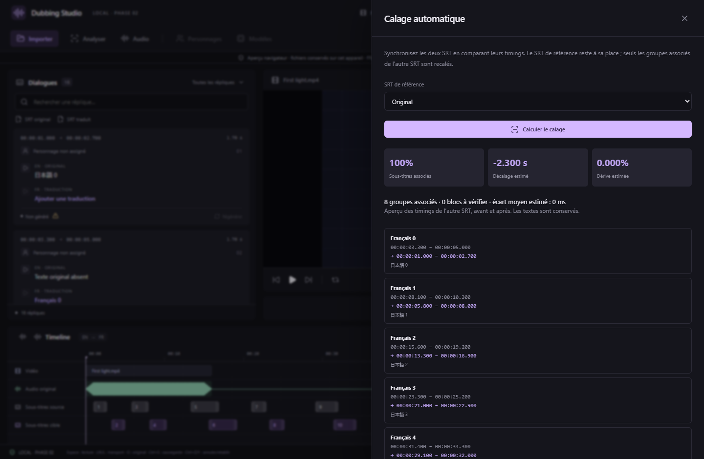

*Actual French browser preview using generated test SRTs with a 2.3-second offset; timings are inspected before application.*

## Phase 3, GPU and updates

Read the [Phase 3 guide](docs/PHASE-3.md) for runtime/model installation, GPU preferences, smooth preview, mixer and in-app updates. Version 0.3.0 must first be installed manually when coming from 0.2.x; subsequent signed releases can update through the interface. A portable package uses the same update installer, which installs a current-user application.

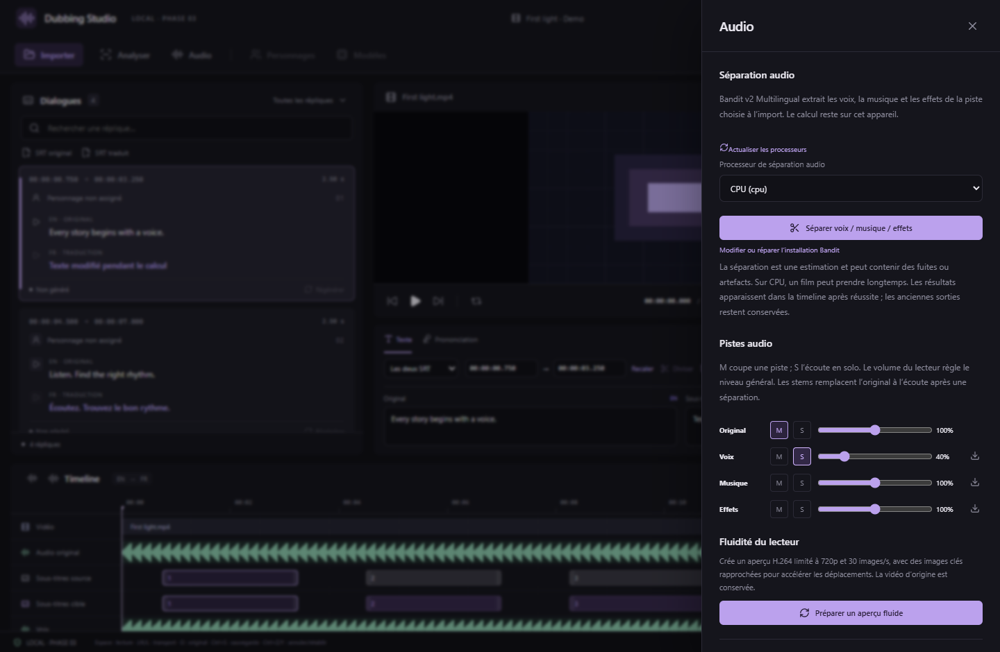

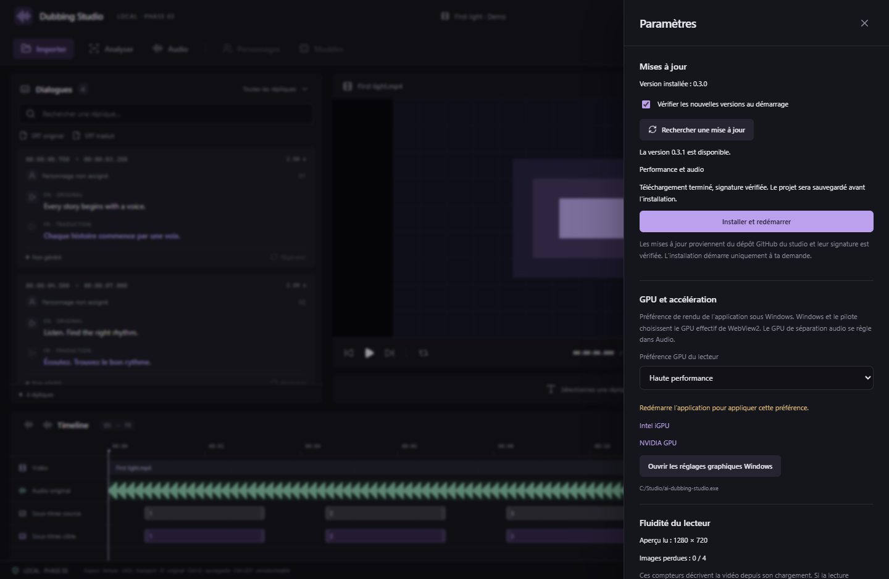

*Actual React interface in browser tests with simulated native IPC, GPU names and a future update scenario. These are not native Tauri captures. Bandit and CosyVoice3 have separate real Windows CPU inference checks.*

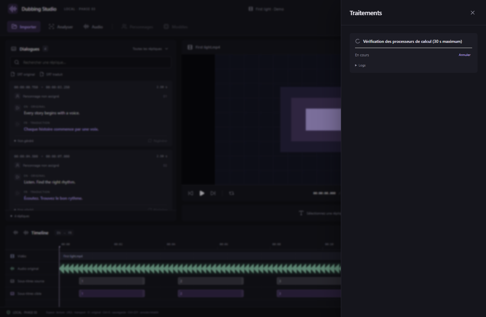

*Browser test of the actual processing interface with simulated native job events. The model download is complete; device checking has its own indeterminate progress.*

## Characters, models and subtitle controls

Read the [Phase 4 guide](docs/PHASE-4.md). Speaker identification proposes anonymous groups from the speech in existing subtitle intervals; users supply character names and review uncertain matches. The CPU model is trained on English VoxCeleb and has not been qualified on full multilingual films. Voice grouping does not synthesize dubbing.

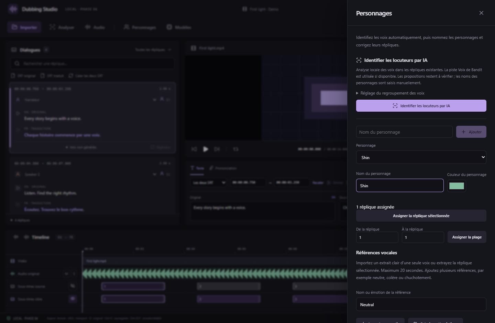

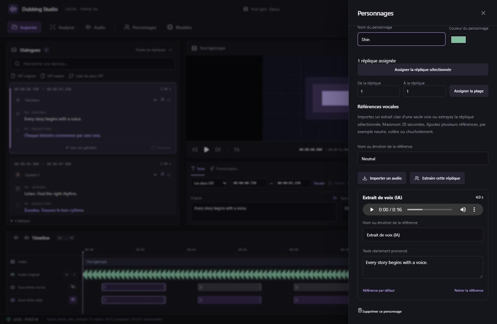

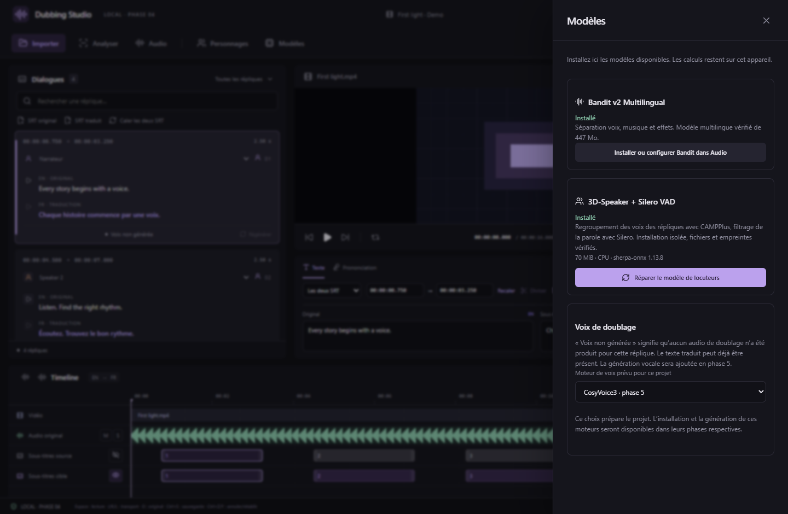

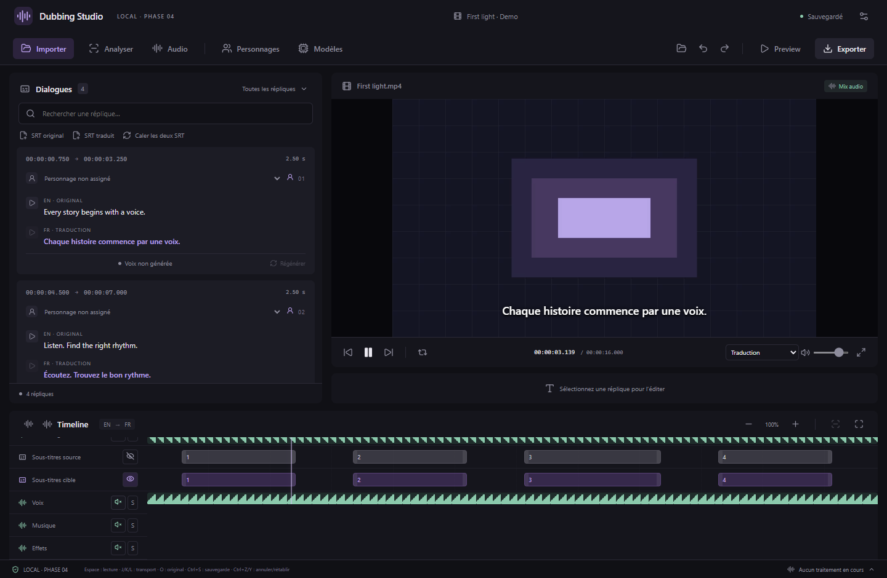

*Actual React UI in browser tests. The character/model/reference screenshots use simulated native results and a synthetic audio stream. Separate real Windows ONNX inference grouped two test voices and kept their repetitions together; it does not establish accuracy on real film soundtracks. Profile/reference preferences use project format 3; older app versions refuse that format.*

## First project

1. Launch the app, choose **Import**, and select a video.
2. Set the project name, source/target languages and audio stream.
3. Choose a parent folder. The desktop app creates `Name.dubproject` and copies the video.
4. Use **Original SRT** and/or **Translated SRT** in the dialogue column. Choose an external file or a text subtitle track detected in the video.
5. Select a dialogue, review the scene, and edit its subtitle or pronunciation text.
6. Reopen the `.dubproject` folder using **Open project**. Move or back up the entire folder to preserve its media.

Use **Explore the example** to try the bundled synthetic video. See the [user guide](docs/GETTING-STARTED.md) for shortcuts, recovery and troubleshooting.

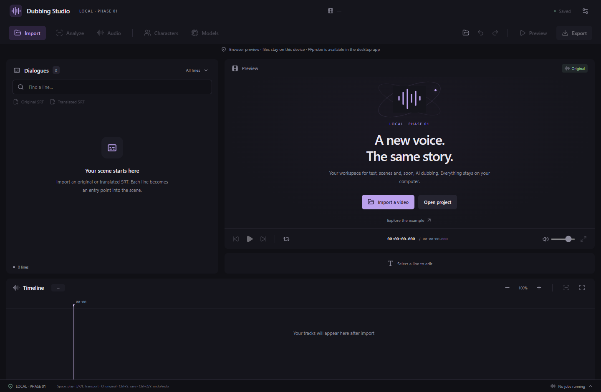

*Welcome screen captured in the French browser preview. Screenshots use the dark theme.*

## Local data

Media processing uses local FFmpeg/FFprobe processes. This version has no cloud provider, account system or telemetry implementation. Original input files are preserved; imported copies and proxies stay inside the project directory.

Projects use JSON, stable IDs, relative asset paths and integer millisecond timings. Existing format 1 projects open normally. Adding separated audio tracks upgrades that project to format 2; older app versions refuse format 2. The dubbing bus upgrades projects to format 6; formats 1–5 remain readable. Older versions reject format 6. Unknown formats are rejected without rewriting the file. Autosave uses atomic writes and recovery snapshots. Editing one project simultaneously in multiple app instances is not supported.

The browser preview uses IndexedDB to store projects and video blobs on the current device. It does not run FFprobe or create native portable project folders. Browser JSON export does not include the video blob. Diagnostics may contain local paths and FFmpeg arguments; review an exported report before sharing it.

## Development

Install Node.js 24, pnpm 11.25.0, Rust stable and the [Tauri prerequisites](https://v2.tauri.app/start/prerequisites/). Windows builds need MSVC build tools, a Windows SDK and WebView2.

```powershell
git clone https://github.com/jontechlabs/ai-dubbing-studio.git
cd ai-dubbing-studio
pnpm install --frozen-lockfile
powershell -NoProfile -File scripts/prepare-ffmpeg.ps1
powershell -NoProfile -File scripts/prepare-prosody.ps1
pnpm desktop
```

Large FFmpeg executables are excluded from Git. The preparation script verifies the pinned archive SHA-256 before copying them.

```powershell
pnpm desktop:build
powershell -NoProfile -File scripts/package-windows.ps1
```

The packaging script produces setup, portable ZIP and checksums in `artifacts/`. See [build instructions](docs/BUILDING.md) for preview, tests, packaging options and platform limits.

## Architecture

| Area | Responsibility |
| --- | --- |
| `src/components` | Player, dialogue list, text editor and timeline |
| `src/hooks` | Project state, serialized autosave, playback and shortcuts |
| `src/domain` | Project contracts, subtitle/time calculations and future provider interfaces |
| `src/services/bridge.ts` | Desktop IPC boundary and browser-preview adapter |
| `src-tauri/src` | Project storage/recovery, FFprobe, FFmpeg import/proxies, subtitles and jobs |
| `resources` / `schemas` | Toolchain pins and reserved model/worker contracts |

Processing commands use structured arguments rather than a shell. Project-relative paths are validated, and desktop media access is scoped to the opened project. Future provider contracts keep model runtimes outside the UI. `resources/models.json` contains the pinned Bandit model; no TTS model is integrated yet.

See [architecture and persistence](docs/ARCHITECTURE.md).

## Roadmap

| Phase | Scope | Status |
| --- | --- | --- |
| 1 | Desktop foundation, media import, persistence, subtitle review, simple timeline | Implemented; development preview |
| 2 | Waveforms, timecode editing, subtitle movement, split/merge, automatic SRT synchronization | Implemented; development preview |
| 3 | Bandit speech/music/SFX separation and audio track management | Implemented; CPU validated, CUDA unqualified |
| 4 | Characters, voice references, local AI speaker grouping and dialogue assignment | Implemented; proposals require review |
| 5 | First TTS provider, per-line generation, multiple takes and review | Implemented; CosyVoice3 CPU inference validated |
| 6 | Additional TTS providers and model manager | Implemented; Fish/Qwen GGUF and Fish FP8, RTX validation pending |
| 7 | Final mix export and MKV packaging | Implemented; simultaneous multi-target editing remains outside the current scope |

Local model installation/repair, storage migration, voice cloning and per-line speech generation are implemented. Synchronized mixing and MKV export are implemented. Placement, manual duration and mood settings use project format 7, readable with v0.7.3 or later. Simultaneous editing of several target languages remains to be integrated.

## Validation

The suites contain **49 TypeScript tests, 62 Rust/Linux tests (61 Windows), 49 Chrome scenarios and 25 Python worker tests**: 185 locally, 184 on Windows. The frontend build, ESLint, Prettier, Rust formatting and Clippy are also checked. Real Windows inference covers CosyVoice3, Qwen GGUF, Fish GGUF and a limited-token Fish FP8 core run on CPU. Browser scenarios simulate native IPC; actual RTX generation and the full native GUI workflow remain unqualified here. See [VALIDATION.md](VALIDATION.md) for evidence and limits.

The earlier [v0.1.1 clean Windows run](https://github.com/jontechlabs/ai-dubbing-studio/actions/runs/38362204358) passed its checks and packaging. Current runs are available under [Actions](https://github.com/jontechlabs/ai-dubbing-studio/actions).

Final Windows GUI validation remains pending following the local execution block on an earlier unsigned build. Linux/macOS GUI builds are not qualified. See [VALIDATION.md](VALIDATION.md) for the exact scope.

## Dependencies and licensing

Windows packages bundle the independent Gyan.dev FFmpeg/FFprobe 9.0.2 essentials programs under GPLv3. Their license is included as `binaries/FFMPEG-LICENSE.txt`. See [third-party notices](THIRD-PARTY-NOTICES.txt), the [upstream build description](docs/third-party/FFMPEG-BUILD.txt) and [Gyan build/source references](https://www.gyan.dev/ffmpeg/builds/). Dependencies retain their own licenses; resolved versions are in `pnpm-lock.yaml` and `Cargo.lock`.

Bandit model code is vendored unmodified from the official Apache-2.0 repository at a pinned revision; weights are downloaded from Zenodo under CC BY-SA 4.0 and are not bundled. The inference dependency lock is included.

No project-wide license has been selected. The synthetic example contains no third-party film, voice reference or model weights.
