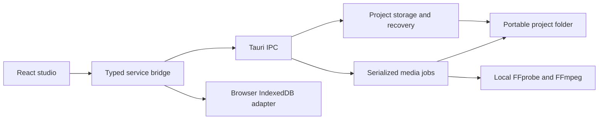

# Architecture and persistence

The React UI calls `src/services/bridge.ts`. In desktop mode, that adapter invokes Tauri Rust commands. In browser-preview mode, it uses IndexedDB and browser media playback. Components do not build FFmpeg command lines.



## Project structure

```text
Example.dubproject/
  project.json
  media/                 imported original copy
  cache/                 playback proxies and waveform peak caches
  recovery/
    previous.json        previous valid save
    pending.json         transient interrupted-save snapshot
```

`project.json` contains format/app versions, project ID and revision, timestamps, languages, media metadata, source/target cues and stable dialogue associations. Cue timings are integer milliseconds. Asset paths are relative and validated against traversal. Source/target cue documents and dialogues are separate so subtitle pairing can preserve their identities.

A dialogue has source and target cue references, a nullable independent `ttsText`, warnings, generation-selection IDs and a nullable character ID. Character/generation collections and provider interfaces reserve future functionality. They do not implement voice generation in Phase 3.

## Saving and recovery

Frontend edits are debounced and saves are serialized. Revision expectations protect the current session from stale updates. Rust validates the project, writes a recovery snapshot, and replaces `project.json` atomically. The previous valid file is retained in `recovery/previous.json`.

Loading checks the format and structure, considers a newer valid pending save for the same project, and can recover from the previous snapshot when required. Unknown format versions are refused without rewriting them. Undo/redo uses bounded in-memory snapshots and is not preserved between sessions. Cross-process locking is not implemented.

## Media jobs

An import request records the selected audio stream and project identity. A single-permit queue serializes media jobs. FFprobe discovers streams; FFmpeg prepares H.264/AAC stereo preview proxies where needed. Commands use structured arguments, a local file/pipe protocol whitelist, cancellation and subprocess cleanup.

The input is copied to a unique asset filename. Existing project assets are not overwritten by a failed import; incomplete outputs owned by the failed job are cleaned up. Job status, progress, logs and restart interruption records are stored in local app data. Retry creates a new attempt.

## Subtitles and playback

UTF-8 SRT parsing handles BOM, CRLF and multiline text. Automatic bilingual pairing only joins unique one-to-one timing matches within the tolerance; ambiguity remains separate and flagged. Later import reconciliation preserves dialogue IDs, TTS overrides and selected generations where associations remain identifiable.

Embedded text tracks are selected by global FFprobe stream index and extracted from the original project media, rather than the playback proxy. FFmpeg converts them into UTF-8 SRT. The serialized, cancellable extraction job validates the track, refuses bitmap streams, and uses the same subtitle persistence/reconciliation path as external SRT imports. It commits only after extraction and parsing succeed.

Video creation opens Processing after enqueueing import. The player distinguishes an unfinished media job from URL resolution/first-frame loading, buffering, and playback errors. A failed load ends its animation and offers proxy preparation.

The dialogue list is virtualized. The player uses the browser/WebView media element; cue selection drives seeking and the simple timeline. Playback state stays separate from persisted project edits. Looping uses configured padding and media duration bounds.

## Future engines

`src/domain/providers.ts` defines reserved provider capabilities, model metadata and TTS requests/results. `schemas/worker-protocol.schema.json` and `schemas/model-manifest.schema.json` are preliminary contracts. The model catalogue includes the pinned Bandit checkpoint. CosyVoice3, Fish S2 and Qwen3-TTS now have native installation and generation adapters; unintegrated catalogue variants remain future work. Their runtimes are described in the Phase 5–7 guides; Bandit has the dedicated runtime described below.

## Phase 2 timing and waveform

The timeline renders actual source/target cues rather than the shared dialogue bounds. Pointer edits are previewed in UI state and committed once on release. Timecode edits transform each selected role’s cue group proportionally; split divides text near a grapheme/whitespace boundary and marks review, while merge creates one cue per role with joined multiline text. Existing audio-generation assets remain in the project; their per-line selection is cleared when restructuring invalidates it.

`src/domain/alignment.ts` estimates an affine timing transform from sampled start/end differences, tests monotonic associations (one-to-one or one-to-up-to-three), and refines drift using independent matches. Search is limited to offsets within two minutes and candidate drift between −10% and +10%. At least three matched groups and 60% cue coverage are required; similar competing transforms are refused. These criteria measure timing evidence, not semantic certainty. The UI computes proposals in a Web Worker, shows examples and metrics, then applies only confirmed groups to the reference boundaries; unmatched timings remain untouched. Revision checks reject stale previews. Text/cue IDs and project generation assets are preserved; regrouped dialogue metadata is marked for review. TTS overrides are carried once when old groups are combined.

`src-tauri/src/waveform.rs` decodes the chosen original audio stream through FFmpeg into mono 8 kHz PCM. It preserves the common input timebase and inserts initial silence where needed. A streaming peak accumulator limits the cache to roughly 200,000 bins, with a minimum bin width of 20 ms. The key includes path, file size/modification time, stream and cache version. Processing is serialized with other media jobs but does not block project editing. Cancellation drops the subprocess; failed/partial computations do not become cache entries. The canvas draws only the visible viewport and normalizes display amplitude without changing stored peaks. Browser preview uses Web Audio instead of FFmpeg.

## Phase 3

The Bandit model implementation is vendored unchanged, with Apache-2.0 license and upstream revision. A Python adapter checks the model SHA-256, loads weights with `weights_only=True`, processes 8-second stereo windows as independent mono channels, and performs normalized overlap/add with bounded buffers. PCM16 48 kHz stereo outputs preserve channel placement and sample count. CPU and PyTorch CUDA devices are supported; AMD/Intel rendering support does not imply CUDA inference support.

Rust downloads verified Python/pip/model artifacts into application data, installs pinned inference dependencies separately from the system Python, orchestrates extraction and the worker, and commits three validated WAVs only on success. Pause/resume travels through worker stdin and takes effect between inference windows. Cancellation kills the worker and discards that attempt’s outputs; failed attempts preserve existing tracks. Retry records include project/media/stream/device identity. Results retain provenance and prior files. Jobs cannot commit to a replaced media/project. Frontend pending edits are rebased over job results so last unsaved keystrokes and gains survive.

Format 1 remains supported. A project gains format 2 when audio track asset references are added; old applications reject it. Paths remain project-relative and validated. A Web Audio graph controls track/master gain and synchronizes stem elements with the video. Display-only timeline data is memoized and uses cue/dialogue maps; the playhead moves through a compositor transform rather than regenerating all cue blocks. Subtitle overlay lookup uses an interval index.

Windows rendering preference is scoped to the current application executable in UserGpuPreferences, preserving unrelated fields. The effective WebView2/decoder adapter remains controlled by Windows and drivers. The UI links to Windows graphics settings and distinguishes renderer preference from Python CUDA device choice.

Tauri’s updater uses an embedded public key and HTTPS static manifest. It verifies artifact signatures before exposing installation, flushes project edits, and restarts through the NSIS updater. The signing private key is kept outside Git and provided to release builds through an Actions secret. It is separate from Windows Authenticode signing.


## Phase 7 playback and MKV

Project format 6 introduces a virtual `dubbing` bus, persisted only on first edit. Older project formats still load. Selected takes match dialogue, target language and imported source, and are placed at the current dialogue start with natural duration, clipped only to the video's end. The Web Audio bus lazily decodes nearby WAVs, bounds its retained cache, schedules sources against the video clock and corrects drift. Pause, seeking, rate changes and edits stop/recreate affected sources. Gains and region boundaries are scheduled on AudioParams. Original audition temporarily overrides monitoring without changing saved mixer state.

The MKV job captures the saved project and persists its retry identity. Rust assembles 24 kHz mono float voices in bounded chunks, opening only active takes. FFmpeg then resamples/mixes the small set of buses at 48 kHz stereo, applies sample-based region expressions and clips peaks. A filter script avoids shell quoting and command-line length limits. Muted and non-solo buses are omitted. The original video is stream-copied, the mix is AAC/FLAC, and optional original audio is stream-copied with project SRT tracks. Language tags, chapters and metadata are mapped explicitly. Temporary files live beside the destination; only successful, probed output is atomically published. Cancellation kills and waits for FFmpeg. Export never uses the playback proxy or monitor gain.

CosyVoice's vendored constructor uses `os.path.join` for model assets instead of slash concatenation, preserving Windows extended paths. A constructor regression checks all inference file paths without Torch; separate real Windows inference validates the model end to end.


## Local voice edits (v0.14.0)

Project format 11 adds `voiceEdits`, keyed by immutable TTS generation ID. Ordered pieces map original mono 24 kHz WAV intervals to output durations and absolute gains; null source endpoints represent silence. Splitting maps output coordinates back to the original source, so deleting or stretching one region preserves the remainder. Validation bounds durations, source ranges, finite gains, IDs and segment counts. Frontend and native load validation agree; generation deletion removes its edit plan.

The timeline editor materializes the current fitted duration before local editing, supports range/point selection and per-gesture history, and refuses expansions crossing the next take or media boundary. Rebase carries local edits through background generation commits. Equal-length gain changes invalidate decoded audio by including the full plan in its key. A retouched lip video additionally records the audio edit key; changes disable existing lip variants and invalidate native signatures without breaking historical unedited signatures.

`voice_edit::render` derives a content-keyed WAV under the project cache from a native-owned generation path. FFmpeg trims source intervals, uses Rubber Band for changed tempos with pitch fixed at one, applies volume and short boundary ramps, creates exact silence, and concatenates exact sample counts. Filter scripts avoid Windows command-length limits. Concurrency, process lifetime, diagnostic tails, timeouts, source/output checks and cancellation are bounded. A cancelled render is not published. The original WAV is immutable. Playback, take audition, WAV download, lip analysis/retouching and MKV assembly share the renderer; video/MKV subsequently use the existing slot fitter.
