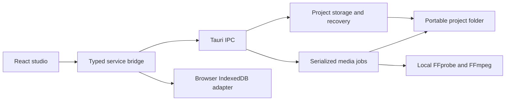

# Architecture and persistence

The React UI calls `src/services/bridge.ts`. In desktop mode, that adapter invokes Tauri Rust commands. In browser-preview mode, it uses IndexedDB and browser media playback. Components do not build FFmpeg command lines.



## Project structure

```text
Example.dubproject/
  project.json
  media/                 imported original copy
  cache/                 playback proxies
  recovery/
    previous.json        previous valid save
    pending.json         transient interrupted-save snapshot
```

`project.json` contains format/app versions, project ID and revision, timestamps, languages, media metadata, source/target cues and stable dialogue associations. Cue timings are integer milliseconds. Asset paths are relative and validated against traversal. Source/target cue documents and dialogues are separate so subtitle pairing can preserve their identities.

A dialogue has source and target cue references, a nullable independent `ttsText`, warnings, generation-selection IDs and a nullable character ID. Character/generation collections and provider interfaces reserve future functionality. They do not implement AI generation in Phase 1.

## Saving and recovery

Frontend edits are debounced and saves are serialized. Revision expectations protect the current session from stale updates. Rust validates the project, writes a recovery snapshot, and replaces `project.json` atomically. The previous valid file is retained in `recovery/previous.json`.

Loading checks the format and structure, considers a newer valid pending save for the same project, and can recover from the previous snapshot when required. Unknown format versions are refused without rewriting them. Undo/redo uses bounded in-memory snapshots and is not preserved between sessions. Cross-process locking is not implemented.

## Media jobs

An import request records the selected audio stream and project identity. A single-permit queue serializes media jobs. FFprobe discovers streams; FFmpeg prepares H.264/AAC stereo preview proxies where needed. Commands use structured arguments, a local file/pipe protocol whitelist, cancellation and subprocess cleanup.

The input is copied to a unique asset filename. Existing project assets are not overwritten by a failed import; incomplete outputs owned by the failed job are cleaned up. Job status, progress, logs and restart interruption records are stored in local app data. Retry creates a new attempt.

## Subtitles and playback

UTF-8 SRT parsing handles BOM, CRLF and multiline text. Automatic bilingual pairing only joins unique one-to-one timing matches within the tolerance; ambiguity remains separate and flagged. Later import reconciliation preserves dialogue IDs, TTS overrides and selected generations where associations remain identifiable.

Embedded text tracks are selected by global FFprobe stream index and extracted from the original project media, rather than the playback proxy. FFmpeg converts them into UTF-8 SRT. The serialized, cancellable extraction job validates the track, refuses bitmap streams, and uses the same subtitle persistence/reconciliation path as external SRT imports. It commits only after extraction and parsing succeed.

Video creation opens Processing after enqueueing import. The player distinguishes an unfinished media job from URL resolution/first-frame loading, buffering, and playback errors. A failed load ends its animation and offers proxy preparation.

The dialogue list is virtualized. The player uses the browser/WebView media element; cue selection drives seeking and the simple timeline. Playback state stays separate from persisted project edits. Looping uses configured padding and media duration bounds.

## Future engines

`src/domain/providers.ts` defines reserved provider capabilities, model metadata and TTS requests/results. `schemas/worker-protocol.schema.json` and `schemas/model-manifest.schema.json` are preliminary contracts. The initial model catalogue is empty. Future workers, installers, hardware backends and model runtimes are not present in this release.
