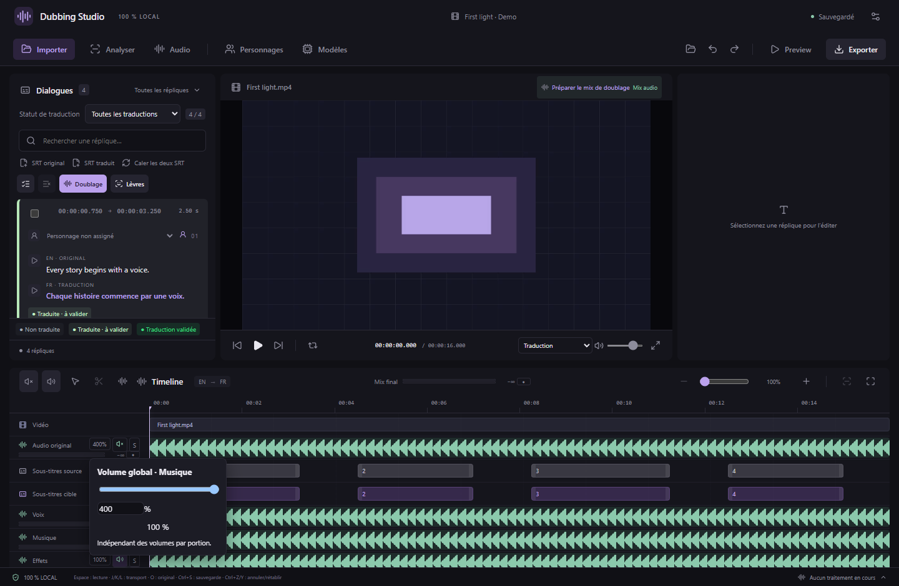
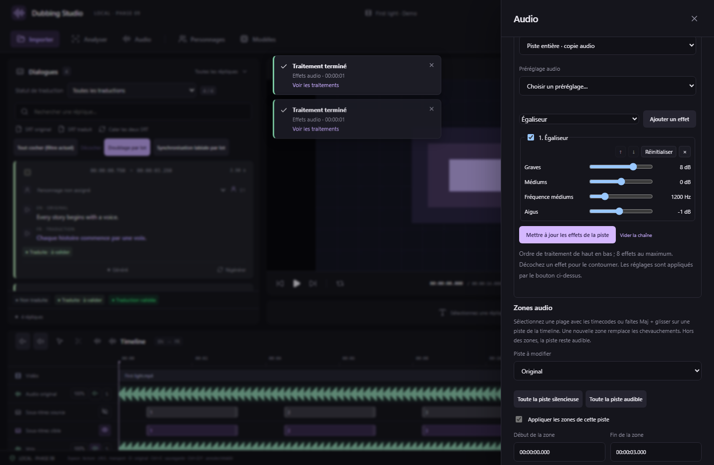
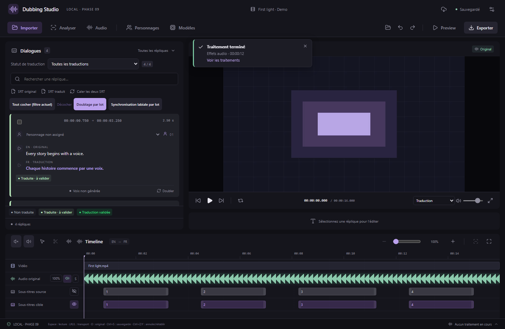

# Effets audio, volume global et notifications — v0.26.0

Les effets fonctionnent entièrement en local avec FFmpeg livré avec le studio, sans modèle IA supplémentaire. Ils sont disponibles sur les répliques de doublage et les pistes audio.

## Régler toute une piste

Cliquez sur le pourcentage à côté de M/S dans l’en-tête de la piste. Le curseur et la saisie numérique règlent son volume global de **0 à 400 %** ; **100 %** restaure le niveau initial. Le panneau **Audio** fournit aussi ce réglage. Il s’applique pendant la lecture et à l’export, se sauvegarde et accepte Ctrl+Z/Ctrl+Y.

Ce volume multiplie les réglages des portions : une piste à 200 % avec une zone à 50 % restitue le niveau initial dans cette zone. Une zone muette et une piste coupée restent silencieuses. Le volume des portions garde sa plage de 0 à 200 %. Amplifier une source déjà forte peut saturer le mix ; réduisez le gain ou utilisez le compresseur/limiteur.

## Effets sur une réplique

1. Double-cliquez sur le bloc de doublage pour ouvrir son édition.
2. Sélectionnez une portion dans la forme d’onde. Sans portion sélectionnée, toute la réplique est traitée.
3. Déployez **Effets audio**, choisissez un préréglage ou ajoutez des effets, puis réglez leurs paramètres.
4. **Écouter avec ces effets** prévisualise sans modifier le projet. **Appliquer les effets au doublage** rend et vérifie l’audio avant de valider le montage.

Chaque portion possède une chaîne de huit effets au maximum, traités de haut en bas. Les flèches changent l’ordre, les cases permettent le contournement et les boutons permettent de retirer ou réinitialiser les effets. Modifier la chaîne **remplace** celle de la zone : changer un pitch de +4 à −3 demi-tons donne −3, sans accumuler les deux réglages. **Vider la chaîne**, puis appliquer, enlève les effets de la portion.

Le WAV original et les essais précédents restent conservés. Les effets suivent le montage, les fondus et les volumes locaux, avec annulation/rétablissement. L’écoute synchronisée, les exports WAV et MKV utilisent le rendu. La forme d’onde du petit éditeur représente toujours l’audio source. Les effets gardent la durée du montage ; les queues d’écho/réverbération sont limitées à la fin de la portion. Élargissez la portion dans une zone de silence si vous souhaitez entendre une queue plus longue, dans les limites habituelles de durée et de chevauchement.

## Effets sur les pistes

Dans **Audio → Effets audio**, choisissez la piste et l’étendue :

- **Piste entière** crée une copie audio indépendante, nommée `… · FX`. L’option cochée par défaut active cette copie et coupe la source dans le mix. Si vous la décochez, la copie est initialement coupée pour éviter de doubler le son.
- **Portion de la piste** traite un intervalle de 10 ms à 120 secondes et ajoute une couche qui remplace seulement ce passage. Pour traiter une portion de la piste virtuelle Doublage, utilisez l’éditeur de la réplique ; la copie entière de cette piste est aussi possible.

Les volumes globaux et locaux restent indépendants des effets et ne sont pas appliqués deux fois. Une copie garde les réglages de volume et les zones de la piste d’origine. Le rendu entier comprend les couches audio présentes au moment de sa création. Il s’agit d’une copie figée : changer ensuite les répliques sources ne régénère pas automatiquement cette copie.

**Préparer le mix de doublage** coupe aussi les copies avec effets de la voix source à remplacer. Une copie traitée du doublage déjà active garde le doublage sec coupé ; une copie volontairement coupée reste coupée.

Pour modifier les effets, choisissez la copie `… · FX` dans ce même panneau, puis **Mettre à jour les effets de la piste**. Les réglages repartent du WAV sec conservé ; ils ne s’accumulent pas à chaque rendu. Une portion déjà traitée réutilise aussi sa référence sèche si aucune couche ajoutée ensuite ne recouvre cet intervalle. Une nouvelle couche recouvrante demande un nouveau traitement de l’état courant.

Le bouton × de la copie dans le mixeur la retire du projet et restaure l’état muet initial de sa source. Une copie servant de source à une autre copie ne peut pas être retirée avant sa dérivée. Ctrl+Z restaure le résultat ; les fichiers conservés pour l’historique ne sont pas effacés. Une portion traitée peut être retirée comme les autres transferts audio.

Le traitement demande de la place dans le dossier du projet : environ **384 ko par seconde** pour le premier rendu stéréo 48 kHz, plus une marge de 32 Mio (WAV sec et résultat). L’espace est vérifié avant le démarrage sous Windows. Les rendus précédents sont conservés pour l’annulation. Une piste dépassant la capacité du WAV RIFF standard est refusée avant traitement. L’annulation et une révision devenue obsolète n’ajoutent aucune piste partielle au projet.

## Effets et préréglages

| Usage | Effets |
| --- | --- |
| Timbre | Égaliseur graves/médiums/aigus, pitch ±12 demi-tons avec option de conservation des formants, passe-haut, passe-bas |
| Dynamique et nettoyage | Compression, limiteur, porte de bruit, normalisation dynamique, réduction de bruit, de-esser |
| Espace | Écho, réverbération légère à plusieurs retards |
| Transformation | Saturation, distorsion, robot par modulation, chorus, flanger, phaser, trémolo, vibrato |

Douze préréglages donnent un point de départ : voix nettoyée, chaleureuse, présence, téléphone, radio, mégaphone, petite pièce, grotte/souvenir, robot, créature grave, voix aiguë et voix éthérée. La réverbération proposée est une ambiance légère à retards multiples, sans convolution ni chargement d’impulsion acoustique. Le pitch modifie la hauteur sans changer la durée ; il ne réalise pas de clonage de timbre.

Les paramètres sont bornés et vérifiés côté interface et moteur natif. Seuls les effets du [catalogue livré](../resources/audio-effects.json) sont acceptés ; aucune commande FFmpeg libre n’est exécutée. Les algorithmes utilisés sont décrits dans la [documentation officielle des filtres FFmpeg](https://ffmpeg.org/ffmpeg-filters.html).

## Notifications des traitements

Une petite notification apparaît au démarrage (~2,8 s), puis à la fin (~5,5 s), y compris en cas d’échec ou d’annulation. Elle indique le type de tâche et sa durée finale lorsqu’elle est connue. Les changements de progression n’en produisent pas d’autres ; trois notifications au maximum sont affichées. Le survol ou le focus suspend la disparition. La croix ferme immédiatement ; **Voir les traitements** ouvre le journal. L’historique restauré au lancement n’est pas annoncé à nouveau.

Captures de l’interface réelle avec média synthétique et commandes natives simulées ; le rendu audio, la conservation des sources et l’export sont vérifiés séparément avec FFmpeg et le studio Windows empaqueté.

## Projets et MCP

Les effets et les gains supérieurs à 200 % utilisent le **format de projet 18**. Les anciennes versions du studio refusent ce format. Les projets antérieurs restent lisibles ; enregistrer un réglage ne produit pas de nouveau doublage IA.

Les 99 outils MCP incluent `studio_audio_effects_catalog`, `studio_apply_audio_effects`, l’opération `effects` de `studio_edit_voice` et le gain 0–4 de `studio_set_track`. Les traitements de piste renvoient un identifiant de tâche et contrôlent la révision du projet au démarrage et à la publication du résultat.
