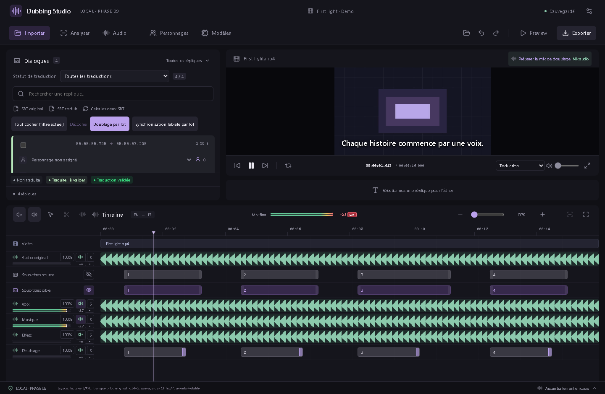
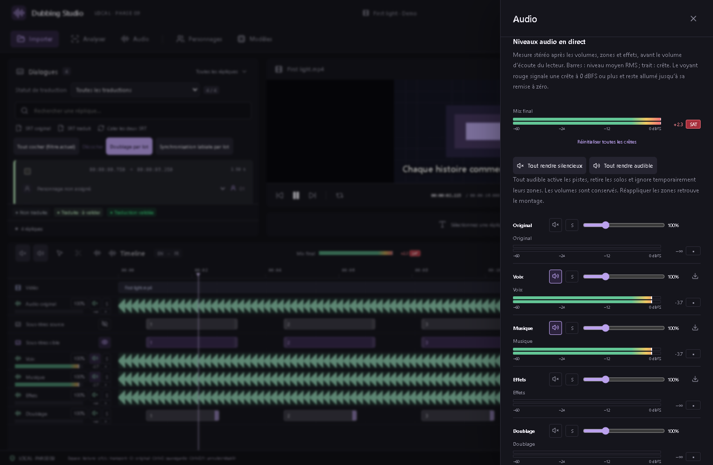

# Niveaux audio et saturation — v0.27.0

Les niveaux se mesurent **pendant la lecture de la timeline**, pour chaque piste et pour le **Mix final**. Aucun modèle IA, téléchargement ou équipement supplémentaire n’est requis.

## Dans la timeline

Sous le nom de chaque piste audio, deux petites barres représentent les canaux gauche et droit. Le mix final reste visible dans l’en-tête de la timeline, même quand une piste est hors de la zone affichée.

- Les barres indiquent le niveau moyen **RMS** ; le trait blanc indique la **crête**.
- La valeur numérique est la crête la plus forte des deux canaux, en **dBFS**. `−∞` indique le silence mesuré sous −96 dBFS. Les barres couvrent −60 à 0 dBFS ; les valeurs positives restent lisibles numériquement.
- Le voyant rouge **SAT** s’allume si un échantillon atteint ou dépasse 0 dBFS. Il reste allumé après le passage fort, une pause ou un déplacement de lecture, pour ne pas manquer un dépassement bref.
- Cliquez sur ce voyant pour remettre à zéro la crête maximale et la saturation de cette piste. Pendant un son qui dépasse toujours la limite, le voyant se rallume au relevé suivant. La remise à zéro ne modifie aucun volume.

## Dans le panneau Audio

La section **Niveaux audio en direct** affiche le mix final avec une échelle plus grande. Chaque piste du mixeur dispose aussi de sa mesure stéréo, sous ses réglages de volume. Le bouton **Réinitialiser toutes les crêtes** efface tous les maxima et voyants de la session.

Le survol des barres affiche la crête actuelle et le maximum enregistré depuis la dernière remise à zéro. Le bouton du voyant affiche aussi ce maximum. Les couleurs restent complétées par les valeurs et le texte SAT ; les canaux et boutons ont des noms accessibles.

## Ce qui est mesuré

La mesure prend le signal réellement lu, **après les volumes globaux, les zones, les fondus et les effets déjà rendus**. Elle inclut les portions transférées ou traitées, les copies avec effets et les essais de doublage sélectionnés. Les boutons muet/solo et les zones silencieuses agissent aussi sur les niveaux. Les transferts sont comptés sur leur piste de destination.

Le mix est la somme stéréo de ces pistes, avant l’écrêtage appliqué lors de l’export. Une piste peut rester sous 0 dBFS alors que leur addition dépasse cette limite : vérifiez donc aussi le mix final. Baissez les volumes concernés ou utilisez les effets de compression/limitation si nécessaire.

Le volume d’écoute du lecteur vient **après** cette mesure. Vous pouvez écouter doucement, voire couper l’écoute, sans masquer un mix trop fort à l’export. Le mode d’écoute temporaire **Original** mesure uniquement la source entendue dans ce mode ; revenez à la lecture du mix pour régler votre export.

La mesure ne concerne pas les écoutes WAV indépendantes des essais, ni les préécoutes d’effets hors timeline. Les indicateurs reviennent au silence à la pause, pendant une recherche de position ou une attente de données ; les maxima et voyants restent disponibles. Un nouveau média/projet ou la fermeture du studio remet la session à zéro. Ces données ne sont pas enregistrées dans le projet et ne remplissent pas l’historique d’annulation.

## Précision et fonctionnement local

Les crêtes sont analysées sur chaque bloc audio avec un [AudioWorklet](https://www.w3.org/TR/webaudio/#AudioWorklet), puis l’affichage est actualisé environ vingt fois par seconde. Les canaux sont mesurés séparément : une opposition de phase gauche/droite ne peut pas masquer leur niveau. Le travail ne s’effectue pas dans la boucle de dessin vidéo. Les mesures sont des **crêtes d’échantillons et RMS**, sans mesure LUFS ni suréchantillonnage true peak. Elles ne détectent pas rétroactivement une distorsion déjà présente dans un fichier source.

Les sondes sont branchées en parallèle ; elles ne changent pas le signal écouté ou exporté. Aucun échantillon audio n’est envoyé hors de l’application. Si le module de mesure est indisponible, la valeur affiche `—` et son infobulle l’indique ; les contrôles et la lecture continuent de fonctionner.

## MCP

Le catalogue comprend désormais **100 outils**. `studio_audio_levels` lit les niveaux avec `action: "status"`, ou efface les maxima/voyants avec `action: "reset"`. Un `id` limite la remise à zéro à une piste ; `$mix` désigne le mix final. Sans `id`, tous les indicateurs sont remis à zéro. La réponse contient l’état de mesure, l’état de lecture, l’heure du dernier relevé et, pour chaque canal, `peakDb`, `rmsDb` et `maxDb`, plus le voyant `clipped` de chaque piste. Les silences utilisent le plancher fini −96 dBFS, compatible JSON.

`studio_get_state.audioLevels` expose aussi ces valeurs. Il n’y a pas de modification du projet ni de régénération vocale. Les projets restent au format 18.

Les captures montrent l’interface réelle avec des signaux synthétiques et des commandes natives simulées. Les tests de l’application Windows empaquetée vérifient séparément le chargement du module et les mesures du véritable circuit audio via le SDK MCP officiel.
