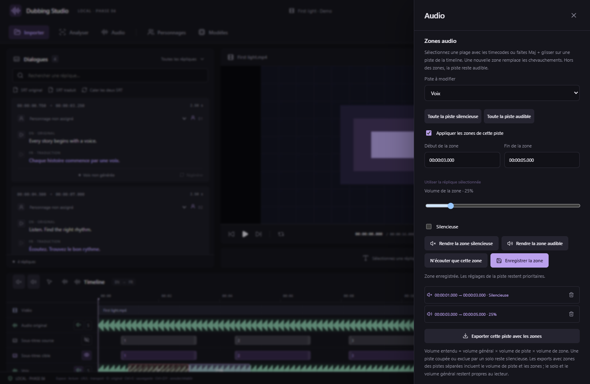

# Zones audio et volumes

## Volume directement dans la timeline — v0.10.1

1. Activez **Sélectionner une zone audio**, puis faites glisser sur la portion d’Audio original, Voix, Musique, Effets ou Doublage. Maj + glisser reste disponible sur les pistes sources ; sur un bloc de doublage, Maj conserve l’aimantation du déplacement : utilisez le bouton de sélection pour y tracer une portion.
2. Le cadre de sélection reste visible et la barre de réglages apparaît dans la timeline, sans ouvrir Audio.
3. Déplacez **Volume de la sélection** de 0 à 200 %. Le changement est immédiat et sauvegardé automatiquement. Un déplacement du curseur rend la portion audible à ce niveau ; les boutons de piste et le volume général restent prioritaires.
4. **Rendre la zone silencieuse/audible** coupe ou rétablit la portion. **100 %** rétablit son volume normal et la rend audible. Cela ne réactive pas une piste coupée.
5. Un clic sur une zone existante rappelle ses réglages. **Ctrl+Z / Ctrl+Y** permettent d’annuler/rétablir. **Effacer la sélection audio** ferme les contrôles sans retirer le réglage enregistré.
6. **Options audio** ouvre explicitement l’éditeur détaillé avec la même sélection : timecodes exacts, isolation, transferts et suppression des zones.

Les zones ne modifient pas les fichiers source. Une nouvelle sélection remplace seulement la partie commune des anciennes zones et conserve leurs portions extérieures. Les niveaux sont réutilisés à la lecture, après un saut temporel et dans le mix exporté.

Capture React réelle avec vidéo synthétique et inventaire natif simulé. Un test distinct mesure le son réellement produit dans le navigateur lors des changements de volume, de la mise en silence et d’un saut hors de la sélection.

## Couper ou entendre certaines portions

1. Ouvrez **Audio → Zones audio** et choisissez la piste : original, voix, musique ou effets.
2. Entrez **Début de la zone** et **Fin de la zone**, au format `00:00:03.000`. Vous pouvez aussi utiliser la réplique sélectionnée.
3. Cliquez sur **Rendre la zone silencieuse** ou **Rendre la zone audible**. Pour changer son niveau, réglez **Volume de la zone**, puis **Enregistrer la zone**.

Une autre méthode consiste à faire **Maj + glisser** sur une piste audio source de la timeline. Le bouton **Sélectionner une zone audio** permet le même geste sans maintenir Maj, y compris sur Doublage. Depuis v0.10.1, la barre de réglages s’affiche directement dans la timeline ; **Options audio** ouvre le panneau détaillé avec les timecodes de la sélection. Cliquez sur une zone existante dans la timeline ou dans la liste du panneau pour la modifier.

Les zones silencieuses sont hachurées ; les zones audibles portent leur pourcentage. Les fichiers source restent inchangés. Les zones et leurs volumes sont sauvegardés avec le projet et peuvent être annulés/rétablis avec **Ctrl+Z / Ctrl+Y**.

Hors des zones, une piste activée reste audible à son volume normal. **N’écouter que cette zone** remplace les zones de la piste choisie par du silence avant/après la sélection et une zone audible à l’intérieur ; les autres pistes gardent leurs réglages.

Capture de l’interface React en navigateur, avec pistes natives simulées et audio de démonstration synthétique.

## Tout couper ou tout réactiver

Les commandes **Tout rendre silencieux** et **Tout rendre audible** sont disponibles dans le mixeur Audio et dans la barre de la timeline. Les variantes **Toute la piste silencieuse/audible** ne concernent que la piste choisie dans l’éditeur.

- **Tout rendre silencieux** coupe les pistes audio actuellement présentes et retire leurs solos.
- **Tout rendre audible** active ces pistes, retire les solos et ignore temporairement les zones. Les volumes et les zones enregistrées sont conservés.
- **Réappliquer les zones** remet le montage en service. Le bouton ne change pas les états des haut-parleurs ; une piste coupée reste coupée. La case **Appliquer les zones de cette piste** règle ce comportement piste par piste.

Une nouvelle zone enregistrée réactive les zones de sa piste. Modifier une zone ne réactive pas automatiquement une piste coupée. Après une séparation Bandit, l’original est normalement coupé ; **Tout rendre audible** le réactive aussi. Coupez à nouveau l’original pour écouter uniquement les pistes séparées.

## Volumes indépendants

Les curseurs du mixeur règlent chaque piste de **0 à 200 %**. Chaque zone possède également son niveau de **0 à 200 %**. Le volume du lecteur sert de niveau général :

`niveau entendu = niveau général × niveau de piste × niveau de zone`

Par exemple, un niveau général de 80 %, une piste à 50 % et une zone à 25 % donnent 10 % du signal source. Une zone silencieuse, une piste coupée ou exclue par un solo ne produit pas de son. Les commandes rapides conservent ces niveaux : un curseur à zéro reste silencieux. L’amplification de plusieurs niveaux peut saturer le signal ; réduisez les volumes si nécessaire.

Les timecodes s’appliquent à la lecture, aux sauts et à la vitesse de lecture. Une zone doit rester dans la durée de sa piste. Les zones d’une même piste ne se chevauchent pas : peindre une nouvelle plage remplace la partie commune et conserve les morceaux situés à gauche et à droite.

## Exporter une piste séparée avec les zones

Dans Zones audio, **Exporter cette piste avec les zones** crée un WAV de la piste Voix/Musique/Effets choisie. Il conserve la durée et applique le volume de piste, son état coupé et les zones activées. Le volume général et les solos concernent uniquement le lecteur. Les parties coupées restent présentes sous forme de silence, pour garder la synchronisation.

Le traitement affiche progression et annulation dans **Traitements**. L’export utilise les réglages au moment du lancement ; les modifications ultérieures restent dans le projet. Une annulation conserve un éventuel export précédent. L’icône d’export du mixeur reste un **export du WAV source**, sans ces réglages.

Cet export concerne les pistes PCM stéréo 48 kHz produites par Bandit. L’original vidéo est éditable à l’écoute ; le rendu complet du mix, l’original et le conteneur MKV restent prévus en phase 7.

## Compatibilité du projet

Les zones utilisent le **format de projet 4**. Le studio ouvre toujours les formats 1 à 3. Les versions 0.4.1 et antérieures refusent les projets de format 4 pour éviter de perdre leurs zones. Les réglages de sous-titres, personnages et modèles conservent le nouveau format. Remplacer la vidéo réinitialise les zones de sa piste originale ; préparer un proxy du même média les conserve.

Depuis v0.16.0, un **clic droit → Supprimer la zone** retire une zone de volume/silence directement sur la timeline, avec annulation. [Guide des menus contextuels](CONTEXT-MENUS.md).
