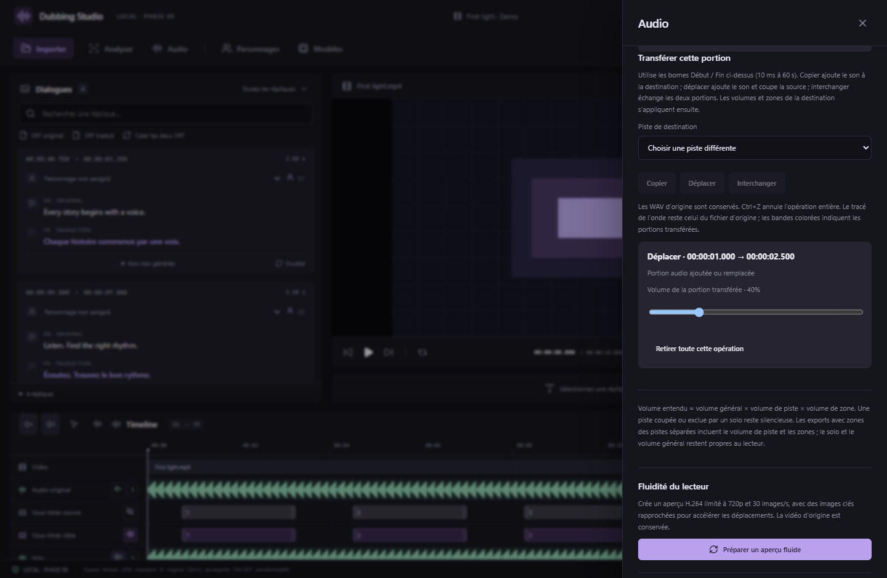

# Pistes de référence, mix et transferts — v0.9.0

Dans **Audio**, les deux sélecteurs sont indépendants :

- **Piste de référence vocale** : son extrait pour une nouvelle référence de personnage et pour le mode « Audio de la réplique actuelle ». Par défaut : **Voix**, sinon **Audio original**. Le panneau Doublage peut remplacer ce choix pour une réplique.
- **Piste à remplacer dans le mix de doublage** : piste coupée lorsque vous cliquez **Préparer le mix de doublage**. Par défaut : Voix. L’audio original est également coupé pour éviter de rejouer toute la bande-son. Les autres pistes séparées sont activées. Ces boutons changent le mix explicitement ; changer le sélecteur seul ne coupe aucune piste.

Une référence déjà enregistrée dans un personnage conserve son WAV. Changer le sélecteur n’en réextrait pas le contenu : créez une nouvelle référence si nécessaire. Une piste devenue indisponible doit être choisie à nouveau. La référence inclut les transferts et les zones de la piste, avant son volume général, mute et solo ; un son coupé par une zone ou un déplacement ne revient pas dans l’extrait.

## Copier, déplacer, interchanger

1. Ouvrez **Audio** ou sélectionnez une zone audio sur la timeline. Dans **Piste à modifier**, choisissez celle contenant le son mal séparé.
2. Réglez **Début / Fin de la zone**, ou utilisez les bornes de la réplique. Durée : **10 ms à 60 secondes** par opération.
3. Dans **Transférer cette portion**, choisissez une autre piste. Les pistes Original, Voix, Musique et Effets disponibles sont utilisables ; les prises de doublage gardent leurs propres commandes de placement et d’étirement.
4. Cliquez **Copier**, **Déplacer** ou **Interchanger**. Suivez le traitement dans Traitements ; annulation et relance sont disponibles.

| Action | Piste source | Piste destination |
| --- | --- | --- |
| Copier | Inchangée | Le son copié s’ajoute au contenu existant |
| Déplacer | Portion rendue silencieuse | Le son déplacé s’ajoute au contenu existant |
| Interchanger | Reçoit la portion de la destination | Reçoit la portion de la source ; les deux anciens contenus sont remplacés |

Les deux portions d’un échange sont capturées avant toute modification. Un transfert suivant utilise le contenu déjà monté, avec ses opérations et zones précédentes. Si vous souhaitez garder les deux contenus sur la destination, utilisez **Copier** ou **Déplacer**. Interchanger conserve chacun des deux sons sur l’autre piste.

Les pistes source restent intactes sur disque. Le projet conserve de petits WAV stéréo PCM16/48 kHz pour les portions ajoutées et des coupes non destructives. Les volumes de destination et leurs zones s’appliquent après le transfert ; le gain/mute/solo de la source ne sont pas « cuits » dans le WAV copié. Les zones de source, elles, font partie du contenu capturé. Une addition ultérieure peut remplir une portion précédemment coupée ; un remplacement ultérieur coupe les couches antérieures dans son intervalle.

## Corriger et écouter

Chaque portion reçue possède **Volume de la portion transférée** (0–200 %), indépendant du volume de la piste et des zones. **Retirer toute cette opération** enlève ensemble les deux côtés d’un déplacement ou d’un échange. **Ctrl+Z / Ctrl+Y** annulent/rétablissent l’opération entière pendant la session. Les WAV conservés permettent cette annulation.

Capture de l’interface React/Chrome, avec médias synthétiques et opérations natives simulées. Les tests natifs distincts vérifient les niveaux réellement rendus par FFmpeg.

Les bandes en bas des pistes indiquent les transferts : bleu pour le contenu reçu, rouge pour une coupe. Un clic rouvre ses bornes dans Audio. **La forme d’onde reste celle du WAV d’origine**, pas le résultat composite. Lecture, nouvelle référence vocale, export WAV avec montage et export MKV utilisent les couches modifiées. Le solo et le volume d’écoute restent propres au lecteur ; les exports WAV appliquent le volume, mute et zones de la piste.

Limites : 128 couches stockées ; l’aperçu décode au plus 8 portions proches et 128 Mio de son, afin de borner la mémoire. Réduisez les couches superposées si cette limite est atteinte. Le format de projet passe à **8** : utilisez v0.9 ou ultérieure pour le rouvrir. Les anciens projets restent lisibles. Ce montage corrige une séparation existante ; il ne relance pas Bandit et ne garantit pas l’isolation d’une voix mélangée à la musique.
