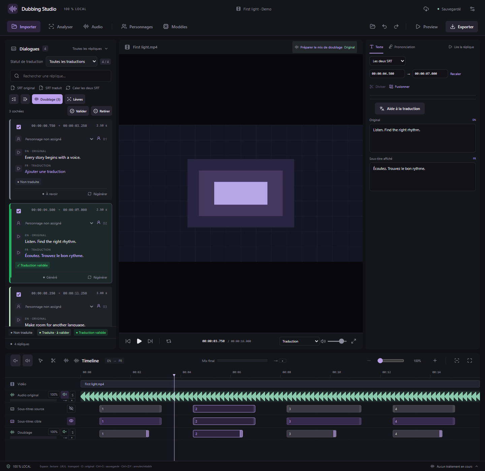
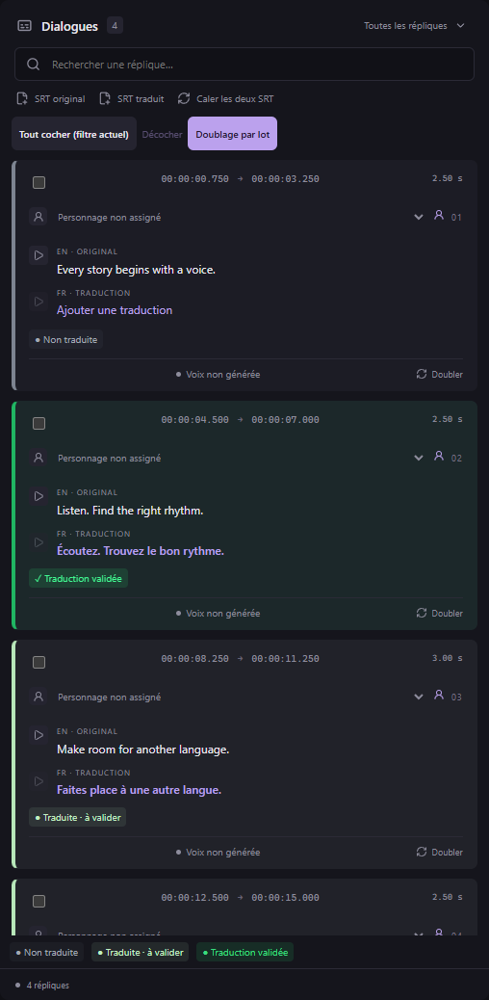

# Modèle conservé pendant le lot et validation des traductions — v0.12.0

## Conserver le modèle pendant le doublage par lot

Le bouton **Doublage par lot** conserve désormais le moteur chargé entre les répliques. La configuration du lot reste commune ; le texte, la référence vocale, la transcription et la graine de chaque demande sont transmis séparément. Les répliques sont traitées une par une.

- **CosyVoice3** : une seule vérification des poids et un seul chargement. Le même modèle sert les répliques suivantes. Le profil CUDA compatible, s’il devient nécessaire, reste utilisé sur le même périphérique pour la suite du lot.
- **Fish S2 FP8** : réutilisation du modèle, de son thread d’inférence et du codec. Les références changent selon les répliques sans accumuler un cache illimité de références.
- **Drama 3 FP8, experts en RAM** : conservation des poids mappés en RAM et des objets du modèle et du codec. Le gestionnaire Comfy peut déplacer des couches entre RAM et GPU pendant l’encodage ou le décodage pour respecter la mémoire disponible. Le cache GPU des experts reste plafonné à 4 Gio et est reconstruit par génération selon le fonctionnement du moteur. Le fichier de poids n’est plus relu ni revérifié intégralement pour chaque réplique.
- **Fish S2 et Qwen3-TTS GGUF** : un serveur audio.cpp privé, limité à un modèle et à l’interface locale `127.0.0.1`, conserve le modèle et sa session. Le serveur n’existe que pendant le lot. Cette intégration utilise l’[API du runtime audio.cpp v0.9.1 déjà installé](https://github.com/0xShug0/audio.cpp/blob/v0.9.1/app/server/README.md).

**Traitements** affiche le chargement initial, la réutilisation du modèle, puis la libération de sa mémoire. Le processus est arrêté et sa fin est attendue **avant** de déclarer le lot terminé, annulé ou en échec et de rendre le créneau de calcul disponible. L’annulation interrompt aussi une génération en cours. Cela libère le contexte GPU du processus et les poids conservés en RAM ; les WAV déjà enregistrés restent dans le projet.

Une erreur de génération ferme le processus concerné. Si l’erreur permet de continuer, la réplique suivante démarre avec un processus neuf. Une erreur de mémoire, de périphérique, de runtime ou de poids arrête le lot. **Réessayer** conserve les réussites et ouvre une nouvelle session pour les éléments restants.

Cette accélération concerne les chargements répétés ; elle ne réduit pas le travail neuronal nécessaire à chaque phrase. Aucun taux d’accélération général sur RTX 5060 Ti n’est annoncé. Deux requêtes réelles sur Qwen3-TTS 0.6B GGUF ont été vérifiées avec le même serveur sur CPU : 8,89 s puis 2,09 s pour deux phrases courtes, sur le poste de développement. Ces mesures ne prédisent pas les performances de votre GPU ou de Drama 3.

## Couleurs des répliques et validation de traduction

La liste des dialogues utilise une bordure et un badge, avec une légende :

| Couleur | État | Signification |
|---|---|---|
| Gris | Non traduite | Aucun texte traduit utilisable ; un texte de prononciation seul ne compte pas comme traduction. |
| Vert clair | Traduite · à valider | Un texte traduit est présent et attend votre vérification. |
| Vert | Traduction validée | Vous avez explicitement confirmé que la traduction répond à vos attentes. |

Cliquez sur **Traduite · à valider** dans une réplique pour la valider. Cliquez sur **Traduction validée** pour retirer cette validation. Le bouton n’est pas disponible sans traduction.

### Valider ou retirer plusieurs validations — v0.28.3

1. Cochez les répliques concernées, ou utilisez **Tout cocher (filtre actuel)**. **Maj + clic** permet de cocher une plage.
2. Une ligne d’actions apparaît sous les boutons de lot, avec le nombre de répliques cochées. Cliquez sur **Valider** ou **Retirer** pour appliquer le même choix à toutes ces répliques.
3. Les traductions vides sont ignorées. Les répliques cochées masquées par une recherche ou un filtre sont aussi concernées ; le nombre affiché compte toute la sélection. Le survol de chaque action indique le nombre de validations qui changeront. Une action sans changement possible est désactivée.

L’ensemble est sauvegardé et annulable par **Ctrl+Z** en une seule opération ; **Ctrl+Y** le rétablit. Les textes, le calage et les essais vocaux existants sont conservés. **Retirer** remet les traductions validées cochées à l’état vert clair « à valider ». **Décocher** retire les cases de sélection sans changer les validations.

*Interface React réelle avec médias synthétiques et commandes natives simulées. La sauvegarde, l’historique et la réouverture sont aussi vérifiés séparément dans l’exécutable Windows par MCP.*

Par MCP, l’outil `studio_approve_translations` accepte `ids`, `approved: true` pour valider ou `false` pour retirer la validation, et le `context` courant. Pour reprendre les cases de l’interface, utilisez `studio_get_state.checkedIds`. Les identifiants répétés sont traités une seule fois ; un identifiant inconnu ou un contexte périmé rejette l’opération entière.

La validation de traduction est **indépendante de la validation d’un essai vocal** : générer, sélectionner, supprimer ou valider une voix ne valide pas le texte traduit. Une traduction déjà validée conserve son état pendant la génération du doublage.

Modifier le texte original, le texte traduit ou l’une des langues retire la validation de traduction. Les changements de calage, de personnage, de référence vocale ou de prononciation seule la conservent. Une modification du texte suivie d’une nouvelle saisie du texte précédent ne restaure pas automatiquement la validation ; l’annulation/rétablissement du projet restaure bien les états enregistrés dans l’historique.

La validation est sauvegardée dans le projet, au **format 10** dès sa première utilisation. Les anciens projets restent lisibles et leurs traductions sont initialement à valider. Les versions de l’application limitées au format 9 ne peuvent pas ouvrir un projet au format 10. Les fichiers SRT restent des sous-titres ordinaires et ne contiennent pas ces validations.

Les captures utilisent l’interface réelle et des commandes natives simulées. Les contrôles natifs distincts vérifient le même processus entre plusieurs demandes, son arrêt après réussite ou annulation, la reprise des demandes restantes et l’historique des validations. Les tests des workers vérifient les chargements uniques et l’absence de réutilisation du texte ou de la transcription de la phrase précédente. Aucun modèle complet FP8 n’a été qualifié ici sur RTX.
