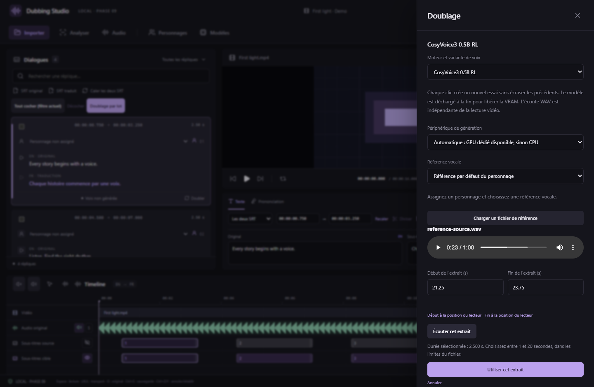
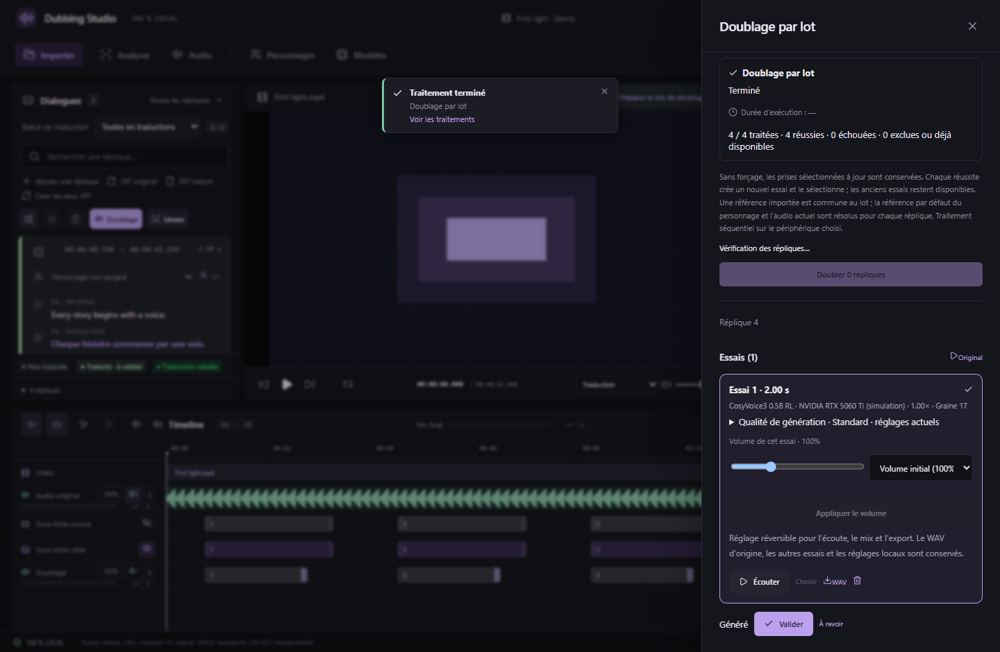

# Extraits de référence et doublage par lot — v0.11.0

## Choisir une portion d’un fichier de référence

Dans **Doublage → Charger un fichier de référence**, ou dans **Personnages → Importer un audio** :

1. Choisissez le fichier. Son lecteur et sa durée deviennent disponibles.
2. Réglez **Début de l’extrait (s)** et **Fin de l’extrait (s)**, avec une précision d’une milliseconde. Les boutons sous le lecteur reprennent sa position comme début ou fin.
3. **Écouter cet extrait** démarre au début choisi et s’arrête à la fin. La sélection doit durer **1 à 20 secondes**, où qu’elle soit dans le fichier ; par exemple 125–132 secondes.
4. **Utiliser cet extrait** copie uniquement la portion choisie dans le projet en WAV mono à 24 kHz. Le fichier original reste intact. Le libellé conserve les bornes ; la référence est autonome si l’original est déplacé.

Annuler la préparation ne crée pas de référence. Un échec de conversion conserve la référence précédente et les bornes en préparation. La durée réelle et les bornes sont vérifiées par le backend ; aucun découpage silencieux d’une sélection trop longue n’est appliqué. La transcription doit correspondre à **l’extrait importé**, dans sa langue d’origine. Les anciens fichiers de référence restent utilisables.

## Choisir les répliques du lot

Dans la liste des dialogues, cochez les répliques. **Maj + clic** étend la sélection entre deux cases dans le filtre courant. **Tout cocher (filtre actuel)** et **Décocher** agissent sur les cases, indépendamment de la réplique active du lecteur. La sélection est conservée en naviguant dans le projet ; les cases ne sont pas partagées entre projets.

Ouvrez **Doublage par lot**, puis choisissez :

- **Toutes les répliques traduites du projet**, indépendamment du filtre de recherche ;
- **Répliques cochées**, en excluant celles sans traduction.

Une réplique doit avoir un véritable texte de sous-titre cible. Le texte de prononciation seul ne la rend pas admissible. Le lot respecte les corrections de prononciation lorsqu’il génère le texte parlé.

## Configuration et forçage

Les contrôles du lot sont les mêmes que ceux de la génération unitaire : moteur/variante installée, périphérique, référence, mode de clonage, humeur, accent compatible, vitesse et graine.

Une **référence importée** fournit la même voix à tout le lot. Avec **Référence par défaut du personnage**, chaque réplique utilise la référence de son propre personnage. Avec **Audio de la réplique actuelle**, l’extrait et la transcription source sont résolus réplique par réplique, sur la piste choisie. Les références personnalisées d’un personnage restent disponibles dans la génération unitaire ; pour un lot, utilisez son défaut ou un fichier commun.

Par défaut, une prise sélectionnée à jour dont le fichier existe est conservée. **Forcer un nouvel essai** génère aussi les répliques déjà doublées. Chaque réussite ajoute un essai et le sélectionne, en conservant les précédents ; un échec conserve l’ancien essai sélectionné. Les réglages du lot sont sauvegardés sur les répliques réussies. Les SRT et les fichiers audio existants ne sont pas écrasés.

Le récapitulatif indique les répliques prêtes, déjà doublées, non traduites et exclues pour une référence ou une configuration invalide. Ouvrez le détail des exclusions pour voir leur cause. Les exclusions sont affichées **avant** de lancer ; le bouton précise le nombre effectivement mis en file. Après correction, un nouveau lot sans forçage conserve les prises déjà obtenues.

## Progression, annulation et reprise

Une seule réplique est générée à la fois, sur le périphérique choisi, pour éviter le cumul de modèles en VRAM. Le moteur est déchargé entre les répliques, comme en génération unitaire : le chargement des poids est donc répété, et un grand lot peut prendre longtemps. Cette version n’introduit pas de cache de modèle maintenu en mémoire.

**Traitements** affiche l’étape courante, une progression globale et les nombres de réussites, échecs et exclusions. Un échec propre à une réplique laisse avancer les autres. Une erreur de périphérique, de runtime ou de mémoire arrête le lot pour éviter de répéter une erreur matérielle sur toutes les répliques. Cela comprend les contrôles de RAM, de VRAM et d’espace disque de Drama 3 ; après correction, la reprise traite les éléments restants.

Les générations successives d’un lot partagent une étape d’annulation pour limiter la mémoire utilisée par l’historique. Une modification manuelle intercalée crée une séparation ; son historique reste indépendant. La reprise après annulation ou échec constitue une nouvelle étape. Annuler les modifications du projet conserve les WAV pour permettre le rétablissement.

**Annuler** interrompt le traitement courant et conserve les réussites. **Réessayer** reprend les éléments restants avec la configuration enregistrée, sans régénérer les réussites, même si le lot était forcé. L’état survit à la fermeture de l’application ; les identifiants d’essais empêchent un doublon si l’arrêt survient après l’enregistrement d’une prise et avant l’écriture du journal du lot.

Les changements de projet, de langue, de texte, de référence ou de sélection de prise intervenus depuis la mise en file sont contrôlés. Une prise terminée peut être conservée sans remplacer une correction manuelle plus récente. Si une demande est devenue obsolète, préparez un nouveau lot pour utiliser les nouvelles données.

Les captures utilisent l’interface React réelle, des commandes natives simulées et de l’audio synthétique. Les tests natifs distincts utilisent FFmpeg pour vérifier les échantillons d’une portion située après la vingtième seconde, et un worker de protocole pour tester les lots, échecs, annulations et reprises. Ils ne mesurent pas les performances ni la qualité d’un modèle complet sur RTX.
