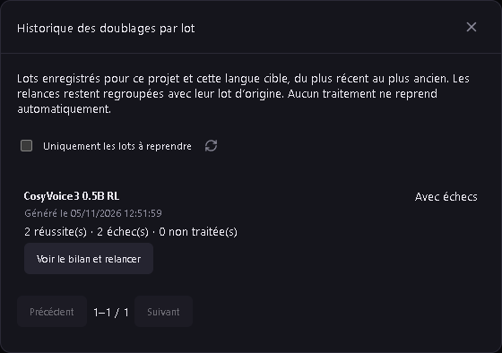

# Historique des doublages par lot — v0.42.0

Ouvrez un projet, puis **Doublage → Lot → Historique des doublages par lot**. La liste retrouve les journaux enregistrés par cette application, même après redémarrage et même si l’ancien traitement a disparu de la liste globale. Elle concerne le projet ouvert et sa langue cible actuelle, avec les lots les plus récents en premier. Elle est paginée ; **Actualiser** recharge la liste et **Uniquement les lots à reprendre** garde les échecs et les lots incomplets.

Chaque lot indique sa date, le moteur et les compteurs de réussite, d’échec et de répliques non traitées. **Voir le bilan et relancer** donne accès aux erreurs par réplique, aux relances individuelles, multiples ou de tous les échecs. Après une interruption, on peut aussi reprendre les non-traitées. Rien ne redémarre à l’ouverture de l’historique.

Les relances restent regroupées avec le lot d’origine ; leur nombre est affiché. Les réglages d’origine sont réutilisés avec les textes et références actuels, vérifiés à nouveau. Les essais et WAV déjà réussis restent intacts. Fermer le bilan ou l’historique ne supprime aucun journal ni essai.

Les journaux v0.41.0 déjà présents sont repris sans migration destructive. Pour ceux qui n’ont pas de date explicite, la date du fichier du journal est utilisée : elle ne prétend pas être celle du premier WAV. Un journal illisible est ignoré avec un avertissement ; les autres restent accessibles. Les lots d’un autre projet ou d’une autre langue cible sont exclus. Les anciens journaux déjà supprimés du disque ne peuvent pas être reconstruits par cet historique.

Le MCP `studio_dubbing_batch_history` fournit la même liste (offset, limit de 1 à 100, problemsOnly), sans effet sur le projet ni démarrage de génération. Les outils de bilan et de relance ajoutés en v0.41.0 restent disponibles. 158 outils MCP, 30 schémas partagés, format de projet 26.
