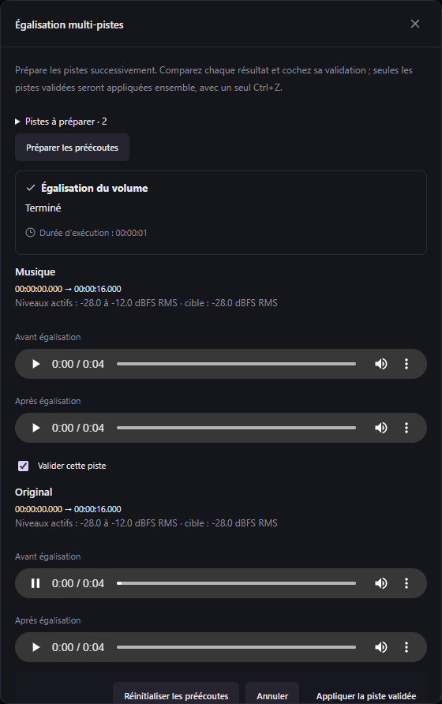
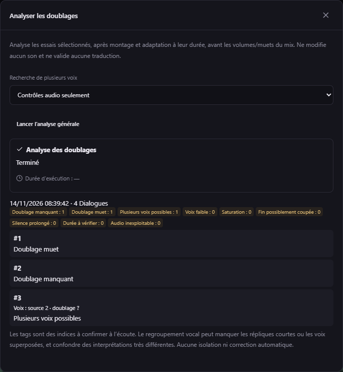

# Égalisation multi-pistes et analyse du doublage — v0.49.0

## Comparer et valider plusieurs pistes

1. Clic droit sur une piste ou une sélection → **Égaliser toute la piste…** / **Égaliser le volume…**.
2. Cliquez sur **Égaliser plusieurs pistes…**, choisissez les pistes (16 au maximum), le niveau bas/haut et la plage courante ou les pistes entières.
3. **Préparer les préécoutes** traite les pistes successivement, avec progression et annulation. Aucune modification audio n’est appliquée.
4. Comparez les lecteurs Avant / Après de chaque piste, puis cochez **Valider cette piste** uniquement pour les résultats à conserver. Une seule écoute reste active à la fois.
5. **Appliquer** ajoute ensemble les seules pistes validées. L’opération est atomique : un résultat invalide, abandonné ou périmé empêche l’ensemble de s’appliquer. **Ctrl+Z** annule toutes les pistes de cette opération en une fois.

Les résultats non validés sont abandonnés à la fermeture. Si le projet change après préparation, préparez les préécoutes à nouveau. Les sources, essais de voix, SRT, volumes, zones muettes et autres pistes restent conservés. Les limites et le traitement progressif de [l’égalisation longue](WHOLE-TRACK-LEVELING.md) restent applicables.

La lecture des égalisations utilise des fragments de 10 secondes et un mix à 48 kHz. Le cache reste limité à 128 Mio, y compris pour 16 pistes stéréo au passage entre deux fragments.

## Analyse générale à la demande

Dans l’en-tête **Dialogues**, utilisez le pictogramme **Analyser les doublages**, puis **Lancer l’analyse générale**. L’analyse est locale, annulable et conserve ses résultats dans le projet après redémarrage. Elle ne remplace aucun audio et ne valide ni traduction ni essai.

Elle examine les essais sélectionnés pour la langue cible, après leurs éditions et leur adaptation au créneau, **avant les volumes et zones muettes des pistes du mix**. Une piste Doublage désactivée ne transforme donc pas tous les essais en « muets ». Les répliques exclues du doublage sont ignorées. Dans un groupe de voix séparées, les sous-répliques sont contrôlées indépendamment ; le parent porte l’indication de plusieurs voix.

| Tag | Ce qui est vérifié |
| --- | --- |
| Doublage manquant | Pas d’essai sélectionné utilisable pour la langue/le média, ou fichier absent. Des essais non sélectionnés peuvent encore exister. |
| Doublage muet | Crête sous −60 dBFS dans le WAV de l’essai édité. |
| Voix faible | RMS sous −35 dBFS, hors silence complet. |
| Saturation | Au moins trois échantillons près des limites PCM et au moins 0,1 % du signal concerné. |
| Fin possiblement coupée | Niveau encore élevé dans les 20 dernières millisecondes et dernier échantillon non négligeable. C’est un indice, pas une vérification des mots prononcés. |
| Silence prolongé | Plus de 500 ms en tête ou en fin, selon un seuil d’amplitude. |
| Durée à vérifier | Créneau conflictuel/inexploitable ou adaptation imposant plus de 1,5× d’accélération. |
| Audio inexploitable | Fichier présent mais illisible/invalide, ou montage impossible à préparer. L’essai est conservé. |
| Plusieurs voix possibles | Groupe multivoix déjà enregistré, ou indication du module de locuteurs décrit ci-dessous. |

### Plusieurs voix : source, doublage ou les deux

Le choix **Recherche de plusieurs voix** permet de contrôler la source, le doublage, les deux, ou seulement les mesures audio. La piste source se choisit séparément ; utilisez de préférence une piste Voix propre. Le module déjà utilisé dans **Personnages** (CAMPPlus + Silero, CPU local) doit être installé pour le regroupement vocal. Son absence ou son échec est affiché explicitement ; les autres mesures restent disponibles.

Le module compare des empreintes vocales issues de fenêtres de parole disjointes de 1,5 seconde, jusqu’à 120 secondes par réplique. Il demande plusieurs fenêtres concordantes avant de proposer plusieurs groupes. Les fenêtres trop courtes ou sans parole donnent un résultat inconnu. Cette méthode **n’est pas un détecteur fiable de parole simultanée** : elle peut manquer de courtes interventions ou des voix parfaitement superposées, et confondre des interprétations très différentes. Le nombre indiqué reste une aide à la réécoute, sans attribution automatique de personnage, séparation ni nouveau doublage.

### Filtrer et corriger

Deux tags manuels sont disponibles sans lancer d’analyse : **À retraduire** et **Voix à améliorer**. Clic droit sur une réplique → **Ajouter le tag…** / **Retirer le tag…**. Ils s’affichent sur la carte et dans les filtres du doublage, restent conservés après redémarrage, réanalyse ou modification de la réplique, et se retirent explicitement lorsque le point est résolu. Ils ne changent pas les validations de traduction ou d’essai. Les opérations de fusion et de recalage conservent ces annotations.

Ouvrez **Filtres du doublage** et cochez les tags. Une réplique correspond si elle possède **au moins un** des tags cochés ; ce filtre se cumule avec le statut de traduction, la recherche et le filtre principal. Vous pouvez ensuite sélectionner les résultats visibles et utiliser les outils de doublage par lot existants.

Les cartes affichent leurs tags. Le rapport permet de rejoindre une réplique. Le clic droit sur une réplique permet de retirer ses tags après vérification, avec annulation possible. Modifier un texte/essai/montage rend ses résultats périmés ; les résultats des autres répliques restent utilisables quand leur contexte audio est inchangé. Des modifications globales de pistes, groupes ou calage peuvent nécessiter une nouvelle analyse. Les résultats périmés restent consultables, mais leurs tags sont exclus des filtres.

Le rapport et les tags manuels utilisent le **format projet 29**. Les projets antérieurs restent lisibles ; utilisez v0.49.0 ou ultérieure pour rouvrir un projet contenant ces données.

## Contrôle IA

Les préécoutes se préparent avec les outils d’égalisation existants. `studio_apply_volume_leveling_batch` reçoit uniquement les IDs des résultats explicitement approuvés, au même projet et à la même révision, et les applique atomiquement. L’analyse se lance avec `studio_analyze_dubbing`, se suit avec `studio_list_jobs`, puis se lit dans `project.dubbingAudit`. `studio_get_dialogues` expose les tags actuels et accepte `qualityTags` en complément de `status` et `ids`. `studio_dubbing_audit_status` indique la disponibilité du module de locuteurs. **166 outils / 32 schémas partagés.**

## Autres analyses à envisager

Les prochains contrôles utiles seraient la transcription locale du texte réellement entendu comparée au texte attendu (mots manquants, répétitions, langue incorrecte), puis la cohérence de timbre par personnage et un contrôle phonétique du calage labial. Ils nécessitent une analyse plus coûteuse et une validation humaine ; ils ne sont pas présentés comme disponibles dans cette version.
