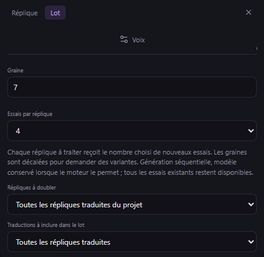

# Plusieurs essais par réplique dans un lot — v0.43.0

Dans **Doublage → Lot**, choisissez **Essais par réplique** : 1, 2, 3 ou 4. Le réglage vaut pour chaque réplique éligible selon la sélection et le filtre de traduction. L’aperçu affiche les répliques et le total d’essais à générer ; par exemple, 10 répliques × 3 = 30 essais.

Une réplique possédant déjà un doublage utilisable reste exclue par défaut. **Forcer un nouvel essai** ajoute le nombre choisi sans retirer les essais précédents. Le même moteur, la même référence et les mêmes réglages sont utilisés ; la graine est décalée de 0, 1, 2 ou 3 pour demander des variantes. Un moteur peut produire des résultats proches : le nombre d’essais ne garantit pas une différence de qualité.

Les essais sont générés successivement. Le modèle est conservé en mémoire lorsque le moteur le permet et libéré à la fin ou à l’annulation. Il n’y a pas de génération parallèle multipliant les modèles chargés. Le dernier essai réussi devient le choix courant, et les autres restent dans **Essais** pour comparaison.

Le bilan et l’historique comptent les essais pour ces lots multiples. Chaque ligne du bilan indique la réplique et son numéro d’essai **dans ce lot** ; ce numéro peut différer de la numérotation globale des essais de la réplique. La flèche relance cet essai précis, les cases permettent une sélection multiple, et les autres commandes reprennent tous les échecs ou les non-traités. Les réussites ne sont pas répétées. Le nombre demandé et les graines sont conservés dans les journaux après redémarrage. Les anciens lots sans cette option restent à un essai par réplique.

Le filtre des traductions validées est contrôlé au début de chaque réplique. Les nouveaux essais retirent normalement la validation commune, sans interrompre les autres essais déjà prévus pour cette même réplique. Les modifications externes du texte ou des références continuent de déclencher les vérifications habituelles.

MCP : `studio_preview_dubbing_batch` et `studio_generate_dubbing_batch` acceptent l’option `selection.takeCount` entre 1 et 4 (défaut : 1). Le bilan renvoie `itemIndex` (index global du lot, base zéro) et `takeIndex` (numéro d’essai de la réplique dans le lot, base un). `studio_retry_dubbing_batch` accepte `selection.itemIndices` pour cibler des échecs précis ; `lineIds` reprend les essais échoués/non traités des répliques indiquées. Les indices réussis ou inconnus sont refusés atomiquement. Les anciennes commandes restent compatibles. 158 outils MCP, 30 schémas partagés, format de projet 26.
