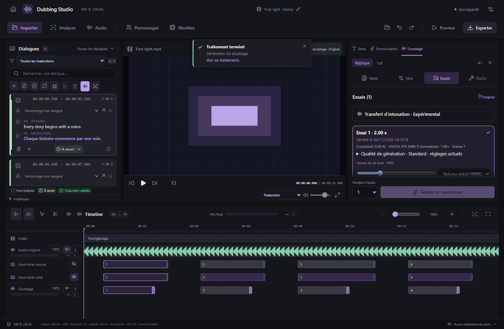
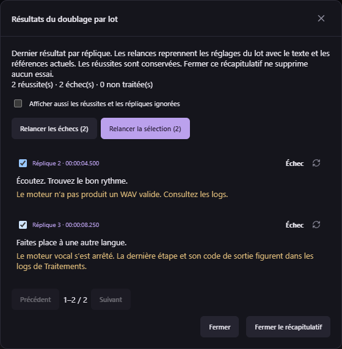

# Dates des essais et reprise des lots — v0.41.0

Chaque essai affiche sa date de création déjà enregistrée, avec heures, minutes et secondes dans le fuseau du PC. L’infobulle précise le fuseau. Les anciens essais sont datés si cette information existe ; une date invalide est indiquée indisponible. Modifier le montage ne réécrit pas la date de génération du WAV original.

Dans Doublage par lot, ouvrez **Répliques du lot** sous l’avancement. Le bilan montre le dernier résultat par réplique : réussite, échec avec sa cause, non traitée ou ignorée. Les lignes sont paginées ; les réussites peuvent aussi être affichées, avec la date de leur essai. Cliquez sur une réplique pour la retrouver dans l’éditeur.

- Relancez une ligne avec sa flèche, cochez plusieurs lignes et utilisez **Relancer la sélection**, ou relancez tous les échecs.
- Après annulation ou arrêt sur une erreur bloquante, **Relancer les échecs et les non-traitées** reprend ce qui reste.
- Les relances gardent les options du lot d’origine (moteur, périphérique, référence, vitesse, graine et qualité), en préparant à nouveau le texte et les références actuels. Une référence invalide est signalée sur sa ligne sans lancer le moteur pour cette ligne.
- Les réussites déjà publiées ne sont pas régénérées. Les reprises mettent à jour le bilan d’origine, ce qui laisse visibles les autres échecs après une relance individuelle. Les WAV et essais antérieurs restent disponibles.
- À la fin, utilisez **Fermer le récapitulatif** ou la croix du suivi pour masquer l’information. Cela ne supprime ni essai ni journal. **Réafficher le suivi** le rouvre dans le panneau. Pendant l’exécution, **Annuler** demande l’arrêt du lot et conserve ses résultats terminés.

Les journaux restent enregistrés dans le stockage de l’application. Le MCP permet de relire un ancien bilan avec `studio_dubbing_batch_report` (pagination, filtre des problèmes) et de relancer avec `studio_retry_dubbing_batch`, `scope` = `failed`, `unfinished` ou `selected`. Le projet ouvert doit correspondre au lot. Les réussites et identifiants inconnus sont refusés dans une sélection explicite. Deux commandes s’ajoutent aux 155 outils existants ; format de projet 26 et moteurs audio conservés.
