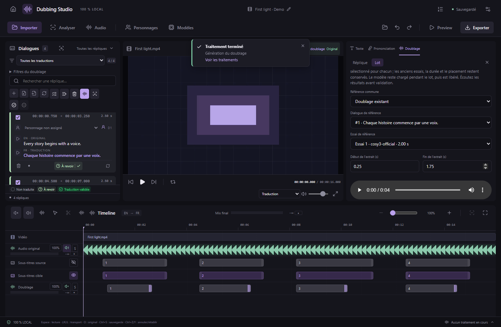

# Harmoniser le timbre de plusieurs dialogues

Disponible en v0.54.0. L’outil transforme les doublages déjà créés avec **Chatterbox Voice Conversion**, en local. Il conserve les paroles et le rythme de l’audio source et rapproche son timbre d’une référence commune. Il ne regénère pas le texte avec un moteur TTS. Une référence nette, sans musique ni autres voix, donne de meilleurs résultats ; l’identité obtenue dépend du modèle et doit être écoutée avant validation.

1. Cochez les dialogues doublés dans la liste. Sélectionnez au préalable l’essai à utiliser dans chacun : c’est cet audio précis qui sera converti.
2. Ouvrez **Doublage → Lot → Harmoniser le timbre**.
3. Choisissez **Doublage existant**, puis le dialogue et l’essai de référence. Réglez le début et la fin de l’extrait (1 à 20 secondes). Vous pouvez aussi choisir **Fichier / référence enregistrée**, puis importer un fichier et sélectionner son extrait, ou réutiliser une référence de personnage déjà enregistrée.
4. Écoutez la référence et choisissez le périphérique. Si Chatterbox VC manque, utilisez le bouton des modèles pour l’installer. Sur la RTX 5060 Ti, sélectionnez le GPU NVIDIA ; aucun repli CPU silencieux n’est effectué.
5. Vérifiez le nombre de dialogues admissibles, puis cliquez sur **Harmoniser…**. Le panneau affiche la tâche en cours tout en conservant l’accès au lecteur et à la timeline.
6. Comparez les boutons d’écoute de l’ancien et du nouvel essai dans le rapport. Chaque succès devient l’essai sélectionné du dialogue ; sa validation reste à faire. Les anciens essais restent accessibles dans **Réplique → Essais**.

## Ce qui est conservé

Un nouvel essai est ajouté pour chaque source admissible, avec son heure, sa provenance et sa durée de conversion. Les WAV précédents restent intacts. Les éditions audio de la source sont rendues avant conversion ; le résultat conserve exactement le nombre d’échantillons. Les décalages et durées de placement sur la timeline, les sous-titres, les pistes et la vidéo principale restent conservés. Les dialogues sans essai sélectionné valide, exclus du doublage ou ayant un fichier manquant sont signalés et ne sont pas convertis.

La référence peut être un des dialogues du lot : son ID reste figé, et les nouveaux essais créés ne deviennent jamais à leur tour la référence du reste du lot. Les sources doivent durer de 0,15 à 120 secondes ; une référence dure de 1 à 20 secondes, dans les limites réelles de l’audio édité.

## Progression, annulation et reprise

Les conversions sont séquentielles. Le modèle et l’empreinte de la référence restent chargés pendant le lot, puis le processus est fermé et attendu à la fin ou à l’annulation pour libérer la VRAM. Une erreur locale apparaît sur la ligne concernée ; une erreur de référence commune, de périphérique, de mémoire ou un changement du projet arrête le lot. Les succès déjà enregistrés restent disponibles.

L’historique des harmonisations permet de retrouver les rapports après redémarrage. Il affiche 25 résultats par page et permet de reprendre un échec, plusieurs lignes cochées, ou toutes les lignes non terminées. Une reprise conserve les mêmes sources et référence et ne reconvertit pas les succès. Si vous avez modifié les entrées concernées, créez un nouveau lot avec les réglages actuels. L’application ne relance pas automatiquement les anciens traitements au démarrage.

## Vérification et limites

Les tests natifs utilisent un véritable processus Python de protocole et de vrais WAV/FFmpeg pour vérifier le modèle résident, les références communes, l’annulation, les résultats partiels, la reprise, l’absence de doublons et la conservation des fichiers/placements. Les tests Chrome vérifient les sélections, les extraits importés, les commandes du panneau et l’historique. Le diagnostic du paquet Windows utilise le SDK MCP officiel pour vérifier la prévisualisation, les limites, l’import d’une référence et sa conservation après redémarrage. Il vérifie aussi le refus explicite d’une génération sans modèle installé.

Ces vérifications ne constituent pas un benchmark de la RTX 5060 Ti ni une validation perceptuelle de la conversion neuronale. Le moteur de conversion déjà intégré est réutilisé ; écoutez les nouveaux essais pour choisir les meilleurs. L’harmonisation seule ne change pas le format projet. Les nouvelles pistes de doublage indépendantes utilisent le format 32 ; leur affectation est conservée lors de l’harmonisation. **174 outils MCP / 35 schémas** sont disponibles, dont quatre commandes pour ce lot : [configuration et API](MCP.md).
