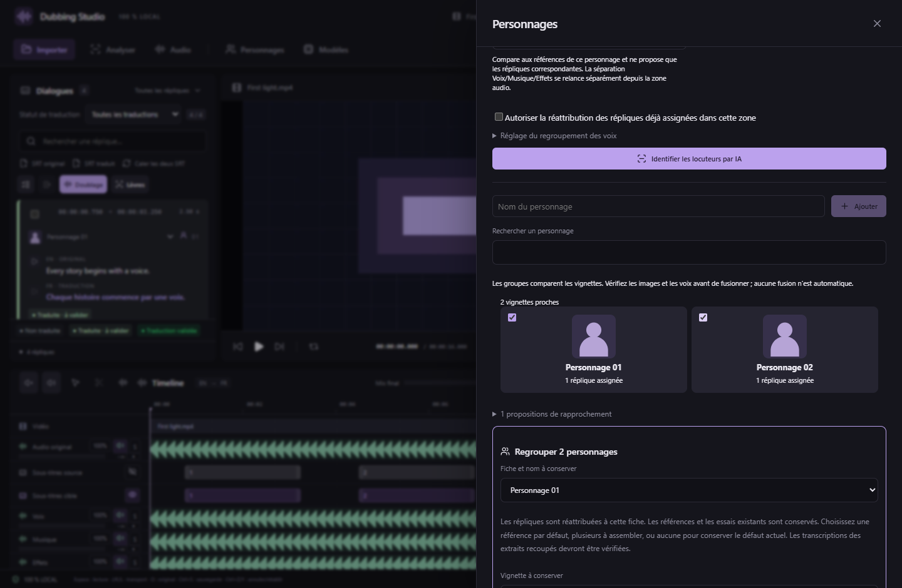
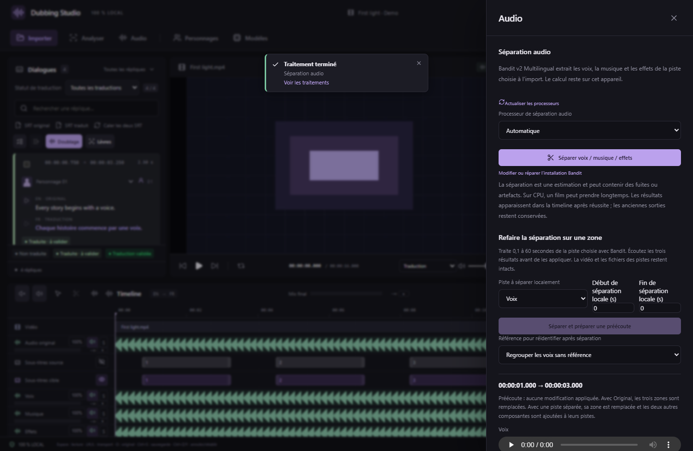

# Personnages, références et corrections locales — v0.29.0

Les personnages ont une galerie dans **Personnages** : vignette, nom, nombre de répliques et extraits écoutables. Les essais de doublage existants restent conservés lors des corrections et des regroupements.

*Interface réelle sur média synthétique, portraits de démonstration et commandes natives simulées. Les tests des modèles et du programme Windows sont séparés.*

## Identifier et vérifier

1. Dans **Modèles**, installez ou réparez **3D-Speaker + Silero VAD**. Cette version ajoute OpenCV, YuNet et le détecteur de visages d’anime au même environnement CPU isolé. Une ancienne installation demande une réparation ; les téléchargements déjà vérifiés sont réutilisés.
2. Ouvrez **Personnages**, choisissez une piste et le projet entier ou un intervalle en secondes. La piste **Voix** est choisie par défaut si disponible, sinon **Audio original**. Les corrections de contenu et les volumes locaux de la piste sont inclus ; son volume général, mute et solo ne modifient pas l’analyse.
3. Lancez **Identifier les locuteurs par IA**. CAMPPlus et Silero analysent la parole des répliques existantes. Ils proposent des groupes de voix, des références et des noms temporaires « Personnage 01 », « Personnage 02 », etc. Les répliques trop courtes, sans parole ou ambiguës peuvent rester non assignées.
4. Écoutez les références proposées avant d’appliquer. Par défaut, les assignations déjà faites sont conservées. Pour corriger des assignations dans la zone analysée, cochez explicitement **Autoriser la réattribution…** avant de relancer.

Une analyse devient périmée si ses timings, ses pistes montées ou sa référence changent. Relancez-la avant de l’appliquer. L’annulation du traitement ne change pas les assignations déjà enregistrées.

## Vignettes et informations du personnage

Le studio extrait une image près du milieu de la réplique de référence. S’il détecte un seul visage, il propose un recadrage ; avec plusieurs visages ou aucun visage fiable, il garde l’image du plan. **La personne visible n’est pas nécessairement celle qui parle** : chaque proposition doit être confirmée ou corrigée.

Dans les réglages de vignette, choisissez une réplique, un instant de sa vidéo et éventuellement un cadrage manuel en pourcentage. La vidéo principale reste intacte ; une petite image PNG est enregistrée dans le projet.

Le champ **Genre · saisie manuelle** permet d’indiquer homme, femme, autre ou non renseigné. Il n’est pas déduit automatiquement de l’image ou de la voix. Le **registre grave, médium ou aigu** est une mesure acoustique indicative de la fréquence fondamentale, avec une confiance minimale ; ce n’est pas une classification du genre.

## Comparer et fusionner

Les vignettes proches sont regroupées visuellement et des propositions de rapprochement sont affichées. La comparaison utilise leur apparence et leurs couleurs ; elle ne prouve pas que deux images représentent le même personnage. Un angle différent peut échapper au rapprochement, et deux personnages ressemblants peuvent être proposés ensemble. **Aucune fusion automatique n’est effectuée.**

1. Cochez plusieurs fiches, ou ouvrez une proposition de rapprochement.
2. Choisissez la fiche et le nom à conserver, puis la vignette souhaitée.
3. Ne cochez aucune référence pour conserver le défaut actuel ; cochez-en une pour en faire le défaut ; cochez plusieurs références pour les assembler dans l’ordre affiché. Vous pouvez régler le début et la fin de chaque extrait sélectionné et les préécouter.
4. L’assemblage accepte 1 à 16 extraits de 100 ms minimum, pour un total de **1 à 20 secondes**. Une nouvelle référence WAV mono est créée ; les anciennes restent disponibles. Après recoupe, sa transcription est laissée vide pour éviter d’associer un texte inexact : utilisez la transcription automatique ou corrigez-la.
5. Fusionnez. Les répliques sont réattribuées à la fiche conservée ; toutes les références sont gardées. Les WAV et les métadonnées historiques des essais restent inchangés. **Ctrl+Z** annule l’ensemble de la fusion, **Ctrl+Y** la rétablit.

Dans **Extraits du personnage**, choisissez une piste et écoutez les passages où il est assigné, par pages de six. La préécoute est limitée à 20 secondes par passage. **Aller à la réplique** referme le panneau et recadre la lecture/timeline sur le passage.

## Retrouver un personnage sur une zone

Sélectionnez un intervalle sur une piste de la timeline, puis **Identifier les voix de la sélection**. Le panneau reprend la piste et les bornes de cette sélection. Vous pouvez aussi les saisir dans Personnages.

La **référence pour retrouver un personnage** est facultative. Choisissez une fiche contenant un extrait de sa voix : l’analyse compare les voix de la zone à ses références et ne propose que les correspondances suffisamment sûres. Elle réutilise cette fiche, sans créer un doublon. Sans référence, elle cherche des groupes anonymes.

Ce guidage reconnaît une voix ; il n’isole pas une personne parmi plusieurs voix simultanées. Pour la séparation Voix/Musique/Effets, utilisez le traitement local ci-dessous. Une référence claire provenant de la même personne est préférable à une voix de remplacement d’un autre interprète.

## Corriger les pistes au même endroit

Sur une sélection audio, choisissez une **piste destination** et cliquez **Interchanger cette sélection**, ou utilisez le menu contextuel d’échange. Les deux extraits sont capturés avant modification et échangés **au même instant**, sur **10 ms à 60 secondes**. Les autres instants et les sources restent intacts. Copier et déplacer restent accessibles dans Audio. Voir [les transferts audio](AUDIO-TRANSFERS.md).

## Refaire uniquement la séparation locale

1. Préparez d’abord les pistes Voix, Musique et Effets avec la séparation Bandit complète si elles n’existent pas encore.
2. Sélectionnez une zone sur la timeline, ouvrez **Audio → Refaire la séparation sur une zone** et reprenez la sélection. Choisissez la piste dont le contenu est mal séparé et un intervalle de **0,1 à 60 secondes**.
3. Lancez **Séparer et préparer une préécoute** sur le périphérique Bandit choisi. Écoutez séparément Voix, Musique et Effets. À ce stade, aucune piste du montage n’est modifiée. Une seconde passe peut améliorer certaines fuites sans garantir un meilleur résultat.
4. Cliquez **Appliquer ces trois résultats** uniquement si le résultat vous convient.

| Piste analysée | Résultat appliqué sur cet intervalle |
| --- | --- |
| Audio original | Remplace les trois zones correspondantes dans Voix, Musique et Effets |
| Voix, Musique ou Effets | Remplace la zone de cette piste ; ajoute les deux autres composantes aux autres pistes |
| Autre piste audio | Rend cette zone silencieuse sur la source ; ajoute les trois composantes aux pistes séparées |

Les fichiers sources ne sont pas réécrits. Les modifications forment une seule opération annulable. Un fichier incomplet ou un montage modifié depuis la préécoute empêche l’application ; relancez la séparation. Une annulation/erreur avant application conserve le montage précédent.

Après application, sélectionnez éventuellement une référence de personnage puis **Réidentifier les voix de cette zone**. Le studio analyse alors la piste Voix corrigée sur ce même intervalle. L’application des nouvelles assignations reste une étape explicite.

## Contrôle MCP et compatibilité

Le format de projet devient **20** pour ces métadonnées et les couches de séparation locale. Les anciens projets restent ouverts ; une version antérieure du studio ne peut pas ouvrir un projet enrichi au format 20.

Le catalogue expose **113 outils**, dont `studio_identify_speakers` avec `scope`, `studio_apply_speaker_analysis`, `studio_set_character_profile`, `studio_capture_character_portrait`, `studio_preview_character_sample`, `studio_prepare_character_reference`, `studio_merge_characters` et les outils de préécoute/application de séparation locale. Les modifications enregistrées exigent le contexte courant du projet. Voir [MCP](MCP.md).

Les calculs sont locaux. Le rapprochement visuel et le registre vocal fonctionnent sur CPU et n’occupent pas la VRAM nécessaire au doublage. Il ne s’agit pas d’une mesure de précision d’identification sur votre film ni d’un nouveau benchmark de votre RTX 5060 Ti.
