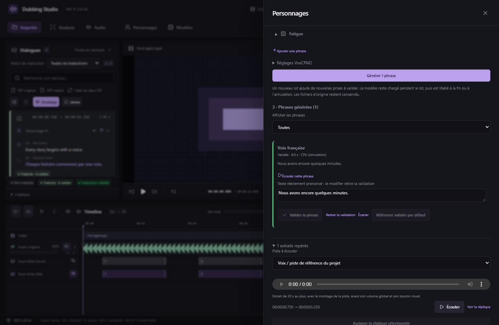
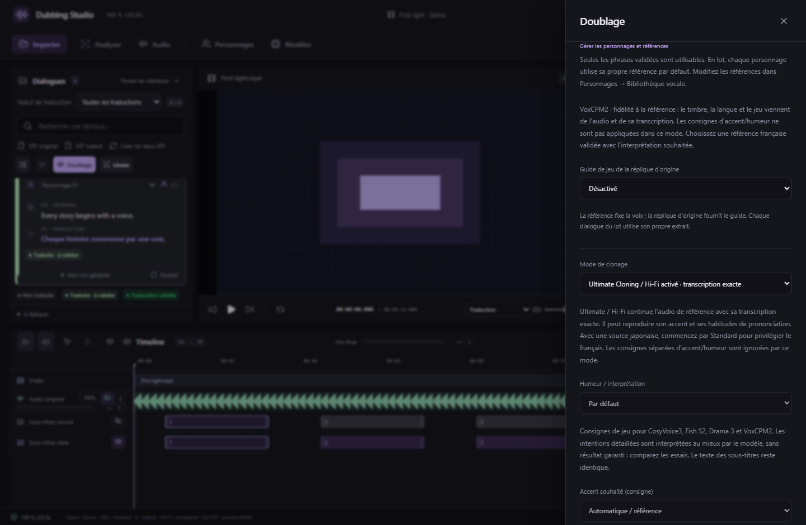
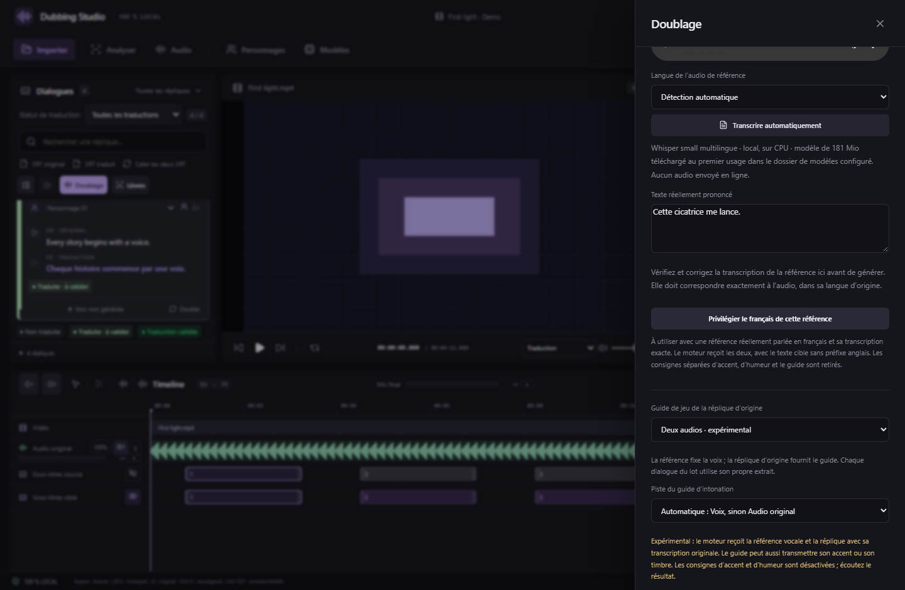

# Bibliothèque vocale par personnage · v0.30

Le studio peut conserver plusieurs extraits d'un personnage, en tirer des phrases françaises, puis utiliser les phrases **écoutées et validées** comme références. La réplique japonaise peut fournir un guide distinct pour le jeu. Tout fonctionne en local avec VoxCPM2 déjà installé ; aucune nouvelle conversion vidéo ni suppression d'essai n'est nécessaire.

## Préparer les voix

1. Ouvrez **Personnages**, choisissez le personnage et dépliez **Bibliothèque vocale du personnage**.
2. Ajoutez des références existantes ou des répliques assignées à ce personnage. Réglez le début/la fin de chaque extrait ; pour une réplique, choisissez sa piste. Utilisez de la parole claire avec peu de musique, de réverbération ou de bruit. Les montages locaux de piste sont respectés, avant le volume et le bouton muet de la piste.
3. Assemblez **5 à 20 secondes au total**, avec 16 extraits au maximum. Une nouvelle source WAV mono 24 kHz est créée, avec provenance et empreinte ; les fichiers d'origine restent intacts.
4. Choisissez les phrases françaises, leur humeur, le périphérique VoxCPM2, la graine et la qualité. Huit phrases sont proposées ; vous pouvez les éditer et en ajouter, avec 12 phrases au plus par lot. L'accent français est une consigne, pas une garantie : écartez les références dont le rendu reste incorrect.
5. Lancez le lot. Le modèle reste chargé entre les phrases, puis son processus est fermé à la fin, à l'annulation ou en cas d'erreur. Une reprise garde les phrases déjà achevées et ajoute les manquantes avec de nouveaux fichiers.

## Écouter et valider

Chaque phrase commence **À valider**. Écoutez la diction, l'accent, le timbre et l'interprétation ; corrigez le **texte réellement prononcé** s'il diffère du texte demandé. Vous pouvez valider, retirer la validation, écarter, et choisir une référence validée par défaut.

Modifier la transcription retire la validation et l'éventuel défaut. Les phrases écartées restent consultables. La validation ne supprime ni ne réécrit le WAV. Les opérations sont sauvegardées et annulables ; les prises de doublage antérieures restent conservées.

*Capture du véritable écran React avec projet de démonstration et fichiers audio de test ; aucune qualification de qualité vocale ou de GPU n'est déduite de cette capture.*

## Doubler avec cette bibliothèque

Dans **Doublage → Référence vocale**, choisissez **Bibliothèque validée du personnage**. Seules les phrases validées sont proposées. Pour une réplique, vous pouvez choisir une phrase précise ou le défaut. En lot, chaque personnage utilise son propre défaut validé ; une réplique sans référence utilisable est signalée avant génération.

Le choix d'une référence de bibliothèque conserve votre mode de clonage. Dans **Mode de clonage**, choisissez **Standard · Ultimate / Hi-Fi désactivé**, ou **Ultimate Cloning / Hi-Fi activé**. En Hi-Fi, l'audio français et sa transcription exacte conditionnent le modèle ; les commandes séparées d'accent/humeur sont désactivées. Choisissez alors une phrase française contenant déjà l'interprétation souhaitée.

Pour une référence japonaise et un texte français, commencez par **Standard** si l'accent français est prioritaire. Ultimate peut reprendre l'accent et les habitudes de prononciation de la référence, même si la cible est française. C'est le compromis confirmé par [un contributeur de VoxCPM](https://github.com/OpenBMB/VoxCPM/issues/321). Le standard conserve les consignes d'accent et d'humeur, sans garantir un accent parfait. Le choix est sauvegardé par réplique et disponible dans la configuration du lot ; les essais existants ne sont pas modifiés.

Le guide à deux audios utilise lui aussi la continuation Ultimate : **Mode de clonage** l'indique explicitement. Revenir à Standard retire ce guide hybride. Le guide acoustique peut rester actif avec le standard. Les phrases de la bibliothèque sont créées avec le clonage standard.

*Écran React avec données de démonstration ; le test vérifie le choix, la persistance et les paramètres envoyés, sans qualification de l'accent produit.*

Les autres moteurs peuvent utiliser les références validées via leurs modes de clonage habituels ; le **guide distinct** est actuellement réservé à VoxCPM2.

## Guide japonais indépendant

Choisissez une référence de timbre distincte de l'audio de la réplique actuelle, puis **Guide de jeu de la réplique d'origine** :

- **Consignes acoustiques** : analyse CPU des pauses, variations de hauteur et d'énergie, transformées en consignes pour VoxCPM2. L'audio japonais n'est pas mélangé à la sortie et aucune resynthèse Praat n'est appliquée. Les consignes d'accent et d'humeur restent accessibles.
- **Deux audios · expérimental** : le modèle reçoit la référence de timbre française et la réplique japonaise avec sa transcription originale exacte. Il utilise l'API combinée `reference_wav_path` + `prompt_wav_path` + `prompt_text`. Les consignes séparées d'accent/humeur sont retirées.

Le mode à deux audios peut aussi transférer l'accent ou le timbre du guide. Aucun mode ne garantit une séparation parfaite entre identité, accent et jeu, ni une copie exacte de l'émotion ou des syllabes. Il n'y a pas de pourcentage de transfert prétendument mesuré. Comparez de nouveaux essais, et conservez le meilleur. Une référence française jouée reste souvent préférable à un guide japonais lorsqu'il faut stabiliser la prononciation.

Chaque dialogue du lot utilise son propre extrait d'au moins une seconde, 20 secondes au plus, sur la piste choisie. Le mode à deux audios exige aussi le texte source ; les sous-titres doivent correspondre à l'extrait.

## Référence française et accent anglais avec VoxCPM2

Si un fichier de référence parlé uniquement en français donne un accent anglais, vous pouvez essayer **Privilégier le français de cette référence** après vérification de sa transcription. Ce bouton active **Ultimate / Hi-Fi** : le studio envoie le même audio comme référence de timbre et de continuation, sa transcription exacte et le texte cible sans préfixe anglais. Il retire les commandes séparées d'accent/humeur et le guide distinct. Il ne force pas l'accent français ; revenez à **Standard** dans Mode de clonage pour désactiver Hi-Fi. Les options archivées des anciens essais restent lisibles et ne sont pas modifiées.

Une référence de deux secondes et une cible d'un seul mot offrent peu de contexte phonétique. Préférez 5 à 20 secondes de français propre, sans silence excessif. La correction du routage n'est pas un verrou phonétique : des erreurs de diction restent possibles et demandent un nouvel essai ou une autre référence.

## Personnage proposé au moment du doublage

Dans **Doublage**, le studio peut comparer la voix de la réplique aux références **d'origine** des personnages avec CAMPPlus et Silero VAD, sur CPU. Les phrases françaises synthétiques ne servent pas à cette identification. Les extraits originaux assemblés sont admissibles.

Depuis **v0.32.4**, cette comparaison démarre **uniquement au clic sur « Proposer un personnage »**. L'ouverture ou la réouverture du panneau, le changement de réplique, de piste ou de référence ne lance aucune identification, même si les propositions automatiques avaient été activées dans une ancienne version. **Actualiser la proposition** effectue une nouvelle comparaison à la demande.

Jusqu'à trois propositions sont affichées, avec une similarité qui **n'est pas une probabilité**. Une voix trop courte ou absente demande un choix manuel ; une faible marge entre candidats est signalée. **Accepter** est nécessaire pour assigner un personnage. Le choix manuel et la sélection de piste restent disponibles dans les réglages.

Une proposition est refusée si la réplique, les références, les montages audio ou l'assignation ont changé. Le cache des empreintes dépend du contenu audio et de la version du modèle. Les essais restent conservés lors d'une assignation ou d'une fusion.

## Compatibilité et MCP

La bibliothèque et les guides utilisent le format de projet **21**. Ouvrez une copie avec la v0.30 ou plus récente ; les anciennes versions refusent ce format. Les projets plus anciens restent lisibles.

Sept commandes MCP complètent les outils existants : préparation de source, génération de phrases, validation et lecture de leurs chemins, proposition de personnage, lecture du résultat et acceptation explicite. Les mutations exigent le contexte courant. Voir [MCP](MCP.md).

Sources de l'API : [VoxCPM officiel](https://github.com/OpenBMB/VoxCPM), [guide d'utilisation](https://voxcpm.readthedocs.io/en/latest/usage_guide.html), [exemples de clonage](https://voxcpm.readthedocs.io/en/latest/cookbook.html). L'intégration utilise la version 2.0.3 épinglée et conserve ses licences existantes.

## Reprise Qwen3-TTS GGUF

Qwen3 dispose d’un budget de frames adapté au texte et à la durée de la réplique, avec 120 secondes au maximum après changement de vitesse. Une sortie qui atteint la limite sans se terminer normalement est refusée, plutôt que conservée comme doublage tronqué. Le journal distingue WAV invalide, sortie trop longue et limite de génération.

Une sortie invalide entraîne au plus une reprise sur le **même périphérique**. Le mode de reprise utilise l’empreinte vocale seule, sans transcription japonaise ; si ce mode était déjà choisi, une graine suivante est utilisée. Le modèle est déchargé avant reprise. Les paramètres demandés sont conservés ; le mode et la graine réellement utilisés lors d’une reprise apparaissent sur l’essai et dans ses métadonnées. L’annulation interrompt les deux tentatives.

Un essai comparatif sur le PC RTX de l’utilisateur a produit « Une explosion ?! Lu ! » en environ 16 secondes (audio de 2,155 s) sans transcription, contre deux échecs précédents d’environ huit minutes. Les 1 633 essais antérieurs ont été vérifiés inchangés. Cela valide ce parcours précis, sans établir une garantie pour tous les textes, références ou pilotes. Les WAV des échecs précédents n’étaient plus disponibles : leur durée exacte n’a pas pu être mesurée rétroactivement.
