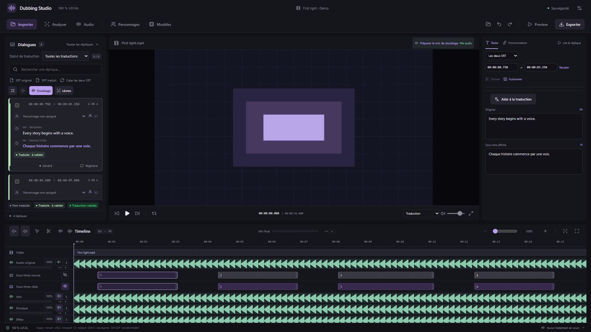
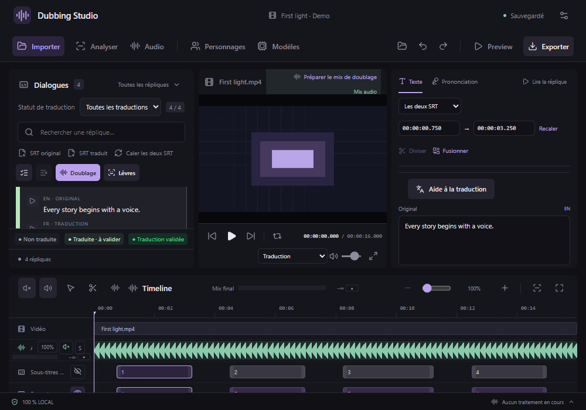
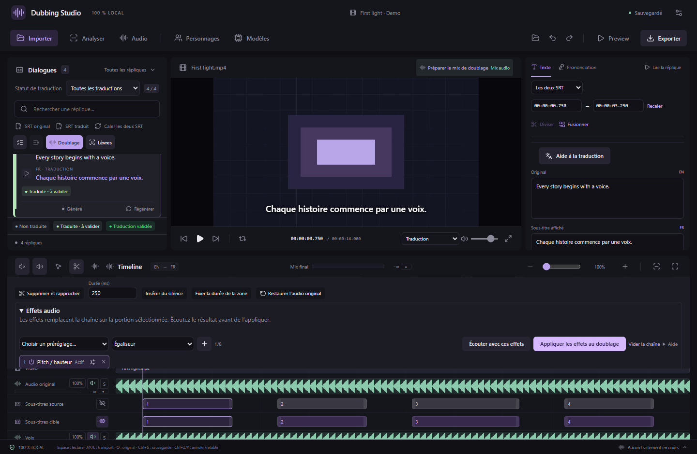
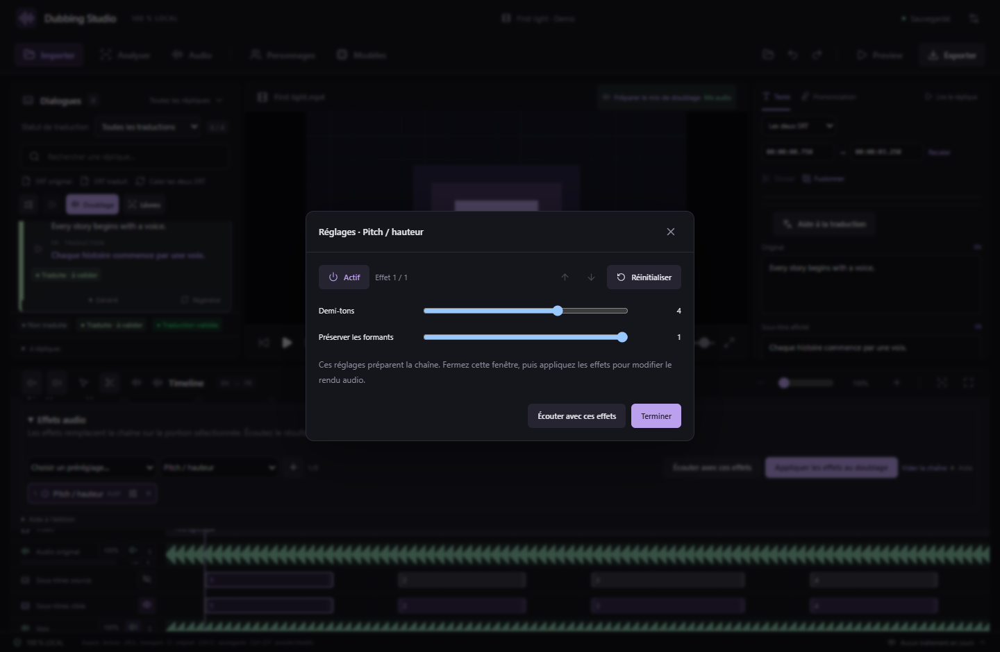

# Disposition de montage et effets compacts — v0.28.0

L’espace de travail garde quatre zones visibles : dialogues à gauche, lecteur vidéo au centre, édition des sous-titres à droite et timeline avec les pistes sur toute la largeur en bas. L’édition du texte ne réduit plus la hauteur du lecteur.

## Adapter les panneaux

Glissez les séparateurs de chaque côté du lecteur. Le clavier permet aussi de les déplacer : flèches gauche/droite, Maj pour un pas plus grand, Début/Fin pour les limites. Un double-clic restaure la largeur par défaut du panneau concerné. Les largeurs sont mémorisées sur ce PC, indépendamment du projet.

Lorsqu’une fenêtre passe sur un écran plus petit, les panneaux s’adaptent pour conserver au moins 320 pixels au lecteur et garder l’éditeur dans la fenêtre. Les préférences de largeur sont conservées pour le retour sur un écran plus grand. La taille minimale du studio reste 1000 × 700. Les contenus longs défilent dans leur propre panneau.

Les actions de lot sont compactes : les deux premières icônes cochent/décochent les répliques du filtre ; **Doublage** et **Lèvres** ouvrent les réglages de lot. Leur nom complet reste disponible au survol et pour les lecteurs d’écran. Les fonctions et les sélections sont conservées.

Le séparateur horizontal règle la hauteur de la timeline. Pendant l’édition d’un doublage, l’éditeur et les pistes partagent cette zone, avec défilement, pour garder le haut de l’application accessible sur une petite fenêtre. Les instructions détaillées se trouvent sous **Aide à l’édition**.

## Activer et régler les effets

1. Double-cliquez sur un bloc de doublage et sélectionnez une portion, ou laissez sans sélection pour traiter toute la réplique. Pour une piste, ouvrez **Audio → Effets audio**.
2. Choisissez un préréglage ou un effet dans la liste, puis cliquez sur **+**.
3. Chaque pastille numérotée possède un bouton marche/arrêt, un bouton de réglages et × pour la retirer. Désactiver un effet conserve ses paramètres.
4. Le bouton de réglages ouvre les curseurs dans une fenêtre séparée. Les flèches y changent la position dans la chaîne ; **Réinitialiser** restaure les paramètres de cet effet. Les occurrences du même effet restent indépendantes.
5. **Terminer** ferme la fenêtre en gardant le brouillon. Prévisualisez le doublage avec **Écouter avec ces effets**, puis utilisez **Appliquer les effets au doublage** ou le bouton de rendu de la piste pour enregistrer le résultat.

Le traitement suit les pastilles de gauche à droite, avec huit effets au maximum. Le contournement ne retire pas un effet et compte dans cette limite. Les curseurs ne prennent plus de place sur la timeline. Les préréglages et les vingt effets disponibles restent identiques.

Tab et Maj+Tab restent dans la fenêtre de réglages ; Échap, × ou le fond la ferment et rendent le focus au bouton d’ouverture. Le panneau Audio sous-jacent reste ouvert. Fermer cette fenêtre n’applique pas un traitement : le bouton de rendu de la chaîne garde ce rôle.

Le WAV d’origine, les essais précédents, les volumes et les fondus restent conservés. Ctrl+Z annule un traitement appliqué. Les réglages concernent les mêmes moteurs FFmpeg qu’avant cette version ; le format de projet reste 19. Les [limites de durée et les effets par piste](AUDIO-EFFECTS.md) restent applicables.

Captures de l’interface React réelle dans Chrome avec média synthétique et commandes natives simulées. Les tests Windows empaquetés et le contrôle MCP sont validés séparément ; aucune donnée d’un projet personnel n’est montrée.
