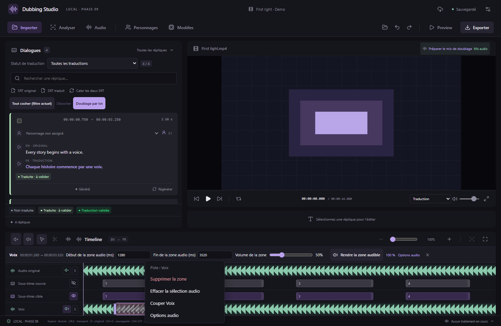
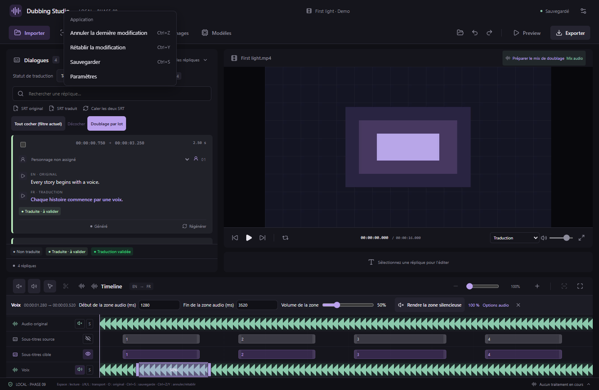

# Menus au clic droit et suppression de zones audio

Disponible à partir de **v0.16.0**.

## Supprimer une zone de volume ou de silence

1. Cliquez avec le bouton droit sur une zone colorée de la timeline, ou sur une de ses poignées de sélection.
2. Choisissez **Supprimer la zone**. Le réglage de volume/silence de cette zone disparaît et la portion reprend le volume normal de sa piste, sous réserve du mute, du solo et du volume global.
3. Utilisez **Ctrl+Z** pour annuler ou **Ctrl+Y** pour rétablir. La suppression est sauvegardée et reste effective après réouverture du projet.

Cela fonctionne sur **Audio original, Voix, Musique, Effets et Doublage**, avec ou sans l’outil de sélection. Les zones voisines conservent leurs réglages. Le clic droit ne déplace ni la lecture, ni les sous-titres, ni les blocs de voix.

Cette commande retire un réglage de mixage : elle conserve le fichier audio, la durée de la piste, les essais générés et les transferts entre pistes. Pour supprimer du son en rapprochant la suite d’un doublage, utilisez l’action **Supprimer et rapprocher** dans l’[éditeur de doublage](VOICE-REGION-EDITING.md).

## Effacer une sélection

Si vous avez seulement dessiné une sélection sans appliquer de traitement, son menu propose **Effacer la sélection audio**. Cette action retire uniquement le cadre de sélection. Elle est également disponible sur une zone enregistrée si vous souhaitez simplement fermer ses contrôles.

## Menu de l’application et des pistes

- Dans l’espace de travail : **Annuler la dernière modification**, **Rétablir la modification**, **Sauvegarder**, **Paramètres**.
- Sur une piste audio : suppression de la zone sous le pointeur lorsqu’elle existe, effacement de la sélection concernée, activation/désactivation de la piste et **Options audio**.
- Dans les champs de texte : le menu habituel du système reste disponible pour copier, coller et corriger le texte.

Les flèches haut/bas parcourent les actions ; Début/Fin vont à la première/dernière action. Entrée active l’action. Échap ou Tab ferme le menu et rend le focus au contrôle précédent. Un clic extérieur, un défilement, un changement de taille de fenêtre ou une modification du projet ferme aussi le menu. Il reste dans les limites de la fenêtre et utilise le thème clair ou sombre de l’application.

Les actions d’édition sont désactivées pendant les opérations qui verrouillent le projet. Aucun nouveau modèle, téléchargement de poids ou changement du format de projet n’est nécessaire.

*Captures de l’interface React réelle avec média synthétique et commandes natives simulées. Une mesure du signal audio dans le navigateur vérifie séparément que supprimer une zone muette rétablit le son.*
