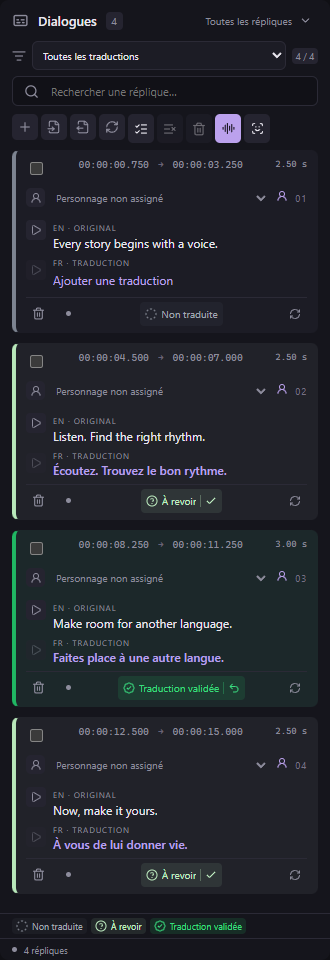

# Statuts et validation des répliques — v0.40.1

Le statut apparaît au centre de la barre située en bas de chaque carte, après les avertissements et avant le bouton de doublage. La légende reprend les mêmes pictogrammes.

- **Non traduite** : cercle pointillé gris ; ajoutez une traduction avant de valider.
- **À revoir** : point d’interrogation dans un cercle et bouton ✓ ; cliquez pour valider.
- **Traduction validée** : badge coché vert et flèche ↶ ; cliquez pour retirer la validation et remettre la réplique à revoir.

L’infobulle précise l’action ou explique pourquoi elle est indisponible : traduction absente, essai sélectionné obsolète, réplique exclue ou traitement en cours. Les répliques exclues gardent leur indication propre.

La validation reste commune au texte et à l’essai sélectionné à jour. Sans essai, elle peut valider le texte pour préparer un lot. Une modification du texte, de la prononciation, de l’essai, du montage ou du calage retire cette validation, comme auparavant.

Au clavier, placez le focus sur le statut et utilisez **Espace** ou **Entrée**. Espace n’active plus la lecture vidéo depuis ce bouton. Valider ne change pas la réplique sélectionnée et ne déplace pas la tête de lecture. Ctrl+Z permet toujours d’annuler.

Le texte peut être abrégé sur un panneau très étroit ; le libellé accessible et l’infobulle restent complets. Les couleurs, filtres et validations par lot sont conservés, ainsi que tous les essais et sous-titres. Moteurs audio, 155 outils MCP, 29 schémas et format de projet 26 inchangés.
