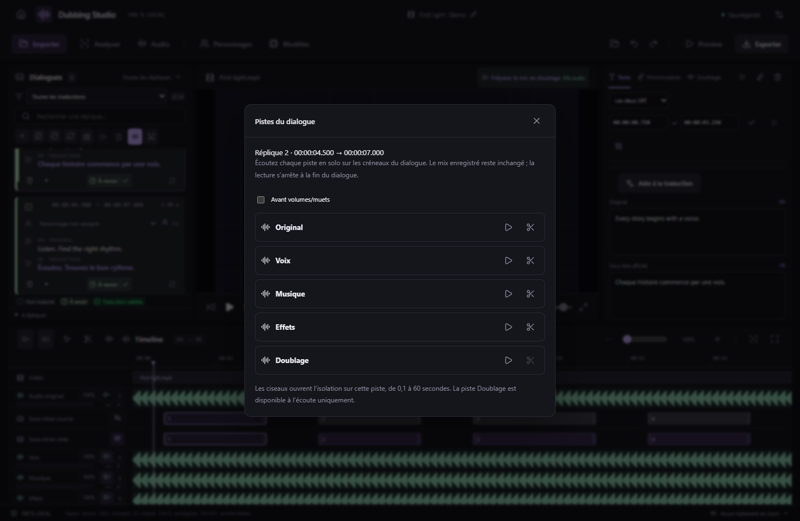

# Écouter les pistes d’un dialogue — v0.46.0

**Clic droit sur un dialogue → Écouter les pistes…** ouvre une fenêtre liée au dialogue cliqué, même si une autre réplique est sélectionnée. Son numéro et ses créneaux sont indiqués. L’ouverture seule ne lance pas la lecture et ne déplace pas le curseur.

Chaque ligne représente une piste disponible : **Original, Voix, Musique, Effets, Doublage** et les pistes audio ajoutées au projet. Les pistes rattachées à une autre vidéo sont exclues. Utilisez le bouton **▶ Écouter** de la piste voulue ; il devient **■ Arrêter** pendant l’écoute. La piste est écoutée seule, exactement sur les créneaux du dialogue. Choisir une autre piste interrompt la précédente ; la lecture s’arrête automatiquement à la fin. Fermer la fenêtre ou appuyer sur Échap arrête l’écoute.

L’écoute respecte les volumes et zones muettes par défaut. **Avant volumes/muets** permet de comparer le contenu à son niveau initial, sans retirer les réglages enregistrés. Changer cette option arrête l’écoute en cours. Les choix temporaires de solo/muet ne sont jamais enregistrés dans le mix.

Le bouton **✂ Isoler les voix** de chaque piste source ferme la fenêtre, arrête l’écoute et ouvre la boîte à outils sur **cette même piste**, aux mêmes timestamps. Vous pouvez changer de modèle, écouter les résultats et les affecter explicitement aux destinations souhaitées. La limite existante de **0,1 à 60 secondes** s’applique à l’isolation. La piste Doublage est disponible à l’écoute, mais n’est pas une source de ces séparateurs.

Une piste trop courte pour couvrir le dialogue est signalée et ses commandes sont désactivées ; aucune troncature automatique n’est faite. Un changement des créneaux ou du projet arrête l’écoute précédente. Les sous-titres, essais, médias et réglages de mix restent conservés. Le raccourci direct **Isoler les voix…** et l’écoute des sélections de timeline restent disponibles.
