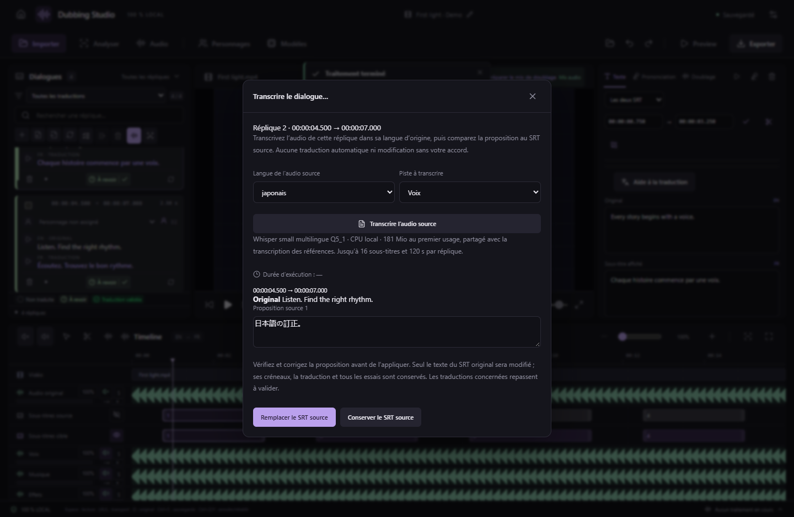

# Transcrire un dialogue depuis le clic droit — v0.44.0

1. Faites un **clic droit sur la carte d’un dialogue**, puis choisissez **Transcrire le dialogue…**. La fenêtre utilise cette réplique, même si une autre est sélectionnée dans l’éditeur ; elle indique son numéro et ses créneaux.
2. Vérifiez la **langue de l’audio source** et la **piste à transcrire**, puis cliquez sur **Transcrire l’audio source**. Whisper small multilingue Q5_1 fonctionne localement sur CPU, avec téléchargement du modèle partagé au premier usage. La transcription est indépendante du modèle d’aide à la traduction. Une réplique peut contenir jusqu’à 16 sous-titres et 120 secondes d’audio cumulé.
3. Comparez le texte reconnu au SRT source. Chaque sous-titre a sa propre proposition, modifiable avant application.
4. Choisissez **Remplacer le SRT source** pour appliquer les textes vérifiés, ou **Conserver le SRT source** pour fermer sans modification. Fermer la fenêtre ou appuyer sur Échap conserve également le texte existant.

Seul le texte source change lors d’une application explicite. Les créneaux, le SRT traduit, la vidéo et tous les essais de doublage restent conservés. Les validations concernées sont retirées pour permettre une nouvelle vérification ; **Ctrl+Z** annule le remplacement.

L’avancement et l’annulation sont accessibles dans la fenêtre. La fermer pendant le traitement laisse la tâche continuer ; le résultat pourra être consulté en rouvrant la fenêtre, sans appliquer automatiquement la proposition ni démarrer une nouvelle transcription. Une proposition vide, inchangée ou devenue périmée est bloquée. Si l’audio ne contient pas de parole exploitable, le texte source reste conservé.

L’accès existant dans **Aide à la traduction → Vérifier le texte original par transcription** reste disponible. Les deux accès utilisent le même moteur et les mêmes protections. Aucun nouveau modèle, outil MCP ou format de projet n’est introduit.
