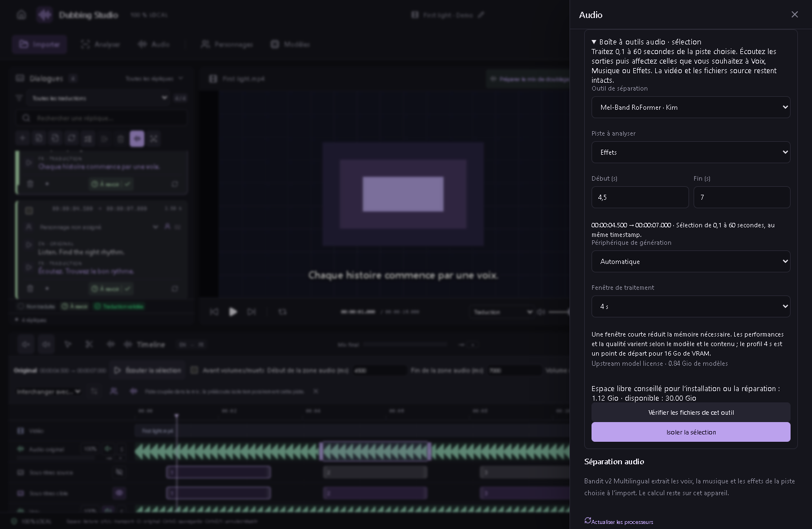

# Isoler les voix d’un dialogue — v0.45.0

Faites un **clic droit sur un dialogue → Isoler les voix…**. La boîte à outils audio s’ouvre sur les heures de début et de fin de ce dialogue, même si une autre réplique est sélectionnée. La position de lecture et les sous-titres ne sont pas déplacés.

Dans **Piste à analyser**, choisissez **Original**, **Voix**, **Musique**, **Effets** ou une piste audio ajoutée au projet. Original est proposé à chaque ouverture depuis un dialogue. Les pistes muettes restent sélectionnables ; les pistes de doublage et celles rattachées à une autre vidéo sont exclues.

Choisissez l’**Outil de séparation** : Mel-Band RoFormer Kim est proposé initialement, avec les mêmes choix que pour une sélection audio, notamment BS-RoFormer, Demucs, AudioSep et les séparateurs de plusieurs voix MossFormer2/SepFormer. Vérifiez l’installation du modèle et le périphérique, puis lancez **Isoler la sélection**. Aucune séparation ni installation ne démarre automatiquement lors du clic droit.

Écoutez les sorties avant de les appliquer. Sélectionnez uniquement les sorties et destinations souhaitées, au même timestamp. Pour les modèles multivoix, cochez les voix à conserver et choisissez ajout ou remplacement. Vous pouvez aussi rendre muette la portion source. **Ctrl+Z** annule l’application ; les fichiers vidéo/audio d’origine, les SRT et les essais de doublage restent conservés.

La même limite de **0,1 à 60 secondes** que pour une sélection audio s’applique. Un dialogue hors de ces limites affiche une action désactivée avec la plage requise ; il n’est pas raccourci automatiquement. Pour un dialogue plus long, utilisez des sélections audio plus courtes.

Un nouveau dialogue recharge sa propre plage, sans réafficher les résultats de l’ancien. Le choix de la piste à analyser concerne cette opération et ne modifie pas les préférences de référence vocale du projet. Les moteurs, modèles et outils MCP existants sont inchangés.
