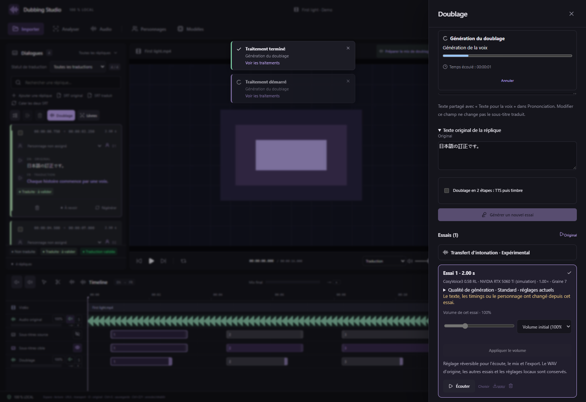
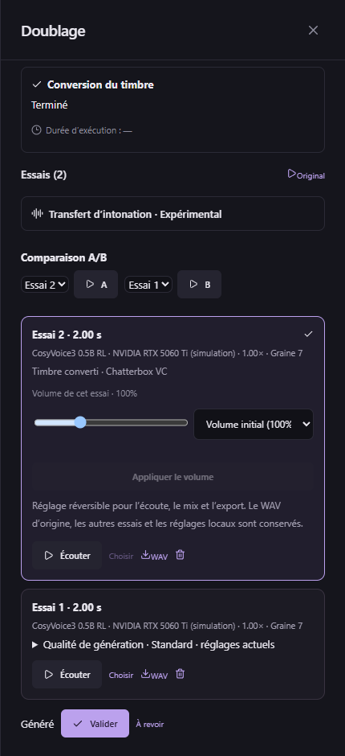

# Traitements dans le panneau Doublage — v0.32.3

La génération d’un essai, le changement de timbre, le transfert d’intonation, la transcription d’une référence et le doublage par lot conservent leur suivi dans le panneau qui les lance.

Le bloc de suivi reste visible en haut pendant le défilement : étape courante, avancement, durée, annulation, erreur et dernières lignes du journal. **Réessayer** relance la tâche depuis ce panneau et suit l’identifiant renvoyé par le moteur. Les réglages restent affichés. Une erreur au lancement s’affiche aussi sur place.

## Retrouver le résultat

Quand un nouvel essai vocal sélectionné est disponible à la fin de l’opération, sa carte reçoit le focus et le panneau défile jusqu’à elle. Cliquez sur **Écouter** pour le comparer aux essais précédents ; aucune lecture ne démarre automatiquement. Les fichiers audio et tous les anciens essais restent conservés.

Le suivi attend la fin de la génération en deux étapes et son essai final. Une mise à jour de piste ou une transcription sans création d’essai vocal ne déclenche pas ce déplacement. Les événements « projet modifié » et « tâche terminée » peuvent arriver dans les deux ordres ; le résultat reste pris en compte, même si la tâche finit avant la réponse de son lancement.

## Lots, microphone et navigation

Le lot affiche ses compteurs dans ce même suivi. À la fin, le panneau présente les essais de la dernière réplique ayant reçu un nouvel essai sélectionné. En cas d’annulation ou d’échec partiel, les réussites restent disponibles ; la relance reprend les éléments restants suivant les règles habituelles du lot.

Une prise au microphone conservée comme nouvel essai reçoit également le focus. La transcription d’une référence met à jour son texte dans le formulaire sans créer d’essai. L’import d’une référence et les réglages de volume conservent leur édition sur place.

Fermer le panneau est un choix de navigation : la tâche continue en arrière-plan et sa fin ne rouvre pas le panneau ni ne change la réplique en cours. Le bouton général **Traitements** et les notifications restent accessibles manuellement. Les boutons vers les modèles, personnages ou outils labiaux ouvrent volontairement leurs réglages.

Le format de projet reste **24**, avec **134 outils MCP**. Les moteurs de génération, leurs poids et les traitements audio natifs sont identiques à v0.32.2. Les captures utilisent un projet de démonstration et des réponses natives simulées ; les contrôles du bureau empaqueté sont décrits dans [VALIDATION](../VALIDATION.md).
