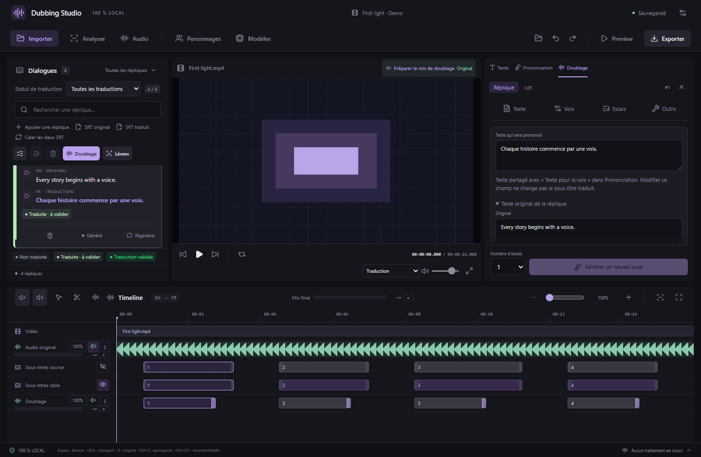
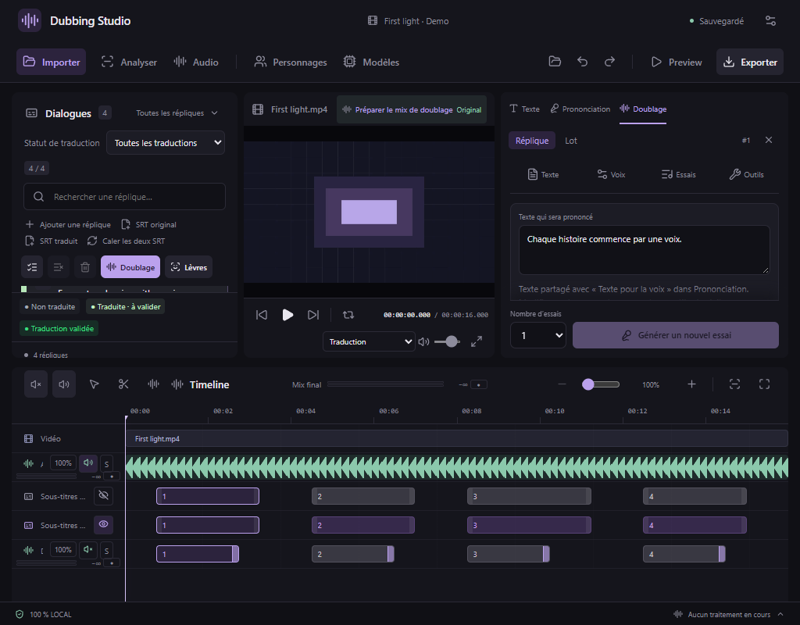

# Doublage dans l’inspecteur

Depuis la v0.38.0, **Doublage** est le troisième onglet du panneau de droite, à côté de **Texte** et **Prononciation**. La vidéo, la liste des répliques et la timeline restent accessibles pendant les réglages et les traitements.

## Utilisation

1. Sélectionnez une réplique, puis ouvrez l’onglet **Doublage**, ou utilisez son bouton **Ajouter un doublage / Régénérer**.
2. Modifiez le texte, la voix, les références et les réglages. La navigation **Texte · Voix · Essais · Outils** et le bouton de génération restent dans ce panneau.
3. Lancez la génération. La progression, le temps écoulé, l’annulation et la relance restent intégrés à l’onglet. Le nouvel essai est sélectionné à la fin ; les anciens sont conservés.
4. Utilisez **Réplique / Lot** en haut pour changer de mode. Le lot conserve sa configuration propre. Le bouton de doublage par lot dans la liste ouvre directement ce mode.

Vous pouvez changer de réplique pendant un traitement : le résultat reste rattaché à la réplique qui l’a lancé. Revenez sur celle-ci pour retrouver sa progression et ses essais. Une fin de traitement sur une autre réplique ou dans un onglet masqué ne déplace pas le focus. L’historique de suivi conservé dans l’onglet est limité aux douze dernières répliques traitées ; tous les essais restent enregistrés dans le projet et les tâches figurent dans **Traitements**.

Les onglets **Texte** et **Prononciation** restent disponibles. Revenir à Doublage conserve ses réglages en cours. La croix en haut de Doublage revient au dernier onglet d’édition ; elle n’annule pas le traitement. Les paramètres Modèles et Personnages continuent de s’ouvrir dans leur fenêtre habituelle ; les fermer retrouve l’onglet Doublage.

## Espace et clavier

Faites glisser la séparation à gauche de l’inspecteur pour régler sa largeur. Doublage possède sa propre préférence de largeur, distincte de Texte et Prononciation. Un double clic sur la séparation rétablit la largeur par défaut ; les flèches permettent aussi le réglage au clavier. Les largeurs s’adaptent à la fenêtre pour conserver le lecteur et les dialogues visibles.

Dans la barre d’onglets : **← / →**, **Début / Fin** changent d’onglet ; **Entrée / Espace** activent le bouton ciblé. Espace sur une commande de Doublage ne lance pas simultanément la lecture vidéo.

Les captures utilisent un projet de démonstration isolé. Cette modification ne change ni les moteurs de voix, ni le traitement audio, ni le format du projet (26), ni le catalogue des 143 outils MCP. Le pilotage MCP `panel: "dub"` et `panel: "batchDub"` ouvre désormais l’onglet correspondant ; `panel: null` revient à l’édition.
