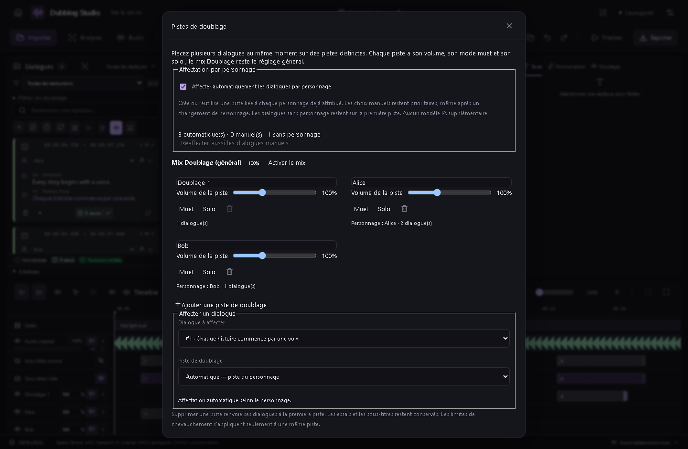
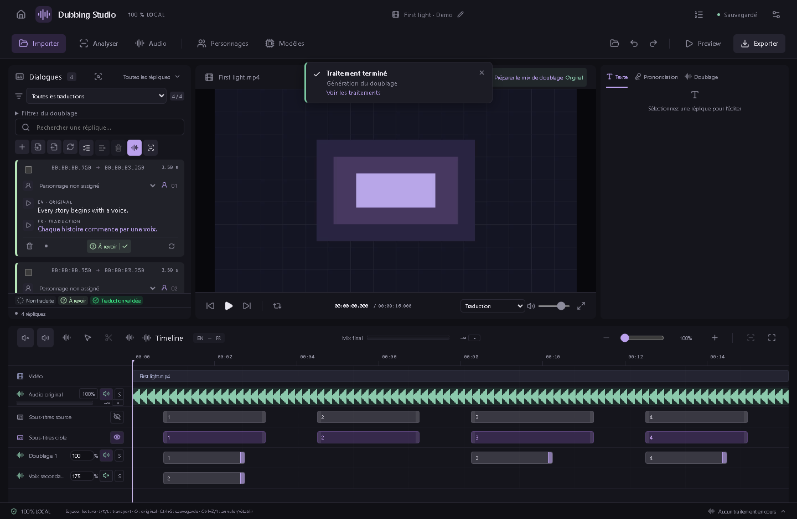

# Plusieurs pistes de doublage

## Affecter automatiquement par personnage — v0.55.0

Ouvrez **Pistes de doublage** dans la timeline et cochez **Affecter automatiquement les dialogues par personnage**. Le mode utilise les personnages déjà attribués aux répliques. Une piste est créée pour chaque personnage concerné ou réutilisée lorsqu’elle est liée à ce personnage, porte son nom sans ambiguïté ou lui est exclusivement affectée. Une piste utilisée par un autre personnage n’est pas réutilisée sur la seule base de son nom. Les volumes, muet/solo et noms personnalisés des pistes réutilisées sont conservés.

Les nouveaux dialogues et les changements de personnage suivent ce routage, y compris après une identification des locuteurs ou une édition via MCP. Les dialogues sans personnage restent sur la première piste. Deux personnages portant le même nom gardent des pistes distinctes grâce à leurs identifiants. Les pistes ne se multiplient pas lors des sauvegardes ou des redémarrages.

Pour corriger une attribution, choisissez le dialogue dans **Affecter un dialogue**, puis une piste précise. Ce choix devient **manuel** et reste prioritaire, même si vous changez ensuite son personnage. La première piste peut aussi être un choix manuel. Pour revenir au routage du personnage, choisissez **Automatique — piste du personnage**, ou faites un clic droit sur son bloc de doublage → **Rétablir la piste du personnage**.

Les affectations manuelles déjà présentes sont conservées lors de la première activation. **Réaffecter aussi les dialogues manuels** permet de les remplacer explicitement par le routage automatique. Désactiver le mode conserve les pistes et affectations actuelles ; les changements de personnage suivants ne déplacent plus les dialogues. Les opérations restent réversibles par l’historique d’édition.

Le nom d’une piste liée suit celui du personnage tant qu’il correspond au nom précédent. Un nom de piste personnalisé reste conservé. Si un personnage est supprimé ou fusionné, les anciennes pistes restent disponibles et les dialogues automatiques suivent leur nouvelle attribution. Supprimer une piste renvoie ses dialogues à la première et marque ce retour comme manuel : la piste supprimée n’est pas recréée immédiatement. De futurs dialogues automatiques peuvent créer une nouvelle piste pour ce personnage.

Le routage automatique utilise le **format projet 33**, à rouvrir avec la v0.55.0 ou une version plus récente. La limite passe à **256 pistes**, première piste comprise ; l’activation échoue sans modifier le projet si toutes les pistes nécessaires ne peuvent pas être créées. Les projets utilisant seulement les pistes manuelles de v0.54 restent au format 32 jusqu’à l’activation du routage ou l’ajout d’une 33e piste. Aucun nouveau modèle n’est nécessaire. Le routage conserve les essais, WAV, sous-titres, durées, offsets et vidéo source.

Les tests TypeScript et Rust partagent un même jeu de données attendu. Ils vérifient les identifiants stables, réutilisations sûres, noms identiques, renommages personnalisés, priorité manuelle, retour automatique, nouvelles attributions, sauvegarde/rechargement, undo, limites et absence de modification des fichiers audio. Les tests Chrome couvrent le gestionnaire et les éditions MCP. Le SDK MCP officiel vérifie le routage natif et les choix manuels après un véritable redémarrage du paquet Windows.

## Pistes manuelles — v0.54.0

La v0.54.0 permet de placer plusieurs dialogues indépendants au même moment sur des pistes de doublage distinctes. Chaque dialogue conserve ses propres textes, références, essais et réglages d’édition. Les voix sont entendues ensemble pendant la lecture synchronisée et dans le mix final exporté en MKV.

1. Cliquez sur **Pistes de doublage** dans la barre de la timeline (icône audio).
2. Cliquez sur **Ajouter une piste de doublage**, puis donnez-lui un nom, par exemple le nom du personnage.
3. Dans **Affecter un dialogue**, choisissez la réplique et sa piste de destination. Répétez pour les autres voix. Il est aussi possible de faire un clic droit sur un bloc de doublage → **Déplacer vers…**, ou **Nouvelle piste et y déplacer ce dialogue**.
4. Placez et étirez les blocs sur leur piste. Deux dialogues placés sur des pistes différentes peuvent avoir exactement le même début et la même fin. Les protections contre une collision restent actives au sein d’une même piste.
5. Réglez le volume (0 à 300 %), le mode muet ou le solo de chaque piste directement dans la timeline ou dans le gestionnaire. Le **Mix Doublage (général)** reste le réglage final commun : il doit être activé pour entendre les voix avec la vidéo. Les sous-titres et la vidéo restent indépendants de cette affectation.

Les dialogues déjà créés restent sur la première piste. Pour ajouter une autre réplique au même créneau, utilisez le bouton d’ajout de dialogue existant, saisissez ses timestamps, puis affectez-la à une autre piste. Les sous-doublages issus de la séparation de plusieurs locuteurs restent compatibles ; leur regroupement est conservé.

Supprimer une piste renvoie ses dialogues à la première piste, en conservant leurs essais, leurs WAV, leurs textes et leurs placements. Si cela crée une collision sur cette piste, elle redevient visible comme telle ; affectez les dialogues à une autre piste pour les entendre simultanément. La première piste ne peut pas être supprimée. La v0.54.0 accepte 32 pistes ; la v0.55.0 permet jusqu’à 256 pistes, avec le format 33 au-delà de 32.

Les réglages et affectations sont conservés après redémarrage et peuvent être annulés avec l’historique d’édition. Le projet passe au **format 32** lorsque ces nouvelles pistes sont utilisées ; utilisez la v0.54.0 ou une version plus récente pour le rouvrir. L’harmonisation du timbre par lot garde l’affectation de chaque dialogue et ajoute de nouveaux essais sans écraser les précédents. Les fichiers audio et la vidéo source restent intacts.

Les tests couvrent les collisions entre pistes et au sein d’une même piste, la durée/position, les gains/muet/solo, la suppression avec réaffectation, la sauvegarde, le redémarrage réel via MCP, la somme de vrais WAV et un véritable export MKV dont les deux voix simultanées sont mesurées et dont la vidéo conserve la même empreinte décodée. La lecture utilise le même gain de piste sur le bus Web Audio ; aucun rendu vidéo intermédiaire n’est nécessaire.
