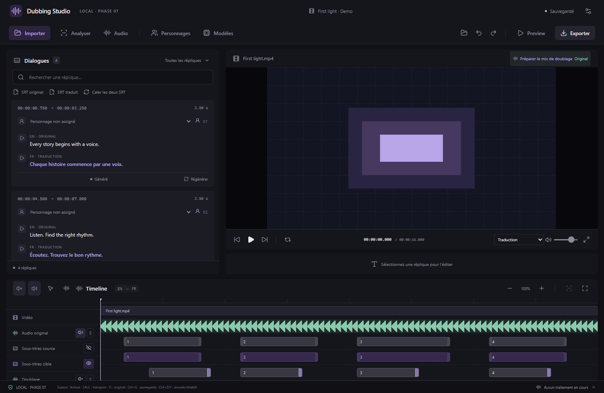
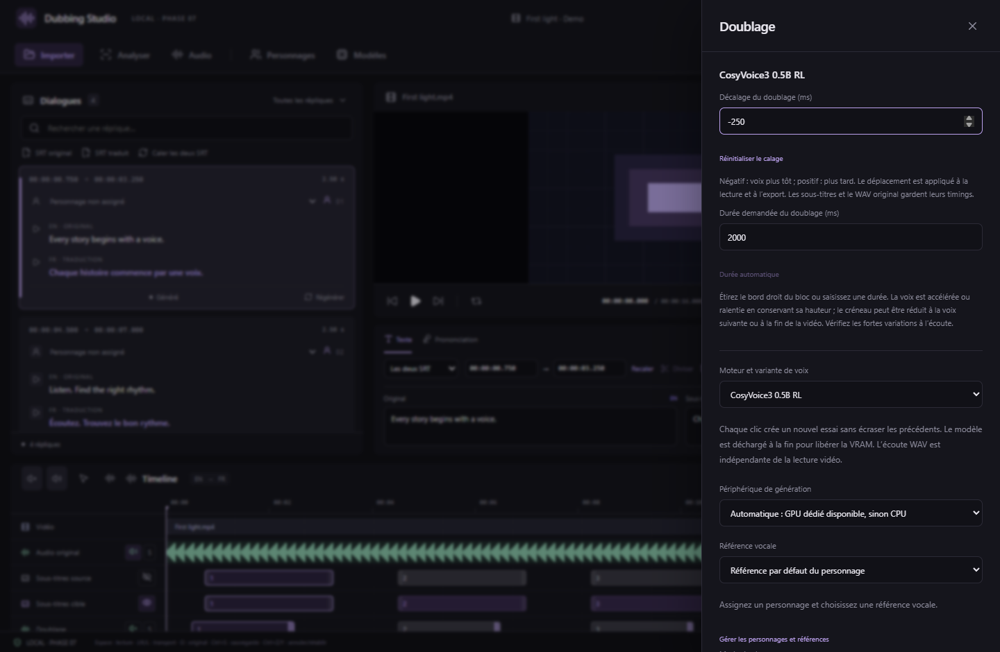

# Déplacer et redimensionner les voix sur la timeline

Depuis **v0.7.3**, les blocs de la piste **Doublage** peuvent être déplacés pour affiner le départ des voix par rapport aux lèvres.

1. Générez une voix et choisissez la prise à utiliser.
2. Dans la timeline, glissez son bloc sur la piste **Doublage** vers la gauche pour l'avancer, ou vers la droite pour le retarder. Zoomez sur la réplique pour un réglage fin.
3. Maintenez **Maj** pendant le déplacement pour aimanter le bloc à la tête de lecture, à son départ original ou aux autres voix. **Échap** annule le geste ; relâcher la souris applique le déplacement en une seule modification.
4. Une fois le bloc sélectionné au clavier, **flèche gauche/droite** déplace la voix de **10 ms** ; **Maj + flèche** ajuste de **1 ms**.
5. Dans **Doublage**, **Décalage du doublage (ms)** permet de saisir une valeur précise. Une valeur négative avance la voix ; une valeur positive la retarde. **Réinitialiser le calage** remet le décalage à zéro.

## Allonger ou raccourcir une voix

Glissez le **bord droit** du bloc de doublage. Vers la droite, la voix ralentit ; vers la gauche, elle accélère. Le traitement conserve la hauteur de la voix avec Rubber Band. Pour un réglage au milliseconde près, ouvrez **Doublage → Durée demandée du doublage (ms)**. Cette durée peut être différente de celle de la réplique et du WAV généré.

**Durée automatique** supprime la durée imposée : les prises courtes retrouvent leur rythme naturel, les prises trop longues sont comprimées dans leur créneau. Les durées manuelles sont comprises entre 1 ms et 120 s et sont limitées au départ de la voix suivante et à la fin de la vidéo. Un créneau nul ou une forte accélération restent signalés avant l’export. Écoutez les fortes variations : préserver la hauteur ne garantit pas une articulation naturelle ni un alignement phonème par phonème.

Le décalage et la durée sont conservés par réplique et langue cible, même en choisissant une autre prise. Ils sont sauvegardés, annulables et rétablis au rechargement. Les projets avec ces réglages passent au **format 7** ; utilisez v0.7.3 ou ultérieure pour les rouvrir. Les anciens projets restent compatibles.

Les timecodes et textes des deux SRT ne changent pas ; les WAV des essais restent intacts. La lecture synchronisée et l’export MKV utilisent le même audio ajusté, mis en cache dans le projet. L’écoute A/B et l’export WAV d’un essai conservent son audio original. La première préparation d’une nouvelle durée peut prendre un court instant.

Le calage est associé au média et à la langue cible : un nouveau chemin de média ou une autre langue ne réutilise pas les réglages d’un autre contexte. Les zones de volume/silence restent attachées à leurs positions dans la vidéo. Le placement manuel affine la synchronisation ; il n’analyse pas le mouvement des lèvres automatiquement.

Capture de l’interface React/Chrome avec des prises et commandes natives simulées. Des vérifications distinctes mesurent la lecture Web Audio après déplacement, le départ réel dans un MKV et la conservation de hauteur lors de l’étirement/compression.

Pour choisir l’interprétation avant de générer, consultez [Humeurs des voix](VOICE-MOODS.md).

## Dernière syllabe coupée : comparer l’essai et la lecture synchronisée

Écoutez d’abord l’essai seul dans **Doublage**, ou exportez son WAV : cette écoute utilise le fichier généré complet, indépendamment du créneau de la timeline.

- **Le WAV est déjà coupé** : essayez une phrase complète avec une ponctuation finale, à vitesse 1, puis un nouvel essai avec une autre graine. Contrôlez également que la transcription de référence correspond à son audio. La ponctuation aide à poser les pauses selon les [conseils Fish Audio](https://docs.fish.audio/resources/best-practices/real-time-streaming) ; elle ne garantit pas qu’un modèle produise toutes les syllabes. Un arrêt trop précoce du moteur nécessite une nouvelle génération.
- **Le WAV est complet, seule la lecture avec la vidéo semble coupée** : revenez à **Durée automatique**, comparez, puis allongez le bloc avec son bord droit dans l’espace disponible. Contrôlez aussi le départ du doublage suivant et les zones muettes/volumes placées sur la fin. Une forte compression peut rendre l’articulation finale moins nette.

Le calage existant utilise la voix complète et un changement de tempo avec conservation de la hauteur ; la durée finale reste bornée par le créneau et la voix suivante. Le moteur utilisé et la comparaison WAV/lecture sont nécessaires pour identifier la cause d’un cas précis. Aucun ajout de silence ne recrée une syllabe absente du fichier source.
