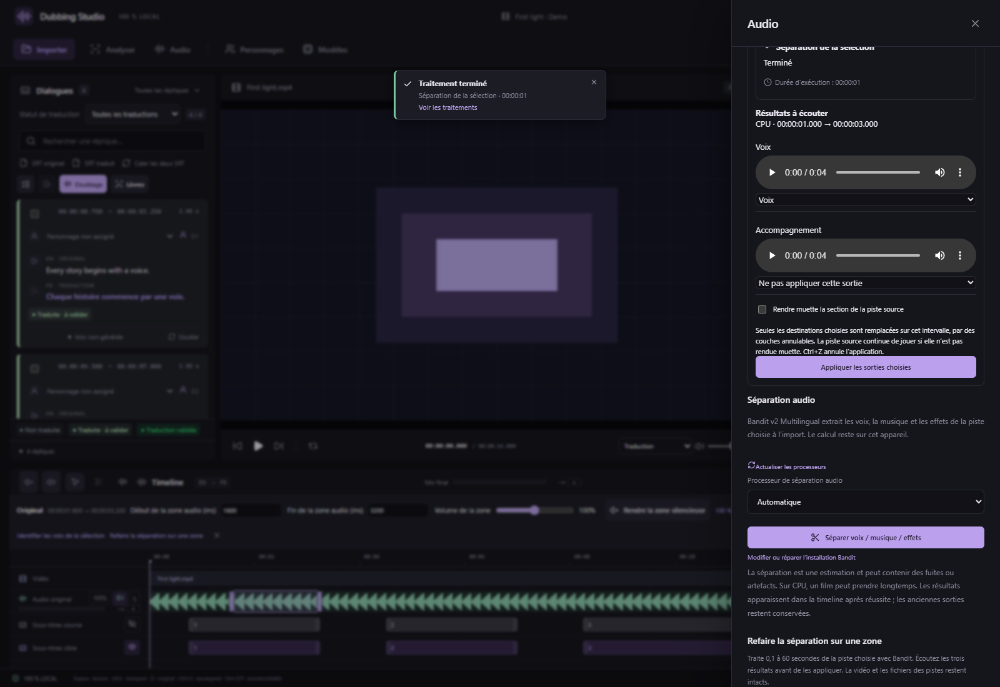

# Atelier de doublage et boîte à outils audio — v0.32

Depuis **v0.32.3**, le suivi intégré concerne aussi le timbre, l’intonation, la transcription et les lots, avec focus sur le nouvel essai sélectionné. [Guide détaillé et captures](DUBBING-INLINE-TASKS.md).

## Doubler et comparer sans quitter le panneau

Sélectionnez une réplique et cliquez sur **Ajouter un doublage** dans l’éditeur SRT, ou **Doubler / Régénérer** sur sa carte.

- **Texte qui sera prononcé** est maintenant modifiable. Il correspond au **Texte pour la voix** dans Prononciation ; le sous-titre traduit reste indépendant. Les règles de prononciation appliquées sont affichées si elles modifient le texte envoyé au moteur.
- **Texte original de la réplique** est modifiable ici aussi. Chaque sous-titre source conserve son identifiant et son intervalle, y compris lorsqu’une réplique regroupe plusieurs sous-titres. Modifier la source retire son ancienne validation de traduction.
- **Écouter la référence vocale actuelle** extrait la piste choisie, avec les corrections locales déjà appliquées, sur la durée de la réplique, au plus 20 secondes. Les références importées et les références du personnage gardent leurs propres lecteurs. L’écoute met la vidéo en pause.
- **Générer un nouvel essai** garde le panneau ouvert. Seule cette tâche affiche ses étapes, son temps, son avancement disponible et son annulation. Les dernières lignes du journal sont repliées. Le nouvel essai rejoint la liste et peut être écouté ou régénéré ; tous les essais précédents restent conservés. Les opérations qui ne fournissent pas de pourcentage affichent un indicateur indéterminé et leur étape.

Les actions explicites de validation sont liées : valider la voix sélectionnée valide aussi la traduction ; retirer sa validation retire celle de la traduction. Valider la traduction valide aussi l’essai sélectionné lorsqu’il correspond encore aux textes et à la réplique. Un essai devenu périmé reste à revoir. Sans essai, il est possible de valider le texte pour préparer un lot. Une génération nouvelle demande toujours une nouvelle écoute : elle ne devient pas automatiquement validée parce que le texte l’était déjà.

## Mode local en deux étapes

Dans Doublage, cochez **Doublage en 2 étapes : TTS puis timbre**. Installez **Chatterbox · conversion de timbre** depuis Modèles si nécessaire.

1. Configurez le TTS habituel pour produire une bonne interprétation française. Une référence française propre est préférable pour privilégier l’accent français. Le moteur, l’humeur, la qualité, la référence et le texte restent ceux du panneau.
2. Choisissez une **Référence pour le timbre final**, indépendante de celle du TTS : réplique source sur la piste choisie, référence de personnage, phrase française validée de sa bibliothèque ou fichier déjà importé.
3. Choisissez le périphérique de conversion. Les deux moteurs s’exécutent successivement et leurs processus se terminent entre les étapes ; ils ne restent pas chargés ensemble en VRAM.
4. Facultativement, activez le **guide d’intonation de la réplique source**. À 0 %, la conversion part du jeu du TTS. Au-delà, le traitement Praat existant applique des contours de hauteur, rythme et énergie de la source avant le changement de timbre. Il reste expérimental : il ne comprend pas le jeu de l’acteur, ne garantit pas les mêmes émotions et peut dégrader le naturel. Sa limite est de 30 secondes ; la conversion seule accepte jusqu’à 120 secondes.
5. Comparez les essais conservés : TTS brut, guide intermédiaire éventuel, puis timbre final. Le volume de sortie choisi s’applique à l’essai final. Une annulation ou un échec à une étape conserve les essais déjà achevés. Une reprise continue les étapes enregistrées uniquement si le projet correspond encore à leur révision.

Ce mode réutilise [ChatterboxVC officiel](https://github.com/resemble-ai/chatterbox/blob/5de7a54aa4e5e2baadb0182dde554908b48b85c2/src/chatterbox/vc.py), déjà intégré et testé dans le studio. La conversion reçoit de l’audio français ; elle ne demande pas à un second TTS de relire le texte. Elle conserve le nombre d’échantillons de la prise et ne corrige pas automatiquement un accent défectueux. Son filigrane Perth reste appliqué. La qualité doit être jugée en comparant les prises, sans présumer d’une amélioration systématique.

### XTTS-v2, ChatTTS, F5-TTS et Seed-VC

| Solution | Intérêt pour japonais → français | Choix dans cette version |
| --- | --- | --- |
| [XTTS-v2 / Coqui](https://huggingface.co/coqui/XTTS-v2) | Français et japonais parmi 17 langues ; clonage interlangue, références multiples, sortie 24 kHz. Intéressant pour comparer le timbre et l’accent. Licence de modèle CPML à examiner selon l’usage. | Comparatif pertinent, pas un nouveau moteur installé dans cette version. |
| [ChatTTS](https://github.com/2noise/ChatTTS) | Projet principalement anglais et chinois, expressivité conversationnelle. Ce n’est pas un choix prioritaire pour du français fiable. Code AGPL et poids CC BY-NC 4.0 dans la distribution officielle. | Non intégré. |
| [F5-TTS](https://github.com/SWivid/F5-TTS) | Moteur de synthèse vocale conditionnée, à évaluer avec un checkpoint réellement adapté au français. | Ce n’est pas le convertisseur audio-vers-audio du second étage. |
| [Seed-VC](https://github.com/Plachtaa/seed-vc) | Véritable conversion avec référence sans entraîner une voix RVC. Bonne piste de comparaison pour l’étage de timbre. Le mode `convert-style` de v2 transforme aussi accent et émotion : une référence japonaise peut donc réintroduire l’accent qu’on cherche à éviter. Le dépôt officiel est archivé. | Non installé dans cette version ; préférer une évaluation séparée, avec conversion de style désactivée pour préserver la diction française. |
| RVC classique | Intéressant si l’on possède déjà un bon modèle entraîné pour chaque voix. La référence seule n’équivaut pas à cet entraînement. | ChatterboxVC fournit ici le parcours sans entraînement. |

Ces appréciations reposent sur les capacités et licences annoncées par les projets ; elles ne constituent pas un classement d’écoute sur votre voix ni un benchmark RTX 5060 Ti.

## Travailler une portion de piste audio

Activez la sélection audio de la timeline, puis glissez une zone de **0,1 à 60 secondes** sur Audio original, Voix, Musique, Effets ou une piste audio personnalisée. Faites un clic droit dans cette zone et choisissez un outil. La piste Doublage conserve ses outils de montage et de conversion de timbre ; ces nouveaux séparateurs analysent les pistes source.

La même boîte à outils est disponible en haut du panneau Audio. La piste, le début et la fin restent réglables. Les modèles s’installent à la demande dans le stockage configuré, avec contrôle d’espace avant les dépendances. Les téléchargements et les poids sont vérifiés par taille et SHA-256. Les modèles installés suivent les déplacements du stockage. Aucun service externe ne reçoit la sélection ou la description.

| Outil | Sorties proposées | Usage et limites |
| --- | --- | --- |
| **BS-RoFormer Viperx 1297** | Voix, accompagnement | Séparation voix/accompagnement. Les poids communautaires n’annoncent pas explicitement de licence ; la licence MIT du chargeur ne suffit pas à établir les droits sur les poids. |
| **Mel-Band RoFormer Kim** | Voix, accompagnement | Autre séparateur vocal, à comparer sur l’extrait. Distribution [KimberleyJSN](https://huggingface.co/KimberleyJSN/melbandroformer). |
| **Demucs v4 htdemucs** | Voix, batterie, basse, reste | Sépare des composantes musicales. Le « reste » n’est pas une piste SFX propre. |
| **Demucs v4 htdemucs_ft** | Mêmes quatre sorties | Ensemble de quatre modèles spécialisés ; plus coûteux que htdemucs. |
| **AudioSep** | Son demandé, reste du signal | Décrivez ce qu’il faut isoler, de préférence en anglais : `A man speaking`, `footsteps`, `background music`. Une description est un conditionnement sonore ; le texte n’est jamais exécuté comme une commande. La séparation dépend du contenu. |

Les modèles RoFormer et Demucs utilisent les architectures [audio-separator](https://github.com/nomadkaraoke/python-audio-separator). [Demucs](https://github.com/adefossez/demucs) ne fournit pas à lui seul une distinction générale musique/bruitages. [AudioSep](https://github.com/Audio-AGI/AudioSep) permet une extraction guidée par description. Toutes les sorties restent à contrôler à l’oreille, notamment lorsque voix et bruitages se chevauchent.

Le profil par défaut traite des fenêtres de 4 secondes avec recouvrement pour limiter la mémoire. Des fenêtres plus courtes peuvent aider sur 16 Go de VRAM ; la vitesse et la mémoire de ces modèles n’ont pas été qualifiées sur votre RTX. Une sélection explicite CUDA ne bascule pas silencieusement sur le CPU en cas d’échec. Le CPU est un choix explicite disponible.

### Écouter et appliquer

Une séparation n’écrit aucune modification du projet. Chaque sortie possède un lecteur et une destination **Ne pas appliquer / Voix / Musique / Effets / piste personnalisée**. Choisissez uniquement les sorties utiles ; une destination ne peut recevoir qu’une sortie dans la même application.

**Appliquer les sorties choisies** ajoute des couches de remplacement à l’intervalle exact de la sélection. Les pistes manquantes sont créées sur une base silencieuse. Les autres instants et les autres pistes restent intacts. Cochez **Rendre muette la section de la piste source** si vous souhaitez ne plus entendre l’ancien signal dans le mix ; sinon il continue de jouer suivant son volume et son activation. Si une destination est la piste source elle-même, son remplacement suffit.

**Ctrl+Z / Ctrl+Y** annule ou rétablit l’application. Les fichiers source, la vidéo principale et tous les essais de doublage restent intacts. Les corrections s’entendent dans le mix et l’export MKV. Une source, une piste, des régions, des couches ou un fichier modifiés depuis l’analyse empêchent l’application d’un résultat périmé. Le résultat peut toujours être auditionné ; il faut relancer la séparation pour l’appliquer à la nouvelle source.

## Contrôle IA et stockage

Le format de projet 23 conserve les informations du pipeline et les couches audio. Le serveur expose 132 outils MCP (100 natifs + 32 d’état/édition/lecture), dont le pipeline, les installations, la séparation, les résultats, les chemins de préécoute et leur application explicite. Voir [MCP](MCP.md).

Les volumes indiqués dans les paramètres sont des fichiers sur disque, pas une mesure de VRAM. RoBERTa et CLAP sont chargés depuis les actifs vérifiés d’AudioSep ; le worker reste hors ligne pendant l’inférence. Les dépendances sont isolées et les archives déjà présentes d’autres moteurs ne sont réutilisées qu’après vérification de leur empreinte.
