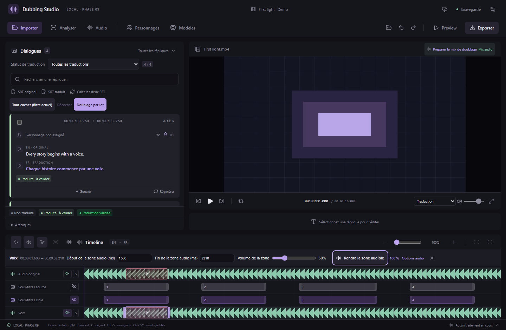

# Fondus, sélections audio et navigation

Disponible depuis **v0.15.0**. Ces outils fonctionnent avec les doublages déjà générés, sans télécharger de modèle supplémentaire.

## Fondus sur une portion de doublage

1. Double-cliquez un bloc de la piste **Doublage** pour ouvrir sa forme d’onde.
2. Sélectionnez une portion par glissement, ou avec les champs de début/fin. Les petites poignées du haut redimensionnent cette sélection ; la poignée **↔** du bas étire l’audio.
3. Renseignez **Fondu d’entrée (ms)** et **Fondu de sortie (ms)**, puis cliquez sur **Appliquer les fondus**. Les valeurs peuvent être nulles ; leur somme doit tenir dans la durée sélectionnée.
4. Réécoutez la sélection. **Retirer les fondus** rétablit une enveloppe de volume pleine sur cette portion, sans retirer son réglage de volume. Les champs servent à configurer la nouvelle enveloppe à appliquer.

Exemple : sur une zone de 1 000 ms, une entrée de 100 ms monte progressivement du silence au volume de la zone ; une sortie de 200 ms descend au silence pendant les 200 dernières millisecondes. Les courbes sont linéaires. Le réglage ne change ni la position ni la durée de la voix.

La forme d’onde reflète les fondus. Si la portion traverse plusieurs segments précédemment coupés ou réglés à des volumes différents, le fondu est continu sur toute la sélection : il ne redémarre pas à chaque segment. Un découpage ultérieur conserve les niveaux atteints à ses bornes ; un étirement adapte les temps de l’enveloppe à la nouvelle durée.

Les originaux restent intacts. Les fondus suivent l’essai choisi, la sauvegarde, l’annulation/rétablissement, l’écoute, le lecteur vidéo et les exports WAV/MKV. Une retouche vidéo des lèvres déjà calculée pour cet essai doit être recalculée après un changement audio.

## Redimensionner les zones des pistes audio

- Activez l’outil de sélection audio ou maintenez **Maj** en glissant sur la piste.
- Tirez la poignée **gauche** ou **droite** de la sélection. Les champs **Début / Fin de la zone audio (ms)** permettent aussi de saisir une borne exacte ; validez avec **Entrée** ou quittez le champ.
- Sur une sélection libre, cela change uniquement la sélection. Sur une zone dont le volume ou le silence a déjà été appliqué, cela redimensionne la zone en conservant son traitement et son identifiant.
- Le redimensionnement d’une zone enregistrée s’arrête à la zone voisine et aux limites de la piste. Pour remplacer volontairement un traitement voisin, créez une nouvelle sélection puis appliquez le volume souhaité.
- **Échap** annule un glissement en cours. Une modification de zone enregistrée se valide au relâchement et peut être annulée avec **Ctrl+Z**.
- Avec une poignée au clavier : **← / →** déplacent la borne de 10 ms ; **Maj + ← / →** de 1 ms.

Ces contrôles concernent **Audio original, Voix, Musique, Effets et Doublage**. La zone ne peut pas être inversée ou vide. Une zone de volume désactivée reste désactivée après son redimensionnement.

## Suivre la réplique sélectionnée

Un clic sur une réplique, ou les boutons de réplique précédente/suivante, ramène la vue horizontale des pistes autour de cette réplique et de la tête de lecture. La marge de lecture configurée est conservée. Un clic sur un bloc de doublage utilise sa position réelle dans la vidéo.

Le zoom choisi ne change pas. Lorsque la zone est plus grande que la vue, la tête de lecture est prioritaire, avec du contexte avant elle. Recliquer sur la même réplique recentre à nouveau la vue après un défilement manuel. Les retouches et le redimensionnement d’une sélection ne provoquent pas de recentrage permanent.

Si l’éditeur de doublage est ouvert, il suit l’essai actif de la nouvelle réplique ; il se ferme si celle-ci n’a pas encore de doublage actif. La sélection audio précédente est effacée pour ne pas éditer par erreur une autre scène. Une écoute isolée en cours s’arrête lors du changement de réplique.

*Captures de l’interface React avec audio de démonstration synthétique et commandes natives simulées. Les tests audio et MKV utilisent séparément le véritable FFmpeg.*

Les projets existants restent lisibles. La première application d’un fondu utilise le **format de projet 12**, qui nécessite v0.15.0 ou plus récente. Les anciennes retouches sans fondus conservent leur format précédent.

Depuis v0.15.1, les durées et déplacements sont protégés par les limites réellement disponibles. Les saisies de calage se valident avec Entrée ou en quittant le champ. Voir le [guide des limites et de la récupération](VOICE-DURATION-SAFETY.md).

Depuis v0.16.0, un **clic droit → Supprimer la zone** retire une zone de volume/silence directement sur la timeline, avec annulation. [Guide des menus contextuels](CONTEXT-MENUS.md).
