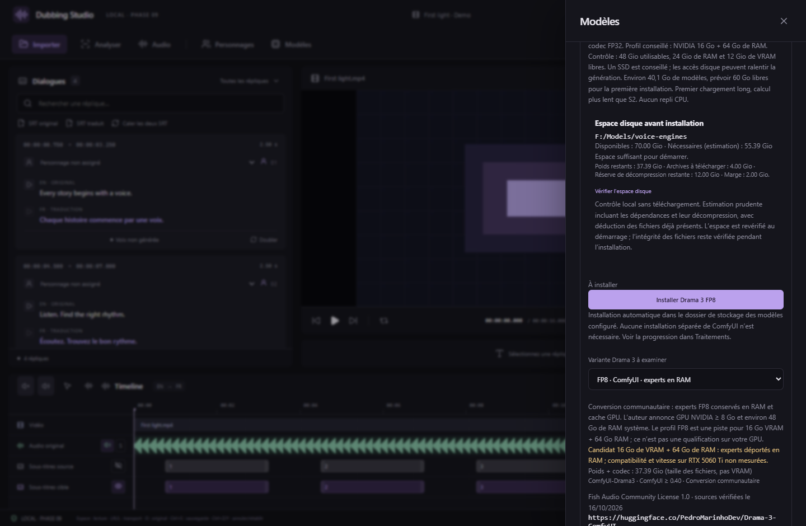

# Fish Audio Drama 3 — génération FP8 avec experts en RAM

Depuis **v0.10.0**, le studio installe et utilise un moteur Drama 3 distinct de S2. Le profil communautaire FP8/BF16 garde les experts routés en RAM et limite leur cache GPU à **4 Gio**. Le codec FP32 est utilisé avant puis après le modèle ; il ne reste pas chargé sur le GPU pendant la génération des codes. Built with Fish Audio.

## Installation sur RTX 5060 Ti 16 Go + 64 Go de RAM

1. Choisir le dossier dans **Paramètres → Stockage des modèles**. Prévoir environ **60 Go libres** à la première installation, sur un SSD si possible. Les poids et le codec représentent **40 144 065 412 octets**, soit 37,39 Gio ; le runtime Python/CUDA et ses archives s’ajoutent à ce total.
2. Ouvrir **Modèles → Fish Audio Drama 3**. Laisser la variante **FP8 · ComfyUI · experts en RAM**, puis cliquer sur **Installer Drama 3 FP8**. Depuis v0.10.1, le bouton est directement dans cette fiche. Une installation existante affiche **Vérifier / réparer Drama 3 FP8**. Les téléchargements utilisent des révisions, tailles et SHA-256 fixés. La vérification peut durer, particulièrement pour le fichier de 38,6 Go. Le bouton Annuler et les logs restent disponibles ; un nouvel essai réutilise les fichiers complets vérifiés.
3. Fermer les autres moteurs IA et applications gourmandes. Le profil conseillé reste **64 Go de RAM + NVIDIA 16 Go**. Depuis v0.10.3, les experts restent dans des vues du fichier Safetensors mappé, sans copie complète en RAM verrouillée. Les contrôles demandent **48 Gio de RAM physique utilisable**, **24 Gio de RAM disponible** et **12 Gio de VRAM libre**. Le cache GPU reste plafonné à 4 Gio. La mémoire disponible est contrôlée au démarrage et à nouveau après libération du codec, avant le chargement du grand modèle.
4. Dans **Doublage**, choisir Drama 3 et le GPU NVIDIA. « Automatique » choisit le premier GPU CUDA visible ; le Ryzen iGPU n’est pas un périphérique CUDA. Un choix `cuda:N` conserve ce GPU pendant toutes les étapes. Il n’y a pas de génération de secours sur CPU.

Le moteur utilise PyTorch 2.8.0 avec CUDA 12.8 et les experts FP8 sont déquantifiés en BF16 à l’utilisation. Il ne dépend pas des noyaux de quantification optimisés CUDA 13 de Comfy Kitchen. Un avertissement Comfy sur ces noyaux ne signifie donc pas que la génération BF16 a échoué.

## Générer une réplique

1. Saisir le texte traduit, puis ouvrir **Doubler** sur la réplique.
2. Choisir **Fish Audio Drama 3 · FP8 · experts en RAM** et la RTX.
3. Choisir une référence vocale de **1 à 20 secondes**, propre et sans musique si possible. La piste d’extraction reste celle choisie dans Audio, par défaut Voix. Une référence française peut mieux guider l’accent français.
4. Fournir **la transcription exacte de toute la référence**, dans sa langue d’origine. Pour une référence de personnage, utiliser **Transcrire la référence** puis vérifier le résultat. Drama 3 n’utilise pas le mode sans transcription ; la traduction française d’une référence japonaise ne remplace pas son texte japonais exact.
5. Choisir l’humeur, la vitesse et la graine, puis **Générer un nouvel essai**. La consigne d’humeur est une indication au modèle, sans résultat garanti. Les logs montrent le chargement, les morceaux de texte et les trames audio générées.
6. Écouter et choisir l’essai. Le WAV mono 24 kHz rejoint les outils existants : déplacement et durée sur la timeline, ajustement automatique, mixage avec les pistes, retouche des lèvres et export MKV.

Ces captures montrent la véritable interface React dans Chrome, avec inventaire CUDA et fin de génération simulés pour les tests ; elles ne montrent pas un résultat du modèle complet.

## Temps de calcul et mémoire

Le premier chargement lit environ 38,6 Go de poids et prépare les banques d’experts en RAM. Cela peut prendre plusieurs minutes. Le modèle et le codec sont libérés à la fin de la tâche. La séparation RAM/GPU économise la VRAM, mais ajoute des transferts PCIe ; ne pas attendre les temps de S2. La tâche est limitée à une heure, environ 28 secondes par morceau de texte et 120 secondes de sortie au total ; une limite de trames atteinte rejette la prise tronquée.

Le cache de 4 Gio est réduit si la mémoire libre et les couches à charger l’exigent. Une réserve GPU de 2 Gio est demandée. La construction du modèle sur `meta` puis l’assignation des poids évitent une seconde copie complète en RAM. Ces protections ne constituent pas une garantie de consommation mesurée sur la RTX 5060 Ti.

Le poste de développement n’a pas de GPU NVIDIA et ne peut pas charger les poids complets. Les tests Windows CPU vérifient le calcul FP8, les banques RAM, les évictions du cache, une génération autorégressive avec un modèle réduit et les 1 367 noms/formes de tenseurs des en-têtes réels. **Vitesse, pic mémoire et qualité française du modèle complet restent à mesurer sur votre machine.** Voir [VALIDATION.md](../VALIDATION.md).

Si une prise se tait ou s’interrompt, vérifier que la transcription couvre tout l’extrait, utiliser une référence différente puis une autre graine. L’auteur du chargeur signale ce comportement possible avec certaines références.

## Sources, variantes et licences

- [Modèle Fish Audio Drama 3](https://huggingface.co/fishaudio/drama-3) : MoE d’environ 35B, environ 3B actifs ; le runtime officiel annonce au moins 48 Go de VRAM.
- [Chargeur ComfyUI-Drama3](https://github.com/PedroMarinhoDev/ComfyUI-Drama3), révision `66c4fb9cd3c0151e1e2ccd207847cb8335e87ab4`, avec adaptation de chargement documentée. Utilisé sans serveur ni installation préalable de ComfyUI.
- [Poids convertis FP8 et codec](https://huggingface.co/PedroMarinhoDev/Drama-3-ComfyUI), révision `9063c072019aa578895e51adb5489c6cd2c834b0` ; tailles et SHA-256 dans `workers/voice-engines.json`.
- ComfyUI 0.40.0, révision `3541246a9c997f4b8c32f9f88f3c985d02021c79`. Source et licence du cœur distribuées dans `workers/vendor/drama3/comfy-core.zip` ; dépendances Windows isolées et vérifiées dans `workers/drama-runtime.json`.

Les variantes officielles FP8, INT4/SGLang-Omni, W6A8 et W4A8 restent **référencées sans moteur de génération intégré**. Aucun moteur GGUF Drama 3 n’est annoncé utilisable ici. Les installations S2 restent séparées.

Consulter la [Fish Audio Community License 1.0](https://huggingface.co/fishaudio/drama-3/blob/main/LICENSE) pour les poids, composants Fish et sorties. Le chargeur et le cœur Comfy sont sous GPL-3.0 avec exceptions décrites par leurs notices ; le source correspondant et les licences sont fournis avec l’application. Les poids sont téléchargés sur demande et ne sont inclus dans aucune archive de distribution.

## Espace disque insuffisant

Depuis **v0.10.2**, la fiche Drama 3 affiche le dossier utilisé, l’espace disponible et une estimation prudente de l’espace supplémentaire nécessaire **avant le téléchargement des dépendances**. Le bouton d’installation reste désactivé tant que le contrôle est en cours, impossible ou insuffisant. Après avoir libéré de l’espace, utilisez **Vérifier l’espace disque**.

Le calcul inclut les poids manquants, les archives non présentes dans les caches Drama/CosyVoice, une réserve de 12 Gio pour le runtime décompressé (réduite de la taille du Python/cœur déjà présent) et 2 Gio de marge. Le paquet PyTorch épinglé décompressé représente à lui seul environ 6,88 Gio. Il s’agit d’une estimation de capacité, basée sur les tailles : les SHA-256 sont toujours vérifiés pendant l’installation. Un disque déconnecté bloque le démarrage. Le contrôle est répété au clic puis par la tâche native avant toute installation ; une diminution de l’espace libre peut donc empêcher une tâche initialement affichée comme possible.

Capture de l’interface React réelle avec un disque et des tailles simulés pour vérifier le blocage sans télécharger les modèles.

`TTS_DRAMA_DISK_REQUIRED` signifie que le disque du dossier de modèles n’a pas assez d’espace libre. Les logs de Traitements indiquent désormais le chemin vérifié, les Gio disponibles et les Gio requis (poids restant à télécharger + 2 Gio de marge). Prévoyez environ 60 Go libres pour une première installation complète, runtime compris. Libérez de l’espace ou déplacez le stockage depuis Paramètres, puis réessayez l’installation. Les fichiers complets déjà téléchargés sont réutilisés après vérification.

## Mémoire disponible et erreur TTS_DRAMA_RAM_REQUIRED

64 Go installés ne signifient pas 64 Gio disponibles : Windows, le navigateur, les autres moteurs IA et la mémoire réservée à l’iGPU en occupent une partie. L’ancien profil demandait 46 Gio disponibles et copiait les experts dans de la RAM verrouillée. Le profil v0.10.3 conserve des vues contiguës des poids mappés, que Windows peut garder en cache ou relire depuis le disque selon la pression mémoire. Le calcul neuronal reste sur le GPU sélectionné, sans repli CPU. Aucun poids n’est converti ni retéléchargé pour ce changement.

Un SSD est conseillé pour le dossier des modèles. Si les pages ne tiennent pas en RAM, les relectures peuvent fortement ralentir la génération. Les seuils sont des garde-fous conservateurs du profil, pas une garantie de débit ou une mesure sur une RTX 5060 Ti. Fermez les autres applications IA et consultez les valeurs **physical / available / required / VRAM** dans les logs si le contrôle bloque encore. Ne désactivez pas les garde-fous pour forcer un chargement.

## Variantes plus légères et vitesse

Le [port communautaire ComfyUI](https://github.com/PedroMarinhoDev/ComfyUI-Drama3#choosing-a-file) annonce les profils suivants pour ses experts en RAM :

| Variante | Fichier du modèle | RAM annoncée par l’auteur |
|---|---:|---:|
| FP8 | 38,6 Go | environ 48 Go |
| W6A8 | 32,7 Go | environ 40 Go |
| W4A8 | 24,6 Go | environ 32 Go |

L’auteur constate davantage de sorties silencieuses en W4A8. W6A8 est donc un candidat à examiner pour réduire la mémoire en conservant la qualité. **Dans le studio v0.10.3, ces deux variantes restent au catalogue préparatoire ; seule la génération Drama 3 FP8 est intégrée.** Les chiffres ci-dessus ne sont pas les seuils du nouveau chargement mappé du studio et ne constituent pas des mesures sur une RTX 5060 Ti.

Des [GGUF Drama 3 pour un port audio.cpp spécifique](https://huggingface.co/Jmica/Drama-3-GGUF) existent aussi. Ils demandent leur chargeur natif et ne peuvent pas être ajoutés au chargeur FP8 actuel en changeant simplement le fichier.

Pour le profil intégré, libérer de la RAM et placer les poids sur SSD limite les relectures lentes. Le studio charge puis libère le modèle à chaque essai : conserver un moteur chaud pendant plusieurs répliques, réutiliser les références encodées et ajuster le cache VRAM sont des pistes d’optimisation futures, à mesurer avec des limites mémoire explicites. Aucun facteur d’accélération n’est garanti par v0.10.3 et une quantification plus petite n’est pas automatiquement plus rapide avec tous les noyaux CUDA.
