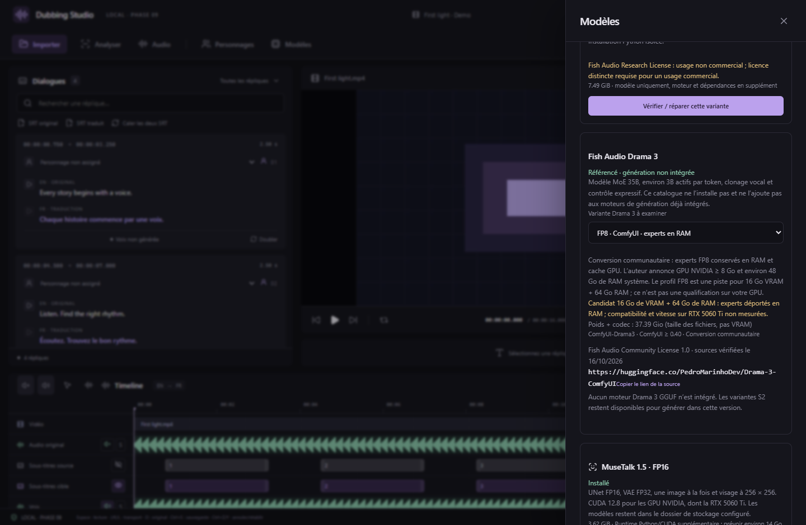

# Fish Audio Drama 3 — catalogue du studio, 16 octobre 2026

Drama 3 est désormais visible dans **Modèles**, avec les variantes et sources ci-dessous. Son moteur de génération **n’est pas intégré dans v0.9.0** : il n’y a pas de bouton d’installation ni de choix Drama 3 dans Doublage. Les moteurs CosyVoice3, Fish S2 et Qwen3 déjà intégrés restent utilisables.

Le [modèle officiel](https://huggingface.co/fishaudio/drama-3) possède un backbone MoE d’environ 35B paramètres, dont environ 3B actifs par token. Ses experts sont en FP8, le reste en BF16 ; le nombre de paramètres actifs ne signifie pas que tous les poids tiennent dans une petite carte. La [documentation d’installation](https://speech.fish.audio/install/) annonce au moins **48 Go de VRAM** et NVIDIA CUDA sous Linux/WSL pour le runtime officiel.

## Pistes pour RTX 5060 Ti 16 Go + 64 Go de RAM

La [conversion communautaire ComfyUI-Drama3](https://huggingface.co/PedroMarinhoDev/Drama-3-ComfyUI) conserve les experts en RAM et utilise un cache GPU. Son auteur annonce un GPU NVIDIA à partir de 8 Go, et environ 48 Go de RAM pour les poids FP8. Cela en fait un **candidat** pour votre configuration, sans qualification sur RTX 5060 Ti ni mesure de qualité française dans le studio. Le chargeur est distinct de celui de S2 FP8.

| Variante | Fichiers du modèle + codec | RAM indiquée par l’auteur | État dans le studio |
| --- | --- | --- | --- |
| FP8 / BF16 officiel | Environ 41,47 Go | Runtime officiel : GPU ≥ 48 Go | Référencé, non intégré |
| ComfyUI FP8 experts / BF16 | Environ 40,14 Go | Environ 48 Go système | Candidat 16 Go VRAM + 64 Go RAM, non intégré |
| ComfyUI W6A8 | Environ 34,22 Go | Environ 40 Go système | Référencé, non intégré |
| ComfyUI W4A8 | Environ 26,17 Go | Environ 32 Go système | Référencé ; l’auteur signale davantage de sorties silencieuses |
| [INT4 W4A16 / SGLang-Omni](https://huggingface.co/fishaudio/drama-3-int4) | Environ 23,97 Go avec codec | Qualification 16 Go non établie ici | Référencé, non intégré |

Les tailles sont calculées depuis les métadonnées des fichiers Hugging Face, codec inclus, et ne représentent pas la VRAM. Le catalogue indique les tailles en **Gio**. Les révisions exactes consultées sont dans `src/domain/dramaModels.json`. Aucun poids Drama 3 n’est téléchargé par cette version, et aucune variante GGUF Drama 3 n’est annoncée compatible avec notre moteur audio.cpp.

Capture de la vraie interface React/Chrome ; la disponibilité des modèles installés est simulée pour le test. Le catalogue Drama 3 lui-même utilise les métadonnées publiques vérifiées. Il ne s’agit pas d’un résultat d’inférence.

La licence à consulter est la [Fish Audio Community License 1.0](https://huggingface.co/fishaudio/drama-3/blob/main/LICENSE). Le catalogue ne modifie pas les installations S2 et n’assimile pas leurs formats ou licences à ceux de Drama 3.
