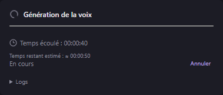
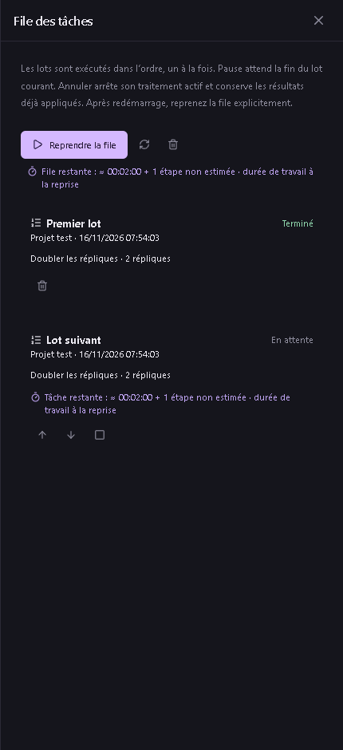

# Durée des essais et estimation — v0.53.0

## Durée conservée avec chaque nouvel essai

Dans **Doublage → Essais**, la ligne de création indique maintenant **Calcul : HH:MM:SS**, à côté de la date et de l’heure. Elle mesure l’opération ayant créé cet essai : génération TTS, changement de timbre ou transfert d’intonation. La longueur du fichier audio, indiquée dans l’en-tête de l’essai, reste distincte du temps de calcul.

Le chronomètre natif utilise une horloge monotone, de la préparation au WAV prêt. Il inclut le chargement du modèle et les nouvelles tentatives internes éventuelles. L’attente avant le début de l’opération est exclue. Dans un lot, chaque essai possède sa propre mesure ; le temps global du traitement reste affiché séparément. Pour une chaîne à plusieurs étapes, les essais intermédiaires et l’essai issu de la conversion possèdent les mesures de leurs opérations respectives.

La mesure est enregistrée dans le projet, indépendamment de l’historique des tâches. Elle reste disponible après fermeture et réouverture. Les essais précédents, les sources audio et la vidéo sont conservés. Une transformation crée sa propre mesure au lieu d’attribuer le temps du parent au nouvel essai. Le lien avec l’identifiant de l’essai évite également d’afficher une mesure parent copiée par un ancien client.

Les anciens essais et les prises importées ou enregistrées sans mesure affichent **Durée non mesurée**. Leur temps de calcul ne peut pas être déduit de leur durée audio ou de leur date de création ; aucune valeur rétroactive n’est inventée.

## Estimation pendant la génération

Le temps restant estimé apparaît à côté de la durée écoulée, dans le panneau de doublage et dans **Traitements**. Il est actualisé pendant l’exécution, même lorsque le moteur n’envoie pas de pourcentage.

L’estimation concerne **l’essai ou l’étape en cours**, y compris pendant un lot. Les nouveaux totaux décrits ci-dessous complètent cette estimation par étape.

La calibration utilise jusqu’à cinq mesures de taille proche, parmi les 512 générations les plus récentes du projet. Elle sépare le moteur, le périphérique demandé, la langue et les réglages de génération, ainsi que les démarrages à froid et le modèle déjà chargé dans un lot. Pour le TTS, la taille du texte et une catégorie de durée de référence servent à sélectionner des exemples comparables. Pour les transformations audio, la durée de l’audio source est utilisée. Une empreinte locale du PC, hachée dans la clé de comparaison, évite de réutiliser automatiquement les temps d’un autre ordinateur.

- Sans mesure comparable : **Estimation indisponible · historique comparable insuffisant**.
- Avec un historique : affichage d’un temps restant **approximatif**, fondé sur la médiane des exemples proches.
- Si le temps prévu est dépassé : **Estimation dépassée · traitement en cours**, sans rester artificiellement à zéro seconde et sans arrêter la tâche.
- Après arrêt, annulation ou fin : l’estimation disparaît et la durée d’exécution reste consultable.

La mémoire disponible, les autres applications, la référence et la variabilité du moteur peuvent modifier le temps réel. Le premier essai d’une configuration n’a donc pas nécessairement d’estimation, et le premier essai avec un modèle déjà chargé peut devoir attendre sa propre mesure de calibration.

## Total du doublage par lot et de la file — v0.53.0

Le panneau de doublage et les traitements affichent **Lot restant** pour l’ensemble des essais encore à exécuter. Chaque essai compte : quatre essais sur dix répliques représentent quarante opérations. Les essais terminés, échoués ou ignorés sont retirés du reste à faire ; une relance repart de ses opérations inachevées. Le premier chargement et le modèle conservé en mémoire ont des mesures distinctes, y compris pour les moteurs GGUF. Après une erreur ayant déchargé le modèle, le prochain départ est recalculé à froid.

Dans **File des tâches**, **File restante** additionne le travail du lot actif et des tâches en attente. Chaque tâche possède aussi son propre total. Le décompte utilise seulement le temps de l’opération active : lorsqu’un essai dépasse sa prévision, il ne consomme pas artificiellement la durée des essais futurs. Les coûts sont recalibrés après chaque nouvel essai ; la file s’actualise toutes les deux secondes tant qu’elle contient du travail, sans lire les fichiers audio ni réécrire son journal pour ces rafraîchissements.

- **≈ 00:03:00** : toutes les opérations prévues disposent d’une estimation comparable.
- **≈ 00:03:00 + 2 étapes non estimées** : seule la partie connue est chiffrée ; ce n’est pas une prévision complète du total.
- **Estimation indisponible** : aucune mesure comparable ne chiffre encore le travail restant. Le premier lot apprend au fur et à mesure.
- **Étape en cours plus longue que prévu** : le traitement continue et le total devient partiel tant que cette étape n’est pas terminée.

Les chaînes **isoler puis doubler** comptent aussi les séparations encore à effectuer. Elles utilisent les temps de séparations locales réussies, avec le même outil, périphérique, fenêtre et une durée proche ; elles ne réutilisent pas les temps du TTS. Si la future piste Voix n’existe pas encore, le doublage reste non estimé jusqu’au lancement de son lot réel. Les durées d’application finale, de libération du modèle et les autres tâches non calibrées peuvent ajouter un peu de temps ; l’interface signale la finalisation.

Il s’agit du **temps de travail estimé**, pas d’une heure de fin garantie. Pause attend toujours la fin du lot actif : celui-ci continue à décompter, puis les durées en attente restent fixes jusqu’à la reprise. Les délais d’une pause, d’une attente de ressources ou de l’ouverture manuelle d’un autre projet ne sont pas prévisibles. Une tâche indépendante déjà active est incluse dans l’attente de la file, ou signalée comme non estimée.

Les futurs lots utilisent leur sélection figée et les mesures de leur projet ouvert. Pour un autre projet, ils conservent la prévision disponible au moment de l’ajout. Un futur lot sans forçage peut encore ignorer des essais devenus disponibles grâce à un lot précédent ; son plan réel est recalculé au lancement. Les journaux de file antérieurs à v0.53 restent compatibles et affichent leurs opérations non estimées jusqu’à la reprise. Après redémarrage, la file reste en pause et les opérations interrompues ne décomptent pas le temps passé application fermée.

## Données et MCP

Ces métadonnées facultatives ne changent pas le format audio ni les réglages de synthèse. Les projets existants restent compatibles ; aucun nouveau format projet n’est nécessaire. Le catalogue conserve **170 outils MCP / 33 schémas**.

`studio_get_project` renvoie `generationTiming` sur les nouveaux essais : identifiant mesuré, opération, `elapsedMs`, taille d’entrée, indicateur `warmModel` et clé de comparaison hachée. `studio_list_jobs` expose l’estimation de l’opération active, son nombre d’exemples et le point de départ dans le chronomètre global. Ces champs sont absents des anciens enregistrements. En v0.53, `studio_list_jobs` fournit aussi `workEstimate` pour le lot entier. `studio_task_queue_status` expose `workEstimate` sur la file et chaque tâche : durée et compte des opérations futures connues/inconnues, plus l’identifiant et le point de départ de l’opération active. Les entrées terminées ne participent plus au total. Ces lectures ne lancent aucun traitement.

Les tests natifs exécutent un vrai worker de protocole et vérifient la mesure, la réouverture et l’utilisation de l’historique. Le diagnostic du portable utilise le SDK MCP officiel, une valeur de test explicite et un redémarrage réel pour vérifier la persistance, le rejet de mesures invalides et les empreintes des WAV et de la vidéo. Ces contrôles ne réévaluent pas la qualité ou la vitesse des modèles neuronaux, dont les moteurs restent inchangés. Les captures d’interface utilisent des données de test.
