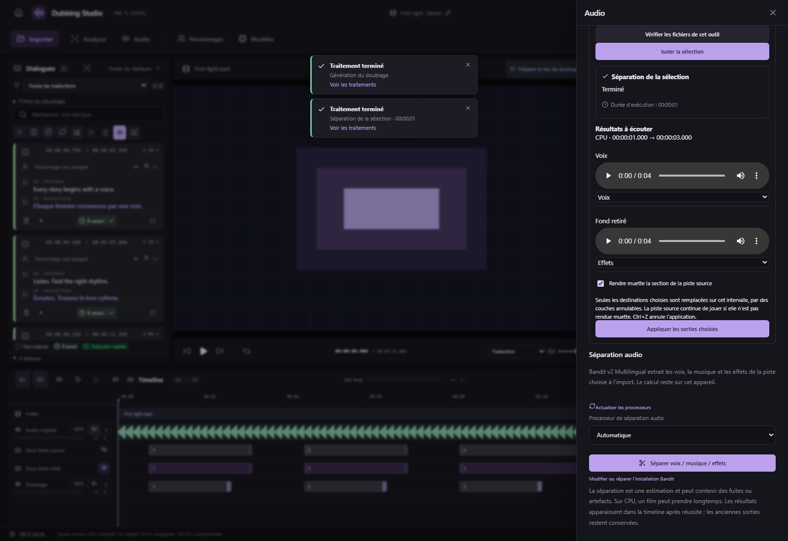

# Inworld Voice Isolator — v0.58.0

**Voice Isolator v1 Offline** nettoie la voix au premier plan à **48 kHz**. Il peut servir à retirer musique, bruit et bavardages avant de préparer une référence vocale ou une transcription. Inworld indique avoir entraîné le modèle à préserver le timbre, les respirations et les rires. Ces objectifs ne garantissent pas le résultat sur chaque scène : préécoutez la voix et le fond retiré.

Il complète les séparateurs de locuteurs : **TF-GridNet / SR-CorrNet** divisent plusieurs voix, tandis qu’Inworld nettoie le premier plan sans référence permettant de choisir un personnage. Le fond retiré peut contenir une autre voix que vous souhaitez conserver. Ce n’est pas une séparation fiable Musique/SFX, ni une restauration d’aigus manquants.

## Utilisation

1. Sélectionnez une portion de piste, puis **clic droit → Nettoyer la voix · Inworld 48 kHz**. Vous pouvez aussi ouvrir **Audio → Boîte à outils audio**, ou **clic droit sur un dialogue → Isoler les voix…**, puis choisir **Inworld Voice Isolator v1 · 48 kHz**.
2. Choisissez la piste source et les bornes (0,1 à 60 secondes). Cliquez sur **Installer ou réparer cet outil**. Le dossier de modèles configuré est utilisé ; le gestionnaire des modèles permet de supprimer cette installation.
3. Lancez **Isoler la sélection**. L’avancement reste dans le panneau courant. Écoutez **Voix** et **Fond retiré** avant de sélectionner une destination.
4. Affectez les sorties souhaitées à Voix, Musique, Effets ou une piste audio existante. Le résultat remplace seulement la portion correspondante par des couches annulables. Cochez **Rendre muette la section de la piste source** pour éviter une écoute en double. **Ctrl+Z** annule.

Les anciens essais, les sous-titres, les sources et la vidéo principale sont conservés. Inworld reçoit un mélange mono des deux canaux ; la voix isolée est centrée en stéréo et le fond est calculé par soustraction de cette voix aux canaux d’origine. Les sorties restent au même timestamp, avec le même nombre d’échantillons. Un gain commun peut être appliqué pour éviter la saturation, sans normaliser séparément les deux sorties.

## Réglages pour la RTX 5060 Ti 16 Go

- **Périphérique : NVIDIA GeForce RTX 5060 Ti**, ou **Automatique (GPU CUDA prioritaire)**.
- **Fenêtre de traitement : 2 s** par défaut lors du choix d’Inworld. Des fenêtres de 4/6/8 s offrent davantage de contexte avec plus de mémoire utilisée. Le checkpoint officiel utilise 8 s ; comparez les fenêtres à l’écoute.
- **BF16 sur CUDA compatible**, conformément à la précision d’entraînement indiquée par Inworld ; **FP32** sur CPU ou GPU sans BF16. Le STFT, l’iSTFT et le scan restent en FP32.
- En cas d’erreur CUDA de mémoire, la fenêtre est divisée par deux jusqu’à 0,5 s, sur le **même GPU**. Un GPU explicitement choisi ne bascule pas sur CPU. La fenêtre effective, les tentatives et le pic VRAM PyTorch sont affichés.

Le scan PyTorch prépare ses facteurs par blocs de **8 trames**, au lieu de 64 en amont. La récurrence et l’ordre des calculs par trame restent identiques. Cela limite les grandes allocations temporaires, notamment sur les fenêtres longues. Les deux références indépendantes de 3 et 11 secondes vérifient cette équivalence. Aucun compilateur CUDA, Triton ou module Mamba externe n’est installé ; le scan PyTorch peut être plus lent que les kernels fusionnés optionnels de l’auteur.

Le moteur réutilise l’environnement Audio isolé **PyTorch 2.8 / CUDA 12.8**, dont toutes les dépendances requises étaient déjà prévues. Les poids représentent environ **244 Mio** ; la première installation du moteur partagé demande davantage de disque. L’espace nécessaire/disponible est vérifié avant téléchargement. Les fichiers sont vérifiés par taille et SHA-256, puis leur architecture est chargée sur CPU avant de marquer l’installation prête. Aucun téléchargement n’a lieu à l’inférence.

## Lots et MCP

Le compositeur de tâches propose Inworld pour **Isoler les voix** et **Isoler puis doubler**. Le modèle, la piste, le GPU, la fenêtre et le routage sont figés avec la tâche. L’accompagnement correspond ici au **fond retiré**, qui peut contenir musique et bruitages : choisissez sa destination en conséquence. Les tâches restent en attente jusqu’au lancement de la file.

Les **177 outils MCP / 37 schémas** restent disponibles. Utilisez `studio_install_audio_toolbox_model` puis `studio_separate_audio_selection` avec `modelId:"inworld-voice-isolator-v1"` et les options Audio habituelles. `studio_audio_toolbox_result` expose `vocals` et `instrumental` (fond), ainsi que le périphérique, la précision, la fenêtre effective, les tentatives et le pic VRAM. `studio_apply_audio_toolbox_result` applique seulement les destinations approuvées. Le format projet reste 35.

## Vérifications et limites

Les tests utilisent les vrais poids sur CPU, avec comparaison aux sorties indépendantes publiées par l’auteur pour 3 et 11 secondes, à une tolérance de `1e-4`. Le parcours du worker vérifie aussi les durées exactes, les canaux, les niveaux, la reconstruction voix + fond, l’intégrité de la source et l’inférence hors ligne. Un diagnostic du paquet Windows utilise le SDK MCP officiel pour installer/vérifier, séparer, préécouter les fichiers, appliquer, annuler/rétablir et rouvrir le projet.

**La VRAM, la vitesse et la qualité sur une RTX 5060 Ti physique, ainsi que les cris/animes, restent à mesurer.** La réduction de fenêtre sur OOM est testée par simulation. Les références de l’auteur vérifient la fidélité de l’implémentation, sans établir une supériorité sur vos vidéos ou sur les autres modèles du studio.

## Sources et licence

[Dépôt officiel](https://github.com/inworld-ai/voice-isolator), révision `c73b3fab81a870410cbac50d2f05f25edc4d10aa` ; [poids officiels](https://huggingface.co/inworld/voice-isolator), révision `9b0285b3fe8403aa8e2f1dbb2165a80a4294c970`. **Code et poids Apache-2.0**. Les modules d’inférence sont inclus sans modification, avec LICENSE, NOTICE et leurs empreintes dans [UPSTREAM.json](../workers/vendor/inworld-isolator/UPSTREAM.json). Les poids se téléchargent séparément. Les fixtures de test dérivent de LibriSpeech (CC BY 4.0) ; attribution et empreintes sont dans [le manifeste de test](../scripts/inworld-smoke-audio.json), sans audio de test embarqué dans les binaires.
