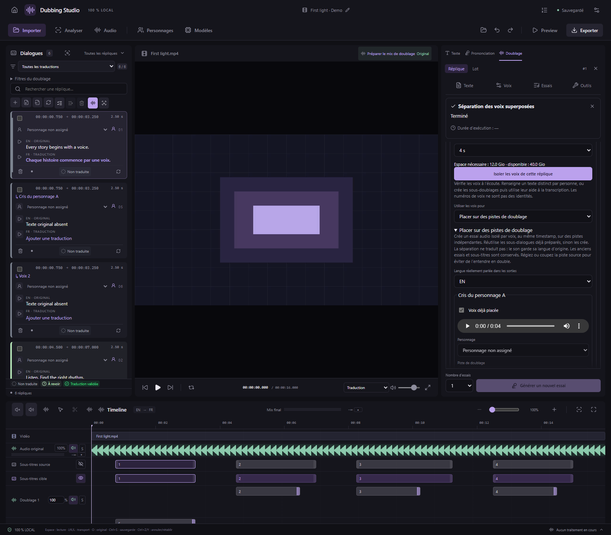

# Voix superposées : pistes de doublage indépendantes — v0.56.0

## Placer une séparation

Depuis **Doublage → Outils → Isoler plusieurs voix**, lancez MossFormer2 ou SepFormer, écoutez les sorties puis choisissez **Utiliser les voix pour → Placer sur des pistes de doublage**. Cette option est aussi disponible après une séparation de locuteurs dans la **boîte à outils Audio** d’une sélection libre.

1. Indiquez la langue réellement parlée dans les sorties. La séparation conserve la parole source ; elle ne produit pas une traduction.
2. Gardez une ou plusieurs voix, attribuez éventuellement un personnage et choisissez une piste existante ou **Nouvelle piste indépendante**. Chaque sortie reçoit sa propre nouvelle piste par défaut, dont le nom est modifiable.
3. Cliquez sur **Créer les essais et placer les voix**. Un essai audio isolé devient sélectionné pour chaque sous-dialogue. Les sous-dialogues préparés pour cette même séparation sont réutilisés ; les autres sont créés au même timestamp. Une sélection libre reçoit un groupe parent sans sous-titres et ses dialogues enfants.
4. Ajustez ou coupez la piste source pour éviter de l’entendre en double. Les pistes de doublage disposent des réglages habituels de volume/muet/solo, d’édition et d’export MKV. Vous pouvez ensuite traduire et générer un nouvel essai TTS pour chaque personnage indépendamment.

Une sortie déjà placée ne peut pas être ajoutée deux fois par le même résultat. Les sorties restantes peuvent être placées plus tard. Pour refaire une séparation, revenez au dialogue parent. La sélection de la variante parent/sous-dialogues reste disponible ; les variantes antérieures sont conservées.

Les anciens essais et leurs fichiers, les SRT, la vidéo principale et les autres pistes restent conservés. Les affectations choisies ici sont manuelles : le routage automatique par personnage les respecte. L’application vérifie les sorties et les convertit en PCM mono 24 kHz avec une durée exacte ; toutes les voix d’un clic sont enregistrées ensemble. Une erreur ou une révision devenue obsolète annule ce clic et retire uniquement ses nouveaux fichiers. **Ctrl+Z** restaure l’état précédent, avec les fichiers nécessaires au rétablissement.

## Cris simultanés : pistes à évaluer

Il n’existe pas de mesure sur vos extraits permettant d’affirmer qu’un candidat fera systématiquement mieux. Le passage de parole ordinaire à des cris, avec musique et bruitages, est une explication plausible des résultats dégradés ; c’est une hypothèse à tester, pas un diagnostic mesuré.

| Candidat local | Intérêt pour ce besoin | Limite à vérifier |
|---|---|---|
| [TF-GridNet, implémentation ESPnet](https://github.com/espnet/espnet/blob/master/espnet2/enh/separator/tfgridnetv2_separator.py) | Autre architecture de séparation dans le domaine temps-fréquence ; nombre de sorties déterminé par le modèle. | Choisir des poids de **séparation multi-locuteurs**. Un checkpoint TF-GridNet de débruitage à une seule sortie n’isole pas plusieurs personnages. Pas de qualification ici sur animes/cris ni sur RTX 5060 Ti. |
| [SR-CorrNet-SS, dépôt des auteurs](https://github.com/dmlguq456/SR_CorrNet_SS) | API locale et poids publiés ; configurations fixes, variables 2–3 et 2–5 locuteurs, ainsi que WHAMR et LibriCSS. Candidat prioritaire pour comparer les voix superposées et les nombres variables. | Les jeux annoncés ne constituent pas une validation sur vos cris d’anime. Tester d’abord de petits extraits ; mesurer mémoire, vitesse, fuites et stabilité des identités. |
| [WeSep / REAL-TSE](https://github.com/REAL-TSE/wesep-real-tse) | Extraction d’un personnage guidée par un extrait vocal propre (`mixture` + `enroll`). Pertinent si l’objectif est de rechercher une voix précise plutôt que de diviser le mélange à l’aveugle. | La référence et le cri peuvent différer fortement. Vérifier l’identité et les résidus à l’écoute ; dépendances/poids à qualifier séparément sous Windows. |

**Ces trois candidats ne sont pas ajoutés comme moteurs installables dans v0.56.0.** Les contrôles de placement fonctionnent avec les séparateurs déjà intégrés. La compatibilité 16 Go et le gain sur les cris restent à mesurer avant une intégration qualifiée.

En attendant : essayez une piste Voix nettoyée plutôt que le mélange contenant musique/SFX, un extrait incluant un peu de parole isolée autour du cri et le bon nombre de locuteurs. Le panneau de réplique propose désormais les mêmes fenêtres **2 / 4 / 6 / 8 secondes** que la boîte à outils. Une fenêtre plus longue modifie le contexte et augmente la mémoire ; elle ne garantit pas une meilleure séparation. Conservez les essais pour comparer.

## Format et pilotage MCP

Le placement utilise le **format projet 34**. Les lecteurs acceptent toujours les anciens formats. Une nouvelle provenance `takeOrigin:{type:"separation",separationId,outputId,sourceTrackId,sourceLanguage}` identifie les essais comme **Audio source isolé · langue**, indépendamment de la langue cible du projet. La langue cible reste la clé technique de sélection des essais ; `sourceLanguage` indique la langue réellement parlée. Aucune reconnaissance ou traduction implicite n’est effectuée.

`studio_place_speaker_dubbings({id,audioLanguage,assignments,context})` : `id` désigne un résultat de séparation réussi dans le projet ouvert, avec une source encore identique. Chaque affectation contient `{outputId,label,characterId,sourceText,targetText,laneId,laneName}`. `laneId:null` crée une piste ; sinon l’ID doit exister. Les ID de sorties doivent être uniques et appartenir au résultat. Les textes sont ceux des sous-dialogues, sans mutation des cues SRT. Le résultat de lecture `studio_speaker_separation_result` expose `placedOutputIds`.

Le nouveau clic est une opération locale brève de placement/conversion de fichiers, distincte du calcul neuronal déjà terminé. L’application refuse une opération concurrente, un résultat obsolète, une sortie invalide ou déjà placée et un dépassement des 256 pistes. **177 outils MCP / 37 schémas partagés.**
