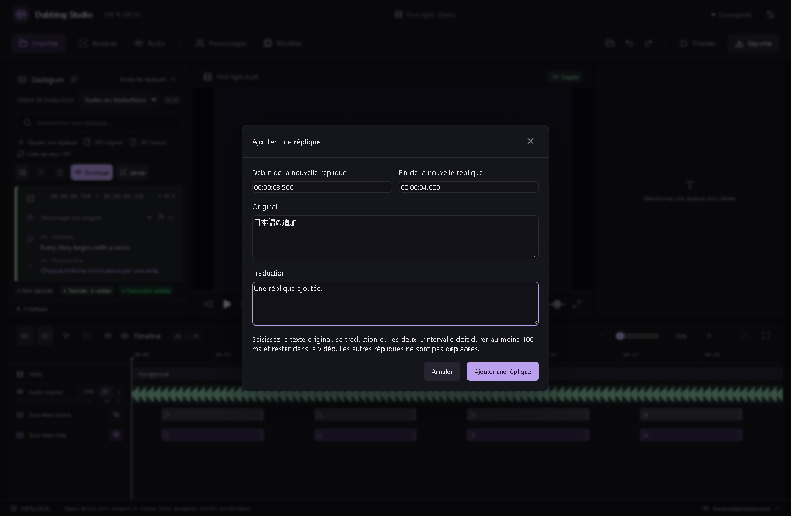
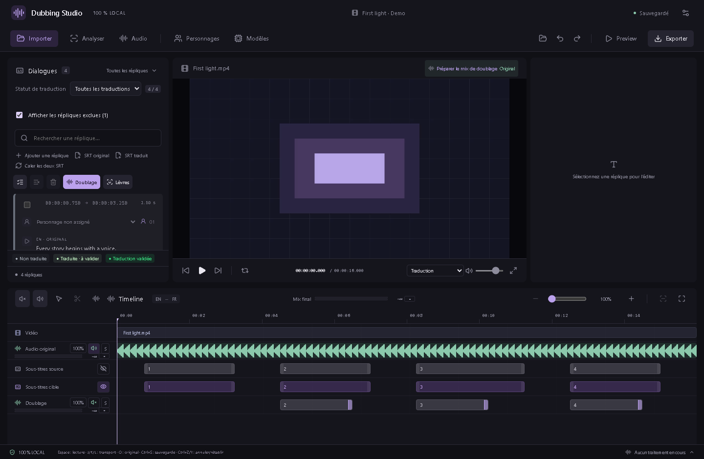

# Validation commune et gestion des répliques — v0.32.1

## Une validation pour le texte et le doublage

« Valider » dans la liste et dans Doublage confirme désormais la même version de la réplique : sous-titres original/traduit, texte parlé, dictionnaire de prononciation, essai sélectionné, référence, montage local, effets, volume et calage enregistré.

Changer un de ces éléments retire la validation commune et remet l’essai à revoir. Choisir un autre essai ne le valide jamais automatiquement. Revenir au texte précédent ne rétablit pas une validation retirée ; il faut la confirmer à nouveau. Ctrl+Z restaure en revanche l’état antérieur, validation comprise.

Un essai périmé ne peut pas être validé. Les actions en lot ignorent les textes vides, les essais périmés et les répliques exclues. Sans essai sélectionné, le texte peut être validé pour préparer un lot de génération ; le nouvel essai créé demande ensuite une validation commune après écoute.

Les anciennes validations texte et voix peuvent être reprises ensemble seulement si l’essai était déjà validé et correspond toujours à la réplique. Une voix validée seule ne suffit pas à valider aussi la traduction. Les essais restent tous conservés. Le format de projet 24 mémorise le contenu précis validé ; une version antérieure du studio ne peut pas ouvrir ce nouveau format.

## Ajouter une réplique

Dans la liste des dialogues, cliquez sur **Ajouter une réplique**, ou utilisez le clic droit sur une carte. Saisissez son début, sa fin et le texte original, sa traduction ou les deux. Le début proposé correspond au curseur de lecture ; le menu d’une carte propose sa fin.

L’intervalle doit durer au moins 100 ms et rester dans la vidéo. Les répliques et sous-titres existants ne sont pas déplacés. L’ajout crée ses propres identifiants de sous-titres et sélectionne la nouvelle réplique pour la modifier ou la doubler. Ctrl+Z annule l’ajout.

## Exclure sans supprimer les sous-titres

Utilisez **Exclure du doublage** au clic droit, sur la carte ou dans l’éditeur. Le bouton de la sélection permet aussi de traiter toutes les répliques cochées en une fois. Une fenêtre rappelle ce qui sera conservé avant l’application.

Les deux SRT, tous les essais, les montages, les références et les calages restent intacts. La réplique disparaît de la liste active, des lots de génération et de retouche labiale, du mix des doublages pendant la lecture et de l’export. Le forçage d’un lot ne réintègre pas les exclusions. Un élément pas encore lancé dans un lot en cours est ignoré s’il vient d’être exclu ; une génération déjà en cours ne peut pas publier un nouvel essai sélectionné sur une réplique exclue.

Les pistes audio source continuent de suivre leurs propres volumes et activations : exclure une réplique ne rend pas automatiquement une portion de l’audio japonais muette. Ses sous-titres restent affichables et exportables. Les variantes labiales enregistrées sont conservées, mais ne s’appliquent pas à un doublage exclu.

**Ctrl+Z / Ctrl+Y** annule ou rétablit l’exclusion. Cochez **Afficher les répliques exclues**, puis **Réintégrer au doublage** pour retrouver l’essai, le montage et le calage enregistrés. Une réintégration n’accorde pas une nouvelle validation commune.

## Pilotage IA

Le serveur expose 134 outils MCP : 100 natifs et 34 commandes d’état, d’édition et de lecture. `studio_add_dialogue` crée une réplique ; `studio_set_dialogue_exclusion` exclut ou réintègre une liste d’identifiants. Ces commandes utilisent le contexte courant, la même validation que l’interface et l’historique d’annulation. `studio_get_dialogues` et `studio_get_project` permettent de lire `excludedFromDubbing`.

Les captures montrent l’interface réelle avec des données de démonstration et des réponses natives simulées. Les tests Windows natifs et ceux du bureau empaqueté sont documentés séparément dans [VALIDATION](../VALIDATION.md).
