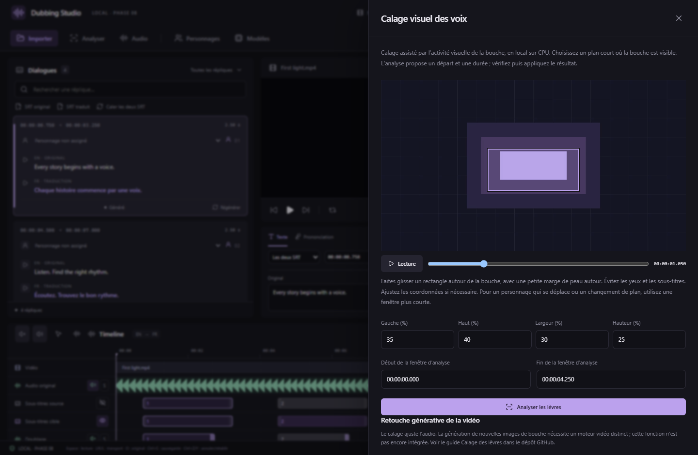
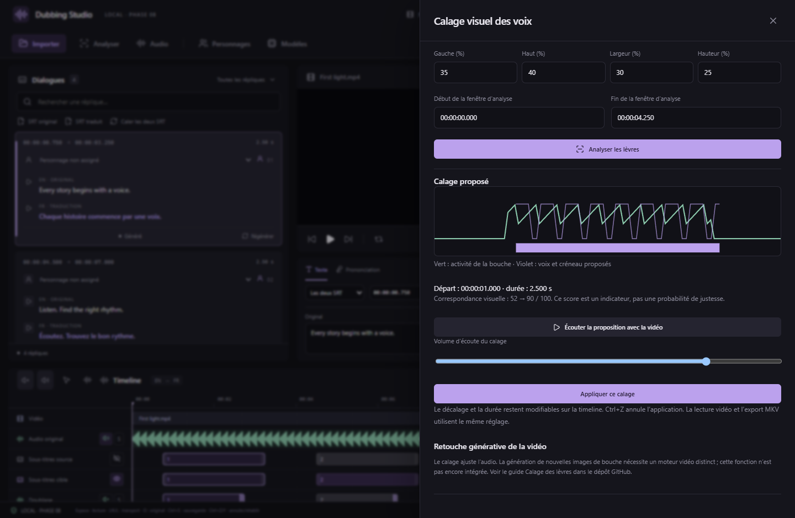

# Calage visuel assisté des doublages — v0.8.0

Cette première version analyse automatiquement **l’activité d’une zone de bouche que vous désignez**. Elle propose un départ et une durée pour la prise vocale choisie. Le calcul est local, sur CPU avec FFmpeg et Rust ; il ne télécharge aucun modèle et n’envoie ni vidéo ni audio en ligne. La sélection du GPU des moteurs TTS reste indépendante.

## Utilisation

1. Générez une voix, choisissez l’essai à utiliser, puis ouvrez **Doublage → Analyser les lèvres**.
2. Repérez une image où la bouche est visible. Dessinez un rectangle autour de la bouche avec une petite marge de peau autour. Les coordonnées en pourcentage permettent de corriger le rectangle. Évitez les yeux et les sous-titres.
3. Choisissez une fenêtre de **1 à 30 secondes**, dans un seul plan stable. Les essais analysés sont limités à **20 secondes**. Les voix voisines limitent la fenêtre pour préserver leurs créneaux.
4. Lancez **Analyser les lèvres**. Le traitement est annulable depuis ce panneau ou Traitements, et peut être relancé. Le résultat est mis en cache dans le projet. Fermer le panneau ne l’applique pas ; le rouvrir retrouve la dernière analyse de cette prise.
5. Examinez la courbe verte d’activité et la voix proposée en violet. Le score est un indicateur de correspondance, pas une probabilité de justesse. **Écouter la proposition avec la vidéo** permet de juger le calage avant de modifier le projet ; son volume d’écoute est indépendant du mix sauvegardé.
6. Cliquez **Appliquer ce calage** si le résultat convient. Une proposition faible ou ambiguë demande une vérification explicite. Un changement du projet ou de la prise empêche l’application d’un résultat ancien.
7. Affinez encore le départ ou la durée sur la timeline, ou dans les champs numériques de Doublage. **Ctrl+Z** annule l’application en une seule opération. Lecture et export MKV utilisent les réglages existants du format 7 ; les deux SRT et les WAV originaux restent intacts.

Captures de l’interface React/Chrome avec une vidéo géométrique et des résultats natifs simulés. Des tests FFmpeg distincts utilisent une bouche animée de contrôle ; ces captures ne démontrent pas la qualité sur un film ou un anime réel.

## Ce que mesure l’analyse

L’algorithme compare les variations d’ouverture/contraste de la zone et l’enveloppe sonore du WAV généré, par pas de **40 ms**. Il recherche un décalage et une durée globale, entre environ **0,67× et 1,5×** la durée naturelle. Le rendu utilise le même étirement avec conservation de hauteur que le montage manuel.

Il ne reconnaît ni phonèmes ni mots et ne déplace pas séparément les syllabes. La zone est choisie manuellement ; il n’y a pas de détection automatique de visage ou de suivi de bouche à travers plusieurs plans. Les pauses internes restent celles de la prise, étirées globalement. Si les deux langues ont des rythmes très différents, une nouvelle génération ou une adaptation du texte peut donner un meilleur résultat.

Ce mode vise les plans courts avec une bouche lisible et relativement stable, y compris les dessins animés. Profils, occlusions, barbe, dents très claires, déplacements de tête, changements de plan et bouches peu animées peuvent tromper la mesure. La vérification à l’image et à l’oreille reste nécessaire. L’exactitude sur un corpus d’animes ou de films n’a pas encore été mesurée.

## Modifier réellement les lèvres de la vidéo

**Cette retouche générative est possible avec des moteurs externes, mais n’est pas intégrée dans v0.8.0.** Le bouton Analyser les lèvres ajuste l’audio et conserve les images source. Le MKV actuel copie la vidéo originale.

| Solution | Fonction documentée | Intérêt et limites pour une future intégration |
| --- | --- | --- |
| [LTX-2.5 IC-LoRA Inpaint](https://github.com/Lightricks/ComfyUI-LTXVideo/blob/master/example_workflows/2.5/README.md) | Le workflow officiel accepte une vidéo et un masque ; l’audio peut rester figé. | Candidat pour repeindre la zone de bouche en conservant le doublage final. Cela ne garantit pas à lui seul un alignement phonème par phonème. |
| [MiniMax H3](https://github.com/MiniMax-AI/awesome-minimax-h3-integration) | Le catalogue officiel répertorie quantifications, intégrations et contrôle/inpainting. | Autre candidat à tester sur le style anime et les petits plans. Les poids, composants auxiliaires et RAM système doivent être pris en compte ; « quantifié » ne garantit pas que le workflow complet tienne dans 16 Go. |
| [WanGP / Wan2GP](https://github.com/deepbeepmeep/WanGP) | Application locale qui pilote plusieurs modèles, dont H3 et LTX, et propose une API. | C’est un moteur d’exécution/interface, pas un modèle vidéo unique. Une intégration devrait cibler une version et un workflow précis. |
| [MuseTalk 1.5](https://github.com/TMElyralab/MuseTalk) | Synthèse des lèvres sur la région faciale avec inpainting latent ; instructions d’inférence Windows. | Candidat spécialisé pour des visages filmés ; son adaptation aux dessins doit être évaluée avant d’en faire le choix par défaut pour des animes. |

Pour la **RTX 5060 Ti 16 Go**, une évaluation commencerait par un seul personnage, un extrait court, un masque limité à la bouche et une résolution modeste, avec le profil mémoire adapté du moteur choisi. Aucune de ces configurations génératives n’a été qualifiée sur la carte de l’utilisateur dans cette version.

Une intégration complète demanderait : extraction du plan et du doublage final, masque suivi dans le temps, exécution locale isolée, aperçu avant/après, conservation des variantes et composition du plan retouché à l’export. Les changements de durée et de nombre d’images du moteur devraient être contrôlés pour conserver la synchronisation. Cette version ne présente pas de bouton d’installation ou de génération vidéo fictif.

Pour le montage manuel : [Zoom de la timeline](TIMELINE-ZOOM.md) · [Placement et durée des voix](DUBBING-PLACEMENT.md).
