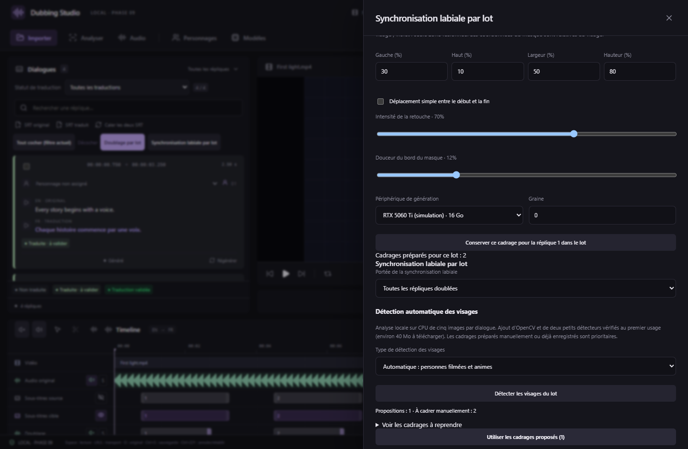
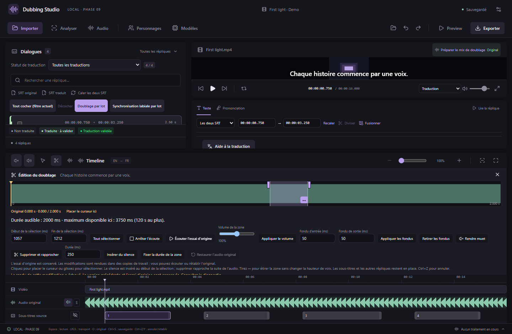
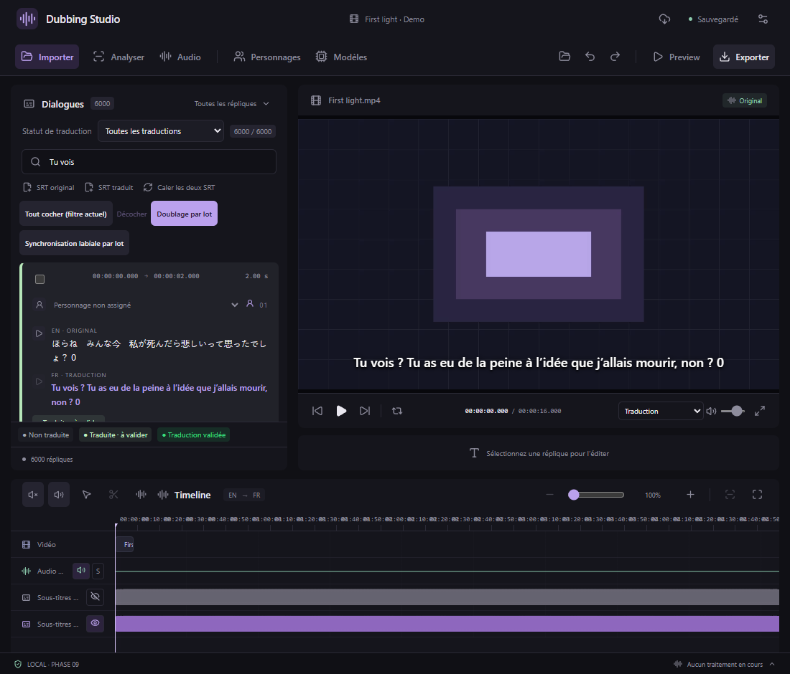

# Synchronisation labiale par lot et éditions audio — v0.18.0

## Lancer un lot

1. Générez les doublages et sélectionnez l’essai à utiliser pour chaque réplique.
2. Dans **Dialogues**, cochez les répliques souhaitées si nécessaire, puis ouvrez **Synchronisation labiale par lot**.
3. Choisissez **Toutes les répliques doublées** ou **Répliques cochées uniquement**. Les répliques sans essai sélectionné sont ignorées, même si leur texte est traduit.
4. Choisissez MuseTalk, LatentSync 1.5 ou 1.6, installez le moteur et sélectionnez votre GPU. Les paramètres de génération sont communs au lot.
5. Utilisez **Détecter les visages du lot**, puis vérifiez et appliquez les propositions. Dans **Réplique utilisée pour le cadrage**, vous pouvez aussi sélectionner une réplique, dessiner le visage et le masque puis cliquer sur **Conserver ce cadrage pour la réplique … dans le lot**. Répétez pour les plans à corriger.
6. Vous pouvez réutiliser les cadrages des variantes déjà enregistrées. Leur priorité est inférieure aux cadrages préparés dans ce panneau. Un cadrage commun pour les autres répliques exige de cocher explicitement **Utiliser le cadrage affiché…**.
7. Vérifiez le bilan : prêtes, sans doublage, déjà synchronisées, sans cadrage, exclues. Les motifs d’exclusion sont consultables. Lancez le lot.

Les cadrages préparés sont conservés dans le panneau jusqu’à sa fermeture, puis dans le journal du lot lorsqu’il démarre et dans les variantes produites. Un cadrage commun ne détecte pas les changements de plan.

## Détection automatique : film et anime

La détection analyse localement **cinq images de chaque dialogue** sur CPU, sans charger le modèle labial en VRAM. Choisissez le mode automatique, **personnes filmées (YuNet)** ou **animes/dessins (LBP animeface)**. Les cadrages manuels préparés et les cadrages enregistrés sont prioritaires ; seuls les éléments encore à cadrer sont analysés.

Au premier usage, environ **40 Mo** sont téléchargés : OpenCV 4.11 et deux petits détecteurs, avec versions, tailles et empreintes SHA-256 vérifiées. Ils utilisent le runtime du moteur labial installé et suivent le dossier de stockage des modèles. Aucun serveur ComfyUI ni nouvel environnement CUDA n’est nécessaire. Un contrôle d’espace libre précède les téléchargements.

Après l’analyse, cliquez sur **Utiliser les … cadrages proposés**. Le sélecteur de réplique permet de vérifier les cadres et de modifier le visage, le masque de bouche ou le déplacement simple. Le masque de bouche est une proposition géométrique ajustable, pas une segmentation automatique des lèvres.

Les images sans visage net, plusieurs visages, les changements de plan repérés et les déplacements ou zooms trop complexes sont signalés pour correction manuelle. La détection **n’identifie pas le personnage qui parle**, ne suit pas toutes les images du film et peut manquer une coupure entre les cinq échantillons. Examinez toujours les variantes avant activation. Les propositions devenues obsolètes après une modification du projet ne sont pas appliquées ; une annulation ne publie aucun cadrage partiel.

*Interface réelle avec résultats natifs simulés pour illustrer les cas ambigus. Les deux détecteurs et le protocole du worker sont vérifiés séparément sur de véritables images filmée et anime, dans des chemins Windows accentués.*

Sources des détecteurs : [OpenCV Zoo / YuNet](https://github.com/opencv/opencv_zoo/tree/47534e27c9851bb1128ccc0102f1145e27f23f98/models/face_detection_yunet) et [nagadomi / lbpcascade_animeface](https://github.com/nagadomi/lbpcascade_animeface/tree/4433ab1ae1166ea75acfe99eb0f18709dac329a0). Les licences MIT sont incluses dans `workers/FACE-DETECTION-LICENSES.txt`. Les images de diagnostic sont téléchargées temporairement et ne sont pas distribuées avec l’application.

*Interface React réelle ; média synthétique et commandes natives simulées pour la capture. Le GPU affiché n’est pas une mesure matérielle.*

## Fichiers, mémoire et reprise

Chaque dialogue possède son propre fichier vidéo, limité à l’emplacement et à la durée de son doublage actuel. Les entrées du modèle sont extraites dans un dossier temporaire privé ; le modèle ne reçoit jamais le chemin de la vidéo principale. **La vidéo principale, les essais audio et les variantes précédentes restent intacts.**

Les variantes actuelles, même désactivées, sont ignorées par défaut. **Forcer de nouvelles variantes** produit d’autres fichiers sans écraser les précédents. Les résultats restent désactivés pour vérification, sauf si vous cochez **Activer les nouvelles variantes après leur génération**. Cette activation désactive une variante déjà active sur le même intervalle.

Le traitement est séquentiel. Le processus du modèle se termine après chaque dialogue ; la VRAM est libérée entre les éléments. Le modèle vidéo n’est donc pas conservé en mémoire pendant tout le lot. **Traitements** affiche l’avancement et permet d’annuler, puis de reprendre avec **Réessayer**. Les séquences déjà réussies sont conservées ; seules les erreurs et les éléments restants sont repris avec leur configuration enregistrée. Une modification du média, de la prise ou de son timing invalide l’élément concerné.

Le lecteur continue d’utiliser la vidéo principale comme horloge. Les variantes activées sont préchargées et superposées pendant leurs intervalles, puis intégrées à l’export MKV. La fluidité dépend aussi du codec, de la résolution et du stockage ; les limites matérielles de [LatentSync](LATENTSYNC.md) restent applicables.

## Découpe et étirement du doublage

Une erreur FFmpeg a été reproduite avec plusieurs portions fortement raccourcies : RubberBand pouvait produire des échantillons sans horodatage utilisable, puis la concaténation échouait avec **Invalid data found when processing input**. Le rendu reconstruit maintenant les horodatages à partir du numéro d’échantillon. Le cache est renouvelé pour éviter de réutiliser les anciens rendus.

L’éditeur vérifie le rendu audio et son ajustement au créneau **avant d’enregistrer** une modification. En cas d’échec, la version précédente du projet reste en place et un message indique que l’essai d’origine est conservé. **Écouter l’essai d’origine** permet de le contrôler sans appliquer les modifications ; **Restaurer l’audio original** rétablit son montage. Les WAV générés ne sont jamais modifiés.

*Capture de l’interface avec une erreur native simulée. La correction FFmpeg est vérifiée séparément avec des WAV synthétiques réels.*

Les anciennes éditions enregistrées peuvent être recalculées avec le nouveau moteur. Une portion volontairement rendue muette ou supprimée reste une édition valide ; utilisez la restauration si vous souhaitez retrouver tout l’essai.

## Affichage des répliques

La liste mesure les hauteurs réelles des cartes multilignes et les recalcule au changement de largeur, de texte ou de filtre. Les identifiants des répliques stabilisent leur position dans la liste virtualisée.

Les validations détaillées et leurs limites sont consignées dans [VALIDATION.md](../VALIDATION.md).
