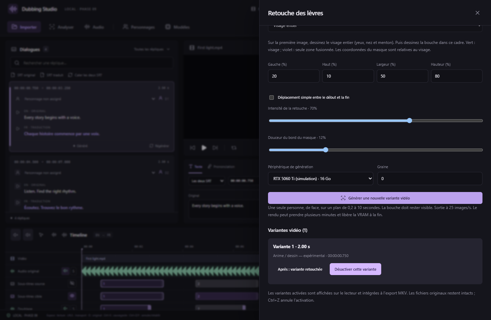

# Retouche locale des lèvres — MuseTalk 1.5, v0.9.0

Le studio génère de nouvelles images de bouche à partir du WAV de doublage choisi. Le cadrage du visage et le masque sont manuels. La vidéo originale et les prises restent conservées ; chaque rendu devient une variante désactivée que vous pouvez examiner puis activer.

Le moteur intégré est [MuseTalk 1.5 de Tencent Music](https://github.com/TMElyralab/MuseTalk), avec un adaptateur local utilisant ses conventions VAE/UNet et Whisper. Ce moteur spécialisé retouche le visage conditionné par l’audio. LTX, H3 et WanGP ne sont pas intégrés. L’[analyse visuelle du calage audio](LIP-ALIGNMENT.md) reste une commande distincte.

## RTX 5060 Ti 16 Go

- Runtime Windows isolé : **Python 3.12.10, PyTorch 2.8.0 CUDA 12.8**. Choix explicite du GPU `cuda:N`, dont la RTX 5060 Ti ; aucun basculement automatique sur CPU.
- **UNet FP16, VAE FP32**, visage **256 × 256**, batch de **1 image** ; Whisper tiny est déchargé du GPU après calcul des caractéristiques audio.
- L’allocateur PyTorch est plafonné au plus petit de 90 % de la mémoire et 12 Gio. Cela vise à laisser de la marge sur une carte de 16 Go, sans garantir la mémoire totale du processus ni sa coexistence avec d’autres applications. En cas de manque de mémoire, le travail échoue avec un message dédié ; fermez les autres logiciels IA.
- Les composants pèsent environ **3,89 Go / 3,62 Gio**, téléchargés au premier usage ; prévoir environ **14 Go** avec Python/CUDA, dépendances et cache d’installation. Le dossier choisi dans Paramètres est utilisé, inclus dans la taille affichée et dans les migrations de stockage.

**La vitesse et le pic de VRAM n’ont pas été mesurés sur une RTX 5060 Ti.** Le développement dispose d’un iGPU AMD : une inférence réelle de contrôle a été effectuée sur CPU avec les poids officiels. Ce diagnostic développeur ne constitue pas un mode CPU dans l’interface, ni une qualification de qualité sur des films/animes. Les résultats sur votre carte restent à vérifier.

## Créer une variante

1. Générez une prise vocale et sélectionnez-la dans **Doublage**. Ajustez d’abord sa position et sa durée, manuellement ou avec le calage assisté.
2. Cliquez **Retoucher les lèvres (vidéo)**. Installez MuseTalk, puis sélectionnez le GPU NVIDIA. Les téléchargements vérifient la taille exacte et le SHA-256 ; les révisions des trois composants sont figées dans `workers/musetalk-model.json`. La génération fonctionne ensuite hors ligne.
3. Choisissez **Personne filmée** ou **Anime / dessin — expérimental**. Les deux utilisent le même modèle ; le profil modifie uniquement l’intensité et la douceur de fusion. Le modèle n’est pas spécialisé pour tous les dessins.
4. Sur la première image de l’extrait, dessinez le **visage entier** : yeux, nez, bouche et menton. Le cadre vert doit rester dans l’image et mesurer au moins 32 pixels dans la vidéo source. Corrigez les pourcentages si nécessaire.
5. Sélectionnez **Masque de bouche** et dessinez une zone englobant la bouche à l’intérieur du visage. Seule cette zone violette est fusionnée dans la vidéo. Les coordonnées du masque sont relatives au visage. Ajustez **Intensité de la retouche** et **Douceur du bord du masque**.
6. Si le visage se déplace simplement, activez **Déplacement simple entre le début et la fin** et renseignez sa position finale. Le lecteur de l’extrait affiche le cadre interpolé. Cela ne suit ni rotation, ni changement d’échelle, ni changement de plan.
7. Lancez **Générer une nouvelle variante vidéo**. Les images sont générées séquentiellement ; cela peut prendre plusieurs minutes. Suivez les étapes, annulez ou consultez les logs. Une limite de deux heures termine un travail bloqué. Les modèles sont déchargés à la sortie du worker.

## Comparer, activer, exporter

**Avant : vidéo originale** et **Après : variante retouchée** permettent de comparer avec le même doublage, sans bande-son originale. Le volume d’écoute est indépendant du mix. Les anciens essais restent disponibles. **Activer pour la lecture et l’export** sauvegarde ce choix ; **Désactiver cette variante** revient à l’original. Ctrl+Z annule l’activation.

Ces captures montrent la vraie interface React/Chrome avec vidéo synthétique et résultats natifs simulés ; elles ne sont pas des exemples de qualité MuseTalk ni une capture de la fenêtre Windows native.

Le lecteur principal affiche les variantes activées et à jour, toujours muettes ; le mix audio reste piloté par la vidéo principale. Si un fichier ne se charge pas, un message l’indique et l’original reste affiché. La lecture utilise un second décodeur vidéo pendant la retouche.

Dans Exporter, **Inclure les retouches activées** fusionne les variantes dans le MKV. Ce mode réencode la vidéo en **H.264 CRF 18** et conserve la résolution ; il ne préserve pas le flux vidéo original à l’identique. Décochez pour conserver le flux original sans retouches. Le mix, la piste originale optionnelle et les deux SRT gardent leurs réglages indépendants.

Déplacer, étirer ou changer la prise après le rendu rend sa variante obsolète : elle n’est plus affichée, son activation est bloquée et l’export avec retouches demande de la désactiver ou de la régénérer. Deux variantes activées ne peuvent pas se chevaucher. Le format de projet devient **8** ; une ancienne version de l’application ne peut plus l’ouvrir.

## Limites de cette intégration

Un seul visage visible, plutôt frontal, sur un plan stable de **0,2 à 10 secondes**, à **25 images/s**. La durée est arrondie vers le bas au pas de 40 ms pour rester dans le créneau audible ; la dernière fraction d’image garde l’original. Travaillez plan par plan. Les autres visages ne sont pas sélectionnés automatiquement.

Les profils, mains devant la bouche, rotations, changements de plan, petits visages, style dessiné très abstrait ou mouvements rapides peuvent produire des dents, contours ou couleurs incorrects. Vérifiez particulièrement les animes. Il n’y a pas d’alignement phonème par phonème ni de garantie que chaque syllabe correspondra à un mouvement précis. Réduisez la force, resserrez le masque, corrigez le cadrage ou gardez la vidéo originale si le résultat dégrade l’image.

Le traitement est local, sans téléversement de vidéo ou de voix. Le code MuseTalk et les composants retenus portent les licences MIT indiquées par l’amont ; le texte et les notices des dépendances sont dans `workers/MUSETALK-LICENSE.txt`. Les poids sont téléchargés sur demande et ne figurent pas dans l’installateur. Consultez [la validation](../VALIDATION.md) pour distinguer tests automatisés, inférence de contrôle et matériel non qualifié.
