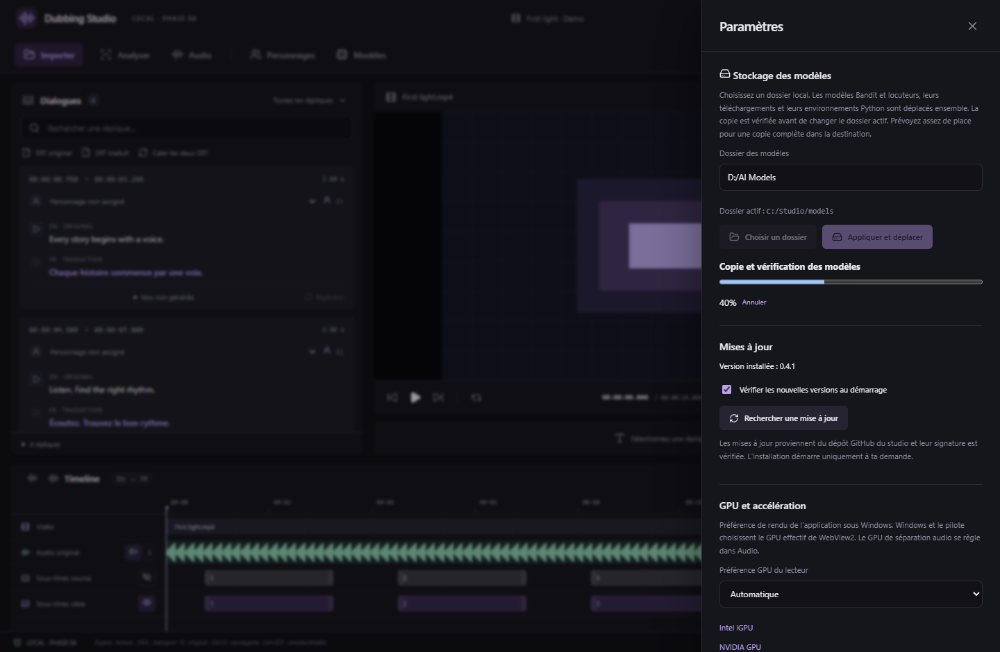
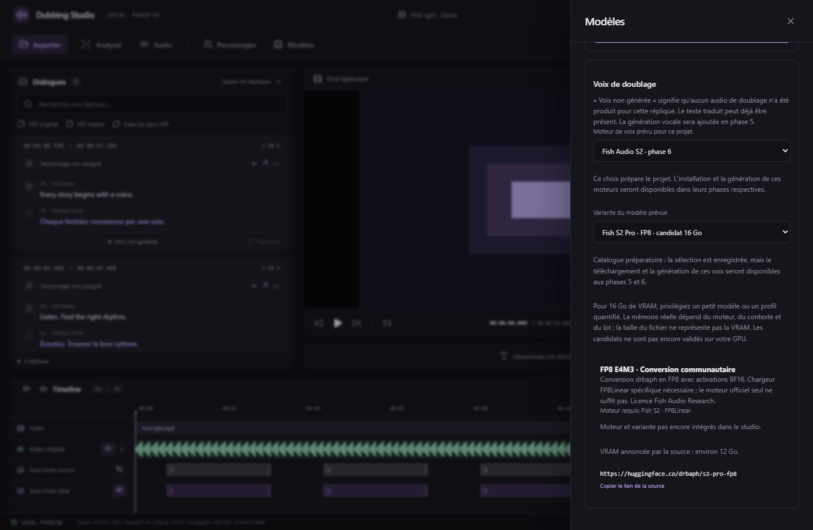
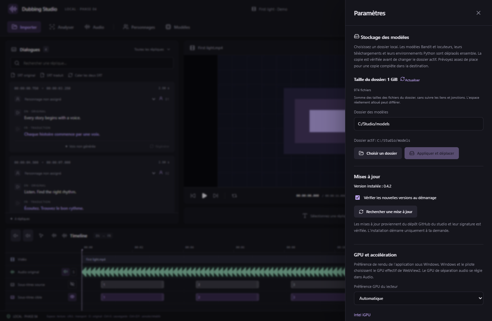

# Modèles, stockage et GPU de 16 Go — v0.5.0

**CosyVoice3 0.5B RL officiel est maintenant installable et utilisable.** Voir le [guide de la phase 5](PHASE-5.md) pour le profil CUDA 12.8, la génération et les références. Son environnement est inclus dans le déplacement du stockage et dans le compteur de taille. Les autres moteurs et les conversions GGUF ci-dessous restent préparatoires.

## Changer le dossier des modèles

Dans **Paramètres → Stockage des modèles**, choisissez un dossier ou saisissez un chemin absolu, puis cliquez sur **Appliquer et déplacer**. Un dossier absent est créé. Le réglage est global et conservé après redémarrage.

Le studio déplace les installations **Bandit** et **locuteurs**, avec leurs poids, téléchargements en cache, Python et dépendances. Les nouveaux téléchargements utilisent le dossier actif. Les vidéos, projets, références vocales et pistes séparées restent dans leurs dossiers de projet.

Le déplacement utilise une copie par blocs, puis une vérification SHA-256 de chaque fichier. Il fonctionne entre disques différents. Prévoyez la place nécessaire pour une copie complète sur le disque cible. La progression et l’annulation restent visibles dans Paramètres et Traitements. Le dossier actif change seulement après vérification ; les anciens dossiers sont ensuite supprimés. Le studio attend la fin des installations et analyses utilisant les modèles.

Une annulation pendant la copie ou une erreur avant l’activation conserve les installations et le réglage d’origine. Un dossier contenant déjà `bandit-runtime` ou `speaker-runtime` est refusé pour éviter un écrasement. Les jonctions et liens symboliques à l’intérieur des installations sont refusés. L’annulation est désactivée pendant la courte étape d’activation et de nettoyage. Si un fichier verrouillé empêche le nettoyage, les modèles du nouveau dossier sont utilisables et un avertissement indique les copies anciennes conservées dans les logs.

Le bouton **Utiliser le dossier par défaut** remplit le chemin d’origine ; **Appliquer et déplacer** effectue le retour. La configuration reste dans les données de l’application (`model-storage.json`). Un disque débranché ne déclenche pas une seconde installation ailleurs : rebranchez-le avant d’utiliser ou de déplacer ses modèles. Une interruption brutale pendant la copie peut laisser un dossier temporaire `.dubbing-models-…` dans la destination ; les originaux sont encore présents.

Capture de l’interface React réelle en navigateur ; les chemins et la progression native sont simulés.

## Activer et couper les pistes

Dans **Audio → Mixeur** ou dans la timeline, le **haut-parleur allumé** active une piste et le **haut-parleur barré** la coupe. L’état coloré signifie désormais « piste activée ». **S** conserve l’écoute en solo. Le son original intégré à la vidéo est coupé également sur l’élément vidéo ; lorsque toutes les pistes sont coupées, la vidéo avance en silence.

Cette commande remplace M, dont l’état actif signifiait auparavant « mute ». Le réglage enregistré `mute` conserve sa signification ; les projets existants gardent leurs choix de mixage. Le volume du lecteur s’applique à toutes les pistes. Les yeux contrôlent l’affichage des sous-titres sans modifier leurs textes.

## Variantes adaptées à une carte de 16 Go

Dans **Modèles**, choisissez le **Moteur préféré pour le projet** puis la **Variante préférée**. La variante officielle CosyVoice3 RL est utilisable. **Fish, Qwen et les conversions GGUF restent préparatoires pour la phase 6.** Le choix seul ne télécharge pas un futur moteur.

| Moteur | Variante proposée | Source et conditions |
| --- | --- | --- |
| CosyVoice3 0.5B RL | Poids officiels PyTorch | [Modèle officiel](https://huggingface.co/FunAudioLLM/Fun-CosyVoice3-0.5B-2512). Installable et utilisable en phase 5 ; précision mixte FP16 sur CUDA. |
| CosyVoice3 0.5B | GGUF Q4_K + flow Q8_0 | [Conversion cstr](https://huggingface.co/cstr/cosyvoice3-0.5b-2512-GGUF), moteur CrispASR. Environ 745 Mo de poids pour les voix prédéfinies ; composants supplémentaires pour cloner une référence. |
| Fish S2 Pro | FP8 avec activations BF16 | [Conversion drbaph](https://huggingface.co/drbaph/s2-pro-fp8), environ 12 Go de VRAM annoncés ; chargeur FP8Linear spécifique. |
| Fish S2 Pro | GGUF Q6_K ou Q4_K_M | [Conversion rodrigomt](https://huggingface.co/rodrigomt/s2-pro-gguf), fichiers d’environ 4,3 ou 3,4 Go ; nécessite le moteur expérimental s2.cpp. |
| Fish S2 Pro | BF16 officiel | [Installation officielle](https://speech.fish.audio/install/) : 24 Go recommandés, au-delà de votre carte de 16 Go. |
| Qwen3-TTS Base | 0.6B ou 1.7B BF16 | [Moteur officiel](https://github.com/QwenLM/Qwen3-TTS). Le 0.6B constitue l’option plus légère pour le clonage. |
| Qwen3-TTS Base 1.7B | GGUF Q5_K + predictor Q8_0, ONNX FP16 | [Projet HaujetZhao](https://github.com/HaujetZhao/Qwen3-TTS-GGUF). Export depuis les poids officiels ; nécessite le moteur hybride complet. |

Sources vérifiées le 14 octobre 2026. Les conversions sont communautaires et demandent leurs moteurs respectifs. GGUF décrit le conteneur et FP8/BF16 une précision de calcul ou de poids ; un fichier ne suffit pas à rendre toute la chaîne TTS compatible. La taille sur disque ne constitue pas une mesure de VRAM. Les chiffres de mémoire viennent des sources et ne sont pas des mesures du studio sur une RTX 5060 Ti.

Pour 16 Go, nous privilégions les petits modèles et les profils quantifiés, une réplique à la fois, avec un seul moteur chargé et une réserve pour les composants audio et le contexte. Cette politique reste à valider lors de l’intégration. Fish conserve sa licence Fish Audio Research : les conditions d’usage de la source s’appliquent aussi aux conversions.

Capture React réelle en navigateur ; le modèle n’est pas chargé. Aucun poids TTS n’est téléchargé automatiquement par cette sélection.

## Taille du dossier (0.4.2)

Paramètres affiche la taille cumulée des fichiers du dossier actif, son nombre de fichiers et un bouton Actualiser. Le calcul se fait en arrière-plan et se relance après un déplacement ou une installation de modèles. Les liens/jonctions ne sont pas suivis. Un calcul interrompu par la limite de durée ou des fichiers inaccessibles est indiqué comme partiel. Il s’agit de la taille logique des fichiers : l’espace réellement alloué par le système de fichiers peut différer.

Les zones audio, volumes par section et commandes rapides sont détaillés dans le [guide audio](AUDIO-REGIONS.md).
