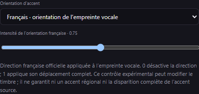

# ZONOS3-Mini et MOSS-TTS Local v1.5 — v0.51.0

## Choisir un moteur

| Moteur intégré | Fichiers de modèle | Usage |
|---|---:|---|
| ZONOS3-Mini · GGUF Q4/Q8 | 1,08 Gio | Clonage sans transcription, orientation française de l’empreinte vocale. Experts Q4_0, projections Q8_0, décodeur et encodeur officiels. |
| MOSS-TTS **Local** v1.5 · GGUF Q8_0 | 7,00 Gio | Alternative multilingue avec langue cible explicite et clonage sans transcription. Codec inclus. Il s’agit du modèle Local, pas du MOSS-TTS 8B. |

ZONOS3-Mini est le premier choix à essayer sur une RTX 5060 Ti de 16 Go : son ensemble de modèles est beaucoup plus petit. MOSS Local Q8 est un candidat plus volumineux ; la taille des fichiers n’est pas une mesure de VRAM. Les performances et la mémoire sur cette carte précise ne sont pas certifiées par les tests CPU du studio.

Les [poids ZONOS3 officiels](https://huggingface.co/Zyphra/ZONOS3-Mini) et le [modèle MOSS Local officiel](https://huggingface.co/OpenMOSS-Team/MOSS-TTS-Local-Transformer-v1.5) sont sous Apache 2.0. Le GGUF MOSS est une [conversion communautaire](https://huggingface.co/audio-cpp/audio.cpp-gguf). Les téléchargements du studio utilisent des révisions immuables, une taille exacte et un SHA-256 pour chaque fichier.

## Installer et générer

1. Ouvrez **Modèles**, puis la carte du moteur. Vérifiez l’espace nécessaire et disponible avant de lancer l’installation.
2. Dans **Doublage → Voix**, sélectionnez le moteur et le périphérique. Sur un PC avec iGPU, choisissez la carte **NVIDIA** explicitement si nécessaire.
3. Choisissez une référence : réplique actuelle, personnage, fichier audio ou bibliothèque vocale. Les sélections début/fin existantes restent utilisables. La durée du studio reste de 1 à 20 secondes.
4. Réglez le texte qui sera prononcé, puis générez un nouvel essai. Aucune transcription exacte n’est nécessaire pour ces deux moteurs.
5. Comparez les essais. Les anciennes générations et les fichiers source sont conservés.

Le moteur est natif, en **Vulkan / CPU**, sans environnement Python supplémentaire. Sa version 0.9.5 possède son propre dossier ; les moteurs audio.cpp 0.9.1 déjà installés restent séparés. Les modèles peuvent être déplacés avec le stockage configuré et supprimés depuis le gestionnaire existant.

La génération par lot, les 1 à 4 essais et la file d’actions enchaînées acceptent ces moteurs. Le processus vocal et ses poids restent chargés dans un même lot, puis sont fermés à la fin ou à l’annulation. Le périphérique de synthèse sélectionné est conservé ; l’analyse MECT-B2 de la référence ZONOS3 utilise le CPU et un cache propre au projet.

## Orienter ZONOS3 vers un accent français

Dans **Orientation d’accent**, choisissez **Français · orientation de l’empreinte vocale**, puis ajustez l’intensité :

- **0** : désactiver le déplacement de l’empreinte ;
- **0,5 à 0,75** : point de départ modéré à comparer avec l’essai sans orientation ;
- **1** : appliquer le déplacement officiel complet ;
- jusqu’à **1,5** : renforcer l’orientation, avec un risque accru de modification du timbre.

Le curseur est indépendant des préréglages de qualité. Il ne préfixe pas le texte avec une instruction que le modèle pourrait prononcer. Le studio reprend la direction française officielle `fra` et la transformation : **empreinte + intensité × direction**, remise à la norme de l’empreinte d’origine. L’empreinte de référence initiale est conservée dans le cache.

La [documentation Zyphra](https://github.com/Zyphra/ZONOS3-Mini/blob/96d9e0ec1e39083ed336ac78f24e3dbc93721c0f/docs/guide.md#speaker-embedding-accents) explique le compromis entre déplacement d’accent et identité vocale. Ce contrôle expérimental ne garantit ni la suppression de l’accent japonais ni un accent régional français particulier. France, Québec, Belgique et Suisse ne sont donc pas proposés comme quatre adaptateurs distincts pour ce moteur. Une référence française propre reste utile.

## Qualité, langue et limites

**Standard** conserve les valeurs par défaut du moteur épinglé. Les réglages avancés exposent uniquement les paramètres réellement envoyés : température, top-p, top-k, pénalité de répétition et, pour ZONOS3, guidage d’identité. Les préréglages Stable et Expressif proposent des variations à écouter ; leur nom ne constitue pas une mesure de qualité.

Le [port natif ZONOS3](https://github.com/0xShug0/audio.cpp/blob/v0.9.5/docs/models/zonos3.md) ne reprend pas les directions émotionnelles cachées, les adaptateurs régionaux, LACI ou l’édition de parole du serveur Zyphra complet. Les humeurs sont donc désactivées pour ces deux nouveaux moteurs. Le studio ajoute seulement l’orientation française d’empreinte décrite ci-dessus. MOSS Local reçoit le nom de la langue cible, par exemple `French` ; il n’expose pas un contrôle d’accent régional.

La version native ZONOS3 intégrée accepte les cibles français, anglais, allemand, espagnol, italien, portugais, japonais, chinois et coréen. Son champ de langue concerne la normalisation du texte, pas un jeton qui impose à lui seul l’accent. Le binaire distribué ne contient pas le normaliseur Zyphra : écrivez les nombres et symboles en toutes lettres dans **Texte pour la voix** lorsque nécessaire.

ZONOS3 produit nativement du mono 44,1 kHz, et MOSS Local du stéréo 48 kHz. Le studio normalise les essais en **PCM16 mono 24 kHz**, comme ses autres moteurs, pour l’édition, le mix et l’export existants. Les budgets de génération et la durée finale restent bornés à 120 secondes. Aucun enregistrement existant n’est écrasé.

## Projets, MCP et vérifications

Les nouveaux moteurs demandent le **format projet 31**. Les projets antérieurs restent lisibles ; leur format est relevé lorsqu’un nouveau moteur est enregistré. Un projet enregistré au format 31 demande le studio 0.51.0 ou ultérieur.

Le catalogue conserve **170 outils MCP / 33 schémas**. Identifiants : `zonos3-mini-gguf` et `moss-local-v15-gguf-q8`. Utilisez `mode: "crossLingual"`. Pour ZONOS3 en français, `accent: "fr-FR"` désigne l’orientation d’empreinte, et `quality: { "accentStrength": 0.75 }` règle son intensité. `auto` conserve la référence ; MOSS accepte uniquement `auto`. Les valeurs hors limites et les contrôles non pris en charge sont refusés.

La qualification Windows comprend des tests d’interface, de format, d’empreinte, d’installation et de conservation des essais. Le diagnostic MCP du portable utilise les vrais installateurs et poids, génère avec les deux moteurs sur CPU, vérifie la réutilisation du modèle sur plusieurs essais, puis transcrit les sorties avec Whisper pour contrôler les mots français. Il vérifie les WAV, les sources conservées et la réouverture au format 31. Ces contrôles ne mesurent pas la qualité perceptive de l’accent ni la vitesse sur une RTX 5060 Ti.

Les captures montrent l’interface réelle avec des commandes natives simulées ; les essais neuronaux sont vérifiés séparément dans le diagnostic du portable. Les notices MIT de Zyphra et la provenance du vecteur sont conservées dans les ressources.
