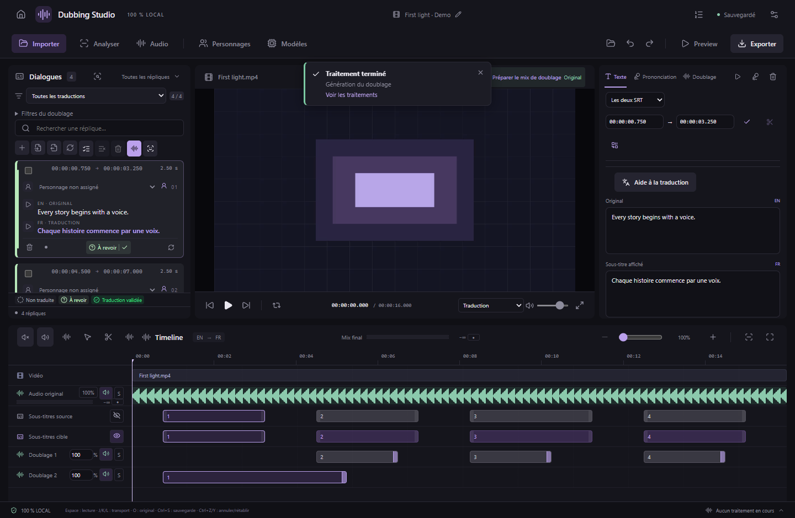

# Durée naturelle et chevauchements — v0.60.0

Le doublage utilise par défaut la durée réelle du WAV généré, ou celle de son montage local. Un sous-titre court et le début de la réplique suivante ne provoquent plus de compression automatique. La lecture vidéo, l’éditeur et le mix MKV utilisent la même règle. L’original du WAV et tous les anciens essais sont conservés.

Lorsqu’une nouvelle génération, un changement d’essai, un déplacement ou un étirement crée un chevauchement, le bloc concerné utilise une autre piste libre au même timestamp. Une piste supplémentaire est créée si nécessaire, dans la limite de 256. Les blocs existants gardent leur position et leur durée. Une piste réutilisée doit avoir les mêmes réglages de volume, muet et solo ; une piste créée reprend ces réglages. Le placement de débordement reste enregistré, y compris lorsque le routage par personnage est activé.

Les anciens projets retrouvent les durées audio naturelles lorsqu’aucune durée manuelle n’était enregistrée. Les chevauchements déjà enregistrés restent audibles et sont répartis lors de la prochaine modification. Les sous-titres, la vidéo et les fichiers source restent inchangés. Un étirement manuel existant est conservé. Pour l’annuler : clic droit sur le bloc → **Réinitialiser la durée**, ou **Durée automatique** dans les réglages de calage. Choisir un autre essai retire la durée du précédent ; ses retouches audio propres restent disponibles.

L’étirement manuel reste explicite, avec conservation de la hauteur. La limite de 120 secondes par essai, le minimum de 1 ms par segment et la fin de la vidéo restent contrôlés. Si une prise naturelle dépasse la fin de la vidéo, sa partie visible est limitée à cette fin sans accélération ; l’avertissement de calage permet de la repositionner pour retrouver sa durée complète.

## Baisser le volume d’un lot

Dans **Doublage → Lot**, régler **Volume de sortie du lot** avant de lancer la génération ou d’ajouter le travail à la file. Les préréglages **75%, 50%, 25%** correspondent à des baisses de **25%, 50%, 75%** ; le curseur permet aussi un réglage précis de 0 à 400%.

Ce gain s’applique à chaque nouvel essai, y compris lorsqu’on génère 1 à 4 essais par dialogue. Il est conservé dans les reprises et les travaux en attente. Il ne modifie ni la durée ni le WAV d’origine. Le volume reste modifiable après génération dans les essais.

## Vérification

Les scénarios de durée et de routage sont partagés entre TypeScript et Rust : sous-titre court, nouvel essai antérieur ou postérieur, départs identiques, réutilisation d’une piste, chevauchement d’une milliseconde, étirement explicite et fin de vidéo. La qualification Windows vérifie aussi un WAV réel via le MCP du binaire compilé, la conservation de tous ses échantillons en lecture naturelle, la durée manuelle, le changement d’essai et la réouverture après redémarrage du processus. Les tests ne mesurent pas la qualité d’inférence des modèles TTS.
