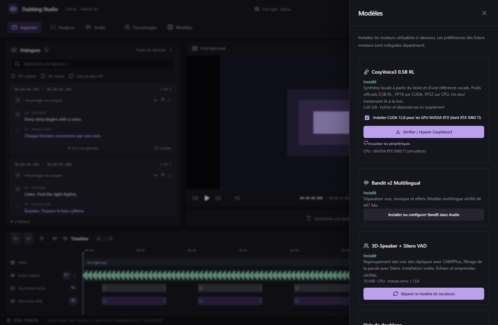
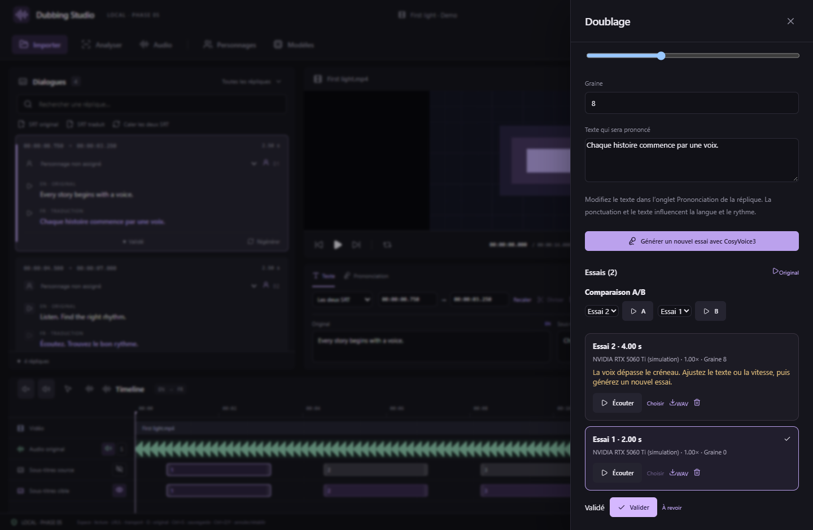

# Phase 5 — doubler une réplique avec CosyVoice3

La version **0.5.0** ajoute le premier moteur de synthèse vocale : **CosyVoice3 0.5B RL officiel**. Le texte, les références, les calculs et les fichiers audio restent sur le PC. Seuls les téléchargements de logiciels et de modèles utilisent Internet.

## Installer pour une RTX 5060 Ti de 16 Go

1. Ouvrez **Modèles → CosyVoice3 0.5B RL**.
2. Laissez **Installer CUDA 12.8 pour les GPU NVIDIA RTX** coché, puis cliquez sur **Installer CosyVoice3**. Aucun Python système, Git, Conda, TensorRT ou vLLM n'est nécessaire.
3. Suivez les étapes dans **Traitements** : Python, dépendances, vérification, puis poids. Une réparation réutilise les fichiers dont le SHA-256 est correct. Annuler conserve les téléchargements complets déjà vérifiés ; Réessayer reprend l'installation. La pause au milieu d'un fichier n'est pas disponible dans cette phase.
4. Après installation, actualisez les périphériques. La RTX doit apparaître avec son nom. Un petit calcul CUDA, puis une multiplication matricielle FP16 sont exécutés avant de proposer le périphérique.

Les poids représentent **5 427 042 285 octets (environ 5,05 GiB)**. Le téléchargement PyTorch CUDA ajoute environ 3,23 GiB, plus les autres dépendances. Prévoyez **environ 25 Go libres** pour les téléchargements et leur installation décompressée. Ce volume sur disque ne correspond pas à la VRAM utilisée.

Le dossier choisi dans **Paramètres → Stockage des modèles** contient aussi ce moteur, ses caches et ses environnements. Le déplacement et le compteur de taille incluent CosyVoice3.

Le moteur utilise la précision mixte FP16 sur CUDA et FP32 sur CPU, une seule génération à la fois. Bandit et les autres tâches IA partagent le même verrou. Le processus termine après chaque réplique et libère sa mémoire GPU ; le chargement des poids est donc répété au prochain essai. Les variantes GGUF, Fish et Qwen ne sont pas installées par ce bouton.

## Générer et écouter

1. Sélectionnez une réplique et vérifiez sa traduction. L'onglet **Prononciation** permet de modifier le texte prononcé sans changer le sous-titre. Les balises HTML sont retirées ; le dictionnaire du projet est appliqué par remplacement littéral, sensible à la casse.
2. Cliquez sur **Doubler** ou **Régénérer** dans sa carte. Le raccourci **R** ouvre les mêmes réglages.
3. Dans **Doublage**, choisissez explicitement **NVIDIA RTX 5060 Ti**. Le mode automatique préfère un périphérique CUDA ayant réussi les contrôles ; CPU reste disponible. Une sélection CUDA indisponible produit une erreur et ne bascule pas silencieusement sur CPU.
4. Choisissez la référence : celle par défaut du personnage, une autre référence du personnage, ou l'audio de la réplique actuelle. Ce dernier utilise la piste Voix de Bandit si elle correspond à la vidéo, sinon l'audio original.
5. Pour une voix japonaise et un texte français, utilisez **Entre langues : référence sans transcription**. Le mode **Avec transcription exacte** exige les mots réellement prononcés dans la référence, dans sa langue d'origine.
6. Choisissez la vitesse (0,5 à 2×) et une graine, puis **Générer un nouvel essai avec CosyVoice3**. Les réglages sont sauvegardés avant le lancement.

La référence doit contenir de la parole audible, durer **1 à 20 secondes**, et ne pas mélanger plusieurs locuteurs. Plusieurs secondes de voix propre donnent généralement une meilleure base qu'un mot isolé. Le studio refuse une référence silencieuse. Le texte est limité à 1 000 caractères par génération et la sortie à 120 secondes.

CosyVoice3 couvre français, anglais, japonais, chinois, coréen, allemand, espagnol, italien et russe. Pour le japonais cible, l'exemple officiel demande une transcription en katakana ; le studio ne la produit pas automatiquement. Le texte et la ponctuation guident la langue et le rythme, sans garantie de calage phonétique sur les lèvres.

**Écouter**, le triangle de la traduction ou **T** lit le WAV retenu et arrête la vidéo. **Original** lit la scène. L'écoute des essais est indépendante du lecteur vidéo et du mix de la timeline dans cette phase. Cliquez à nouveau pour arrêter l'écoute. Les sélecteurs **A/B** permettent d'écouter deux essais sans modifier celui retenu.

## Choisir, comparer et valider

Chaque lancement crée un fichier distinct dans `generations/`. Les essais précédents restent présents. La carte indique la durée, le périphérique, la vitesse, la graine et, pour un calcul CUDA, le pic de mémoire allouée mesuré par PyTorch.

- **Choisir** retient un essai pour la réplique et la langue cible.
- **Valider** marque le choix comme relu ; **À revoir** retire cette validation.
- Un dépassement du créneau est signalé : modifiez le texte ou la vitesse, puis créez un nouvel essai. Aucun étirement, découpage ou écrasement automatique n'est appliqué.
- Une modification du texte, des timings, du personnage ou de la source rend l'ancien essai obsolète et bloque sa validation. Les changements d'une référence enregistrée sont aussi vérifiés.
- **WAV** exporte un essai individuel. Le retrait d'un essai enlève son association ; son fichier reste dans le projet pour permettre Annuler/récupération.

Les traitements ont des étapes distinctes pour la référence, la vérification des poids, le chargement et la synthèse. Chargement et synthèse affichent une progression indéterminée. Annuler arrête le processus ; les générations déjà enregistrées sont conservées. Un délai de quinze minutes limite une génération bloquée.

Ces captures montrent l'interface React réelle avec données et périphériques natifs simulés. Elles ne constituent pas des mesures de performances sur une RTX 5060 Ti.

## Compatibilité et validation

Les réglages et essais utilisent le **format de projet 5**. Les formats 1 à 4 restent lisibles ; les versions précédentes de l'application refusent le format 5. Les résultats de séparation Bandit sont conservés.

Une génération réelle française sur Windows a produit un WAV mono 24 kHz de 2,96 secondes avec les poids officiels RL et un runtime CPU. Le runtime CUDA 12.8 est installé et testé séparément à partir de fichiers verrouillés. Voir [VALIDATION](../VALIDATION.md) pour les résultats complets et leurs limites. Ce poste de développement ne dispose pas d'une RTX 5060 Ti : performance, qualité subjective et génération CUDA sur cette carte restent à confirmer.

Il reste **deux phases** : phase 6 (autres moteurs et gestionnaire général de modèles), puis phase 7 (mix final, export MKV et langues multiples). Le mix final et l'écoute du doublage synchronisée à toute la scène ne sont pas ajoutés par cette version.

## Sources verrouillées

- [CosyVoice officiel](https://github.com/QwenAudio/CosyVoice/tree/074ca6dc9e80a2f424f1f74b48bdd7d3fea531cc), Apache 2.0.
- [Poids officiels, révision verrouillée](https://huggingface.co/FunAudioLLM/Fun-CosyVoice3-0.5B-2512/tree/29e01c4e8d000f4bcd70751be16fa94bf3d85a18), dont `llm.rl.pt` installé sous `llm.pt`.
- [Exemples officiels de clonage](https://github.com/QwenAudio/CosyVoice/blob/074ca6dc9e80a2f424f1f74b48bdd7d3fea531cc/example.py).

Les modèles, Python et les wheels ont des URL HTTPS, tailles exactes et SHA-256 dans `workers/cosyvoice-model.json` et `workers/cosyvoice-runtime.json`. Aucune dépendance n'est résolue à la volée par pip dans l'application. L'adaptateur retire les objets d'entraînement du YAML et les imports d'entraînement inutilisés de Matcha ; les réseaux et les checkpoints sont conservés.
