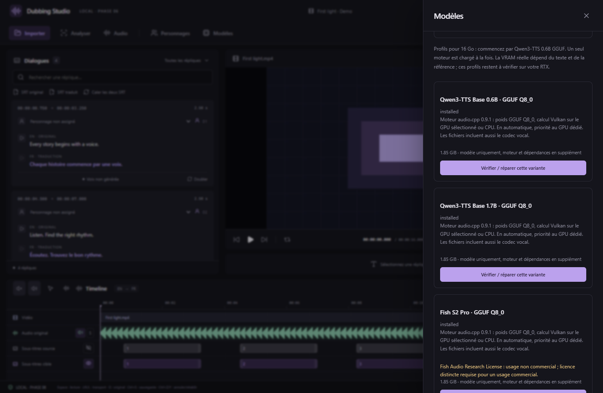

# Phase 6 — Fish S2, Qwen3-TTS et correction des références

La version 0.6.0 ajoute quatre variantes installables et conserve CosyVoice3. Les modèles et leurs moteurs fonctionnent localement après installation. Les téléchargements sont vérifiés par taille et SHA-256, avec révisions des poids figées.

## Choisir un profil pour une RTX 5060 Ti 16 Go

| Variante | Poids sur disque | Moteur et calcul | Référence |
| --- | ---: | --- | --- |
| Qwen3-TTS Base 0.6B GGUF Q8_0 | 1,85 Gio | audio.cpp 0.9.1, Vulkan ou CPU | Avec ou sans transcription |
| Qwen3-TTS Base 1.7B GGUF Q8_0 | 2,51 Gio | audio.cpp 0.9.1, Vulkan ou CPU | Avec ou sans transcription |
| Fish S2 Pro GGUF Q8_0 | 5,88 Gio | audio.cpp 0.9.1, Vulkan ou CPU | Transcription exacte requise |
| Fish S2 Pro FP8 E4M3 | 7,49 Gio | Fish FP8Linear, PyTorch 2.8.0, CUDA 12.8, activations BF16 | Transcription exacte requise |

Les tailles comprennent les composants vocaux nécessaires, mais pas les moteurs, Python, dépendances ni téléchargements conservés. La taille du fichier ne représente pas la VRAM. Commencez par Qwen 0.6B GGUF, puis comparez les essais avec Qwen 1.7B ou Fish. Les autres variantes Q4/Q6/Q5 du catalogue utilisent d'autres moteurs et restent indiquées comme non intégrées ; elles ne sont pas interchangeables avec ces fichiers.

Le moteur GGUF est la distribution Windows **Vulkan portable**, avec prise en charge du Ryzen 5700G, qui ne possède pas AVX-512. Il utilise la RTX via Vulkan sans installer le toolkit CUDA. Fish FP8 utilise CUDA et requiert une carte NVIDIA compatible BF16 et **au moins 12 Gio de VRAM libre** avant chargement. Ce seuil constitue une vérification initiale, pas une garantie contre un dépassement de mémoire pendant la génération. En cas de mémoire insuffisante, fermez les autres applications IA ou choisissez une variante GGUF. Les profils restent à qualifier sur la RTX 5060 Ti réelle.

Fish utilise la **Fish Audio Research License**, avec usage non commercial et licence commerciale distincte. Qwen3-TTS utilise Apache-2.0. Les conversions et moteurs communautaires conservent leurs propres notices. Sources : [Fish FP8](https://huggingface.co/drbaph/s2-pro-fp8), [poids GGUF audio.cpp](https://huggingface.co/audio-cpp/audio.cpp-gguf), [moteur audio.cpp](https://github.com/0xShug0/audio.cpp/releases/tag/v0.9.1), [Qwen3-TTS officiel](https://github.com/QwenLM/Qwen3-TTS).

## Installer et doubler

1. Ouvrez **Modèles** et **Installer cette variante** sur le profil souhaité. Suivez **Traitements**. Les gros téléchargements et extractions peuvent prendre plusieurs minutes ; l'annulation reste disponible. **Vérifier / réparer cette variante** réutilise les fichiers valides. Fish réutilise aussi les archives de dépendances CosyVoice3 déjà téléchargées et vérifiées, tout en extrayant un environnement Python distinct.
2. Renseignez la traduction, puis cliquez sur **Doubler** dans une réplique.
3. Choisissez **Moteur et variante de voix**. Le choix est enregistré pour cette réplique. La préférence du projet sert de choix initial pour les répliques sans réglage.
4. Dans **Périphérique de génération**, sélectionnez explicitement la **RTX 5060 Ti**. En automatique, GGUF privilégie le GPU dédié. Les indices Vulkan et CUDA sont distincts : une RTX peut être `vulkan:1` et `cuda:0` sur le même PC. Le nom affiché provient du moteur concerné.
5. Choisissez une référence de personnage ou **Audio de la réplique actuelle**. Utilisez 1 à 20 secondes de parole claire d'une seule personne ; plusieurs secondes donnent une meilleure référence qu'une exclamation très courte. Fish bénéficie particulièrement d'un extrait de plusieurs secondes.
6. Pour Fish, fournissez la transcription exacte de la référence dans sa langue d'origine. Pour une référence issue de la réplique actuelle, le texte du SRT original est utilisé. Pour Qwen, le mode **Entre langues** utilise l'empreinte vocale sans transcription ; le mode avec transcription utilise aussi le contexte audio/texte. Corrigez les indications de bruit et autres textes qui ne sont pas prononcés avant d'utiliser ce dernier mode.
7. **Générer un nouvel essai** crée un WAV distinct, conservé avec le moteur, la variante et les paramètres. Écoutez, comparez, sélectionnez, puis validez ou exportez le WAV. Une sortie trop longue est signalée pour révision. Les anciennes prises restent disponibles quand vous changez de moteur.

Capture de l'interface React réelle. Les résultats, tailles et noms de GPU fournis par le test de navigateur sont simulés ; ce n'est pas une mesure de performances RTX.

## Correction de INVALID_REFERENCE_AUDIO

Capture de test de l'interface réelle avec état d'installation simulé et tailles issues des manifestes.

L'analyse des locuteurs enregistrait des références mono à **16 kHz**, alors que le worker CosyVoice3 exigeait **24 kHz**. Une référence valide pouvait donc être refusée avant chargement du modèle.

Le worker convertit maintenant automatiquement les références 16 kHz et les fichiers stéréo en mono PCM16 24 kHz. Le fichier original reste intact et le fichier temporaire est supprimé après utilisation. Les références silencieuses, corrompues ou hors de la plage 1–20 secondes restent refusées avec un message explicite. Il est inutile de réinstaller les poids CosyVoice3 pour cette correction.

## Stockage et suite

Le dossier configuré dans Paramètres contient aussi `cosyvoice3-runtime` et `voice-engines`. **Appliquer et déplacer** déplace ces installations, leurs caches et les autres modèles, avec vérification avant activation. Les références et prises générées restent dans les projets.

Il reste **une phase**, la phase 7 : écoute du doublage synchronisée à la scène, mix final, export MKV et langues multiples. Pour cette version, l'écoute d'une prise WAV reste indépendante du lecteur vidéo.
