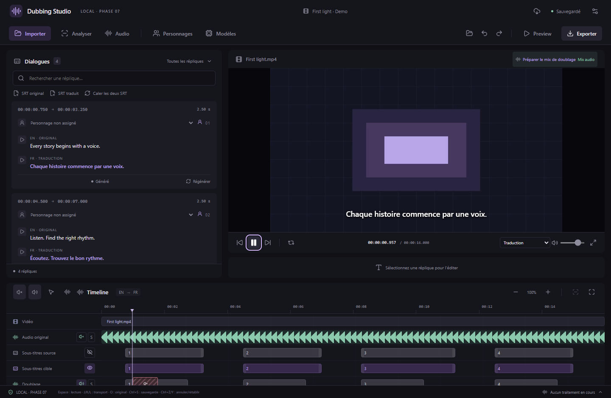
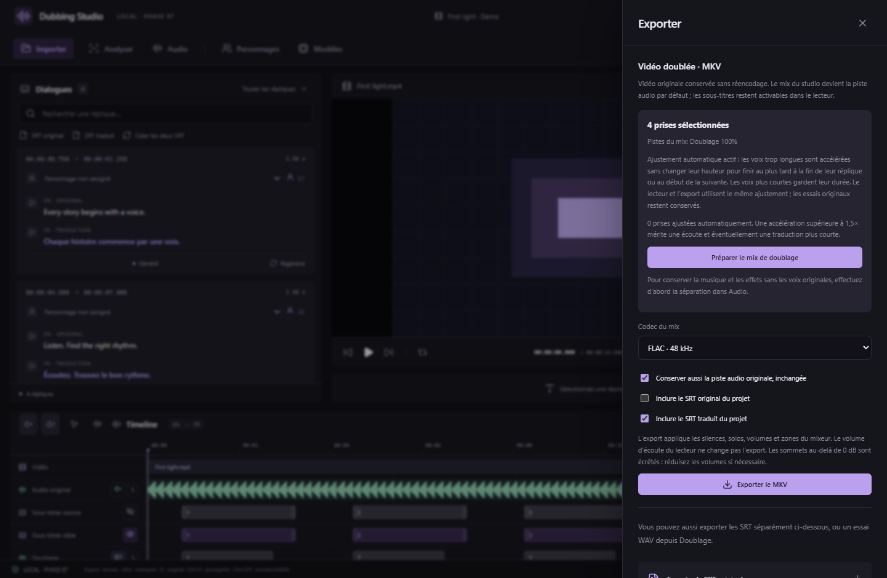

# Phase 7 — écoute synchronisée, mix et export MKV

La version **0.7.1** ajoute le calage automatique des voix à la piste **Doublage** introduite en phase 7. Elle lit les essais sélectionnés pour la langue cible du projet avec la vidéo, puis exporte le montage dans un conteneur Matroska.

## Écouter le doublage

1. Importez vos SRT, corrigez les associations et générez des essais depuis **Doubler**. Choisissez l’essai à retenir pour chaque réplique.
2. Pour conserver la musique et les effets sans les voix originales, lancez la séparation Bandit depuis **Audio**.
3. Cliquez sur **Préparer le mix de doublage**, au-dessus du lecteur ou dans **Audio**. Cette commande active le doublage, la musique et les effets, coupe l’audio original et la piste Voix de Bandit, et remet les solos à zéro. Elle conserve vos volumes et vos zones.
4. Appuyez sur **Lecture**. Les prises commencent au début actuel de leur réplique. Déplacement dans la vidéo, pause et boucle restent synchronisés. Le lecteur charge les prises proches de la tête de lecture avant de commencer ; il conserve un cache limité.
5. Ajustez le volume, le silence ou le solo de **Doublage**, **Musique** et **Effets** dans **Audio**. Les commandes rapides et les zones de volume/silence fonctionnent aussi sur Doublage. Un bloc dans la timeline représente chaque prise sélectionnée, avec sa durée sonore.

### Calage automatique des voix

Le calage est actif automatiquement, pour les nouvelles prises et celles déjà générées avec CosyVoice3, Fish ou Qwen. Le créneau commence au début actuel de la réplique et se termine au premier de ces repères : sa fin, le début de la prise sélectionnée suivante, ou la fin de la vidéo. Une voix trop longue est accélérée avec Rubber Band/FFmpeg en conservant sa hauteur. Elle tient entièrement dans ce créneau : on ne se contente pas de couper la fin de la phrase. Une voix plus courte garde son débit naturel ; le reste du créneau reste silencieux sur la piste Doublage.

Le lecteur et l’export MKV utilisent le même WAV ajusté. La timeline représente sa durée dans le montage. Le WAV d’origine reste dans **Générations** : l’écoute A/B et **Exporter WAV** continuent à fournir cet essai original. Modifier les timecodes ou changer de prise recalcule automatiquement l’ajustement lors de la prochaine lecture ou de l’export. La préparation peut afficher brièvement le chargement avant la lecture.

**Exporter** indique combien de prises seront ajustées. Au-delà de **1,5×**, une alerte demande de vérifier l’intelligibilité : raccourcir la traduction ou élargir le créneau peut donner un meilleur résultat. Deux prises commençant exactement au même instant n’ont pas de créneaux distincts ; elles sont signalées et omises du mix jusqu’à correction des timings. L’export incomplet exige alors votre accord explicite.

Les fichiers ajustés sont un cache jetable du projet (`cache/fit-*.wav`), séparé des modèles et des prises originales. Leur clé dépend du contenu de la prise et du créneau. Ils peuvent occuper de la place après plusieurs variantes de timings ; application fermée, supprimer uniquement ces fichiers de cache est possible et ils seront recréés à la demande. Deux ajustements au maximum tournent simultanément ; l’export dispose d’une progression et reste annulable.

L’écoute A/B d’un essai WAV reste indépendante et met la vidéo en pause. **Original / O** permet une écoute temporaire de l’audio original sans modifier les réglages enregistrés du mix. **Lecture**, une modification du mix ou **Tout rendre silencieux** termine cette écoute temporaire. À vitesse accélérée, les prises Web Audio changent aussi de hauteur ; évaluez la voix à vitesse normale.

## Exporter le MKV

Ouvrez **Exporter**. Le panneau indique le nombre de prises, les pistes audibles et les éléments à vérifier. Les répliques traduites sans prise, les prises modifiées depuis leur génération, les accélérations supérieures à 1,5× et les créneaux en conflit demandent une autorisation explicite d’export incomplet. Un dépassement corrigé automatiquement à 1,5× ou moins n’en demande pas. Une prise provenant d’un autre média ou d’une autre langue ne remplace pas une prise manquante.

- **Vidéo :** flux vidéo original copié sans réencodage, depuis le média importé et jamais depuis le proxy de prévisualisation.
- **Mix :** piste stéréo 48 kHz, AAC 320 kb/s par défaut ou FLAC. Silences, solos, volumes de piste et zones sont ceux du projet au lancement de l’export. Le volume d’écoute du lecteur n’influence pas le fichier.
- **Original :** option pour conserver aussi la piste audio originale sélectionnée lors de l’import, sans modification. Elle reste une piste séparée, non choisie par défaut dans le MKV.
- **Sous-titres :** options indépendantes pour les SRT original et traduit actuels du projet. Ils restent sélectionnables dans le lecteur ; ils ne sont pas incrustés dans l’image.
- **Métadonnées :** langues source/cible, titres des pistes, métadonnées et chapitres du média. Le mix est la piste audio par défaut.

L’export respecte un instantané sauvegardé du projet. Vous pouvez continuer à éditer ; ces modifications serviront à l’export suivant. **Traitements** affiche l’ajustement des voix, l’assemblage puis le mixage, avec progression, logs et annulation. Un échec ou une annulation conserve un éventuel ancien fichier de destination. Réessayer après modification du projet exige de relancer depuis Exporter.

L’assemblage des prises utilise des tampons bornés ; les milliers de répliques ne deviennent pas des milliers d’entrées FFmpeg. Il utilise un fichier temporaire mono float32 d’environ **346 Mo par heure de vidéo**, plus le MKV en cours, sur le disque de destination. Au-delà de 128 voix simultanées, l’export est refusé. Les sommets dépassant 0 dB sont écrêtés ; baissez les niveaux pour éviter la saturation. Aucun équilibrage automatique de loudness n’est appliqué.

Chaque projet garde une paire de langues source/cible. Ce MKV peut contenir le mix cible et l’original ; l’édition simultanée de plusieurs doublages cibles dans un même projet n’est pas ajoutée par cette version.

## Correction CosyVoice3 sur un stockage personnalisé

### Arrêt du moteur après le chargement (0.7.1)

L’ancien code `SEPARATION_FAILED` provenait d’un lanceur partagé : il pouvait désigner un arrêt du moteur vocal sans exception Python. Les avertissements `sdpa`, `CUDAExecutionProvider` absent et TorchAudio, à eux seuls, n’indiquent pas la cause fatale. Le log communiqué ne contient pas de code de sortie permettant de confirmer le composant fautif sur la RTX.

La référence est désormais décodée directement par **SoundFile**, rééchantillonnée par **SciPy**, puis analysée sur CPU avec les deux sessions **ONNX** explicitement en mode CPU. Cela évite le répartiteur natif de TorchAudio à cet endroit et la demande d’un fournisseur CUDA absent de l’environnement ONNX installé. La synthèse neuronale reste sur le GPU sélectionné ; installer ONNX Runtime GPU séparément n’est pas nécessaire.

En cas d’arrêt inattendu du moteur CosyVoice sur GPU, le studio réessaie **une fois sur le même GPU**, en FP32 avec attention mathématique et cuDNN désactivé. Ce profil peut être plus lent et demander plus de mémoire. Il n’est pas déclenché pour une annulation, un manque de mémoire explicite ou une erreur de référence. La limite totale de 15 minutes reste commune aux deux essais. Une prise réussie avec ce profil l’indique dans sa fiche. Fish/Qwen ne passent pas par cette reprise CosyVoice.

Si l’échec persiste, **Traitements → Logs** indique maintenant la dernière étape (caractéristiques, tokens ou empreinte du locuteur), le code de sortie Windows en décimal et hexadécimal, et une pile native lorsque Python peut la capturer. Le message distingue moteur vocal, crash natif et mémoire système. Transmettez la fin de ces logs pour localiser le défaut restant.

Installez **0.7.1**, redémarrez puis relancez une réplique avec la RTX sélectionnée. **Les modèles n’ont pas changé : aucun nouveau téléchargement des poids n’est requis.** Une génération complète a été vérifiée sur Windows/CPU ; le profil CUDA et l’échec signalé doivent encore être confirmés sur la RTX 5060 Ti de l’utilisateur.

### Chemins étendus (correctif 0.7.0 conservé)

L’erreur `\\?\F:\...\model/cosyvoice3.yaml not found!` pouvait survenir alors que tous les fichiers étaient installés et vérifiés. Le constructeur officiel concaténait un `/` au chemin Windows étendu `\\?\...` ; Windows n’effectue pas la normalisation habituelle des séparateurs avec ce préfixe. Les chemins YAML, ONNX, poids et autres fichiers du constructeur utilisent désormais les jointures natives.

Installez 0.7.0, redémarrez l’application et relancez la génération. **Les poids n’ont pas changé et n’ont pas besoin d’être retéléchargés** pour cette erreur. Une véritable absence de fichier ou une empreinte incorrecte déclenche toujours les vérifications habituelles ; utilisez alors **Modèles → Vérifier / réparer CosyVoice3**.

Le correctif a produit un WAV Windows réel de 1,52 s à 24 kHz avec le même préfixe étendu. Un test du constructeur couvre aussi les espaces, accents et chemins de plus de 260 caractères. Le matériel de développement n’est pas une RTX 5060 Ti : cet essai valide les chemins et l’intégration, sans constituer une mesure de performance de votre GPU.

Captures de l’interface React réelle dans les tests Chrome, avec prises synthétiques et résultats natifs simulés. Les tests Rust produisent et inspectent séparément de vrais MKV avec FFmpeg.

Références : [chemins Windows étendus](https://learn.microsoft.com/windows/win32/fileio/maximum-file-path-limitation), [Rubber Band dans FFmpeg](https://ffmpeg.org/ffmpeg-filters.html#rubberband), [profils PyTorch 2.8](https://docs.pytorch.org/docs/2.8/backends.html), [validation et limites](../VALIDATION.md).
