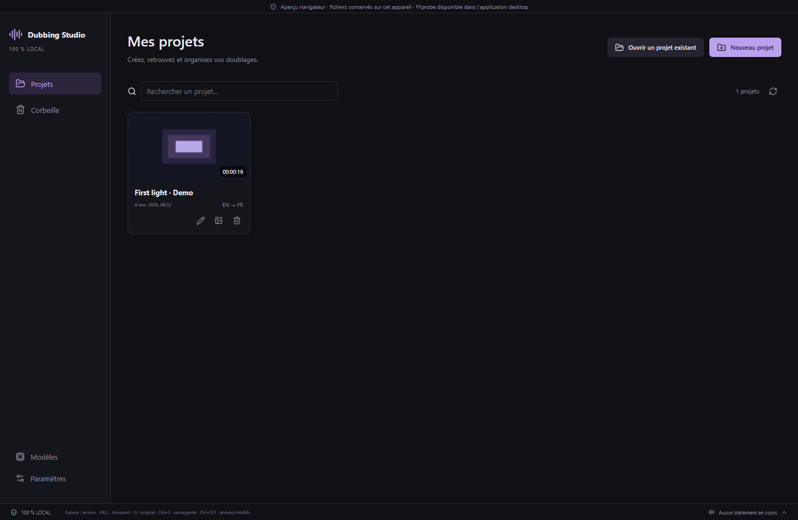

# Accueil et gestion des projets — v0.40

Au démarrage, le studio affiche **Mes projets**. Chaque carte présente la vignette, le nom, la date de modification, les langues et la durée de la vidéo. La recherche filtre les noms. Les paramètres et les modèles restent accessibles depuis la colonne de gauche.

## Créer et retrouver un projet

**Nouveau projet** demande le nom, les langues et le dossier de stockage. Le dossier précédent est proposé ; au premier lancement, le choix par défaut est `Documents/AI Dubbing Studio Projects`. Le projet vide s’ouvre dans l’éditeur : importez ensuite sa vidéo avec **Importer**. La vidéo est ajoutée à ce même projet. **Ouvrir un projet existant** permet de retrouver un dossier déjà créé.

Lors du premier lancement après la mise à jour, le dernier projet connu et les dossiers `.dubproject` voisins sont ajoutés au catalogue (jusqu’à 2 000 dossiers examinés). Les projets conservés ailleurs peuvent être ajoutés avec **Ouvrir un projet existant**. Aucun balayage complet de vos disques n’est effectué.

## Renommer et revenir à l’accueil

Cliquez sur le nom du projet dans la barre supérieure de l’éditeur pour le renommer. Le pictogramme de crayon sur une carte ou son menu contextuel propose la même action. Le nom affiché change, tandis que le dossier et les chemins des fichiers restent identiques.

Le bouton **Accueil — Projets**, en haut à gauche de l’éditeur, sauvegarde les modifications, arrête la lecture et affiche le gestionnaire. Attendez la fin des tâches actives ; un enregistrement microphone en cours ou non enregistré doit également être terminé ou abandonné. Les essais, réglages, sous-titres et médias restent dans le projet. Le prochain lancement de l’application affiche toujours l’accueil.

## Vignettes

La vignette est capturée localement à **2 minutes**, ou vers **40 % de la vidéo** lorsque celle-ci dure moins de 5 minutes. Cela réduit le risque de choisir l’introduction ou la fin, sans constituer une détection automatique des génériques. Le pictogramme d’image permet de choisir un autre moment en secondes et de capturer un aperçu. Le moment doit être situé dans la vidéo.

Les vignettes visibles sont chargées progressivement, une capture à la fois, puis mises en cache dans les données de l’application. Elles ne modifient ni la vidéo ni le contenu du projet. Un projet vide ou un média inaccessible conserve un emplacement de vignette.

## Suppression et restauration

La corbeille d’une carte demande confirmation, puis déplace le dossier `.dubproject` fermé dans `.ai-dubbing-studio-trash`, à côté du dossier d’origine et sur le même disque. **Corbeille → Restaurer** le remet à son emplacement initial. Si la destination est déjà occupée, la restauration est refusée : aucun fichier existant n’est écrasé. Un journal de déplacement permet de retrouver une opération interrompue.

Cette corbeille est propre au studio et **ne libère pas l’espace disque** : les fichiers sont conservés pour la restauration. La suppression définitive n’est pas proposée dans cette version. Une vidéo externe au dossier du projet n’est jamais déplacée.

Pour un projet introuvable, ou stocké dans un dossier sans suffixe `.dubproject`, **Retirer de la liste** enlève seulement sa carte après confirmation et conserve tous les fichiers. Les liens et jonctions ne peuvent pas être envoyés à la corbeille. Les projets dont le format est plus récent sont indiqués indisponibles et ne sont pas réécrits.

## Contrôle IA et compatibilité

Les mêmes actions sont disponibles via [MCP](MCP.md#accueil-et-projets-v040). Le catalogue passe à **155 outils**, avec les 145 outils précédents conservés. Le format des projets reste **26** ; les moteurs, modèles et traitements audio restent identiques. Deux copies d’un projet qui partagent le même UUID possèdent des clés de catalogue distinctes.
