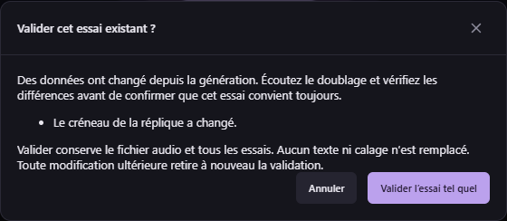

# Revalider un doublage existant — v0.40.2

Un essai peut rester audible mais différer du texte, du créneau, du personnage ou de la référence actuels. Auparavant cette différence rendait le bouton de validation indisponible jusqu’à une nouvelle génération.

Dans la carte d’une réplique, dans Doublage → Essais ou avec le raccourci **V**, demandez la validation. Si l’essai diffère, une fenêtre indique les changements ; pour un texte différent, elle affiche le texte généré et le texte à prononcer actuellement. Après écoute et vérification, choisissez **Valider l’essai tel quel**, ou annulez pour corriger/régénérer. Les sous-titres et le WAV ne sont pas réécrits. Pour une réplique multivoix, les changements sont présentés par voix ; chaque voix active doit garder une traduction.

L’accord porte sur le texte, l’essai sélectionné, les références et le montage actuels. La confirmation devient indisponible si ces données changent pendant son affichage. Une modification ultérieure retire de nouveau la validation, y compris après sauvegarde/réouverture. L’historique et tous les essais restent disponibles.

Une traduction absente, une réplique exclue ou une opération bloquante empêchent toujours la validation. Pour le doublage, sélectionnez d’abord l’essai à écouter/valider dans Essais. Une validation du texte seul reste possible pour préparer un lot lorsqu’aucun essai n’est sélectionné.

Les lots ignorent les essais obsolètes par défaut. En MCP, `studio_review_take` et `studio_approve_translations` acceptent l’option facultative booléenne `acceptChangedTake: true` pour un accord explicite. L’absence de cette option conserve les protections précédentes. Les autres contrats, 155 outils, 29 schémas et format de projet 26 sont conservés. Aucun nouveau moteur ni modèle n’est nécessaire.
