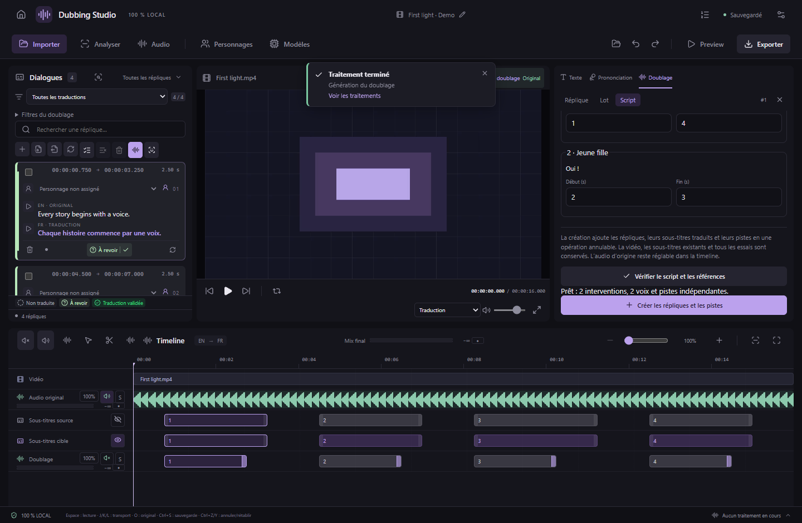

# Script multi-personnages — v0.59.0

Dans le panneau de droite, ouvrez **Doublage → Script**. Ce mode transforme un texte balisé en répliques ordinaires, chacune avec sa référence et sa piste. Il fonctionne avec les moteurs déjà intégrés, notamment ZONOS3-Mini : il ne demande pas au modèle de changer de voix au milieu d’une génération.

```text
[Speaker 1: Femme adulte] Mademoiselle Natsuki Kodama.
[Speaker 2: Jeune fille] Oui !
[Speaker 1] Approchez, je vous prie.
```

## Préparer et écouter

1. Saisissez ou collez le script. Commencez chaque intervention sur une nouvelle ligne par `[Speaker 1]`, `[Speaker 2]`, etc. Une description après `:` est facultative ; elle sert de nom initial pour choisir la voix et nommer sa piste. Elle ne modifie pas le timbre du modèle. Une intervention peut contenir plusieurs lignes.
2. Réglez le début du script et une durée proposée, puis cliquez sur **Préparer les interventions**. Cette durée sert uniquement à préparer les créneaux, pas à estimer automatiquement la durée de la parole.
3. Choisissez le moteur, le périphérique, la qualité et l’orientation d’accent lorsque le moteur le permet. Chaque voix reçoit une référence distincte au choix : fichier déjà importé, référence d’un personnage, phrase validée de sa bibliothèque, ou nouveau fichier dont vous choisissez les bornes. Vous pouvez écouter chaque référence. Les modes exigeant une transcription proposent de la transcrire localement avant de vérifier le script.
4. Réglez les débuts et fins des interventions en secondes. **Deux personnages différents peuvent parler au même moment.** Pour une phrase de 10 à 12,5 s et une réponse de 11,8 à 12,4 s, les voix se chevauchent de 11,8 à 12,4 s. Deux interventions du même Speaker ne peuvent pas se chevaucher sur sa piste ; utilisez deux identifiants si vous souhaitez superposer deux prises de cette voix.
5. **Vérifier le script et les références** contrôle les créneaux, le moteur, les fichiers et les transcriptions nécessaires. Une modification du projet ou des réglages demande une nouvelle vérification. **Créer les répliques et les pistes** ajoute l’ensemble en une seule opération annulable.
6. Choisissez **1 à 4 essais par réplique**, puis lancez la génération. Chaque intervention utilise sa propre référence enregistrée. Le lot s’exécute séquentiellement ; ses voix sont ensuite lues ensemble aux timestamps choisis. Le traitement et les erreurs restent dans ce panneau. Les essais terminés sont écoutables et sélectionnables ; le dernier nouvel essai reçoit le focus. Générer à nouveau ajoute des essais aux mêmes répliques, sans recréer leurs pistes.
7. Préparez le **Mix Doublage** pour écouter avec la vidéo. Ajustez les blocs, volumes et silences dans la timeline. La source n’est pas automatiquement rendue muette : réglez-la pour éviter d’entendre simultanément les voix originales et françaises.



## Conservation et limites

- Jusqu’à **16 voix**, **128 interventions**, **1 000 caractères par intervention** et 64 Kio de script. Numéros de Speaker entre 1 et 99.
- Références de **1 à 20 secondes**. Une référence propre ne contenant qu’une personne est préférable ; aucune séparation automatique n’est lancée dans ce mode.
- Créneaux de **0,1 à 120 secondes**, à l’intérieur de la vidéo. Les pistes existantes comptent dans la limite de 256 pistes du projet.
- La création ajoute des dialogues et leurs sous-titres **cibles** ; elle conserve la vidéo, les sous-titres précédents, les essais et les fichiers audio existants. **Ctrl+Z** annule la création. Les nouveaux dialogues restent modifiables avec les outils habituels après fermeture ou redémarrage.
- Les lots utilisent le suivi et l’historique durables existants : annulation, résultats partiels et reprise des essais en échec. Le moteur reste chargé lorsque les requêtes sont compatibles et est libéré à la fin ou à l’arrêt. Les références changent réellement d’une intervention à l’autre.
- Le script ne reconnaît pas les personnes présentes dans la vidéo, ne sépare pas les voix superposées et ne transfère pas automatiquement l’intonation japonaise. Les descriptions de locuteurs sont retirées avant la synthèse.
- Le format de projet utilise les champs existants des dialogues et pistes (32, ou 33 au-delà de 32 pistes), sans nouveau format obligatoire pour les projets déjà en 35.

## Pilotage MCP

**180 outils / 39 schémas partagés.** Trois commandes utilisent les mêmes validations que l’interface :

- `studio_preview_scripted_dubbing({options})` : lecture seule. `options` contient `script`, `startMs`, `durationMs`, `speakers`, `options` (réglages vocaux communs), et éventuellement `slots: [{startMs,endMs}, …]`. Sans `slots`, les créneaux proposés sont séquentiels. Chaque speaker contient `{speaker,name,characterId,referenceMode,referenceId}` ; `referenceMode` vaut `file`, `custom` ou `library`.
- `studio_create_scripted_dubbing({projectId,expectedRevision,options,context})` : création atomique, sans inférence. Retourne `{project,lineIds}` ; conservez les identifiants.
- `studio_generate_scripted_dubbing({projectId,expectedRevision,selection:{lineIds,takeCount},context})` : lance un lot avec les réglages **propres à chaque dialogue**. Retourne un ID de tâche ; consultez les jobs et le rapport de lot. Il est possible de réutiliser les IDs pour ajouter d’autres essais.

Lisez le contexte courant avant les mutations. Le panneau est accessible par `studio_preferences({panel:"scriptDub"})`. Les tests partagent les fixtures du parseur entre TypeScript et Rust, vérifient les chevauchements, les références, l’annulation/régénération, la conservation et l’API de l’application empaquetée. La vérification du protocole TTS utilise un worker déterministe pour mesurer la réutilisation du processus et le changement de référence ; elle ne constitue pas une comparaison de qualité vocale.
