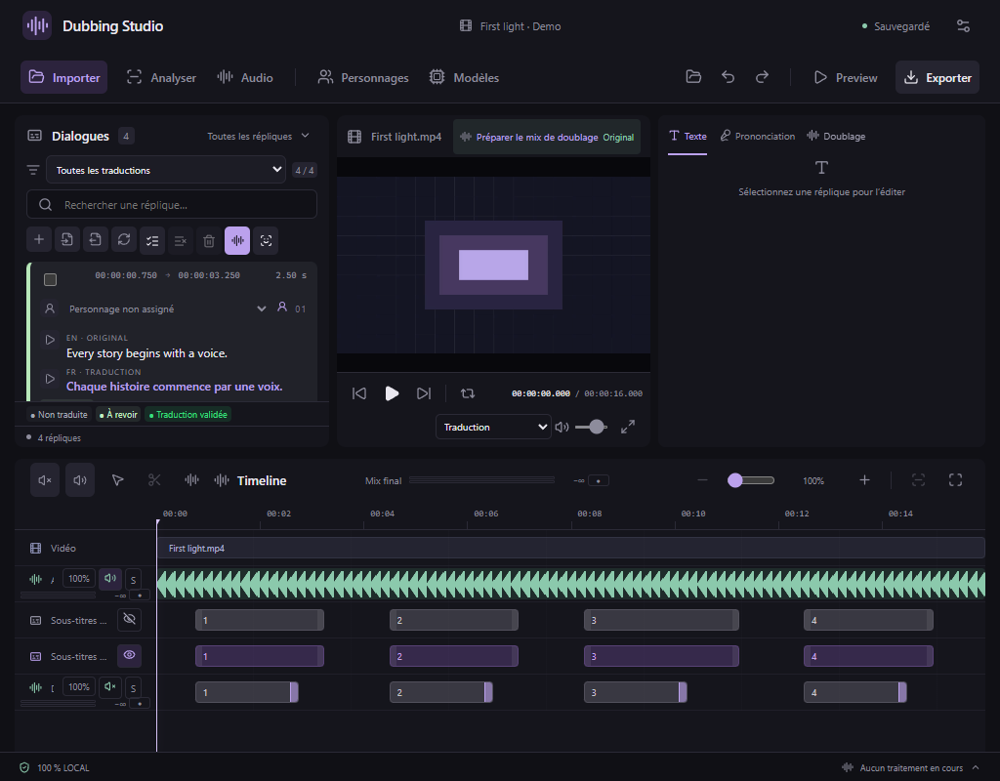
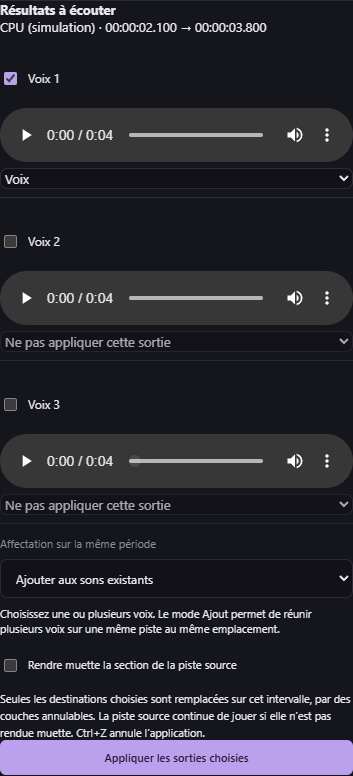

# Sélections audio et interface compacte — v0.39.0

## Répliques

Les commandes d’ajout de réplique, d’import des deux SRT, de calage, de sélection, de doublage et de synchronisation labiale utilisent des pictogrammes. Survolez un bouton pour lire son action ; son nom reste également accessible au clavier et aux lecteurs d’écran. Les horaires, textes source et cible restent visibles, avec des cartes plus rapprochées et des lignes mesurées selon leur contenu.

La validation commune du texte et du doublage utilise un seul statut visible : **Non traduite**, **À revoir** ou **Traduction validée**. « Traduite · à valider » devient « À revoir ». L’état de la voix (générée, non générée, etc.) est disponible sur son pictogramme en bas de carte. Le filtre conserve les mêmes règles de sélection ; aucune validation existante n’est modifiée par ce changement de présentation.

## Vignettes

**Prévisualiser** et **Capturer** sont alignés. Le choix de cadrage automatique est placé sur une ligne séparée ; les réglages manuels restent accessibles en le désactivant. Les infobulles conservent les noms complets des actions. Le mini lecteur, le choix de visage et le recadrage ne changent pas.

## Boîte à outils audio

Le panneau affiche une animation et un message pendant le chargement du catalogue. Les commandes attendent que les modèles soient disponibles. En cas d’échec du chargement, **Réessayer** permet de relancer la lecture du catalogue.

Chaque résultat correspond à la sélection, à sa piste, au modèle et aux réglages qui l’ont produit. Modifier ces paramètres ou ouvrir une autre sélection efface l’ancienne préécoute du panneau. Une réponse tardive ne la réaffiche pas. La dernière séparation terminée n’est plus rappelée automatiquement à l’ouverture.

### Isoler plusieurs voix depuis une sélection

1. Sélectionnez une portion de piste puis ouvrez la boîte à outils audio.
2. Choisissez **MossFormer2 · 2 voix** ou un profil **SepFormer · 2/3 voix**, selon le nombre de personnes qui se superposent. Installez le modèle si nécessaire ; le contrôle d’espace disque reste actif. La limite est de 0,1 à 60 secondes.
3. Lancez **Isoler la sélection**, puis écoutez les voix séparément. Cochez les voix à conserver et choisissez leurs pistes de destination.
4. Choisissez **Ajout** pour les mélanger au contenu existant, ou **Remplacement** pour remplacer la zone. Si plusieurs voix vont sur une même piste, le remplacement s’effectue une fois, puis les voix sont assemblées au même emplacement. Les sorties non choisies sont ignorées.
5. Appliquez explicitement le résultat. L’opération reste annulable. La vidéo et les fichiers source ne sont pas réécrits ; les SRT et les essais existants sont conservés.

Le nombre de voix provient du profil sélectionné ; il n’est pas détecté automatiquement. Une séparation peut conserver des fuites entre voix : écoutez les sorties avant application. Pour créer des sous-doublages par personnage, utilisez toujours l’outil **Isoler plusieurs voix** d’une réplique dans l’onglet Doublage.

Les **143 outils MCP précédents** sont conservés ; deux commandes portent le total à **145**. `studio_separate_dialogue_speakers` accepte désormais l’absence de `lineId` pour une sélection libre ; `studio_apply_speaker_separation_result` affecte les sorties choisies. `studio_create_speaker_dubbings` exige toujours un résultat lié à une réplique. Le format de projet reste **26**.

## Installation et suppression des modèles

L’installation de MossFormer2 et des autres modèles globaux est désormais suivie dans l’onglet Doublage même sans projet associé à la tâche. Une installation terminée ne reste plus bloquée sur « Préparation du traitement… ».

Ouvrez **Modèles → Gérer les fichiers des modèles** pour voir les poids présents et leur taille réelle, y compris les téléchargements partiels. Le pictogramme de corbeille ouvre une confirmation avant suppression. La liste et les états d’installation sont actualisés après l’opération ; une réinstallation reste possible depuis le modèle concerné.

Les environnements Python et bibliothèques partagés restent disponibles, ainsi que les projets, médias, références et essais. Le total affiché ici concerne les poids gérés ; la taille du dossier complet reste visible dans Paramètres. Les composants LatentSync 1.5 et 1.6 sont regroupés car ils partagent leur dossier. La suppression est refusée pendant une tâche active et pour les dossiers contenant des liens ou jonctions. Cette suppression de fichiers n’est pas annulable par Ctrl+Z.

Les commandes MCP `studio_managed_models` et `studio_remove_installed_model` exposent la même gestion ; la seconde exige l’identifiant listé et `confirmed: true`.
